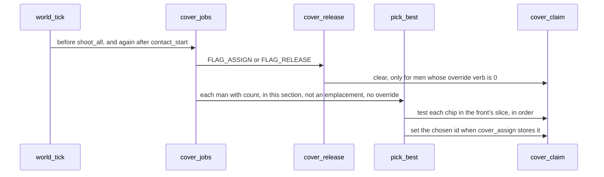
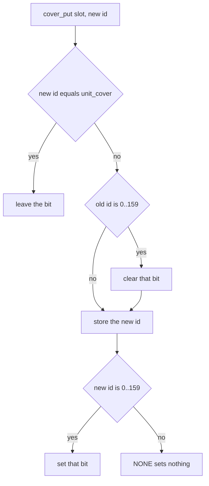

# Cover claim — one bit per chip, not a slot scan

| Field | Value |
| --- | --- |
| Author | FORCE design session |
| Date | 2026-09-25 |
| Status | **landed** |
| Last worked on | 2026-09-25 |
| Repo path | [`cover-claim.md`](cover-claim.md) |
| Source | `src/c64/move.asm`, `src/c64/combat.asm`, `src/c64/world.asm`, `src/c64/bss.asm`, `src/c64/equ.inc`, `src/c64/generated/farm.asm` |
| Spec, not edited | `src/sdl/game/world.c` |
| Follows | [`door-crossings.md`](door-crossings.md) |

Assigning cover walks all 32 unit slots once per chip. On the farm that walk is about 31,000 cycles for six men and eleven chips. A bit per cover id answers the same question. Who gets which chip does not change.

---

## What was measured

PAL farm, 2026-09-25, after the doorway tables (`2e866e6`). Do not re-time this to rewrite the doc. A game frame starts at `loop` (`$402F`), the instruction after the previous draw returns. Logic runs from there to `wait_ui` (`$4065`). Logic plus draw adds `draw_all` (`$4208`) through the next `loop` and excludes the raster wait. The budget is about 60,000 machine cycles for that work. Three PAL video frames are `3 * 19705 = 59115` cycles.

702 logic frames through the farm-loss write (`script_outcome` value 2 at `$C861`). 31 of them cost more than 60,000 with the draw. The 48 banner frames after the loss all fit.

The longest was the 50th logic frame: logic 124,252, draw 23,451, work 147,703. Inside the logic:

| Work | Calls | Cycles |
| --- | ---: | ---: |
| `cover_taken` | 66 | 30,972 |
| `pick_best` | 6 | 12,119 |
| `smear_closest` | 12 | 3,956 |
| `pick_grenade` | 6 | 7,085 |
| `input_scan` |  | 6,204 |
| ROM (the tick crossed video frames) |  | 7,432 |

`cover_assign` ran once, `cover_release` once, `cover_jobs` twice. The tick calls `cover_jobs` before combat and again after contact (`world_tick`). Six men times the gate room's 11 chips is 66. `30972 / 66 = 469` cycles a call: a full 32-slot scan. The chips were free, so `cover_taken` did not return early. `pick_best`'s 12,119 does not contain those 30,972. Six calls cannot be smaller than the 66 calls they make if the parent total included the child. Subtract the scan once.

`door_find` and `pick_front` were one call each and under 100 cycles. The doorway tables are not this spike. Seven `unit_think` calls. One doorway.

Across the fight: 24 `cover_assign` calls, 605 `cover_taken` calls, on 22 frames. 15 of the 31 over-budget frames contained a `cover_assign`. The other 16 did not. `469 * 605` is about 284,000 cycles, but a chip that is already taken returns early, so later men in the same assignment cost less than 469. Use 469 only for the fully free scan on frame 50.

Dropping the `cover_taken` cycles out of frame 50 leaves `124252 - 30972 = 93280` cycles of logic, about 93,000. Still over 60,000. The replacement is not free: a bit test is about 40 cycles, so 66 calls put roughly 2,600 back. Frame 50's logic falls by about 28,000, to about 96,000, and the draw is still there. Frames 198, 199, 215, 256, and 312 (1-based, from that run) were just over 60,000 and would fall under if their `cover_taken` cost came out. The tall spikes (50, 149, 183, 270) shrink by 15,000 to 31,000 and stay over. Rifles, grenades, and IRQ time remain.

## The rule that stays

This is a cycle cut. Visible behavior stays what the C64 does today. `src/sdl/game/world.c` is the behavior spec for the port and is not edited to chase the C64 tables. Where the two already differ, keep the C64.

`cover_taken` (`move.asm`) sets carry when some slot with `unit_count != 0` has `unit_cover` equal to A. It does not read `unit_hp`. A man at 0 HP still holds his chip until `apply_deaths` writes `NONE`. It does not test that he can path to the chip. The bit means that same test, and nothing more.

The id in `unit_cover` is a reservation for where he is going, not a mark that he is standing on the cell. `NONE` (`$FF`) means none. Stepping off the cell does not clear it. Nothing in the stepper stores `unit_cover`.

`pick_best` still ranks free chips by grade, then Manhattan distance to that man. Grade 3 ranks as 4, grade 2 as 2, grade 1 as 0. Any other grade is skipped. A higher rank wins. The same rank keeps the nearer chip. An equal distance keeps the earlier chip in the slice (`cmp mv_nx` / `bcs` skips a greater or equal distance). Scouts rank as 3, between grade 3 and grade 2, and only when `rom_scout_facing` equals the section front. `FACE_NONE` skips the scout, the same as a facing mismatch. At `scout_ok`, `cmp #FACE_NONE` / `beq sadv` is the reject (`sadv` increments `mv_lead` and continues the walk). It does not fall through. SDL's `pick_best` does the same (`front == FORCE_FACE_NONE` continues). Leave that loop as it is. The change is not "take the first free chip."

The room's chips are already one ROM list in three contiguous groups: `rom_room_cover_base`, `rom_room_cover_lo`, `rom_room_cover_none`, `rom_room_cover_hi`. `pick_best` takes the rear, `opposite_face` of the section front, and selects one slice:

| Slice | When | Start | Count |
| --- | --- | --- | --- |
| West bank | E–W axis and rear east, or N–S axis and rear north | `base` | `lo + none` |
| East bank | E–W axis and rear west, or N–S axis and rear south | `base + lo` | `none + hi` |
| Neutrals | front is `FACE_NONE`, axis is `AXIS_NONE`, or the rear is not that pole | `base + lo` | `none` |

A kill-order chip whose cell is the order cell is skipped. That test is on the chip loop only. The C64 scout loop does not skip a kill-order scout. SDL's `pick_best` does. A front of `FACE_NONE` still selects the neutral chip slice (`beq neutrals`). That is a different branch from the scout reject. Leave the C64 scout loop alone.

No reachability test is added. Caps stay `COVER_MAX` 128, `SCOUT_MAX` 32, `UNIT_MAX` 32 (`equ.inc`). Scout ids stay `COVER_MAX + index`. The farm's scout counts are 0. The code still supports scouts, so the bit table includes them.

Farm cover (`generated/farm.asm`): room 0 has 11, room 1 has 15, room 2 has 9, the rest 0. Room 0 is all neutrals (`lo` 0, `none` 11, `hi` 0) on an east–west axis, so the west, east, and neutral slices are the same 11 chips. That is why frame 50 is 66 tests and not a shorter bank. Room 1 is `lo` 7, `none` 0, `hi` 8. Room 2 is `lo` 2, `none` 0, `hi` 7.

An individual override survives `cover_release`: a man with `unit_over_verb` set is not stored, so his bit stays. A new order does not. `section_issue` writes `unit_over_verb` to 0 for the section before it sets `FLAG_ASSIGN` or `FLAG_RELEASE`. The skip still matters for a `FLAG_ASSIGN` that does not wipe overrides first: `apply_deaths` (`death_reassign`), `contact_start`, `script_approach`, the spawn pulse in `move.asm`, and a man already on the destination of `section_join`.

## The change

One bit per id, in BSS. `cover_taken` tests the bit. Every store of `unit_cover` updates the bit for the id it replaces and the id it writes. `world_load` writes `NONE` into every `unit_cover` and zeros the table, on the cold path and on F3, before any stamp. A BSS zero is chip id 0, not an empty claim.



### 1. Twenty bytes at the bottom of BSS

`COVER_MAX + SCOUT_MAX` is 160 ids. `160 / 8 = 20` bytes. Chips are ids 0..127 (16 bytes). Scouts are ids 128..159 (4 bytes), contiguous after the chips, so the id is the bit index: byte `id >> 3`, mask `1 << (id & 7)`. One table, `cover_claim`. A second base would cost a subtract on the hot test.

`cb_bit` in `combat.asm` is already the eight masks. `despawn_exits` in `world.asm` indexes it, and `world.asm` is included before `combat.asm`, so a forward use from `cover_taken` is the same reference the program already links. Do not add a second mask table.

Name the length in `equ.inc` next to the caps:

```
CLAIM_BYTES = (COVER_MAX + SCOUT_MAX) / 8   ; 20
```

`bss.asm` gains `cover_claim: .res CLAIM_BYTES`. BSS is end-anchored (`force.asm`, segment `BSS`, `end=$CFFF`). Adding 20 bytes moves the start down. It does not get its own segment.

As of `2e866e6`, `build/force.sym` has `bss_start` at `$C33B` and `bss_end` at `$D000` (exclusive; the last byte is `$CFFF`). Occupancy is the locked `OCC` segment at `$C000`, `.res $320`, so `$C000`–`$C31F`. The free bytes are `$C320` through `$C33A`: 27. After this table, `bss_start` is `$C327`. Seven bytes remain (`$C320`–`$C326`). `agents/c64-port.md` still says BSS is `$C7D2`–`$CFFF` with `$4B2` bytes of headroom. That page was not updated when the doorway tables landed. The live gap is 27 bytes. A byte-per-id owner table is 128 + 32 = 160 bytes and does not fit. Do not put the bits in the `$A000`–`$BFFF` code gap. That gap stays free (`e50f9fd`).

`clear_bss` zeros the table, and it zeros `unit_cover` too. Zero is chip id 0, not `NONE`. `main` always calls `world_load` next. That is the path that writes `NONE`. `clear_bss` does not run on F3. See §4.

### 2. `cover_taken` tests the bit

Keep the proc. `pick_best`, `occupy_chip`, and `unit_nudge` already call it. The body becomes a range check and a bit test. About 40 cycles either way, taken or free. A taken chip no longer returns early by finding its holder in the first few slots. On frame 50 every chip was free, so there is no early-out to lose. Later men in an assignment also stop paying for a walk.

Contract, same as now (`occupy_chip` reloads the id from `zT0` because A is scratch; `agents/c64-issues.md` records the bug that contract closed):

- Carry set when the id is claimed.
- The input id is left in `zT0`.
- A and Y are scratch. X is scratch too: the three callers reload it. Do not `pha` X on this path.

An id at or above `COVER_MAX + SCOUT_MAX` returns carry clear and does not index the table. `NONE` is `$FF`, so it falls out there. Today's callers never pass `NONE`: `pick_best` passes a chip below `rom_cover_count`, or a scout id it just bounds-checked; `occupy_chip` and the chip arm of `unit_nudge` branch away when `chip_at` returns `NONE`. The compare is what keeps a bad id off the end of the 20 bytes.

```
cover_taken:
    cmp #(COVER_MAX + SCOUT_MAX)
    bcs miss
    sta zT0
    lsr
    lsr
    lsr
    tax
    lda zT0
    and #7
    tay
    lda cover_claim,x
    and cb_bit,y
    beq miss
    sec
    rts
miss:
    clc
    rts
```

The bit is not cleared because `unit_hp` is 0. `cover_taken` does not read HP today. `shoot_all` still runs before `apply_deaths`, and the first `cover_jobs` of the tick still sees a man who died in the previous tick as already released, because `apply_deaths` ran before the tick returned. Same order. Do not move `cover_jobs`.

### 3. One writer updates the bit

A missed store is a stuck chip or a double claim. There is one writer, `cover_put`, and every `sta unit_cover` goes through it. Grep is the review.

`cover_put`: X is the slot and is preserved. Y is preserved. A is the new id. Scratch is A and `zPtr` only, plus the stack if X and Y have to be saved around the index. It must not write `zA0`–`zA4`, `zR0`, or `zT0`–`zT7`.

Live across a store, as the code is now:

| Caller | Still live after the store |
| --- | --- |
| `section_peel` | `zT0` picked count, `zT2` source, `zT3` destination, Y the peel index, X the slot |
| `despawn_exits` | `zT7` section mask, Y the slot |
| `unit_spawn` | `zA0`, `zA1`, `zA2` (target and section are stored after the cover), Y the slot |
| `unit_nudge` | `zT3` id, `zT4`/`zT5` cell, `zR0` verb, `mv_ox`/`mv_oy` on the chip path, X = `think_i` |
| `apply_deaths` | Y the slot, `cb_dead0` / `cb_dead1` |
| `cover_assign` | `mv_who`, `mv_dest`, `mv_front`, `think_i` |

Rule inside `cover_put`, not a second scan:

1. If the new id equals `unit_cover,x`, return. The bit stays set when he is handed his own chip.
2. If the old id is below `COVER_MAX + SCOUT_MAX`, clear its bit.
3. Store the new id.
4. If the new id is below `COVER_MAX + SCOUT_MAX`, set its bit. `NONE` does not set one.

Do not gate the clear on `unit_count`. `apply_deaths` and `despawn_exits` write 0 into `unit_count` and only then write `NONE`. The old id is still in `unit_cover` when `cover_put` reads it. A helper that refused to clear a zero-count slot would leak the chip on every death. Read the old id before the store.

That clear is safe only once the only 0..159 values in `unit_cover` are real reservations. `clear_bss` leaves 0, which is chip id 0. Death and despawn write `NONE` only for slots they visit. Never-used slots, and slots a restart did not spawn into, do not hold `NONE` today. §4 writes `NONE` over every slot before play, so a later `cover_put(NONE)` on an empty slot hits the same-id return and does not clear a live bit. Do not treat a stale 0 as ownership, and do not add a count gate to paper over it.

The set has to be visible before `cover_put` returns. The next man in the same `cover_assign` calls `pick_best` immediately.

The bit cannot represent two holders. It does not have to. `pick_best` will not return an id `cover_taken` accepts. `occupy_chip` returns when the bit is set. The chip arm of `unit_nudge` refuses an id someone else holds (`cover_taken` set and `unit_cover` is not that id). A replace clears the old id in the same `cover_put`. At most one slot holds a given id. After the `world_load` write, an empty slot holds `NONE`, so clearing it does not drop someone else's chip.



Twelve stores, from every `sta unit_cover` under `src/c64` at `2e866e6`. No other store exists.

| Store | Proc | What A is | Bit |
| --- | --- | --- | --- |
| `move.asm` | `cover_release` | `NONE`, and only when `unit_over_verb` is 0. No `unit_count` test. The override path does not store. | clear the old id |
| `move.asm` | `cover_assign` | `pick_best`'s result, after `cover_release`. Eligible man only: count set, this section, not `KIND_EMPLACEMENT`, override 0. | set if it is an id; `NONE` clears nothing new |
| `move.asm` | `occupy_chip` | `zT0`, the id `cover_taken` saved. Called only when his `unit_cover` is already `NONE` and the bit is clear. `arrive` and the MOVE landing in `unit_think` both call it. | set |
| `world.asm` | `unit_spawn` | `NONE`. Count is already set. After §4 the old byte is `NONE`. | same id, so no bit changes |
| `world.asm` | `despawn_exits` | `NONE`, after count is 0 | clear the old id |
| `world.asm` | `unit_nudge` `chip_free` | `zT3`, the chip under the order cell | clear old, set new, unless it is the same id |
| `world.asm` | `unit_nudge` `chip_xy` | `zT3`, same id, once `cover_cell` has decoded it | same |
| `world.asm` | `unit_nudge` `room_pick` | `pick_best`'s id | clear old, set new |
| `world.asm` | `unit_nudge` `plain` | `NONE` (no chip, `pick_best` returned `NONE`, or `cover_cell` failed) | clear |
| `world.asm` | `unit_nudge` `as_move` | `NONE` | clear |
| `world.asm` | `section_peel` | `NONE`. Count stays set. Override is cleared beside it. | clear |
| `combat.asm` | `apply_deaths` | `NONE`, after count is 0. May then set `FLAG_ASSIGN`. | clear the old id |

`unit_nudge`'s room path calls `pick_best` while the man still holds his current id. SDL's `force_unit_nudge` writes `NONE` before `pick_best`, so the man can be handed his own chip again. The C64 does not. Do not add that clear. His own chip still tests taken, `pick_best` will not return it, and `cover_put` clears it only when the store actually replaces it.

These do not store `unit_cover`. They must not touch the table:

- `unit_nudge` `as_halt` and `as_kill`. The reservation stays. Halt and kill do not give the chip up.
- `section_issue`. It clears overrides and sets the flag. The bit moves later, inside `cover_jobs`, when `cover_release` or `cover_assign` stores.
- `section_join`. It clears the override on the men who move and may set `FLAG_ASSIGN` on the destination. Their old ids stay claimed until that assign's `cover_release` writes `NONE`. Men already on the destination with an override are skipped by `cover_release`, and their bits stay.
- The stepper. Leaving the cell is not a release. `occupy_chip` claims only when `unit_cover` is `NONE`. A man who already has a reservation does not retarget by walking onto a different chip.

### 4. `world_load` writes `NONE` and zeros the table

`clear_bss` fills `unit_cover` with 0. That is chip id 0, not `NONE` (`$FF`). `world_load` zeros every `unit_count` and `unit_over_verb`. Today it does not write `unit_cover` or `unit_section`. `main` always falls into `world_load` after `clear_bss`. F3 sets `in_restart`, and `game_tick` calls `world_load` only. It does not call `clear_bss`.

After boot, a slot nothing has spawned into stays `unit_section == 0`, `unit_cover == 0`, `unit_count == 0`. The friendly stamps all pass section 0 (`zA2 = 0`), so the slots they do not take stay on section 0. After F3, a slot that is not spawned into keeps the previous fight's section and cover id, with count 0.

`cover_release` stores `NONE` for every slot in the section whose `unit_over_verb` is 0. It does not test `unit_count`. Section 0 therefore walks those empty slots. `unit_spawn` sets count and only then stores `NONE`, so a count gate would not save it either. If `cover_put` treats the old byte as ownership, both stores clear bit 0, or whatever stale id F3 left behind. Room 0's chips are ids 0..10. A living man in another slot who already holds chip 0 (another section ordered into that room, or an enemy contact assign) loses the bit while his `unit_cover` is still 0. The next `pick_best` hands the hole out again. Zeroing `cover_claim` alone does not hold. The next release or spawn of a ghost slot clears that stale id under whoever was given the chip after the zero.

In the same prologue, after the count wipe and before the friendly `unit_spawn` loop, write `NONE` to every `unit_cover` and zero `cover_claim`. Do it on the cold path and on F3. Store `NONE` directly. Do not call `cover_put`. This prologue runs while every count is 0, and its job is to stop a later `cover_put` from seeing id 0. After it, the only 0..159 values in `unit_cover` are reservations that `cover_assign`, `occupy_chip`, or a nudge stored onto a slot with count set.

Empty slots keep `unit_section`. `cover_release` still visits them. Their `unit_cover` is `NONE`, so `cover_put` returns on the same-id test and does not touch a live bit. `unit_spawn` into one of them stores `NONE` over `NONE`. Death and despawn still clear through `cover_put` with count already 0. That clear is safe because that slot was the only holder.

## Leave alone

- Do not change grade-then-distance, the direction slices, or the kill-order chip skip.
- Do not let `FACE_NONE` accept a scout. `beq sadv` rejects it. The neutral slice is the chip loop only.
- Do not treat a zero `unit_cover` as free. Id 0 is a chip. `world_load` writes `NONE` so an empty slot's later `cover_put` does not clear bit 0.
- Do not add a reachability test, and do not take the first free chip.
- Do not clear a claim when a man steps off the cell, halts, or is given `K`.
- Do not clear an override's bit in `cover_release`. That path does not store his id.
- Do not write `NONE` before `pick_best` on the C64 room nudge. That is SDL's order, not this code's.
- Do not edit `src/sdl/game/world.c`, the doorway tables from `2e866e6`, `FIRE_WAIT`, or the movement phases from [`tick-cost.md`](tick-cost.md).
- Do not phase fire and do not retune `MOVE_WAIT`.
- Do not put claim data in `$A000`–`$BFFF`, and do not add a 160-byte owner table above occupancy.
- `agents/c64-port.md`'s old BSS headroom is not a reason to grow past `$C320`.

## Alternatives

1. **A claim bitset in BSS, 16 bytes of chips and 4 of scouts.** Fits the 27-byte gap. The hot test is a shift, an index, and a mask, about 40 cycles, and it does not care which slot holds the id. That is the proposal. The cost is that every store has to maintain it, and `world_load` has to write `NONE` as well as zero the bits. A bit zero alone leaves id 0 in never-used slots (`clear_bss` fills them with 0) and leaves the previous fight's ids across F3. The next `cover_release` or `unit_spawn` would clear that bit under a living holder. A stuck bit is a chip that never refills. A missed set, or a clear of someone else's id, puts two men on one chip. One writer, the twelve call sites, and the `NONE` wipe are the mitigation.

2. **A byte per id naming the holding slot.** Easier to dump (the byte is the slot, `$FF` is free) and it can detect a double claim. 128 + 32 = 160 bytes. Occupancy ends at `$C31F` and BSS starts at `$C33B`, so the hole is 27 bytes. 160 does not fit. Putting it in the code gap spends the room `e50f9fd` kept for code. Rejected on size, not on taste.

3. **Leave the scan.** It is correct, and it is the assignment spike: 30,972 cycles on frame 50, and 15 of the 31 over-budget frames are assignment frames. Keeping it spends that cost on every later map that fills a room the same way. Rejected because the bit is the same answer in about 40 cycles and the bytes fit.

## Check

Build `force.prg`. `bss_start` in `build/force.sym` must sit at or above `$C320`. At 20 bytes it should be `$C327`.

One farm through a cover assignment, counted the same way as the 2026-09-25 run (from `loop` to `wait_ui`, and with the draw, excluding the raster wait). The frame-50 shape, six men and the gate room's eleven chips, should lose the ~31,000 cycles of `cover_taken` and keep the same chip ids on the same men. Ranking is unchanged, so the ids are the check that the bit did not become "first free."

A death writes `NONE` and the next assign in that tick (the second `cover_jobs`, after `apply_deaths`) may give the chip to someone else. An override keeps his chip across a section release that does not clear `unit_over_verb` (a death reassign, contact, an approach change, a spawn into a section already in contact, or a join onto a section where he already had an override). A man who steps onto an unreserved chip with `unit_cover == NONE` still claims it in `occupy_chip`. A man who already has a reservation does not lose it by walking off. A MOVE nudge and a peel still clear it. A halt or kill nudge still does not.

Frame 50 does not cover an empty slot. It is one cold assign, and a section-0 release that runs before anyone else holds chip 0 writes `NONE` over zeros while the bits are still clear. After F3, give a living man chip 0 (or any id a ghost slot still had) and then release that section's empty slots, or spawn into one. His bit must stay set, and his `unit_cover` must still be that id. The same release on a cold boot, once the other sections have taken chip 0, must not clear it either.

There is no ctest for this. SDL `--smoke` does not assign cover and must not be changed to do it. The farm run is the check.

## Key Decisions

1. **A bit per id, not a new search and not an owner byte.** `cover_taken` only answers "is this id reserved." The slot that holds it is already in that man's `unit_cover`. Twenty bytes fit. One hundred sixty do not.

2. **The bit is the `cover_taken` predicate.** Some slot with `unit_count != 0` has this `unit_cover`. HP, path, and "standing on the cell" are not part of it. A dead man holds the chip until `apply_deaths` stores `NONE`.

3. **The store is the only update.** Set the new id's bit and clear the old one inside `cover_put`. Stepping off does not clear. Halt and kill do not store, so they do not clear. An override survives `cover_release` because that proc does not store his id.

4. **Clear even when count is already 0.** Death and despawn zero `unit_count` before they write `NONE`. The old id is still in the byte. Gating the clear on count would leak every killed man's chip. This is safe because `world_load` has already made every non-reservation `NONE`. A stale 0 is chip id 0, not an empty claim, and `cover_put` must not see one.

5. **`world_load` writes `NONE` and zeros the table.** Cold start and F3 both. `clear_bss` leaves `unit_cover` at 0 and does not run on F3. The writes sit in the same prologue, after the count wipe and before the friendly `unit_spawn` loop, and they are direct stores, not `cover_put`. Spawn's later `NONE` does not repair slots that stay empty. After this, the only 0..159 values in `unit_cover` are real reservations.

6. **`pick_best` stays a ranker.** Grade, then Manhattan, then earlier-in-the-slice. Direction slices stay. The kill-order chip skip stays. `FACE_NONE` still rejects scouts (`beq sadv`). That is not the neutral chip slice. The C64 does not drop the man's own claim before the room-nudge `pick_best`, and this cut does not add that. No reachability test.

7. **Scouts are in the same 20 bytes.** Ids 128..159 are `COVER_MAX + index`. The farm has no scouts. `pick_best` still calls `cover_taken` with a scout id when a room has any. Leaving them out would bring the scan back on the next map. The scout loop is unchanged, including the `FACE_NONE` reject.

8. **SDL is not edited.** This does not retune movement, phase fire, or touch the doorway tables. Frame 50 stays over 60,000. That is accepted. The cut removes the assignment scan, not the rifle and grenade work.

9. **`cover_taken` keeps the `zT0` contract and stays a proc.** `occupy_chip` stores `zT0`, not A. Inlining the test into `pick_best` would save a `jsr` and scatter the range check. The `jsr` is noise next to 31,000 cycles.

## Security and privacy

Does not apply. One player, no accounts, and the claim bits are mission RAM wiped on load.

## Observability

Does not apply. No new log, metric, or alert. The check is the same farm cycle count as the 2026-09-25 run.

## Rollout

Does not apply. No flag and no staged switch. One commit on master; the slot scan is gone with it. Rollback is reverting that commit.

## Open questions

None. The bit, the write rule, the ranking, and the memory hole are decided.

## References

- [`door-crossings.md`](door-crossings.md) — the doorway tables this cut does not touch (`2e866e6`)
- [`tick-cost.md`](tick-cost.md) — step phasing and the weapon scans that still dominate the tall frames
- [`cover-advancing.md`](cover-advancing.md) — why the live set is one pole plus neutrals
- `src/c64/move.asm` — `cover_jobs`, `cover_assign`, `cover_release`, `pick_best`, `cover_taken`, `occupy_chip`, `chip_at`
- `src/c64/combat.asm` — `apply_deaths`, `cb_bit`
- `src/c64/world.asm` — `world_load`, `unit_spawn`, `despawn_exits`, `unit_nudge`, `section_peel`, `section_issue`, `section_join`, `contact_start`
- `src/c64/bss.asm`, `src/c64/equ.inc`, `src/c64/force.asm` — BSS end anchor and occupancy
- `src/sdl/game/world.c` — `cover_taken`, `pick_best`, `force_cover_assign`, `force_unit_nudge`, `occupy_if_chip`. Spec only. Not edited.
- `build/force.sym` at `2e866e6` — `bss_start` `$C33B`, `loop` `$402F`, `wait_ui` `$4065`, `draw_all` `$4208`, `script_outcome` `$C861`

## PR Plan

These are commit-sized slices on master, not GitHub pull requests. One slice is the whole cut: one table and its writers.

### PR 1: Mark each claimed cover chip with a bit.

- **Files / components:** `src/c64/equ.inc` (`CLAIM_BYTES`), `src/c64/bss.asm` (`cover_claim`), `src/c64/move.asm` (`cover_taken`, `cover_put`, `cover_release`, `cover_assign`, `occupy_chip`), `src/c64/world.asm` (`world_load`, `unit_spawn`, `despawn_exits`, `unit_nudge`, `section_peel`), `src/c64/combat.asm` (`apply_deaths`). If this note is already indexed, the same commit sets its status to landed and updates the row in `design/README.md`.
- **Dependencies:** none. Door crossings are already on master (`2e866e6`).
- **Description:** Add the 20-byte claim table in BSS. Replace the body of `cover_taken` with a bit test that still leaves the id in `zT0`. Route every `sta unit_cover` through `cover_put`, which clears the old id's bit and sets the new one, and does not read `unit_count`. In `world_load`, after the count wipe and before the friendly stamps, write `NONE` into every `unit_cover` and zero the table, on the cold path and on F3. Those `NONE` stores are direct, not `cover_put`. Do not change `pick_best`'s ranking, the scout reject on `FACE_NONE`, the slices, SDL, the doorway tables, or the movement and fire waits.
