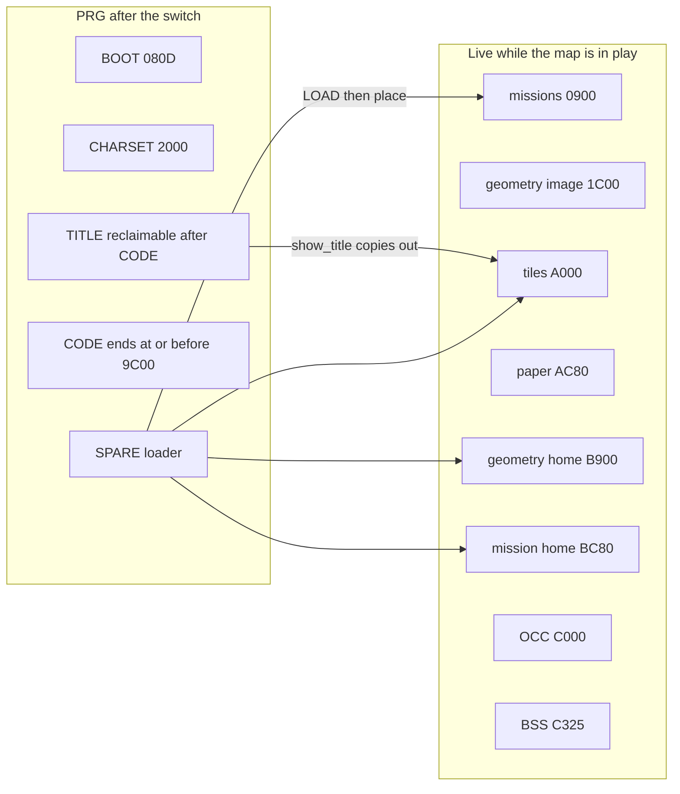

# Map and mission bundles for the C64

| | |
|---|---|
| Author | _placeholder_ |
| Date | 2026-09-25 |
| Status | Draft |
| Path | `design/map-mission-bundle.md` |

## Overview

Hold the Farm's map and mission are assembled into the game PRG. `tools/gen_c64.py` writes `src/c64/generated/farm.asm`, and `src/c64/force.asm` includes it at the end of `CODE`. Editing Tiled or `assets/scripts/farm.txt` therefore requires an assemble before the new bytes can run. The C64 port should load those bytes from a file instead.

The converter will write one PRG-shaped bundle per map. The bundle holds that map's geometry, the missions that name the map, and the two cell planes. The game loads the whole file with KERNAL `LOAD` ,8,1, copies missions and geometry to fixed homes, and expands the planes into `$A000`–`$B8FF`. The active mission is then copied into one fixed working home that the existing `rom_*` / `sc_*` labels already address. Other missions stay packed until the next one is placed over that same home. SDL keeps its generated C. The file is ordinary bytes so a later SDL reader can use it; that reader is not designed here.

## Background and motivation

Today one authoring change takes two compilers and an assemble:

- `tools/gen_sdl.py` emits `src/sdl/generated/force_data.c` for the SDL binary. There is no runtime load (`agents/assets.md`).
- `tools/gen_c64.py` walks the same assets, keeps only the mission whose map stem is `farm`, and emits charset bytes plus `farm.asm`.
- `force.asm` line 167 includes that file in `CODE`. `map.asm` `build_rows` and `world.asm` `world_load` read the labels directly (`rom_tiles`, `rom_play_*`, `sc_op_code`, the spawn tables).

A fresh assemble on 2026-09-25 (`am65 -i src/c64/force.asm -o /tmp/force-measure.prg --prg -s /tmp/force-measure.sym`) gives:

| Segment | Range (exclusive end) | Notes |
|---|---|---|
| `BASIC` | `$0801`–`$080D` | `10 SYS 2061`, locked |
| `BOOT` | `$080D`–`$0819` | 12 bytes: `sei`, `$01=$36`, `cld`, `txs`, `jmp main` |
| `CHARSET` | `$2000`–`$2800` | 2048 bytes, `generated/charset.bin` |
| `SPARE` | `$2800`–`$35EA` | live code; 2454 bytes free before the sprite at `$3F80` |
| `SPRITE` | `$3F80`–`$3FC0` | 64 bytes, locked |
| `CODE` | `$4000`–`$A3A0` | `main` at `$4000`. Exclusive end is the first title byte |
| `TITLE` | `$A3A0`–`$CAB0` | 10000 bytes, `after=CODE`, `reclaimable` |
| `OCC` | `$C000`–`$C320` | `$320` bytes, noemit, locked |
| `BSS` | `$C325`–`$D000` | 3291 bytes, `end=$CFFF`, noemit, `overlap_reclaimable` |

`build/force.sym` in the repo is stale (it ends `CODE` at `$9F06`, omits `TITLE`, and has no `rom_cam_*`). Do not use it. The listing above matches `agents/c64-port.md`'s segment table. `rom_map_w` is at `$8758` and the last script byte ends at `$A3A0`, so the linked farm block is `$8758`–`$A3A0` = **7240 bytes**. Of that, `rom_tile_class` and `rom_tile_force` are 128 bytes each and stay in the PRG. The other **6984 bytes** are the payload this design moves out. Removing them, and adding nothing else to `CODE`, puts the exclusive `CODE` end at `$8858`. That is the figure later asserts use.

`$A000`–`$A39F` is live today. It holds the last 101 bytes of `rom_paper` (paper is `$93E5`–`$A065`), then class, force, rooms, cover, portals, scouts, spawns, and the script through `$A39F`. A `LOAD` aimed at `$A000` is illegal until those bytes are gone. `TITLE` sits on top of the rest of `$A000`–`$BFFF` and on `OCC`/`BSS` through `$CAAF`. `show_title` copies it out before `clear_bss`. That order is what makes the overlap legal, and the new load has to stay after `show_title`.

`world_load` (`src/c64/world.asm`) copies `rom_map_*`, `rom_play_*`, `rom_cam_*`, spawns goodguy stamps, and reads `sc_start_*` and the grenade stocks. `build_rows` (`src/c64/map.asm`) sets `paper_off` to `rom_paper - rom_tiles` and points `row_lo`/`row_hi` at `rom_tiles`. `map_ptr` adds `paper_off` to reach the colour byte. F3 sets `in_restart`; `game_tick` calls `world_load` and `session_init` and does not call `clear_bss` (`force.asm` says so at the blank before init, and `clear_bss` has no other caller). `session_init` stores `drawn = 0`, so the next `draw_all` takes the full-paint path and `build_occ` refills `OCC`.

Pain: a content edit cannot be copied onto a disk and run. The PRG is also 49841 bytes, 7240 of which are one map.

## Goals and non-goals

### Goals

- Edit Tiled and mission scripts, run the converter, and load the result on a c64m HostFS folder without reassembling game code.
- Produce a `.d64` with the same files as a pipeline product, not as a requirement of every run.
- One bundle per map, containing that map and every mission that names it.
- Two cell planes as separate chunks, decompressed independently into homes that last as long as the map is in play.
- LZSS on those planes when the compressed form is smaller than the raw form. Missions stay uncompressed.
- A fixed working home for the active mission, sized to the existing compiler caps. Other missions stay packed.
- Shared Tiled layers stay `color`, `tiles`, `properties`, `rooms`. Every other layer name is a mission script stem. The current `actors` layer is renamed `farm`. Hidden layers still compile.
- The same `LOAD` ,8,1 path for a HostFS folder and for a c1541 image.

### Non-goals

- Title program, title song, campaign or continue UI, and save files. `src/c64/title.asm` stays as it is.
- SDL runtime loader. `gen_sdl.py` still emits linked C. Parity is later.
- Charset or tile-art swapping. `CHARSET`, `rom_tile_class`, and `rom_tile_force` stay in the PRG. One chunk id is reserved and unused.
- New missions, a second map, fog, or gameplay changes. Do not rename `assets/maps/farm.tmx` to `map_1_of_2`. Do not add a city mission.
- Scripted key injection. Loader phases are checked with a breakpoint and a memory read. The user play-tests the game.

## Key decisions

1. **Bundles are loaded, not assembled.** `farm.asm`'s map and mission bytes leave the PRG. `gen_c64.py` still emits `charset.bin` plus the 256-byte class and force tables. Decided: that is the coupling to remove, and the charset is explicitly out of scope.

2. **One bundle per map.** Missions that share a map travel with it. A later mission on a different map loads a different bundle. Sharing a map across an ordered campaign is a content habit, not a restriction the loader enforces.

3. **Flat index, not IFF.** A 6502 walker wants a count and a fixed-size entry, not a scan for four-byte ids and pad-to-even rules. IFF earns its keep when chunks nest or when foreign tools must skip unknown subtrees. This file has a closed set of chunk ids. Unknown ids are skipped by offset, which is the forward-compat property we actually need (the reserved tileset id). The index is 26 bytes plus 10 bytes per chunk.

4. **Planes are two chunks.** Tiles at `$A000` (3200 bytes, exclusive end `$AC80`) and paper at `$AC80` (3200 bytes, exclusive end `$B900`). `paper_off` stays `$0C80`. `build_rows` keeps the subtract; the labels become equates. `$A000`–`$BFFF` is RAM while `$01=$36` (BASIC out, KERNAL and I/O in). The 8KB under the KERNAL is not a home.

5. **LZSS is per plane, and only when it shrinks the chunk.** No LZSS codec exists in this repo or in `../machines` (the gomoku tree's LZSA is a different codec and is not reused). One encoder, specified below, lives in `tools/lzss.py`. The measure script and `gen_c64.py` both import it. A set flag bit is a literal. On the current farm that encoder emits 532 tile bytes and 433 paper bytes. Those two integers are that function's output, not a target for a different matcher. A filled board will do worse. The uncompressed six-mission cap still fits, so the ratio is not a fit assumption. A chunk whose LZSS form is not smaller is stored raw with the flag clear. The decoder is new 6502, permanent, in `SPARE`, and is not written by this design.

6. **Compressed (or raw) plane bytes are the tail.** After they have been expanded they are dead, so that tail may cover `OCC` and `BSS`. Mission bytes are in front of the tail and are copied to `$0900` before the tail is consumed. `clear_bss` runs only after the tail is dead. It does not run on F3.

7. **Fixed working home, not a pointer chase.** Activating a mission zero-fills `$BC80` for 639 bytes and scatters that mission's tight arrays into the fixed slots. The game keeps `lda sc_op_code,y`. The packed copies of the other missions stay at `$0900`. The extra RAM is one mission, 639 bytes, which is the cap size. Rejected alternative: retarget zero-page pointers at whichever blob was loaded.

8. **Map versus mission.** Planes, rooms, cover, portals, and scouts are placed once per map load. Spawns, play rectangle, camera, grenade stocks, script tables, start beat, and spawn room are per mission. A mission that needs different walls is a different map. Opening spawns live on the mission's Tiled layer. Later waves stay in the script (`spawn N letter`), as `world_load` already ignores non-goodguy stamps and the script spawns enemies.

9. **Tileset chunk id `$05` is reserved and unused.** The loader skips it. Charset loading is not implemented. New maps use the existing 128 tiles. New tile art cannot, until a later project fills that id.

10. **C64 first.** The bytes are plain. SDL waits.

11. **Title stays.** It is mentioned only where it occupies `$A000` at boot. Load runs after `jsr show_title`.

12. **PRG-shaped files, one `LOAD` per directory entry.** Two-byte load address, then payload. HostFS types `.prg` as PRG and strips that extension from the CBM name (`c64_hostfs.c`). `LOAD "FARM",8,1` works on a HostFS folder and on a disk image mounted as a drive. It is the wrong tool for a `.d64` opened from inside a HostFS folder; sequential I/O does not work there either (`manual.md` HostFS table: SEQ is host-cwd only). Development mounts the folder. Shipping mounts the image. The converter's name check is stricter than the HostFS runtime: no `FILE` substitute, and a collision fails the build. HostFS itself will still rename a clash with some other file already in the mount.

13. **One-shot is the default.** Measured cap (header + geometry at the caps + six missions at the caps + raw planes) ends at `$CC0F`, 1009 bytes below `$D000`. Packed missions occupy `$0900` up to but not including the geometry image at `$1C00` (4864 bytes). Six capped missions leave 921 bytes there. A continuation filename in the header is the hatch for a later map that fails the file-end gate or that `$1C00` ceiling. It is empty for farm. A second file does not require a format break.

14. **Naming.** Catalog line is `name map x,y,w,h script`. The map token is the TMX stem. The script token is the layer name and the stem of `assets/scripts/<stem>.txt`. The catalog name is not a layer. Current row, unchanged: `farm_mission farm 40,0,40,20 farm`. The agreed example `farm_mission map_1_of_2 …` / `city_mission map_1_of_2 …` is the rule, not a rename to perform. `load_missions` already rejects a rect whose width or height is not positive, so `0,20,0,20` cannot ship.

15. **Disk tool.** Invoke `$C1541` when that variable is set, otherwise `c1541` on `PATH`. On this machine the variable is the literal `c1541`, and `/opt/homebrew/bin/c1541` (VICE 3.10) is what `PATH` resolves. `/Applications/vice-arm64-gtk3-3.10/bin/c1541` is a shell wrapper around `VICE.app`. Whether either invocation writes a disk the trap will load is PR 2, not a claim of this draft.

16. **Homes were chosen for the caps, not for today's one script.** The `$B900` gap (1792 bytes) holds capped geometry (870) plus the 639-byte home, and does not hold six capped missions. Those live at `$0900`, and they stop at the geometry image (`$1C00`), not at the charset. Six capped missions fit, with 921 bytes spare. An eighth does not.

## Proposed design

### What is measured

Counts are from `src/c64/generated/farm.asm` (the bytes `gen_c64.py` emits) and from the caps in `tools/gen_sdl.py` (`FORCE_ROOM_MAX` 16, `FORCE_PORTAL_MAX` 24, `FORCE_COVER_MAX` 128, `FORCE_SCOUT_MAX` 32, `FORCE_SPAWN_MAX` 32, `FORCE_SCRIPT_OPS_MAX` 64, watchers 8, beats 12, preds 32, wheres 16, spawn templates 8). `src/c64/equ.inc` repeats the map caps (`ROOM_MAX`, `COVER_MAX`, `PORTAL_MAX`, `SCOUT_MAX`) and does not repeat the script caps. The loader PR copies the script caps into `equ.inc` so the two cannot drift. `gen_c64.py` currently rejects scouts above 127, not 32. That check is wrong: scout ids are `COVER_MAX + index` and `CLAIM_BYTES` is `(128+32)/8` = 20. The converter rejects scouts above 32.

Current farm, from the generated bytes:

| Piece | Current | At the caps |
|---|---:|---:|
| Tiles plane | 3200 | 3200 (80×40 is still required) |
| Paper plane | 3200 | 3200 |
| Map scalars (`map_w/h`, four counts) | 6 | 6 |
| Room arrays, 13 fields | 130 logical (10 rooms); 208 in the PRG because `pad(..., 16)` | 208 |
| Cover, 4 fields | 140 (35 chips) | 512 |
| Portals, 2 fields | 24 (12) | 48 |
| Scouts, 3 fields | 0 logical; 3 in the PRG (`or [0]` placeholder) | 96 |
| **Geometry chunk** | **300 logical; 381 linked** | **870** |
| Play rect + camera + spawn count | 7 | 7 |
| Spawn x/y/tile | 21 (7 stamps) | 96 |
| Script scalars | 12 | 12 |
| Script arrays | 163 (18 ops, 8 beats, 2 watches, 10 preds, 6 wheres, 3 templates) | 524 |
| **One mission, tight** | **203** | **639** |
| Class + force (stay in the PRG) | 256 | 256 |

Linked farm block 7240 = 256 class/force + 6400 planes + 13 mixed scalars + 208 padded rooms + 140 cover + 24 portals + 3 scout placeholders + 21 spawns + 175 script. 175 = 12 script scalars + 163 arrays. The seven mission scalars inside the 13 are play, camera, and spawn count.

All seven stamps are class `goodguys` (tiles 2 and 6). `world_load` would skip an enemy stamp. `agents/c64-port.md`'s "six player units" does not match `rom_spawn_count` = 7. The bytes win. `agents/assets.md`'s east strip `40,0,40,40` does not match `assets/missions.txt`, which is `40,0,40,20` with camera 40,0. The catalog wins.

Six missions at the caps, worst stem of 15 characters:

| | Bytes |
|---|---:|
| Six packed bodies | 6 × 639 = 3834 |
| Directory (count byte + 6 × (length, 15-byte stem, u16 size)) | 109 |
| Mission chunk | 3943 |
| Geometry at the caps | 870 |
| Index, 4 chunks | 66 |
| Raw planes | 6400 |
| **One-shot payload, raw** | **11279** |
| Same, with this encoder's farm planes (532 + 433 = 965) | 5844 |

Mission capacity is `$0900`–`$1C00` = **4864 bytes**, because the geometry image occupies `$1C00` for the whole load and stays there afterwards. `$1FFF` is only the charset wall. 4864 − 3943 = **921 spare**, which is the guard `$1867`–`$1BFF`. A seventh capped mission is 1 + 7 × (1 + 15 + 2 + 639) = 4600 bytes, exclusive end `$1AF8`, with 264 bytes left. An eighth is 5257 bytes, exclusive end `$1D89`, which crosses `$1C00`. The same eighth also misses the file gate: 66 + 870 + 5257 + 6400 = 12593, exclusive end `$D131`. Both gates fail together. The measure script's `$0900 + mission_chunk > $1C00` check is the only spare number. Six is the content target. Do not treat `$1FFF` as room for another mission.

`$B900`–`$BFFF` is 1792 bytes. Geometry 870 + working home 639 = 1509, leaving 283 bytes of gaps (`$BC66`–`$BC7F` and `$BEFF`–`$BFFF`). The status byte is not one of them. It does not hold the packed set. Today's one script (203) plus capped geometry (870) plus the home (639) is 1712 and would fit in the gap, and would then break as soon as a second capped mission arrived. The low hole is the home that survives the caps.

The encoder in `tools/lzss.py` is greedy. At each position `i` it scans `j` from `max(0, i − 4095)` upward. The match length is the run of equal bytes, capped at 18, at the bytes still in the plane, and at `i − j`, so a match is never longer than its offset (a run is a chain of non-overlapping copies, not a length-18 offset-1 run). The longest length wins. An equal length does not replace the earlier `j`, so the tie break is the smallest offset. Shorter than 3 is a literal. Flag bytes are LSB first, including a short final group, and a **set** bit is a literal. That function, on the current `farm.asm` planes, emits 532 tile bytes and 433 paper bytes, and a matching decoder returns the original 3200. A longest-match search that breaks ties the other way, or that allows length greater than offset, will not emit those sizes. PR 1 does not treat 532 and 433 as the output of "LZSS" in the abstract. It treats them as the output of this function, and `gen_c64.py` calls the same function.

| Plane | Raw | This encoder | Saved | Alone in the 4096-byte scratch |
|---|---:|---:|---:|---|
| Tiles | 3200 | 532 | 2668 | yes |
| Paper | 3200 | 433 | 2767 | yes |

Together, 965 ≤ 4096, which is what the farm file needs: both sources sit inside the tile destination and must be staged before either decode. Two raw 3200-byte planes sum to 6400 and must not be staged together. The tail layout keeps that from arising. Tile 112 is 2934 of 3200 tile bytes and paper byte 5 is 2732 of 3200; that is why this board compresses, and it is not a budget.

Disk blocks are `ceil(file_bytes / 254)` with the two-byte load address included.

| File | Payload | File bytes | Exclusive end if loaded at `$A000` | Margin under `$D000` | Blocks |
|---|---:|---:|---|---:|---:|
| Farm, raw planes, logical chunks | 6977 | 6979 | `$BB41` | 5311 | 28 |
| Farm, LZSS planes | 1542 | 1544 | `$A606` | 10665 | 7 |
| Six-mission cap, raw planes | 11279 | 11281 | `$CC0F` | 1009 | 45 |
| Six-mission cap, this farm's LZSS | 5844 | 5846 | `$B6D4` | 6444 | 24 |

`$CC0F < $D000`, so the cap fits in one `LOAD` even with raw planes. This encoder's farm LZSS tail ends at `$A606`, which does not reach `OCC`. The overlap path still has to exist, because the raw cap tail runs through `$CC0E` and a future noisy map may store raw planes. The current PRG is 49841 bytes. Dropping 6984 linked bytes and keeping the 10000-byte title is the size change. The loader and decoder grow `SPARE` toward the sprite; the assemble fails if that reaches `$3F80`. There is no separate byte budget.

`gen_c64.py` rejects any width other than 80 and any height over 40. Keep that. Both homes are exactly 3200 bytes. A smaller map is a converter error, not a short chunk.

### RAM homes

```text
$0801 BASIC stub
$080D BOOT (12 bytes)
$0819        load_status
$081A        index copy, 86 bytes for 6 entries, through $086F
$0870        unused through $08FF
$0900        packed mission set, max exclusive end $1867 (3943 bytes)
$1867        unused guard through $1BFF (921 bytes)
$1C00        geometry image while planes are decoded, 870 bytes, exclusive end $1F66
$1F66        unused guard through $1FFF (154 bytes)
$2000        CHARSET (locked)
$2800        SPARE live code through $35E9
$35EA        loader and LZSS decoder grow toward $3F80 (2454 bytes free today)
$3F80        sprite
$4000        CODE. After the farm payload leaves, exclusive end $8858
             if nothing else is added. Assert exclusive end <= $9C00
             (at least 1024 bytes before the plane home).
$A000        tiles, 3200 bytes
$AC80        paper, 3200 bytes
$B900        geometry home, 870 bytes, exclusive end $BC66
$BC66        26 bytes unused
$BC80        active mission home, 639 bytes, exclusive end $BEFF
$BEFF        257 bytes unused through $BFFF. Not a status byte:
             a cap-sized LOAD covers this region until relocate finishes.
$C000        OCC, $320 bytes. Also the plane scratch during load.
$C320        5 bytes unused (BSS is end-anchored, not packed against OCC)
$C325        BSS, 3291 bytes, through $CFFF
$D000        I/O while $01=$36. A LOAD must not write here.
$E000        KERNAL, and the title bitmap only while show_title banks $01=$35
```

`load_status` is `$0819`. The index copy is `$081A`–`$086F` (86 bytes). That is the boot hole, which the loaded image at `$A000` does not cover. Do not use `$02A0`–`$02FF`. `$02A6`, inside that range, is the KERNAL PAL/NTSC flag. The line-251 split chains `$EA31` (`irq.asm`), and that KERNAL body is what consumes the flag. `$0259`, `$0263`, and `$026D` are the KERNAL LAT/FAT/SAT (`c64.c`). A six-entry index is 26 + 6×10 = 86 bytes and fits. The format rejects `chunk_count` above 6 (96 bytes). The guard is 231 bytes, so the cap is the format, not the hole.

Geometry home, base `$B900`:

| Offset | Bytes | Label |
|---:|---:|---|
| 0 | 2 | `rom_map_w`, `rom_map_h` |
| 2 | 4 | `rom_room_count`, `rom_cover_count`, `rom_portal_count`, `rom_scout_count` |
| 6 | 208 | 13 × 16 room bytes: x0, y0, w, h, colour, cover_base, cover_count, scout_base, scout_count, axis, cover_lo, cover_none, cover_hi |
| 214 | 512 | `rom_cover_x/y/grade/facing`, 128 each |
| 726 | 48 | `rom_portal_x/y`, 24 each |
| 774 | 96 | `rom_scout_x/y/facing`, 32 each |

870 bytes. `rom_room_colour` is emitted today and has no reader in `src/c64`. Keep the 16 bytes so the home stays a superset of the current tables.

Mission home, base `$BC80`, 639 bytes:

| Offset | Bytes | Label |
|---:|---:|---|
| 0 | 4 | `rom_play_x/y/w/h` |
| 4 | 2 | `rom_cam_x/y` |
| 6 | 1 | `rom_spawn_count` |
| 7 | 96 | `rom_spawn_x/y/tile`, 32 each |
| 103 | 6 | `sc_op_count`, `sc_beat_count`, `sc_watch_count`, `sc_pred_count`, `sc_where_count`, `sc_spawn_count` |
| 109 | 2 | `sc_start_spawn_room`, `sc_start_beat` |
| 111 | 4 | `sc_player_grenades`, `sc_player_grenade_wait`, `sc_enemy_grenades`, `sc_enemy_grenade_wait` |
| 115 | 256 | `sc_op_code/a/b/c`, 64 each |
| 371 | 12 | `sc_beat_pc` |
| 383 | 40 | watch pred0, pred1, op, arg, flags, 8 each |
| 423 | 128 | pred kind, who, a, b, 32 each |
| 551 | 48 | where kind, a, b, 16 each |
| 599 | 40 | spawn n, letter, room, batch, period, 8 each |

`sc_beat_count` and `sc_spawn_count` have no reader besides the bytes themselves. They stay, same reason as room colour. Grenade waits stay because `combat.asm` reads `sc_player_grenade_wait` and `sc_enemy_grenade_wait` on each use, not from a BSS copy.

`gen_c64.py` writes `src/c64/generated/homes.inc` with these as `=` equates (`rom_tiles = $A000`, `rom_paper = $AC80`, and the rest at the offsets above). Absolute indexed loads do not care that the addresses are unaligned. After the switch PR, `farm.asm` no longer defines those labels.



### On-disk layout

Host file `farm.prg`. CBM name `FARM` (the `.prg` stem, uppercased). Load address `$A000`. Magic at the first payload byte, which is what lands at `$A000`.

```text
0000  00 A0                 PRG load address. Not part of the RAM image.
0002  46 4D 41 50           "FMAP" at $A000
0006  01                    version. Anything else fails.
0007  01                    flags. bit0 = missions are in this file.
0008  01                    mission_count
0009  00                    reserved, write 0
000A  A0 A0 .. A0           16 bytes, continuation CBM name, $A0 pad
001A  00                    continuation length, 0..16. 0 means no second file.
001B  04                    chunk_count
001C  entries               10 bytes each, little-endian
```

Entry:

```text
u8  id
u8  flags          bit0 = LZSS. Other bits must be 0.
u16 offset         from the magic byte (RAM address = $A000 + offset)
u16 src_len
u16 dest_addr
u16 dest_len       expanded size for a plane or for geometry; packed size for the mission set
```

Ids:

| Id | Name | Required | dest allowlist |
|---|---|---|---|
| 1 | geometry | yes | dest `$B900`, `dest_len` 870, `src_len` ≤ 870 |
| 2 | mission set | yes when continuation length is 0 | dest `$0900`, `src_len` = `dest_len` ≤ 3943 |
| 3 | tiles | yes | dest `$A000`, `dest_len` 3200, `src_len` ≤ 4096 |
| 4 | paper | yes | dest `$AC80`, `dest_len` 3200, `src_len` ≤ 4096 |
| 5 | tileset | no | skipped, not written. Do not emit it. |
| other | | | skipped if `offset+src_len` is inside the image. Not written. |

The dest field is how the file annotates the home. The loader still checks the allowlist, so a bad file cannot point tiles at `CODE`. Missing a required id fails. `chunk_count` above 6 fails. A six-entry index is 86 bytes at `$081A`–`$086F`. Seven entries are 96 bytes and are a format error, not a hole that is one byte short.

Geometry chunk, tight, then the loader zero-fills the 870-byte home and copies each array to its fixed slot:

```text
u8 map_w, map_h
u8 room_count, cover_count, portal_count, scout_count
room fields in home order, each room_count bytes
cover fields, each cover_count bytes
portal fields, each portal_count bytes
scout fields, each scout_count bytes
```

Empty means zero bytes, not the one-byte placeholder `emit_bytes` writes today.

Before any copy, the loader (and `mission_activate` for a later mission) rejects a count above its cap and rejects a body whose walked size is not `src_len`. The walk is a size check, not a store. Zero-fill happens only after it passes. Caps, matching `equ.inc` and `gen_sdl.py`: rooms 16, cover 128, portals 24, scouts 32, spawns 32, ops 64, beats 12, watches 8, preds 32, wheres 16, spawn templates 8. `map_w` must be 80 and `map_h` must be 40, the same reject `gen_c64.py` already applies, because `build_rows` uses `map_w` as the row stride. A `room_count` or `spawn_count` of 200 is status 7, not a successful map. The converter's scout check (above 32, not the current 127) is necessary and is not a substitute for this loader check. A file swapped in after the converter ran still has to fail here.

Mission-set chunk:

```text
u8 count
repeat count:
  u8  stem_len          1..15, bytes are the script stem, case preserved
  u8  stem[stem_len]
  u16 packed_len
  packed bytes:
    play_x, play_y, play_w, play_h, cam_x, cam_y, spawn_count
    spawn_x/y/tile, spawn_count each
    six script counts, start_spawn_room, start_beat, four grenade bytes
    op_code/a/b/c, op_count each
    beat_pc, beat_count
    five watch arrays, watch_count each
    four pred arrays, pred_count each
    three where arrays, where_count each
    five spawn-template arrays, spawn_tmpl count each
```

Farm's packed mission is 203 bytes. The chunk with `count=1` and stem `farm` is 211 bytes. Six capped missions with 15-byte stems are 3943.

Planes follow the mission chunk. That is the tail. One flag rule: each flag byte is LSB first, and a **set** bit is a literal. A clear bit is a match. "Flag bit 0 means a literal" is the wrong reading; bit 0 of the flag byte is the first item, and the item is a literal only when that bit is 1.

- set bit: the next byte is a literal
- clear bit: the next two bytes are `offset_lo` and `((offset >> 4) & $F0) | (length - 3)`
- offset is 1..4095 and must be ≤ bytes already written
- length is 3..18, and the encoder never emits a length greater than the offset
- the copy is byte by byte from `dest[pos - offset]`, so a match may overlap itself on decode even though this encoder does not emit that case

No preset ring. The decoder's source and destination must not overlap. The staging rule below is what makes that true. The decoder stops at `dest_len` and fails if it would read past `src_len` or finish short.

Farm, as `tools/lzss.py` emits it for the current planes (offsets from the magic). These offsets move if the encoder or the planes change. They are not a second acceptance test:

| Chunk | Id | Flags | Offset | src_len | dest | dest_len |
|---|---:|---:|---:|---:|---|---:|
| geometry | 1 | 0 | `$0042` (66) | 300 | `$B900` | 870 |
| missions | 2 | 0 | `$016E` (366) | 211 | `$0900` | 211 |
| tiles | 3 | 1 | `$0241` (577) | 532 | `$A000` | 3200 |
| paper | 4 | 1 | `$0455` (1109) | 433 | `$AC80` | 3200 |

Exclusive end `$A606`. The raw-plane farm is the same chunks with flags 0, `src_len` 3200, tiles at offset 577, paper at 3777, exclusive end `$BB41`.

Cap, raw, the gate that picked one-shot:

| Chunk | Offset | src_len | Where it sits if loaded at `$A000` |
|---|---:|---:|---|
| geometry | 66 | 870 | `$A042`–`$A3A7` |
| missions | 936 | 3943 | `$A3A8`–`$B30E` |
| planes | 4879 | 6400 | `$B30F`–`$CC0E` |

Missions end at `$B30F`, below `OCC`. The plane tail is what crosses `$C000`. That is the rule: missions are not the tail.

Continuation hatch, unused for farm. If a future bundle's exclusive end would be ≥ `$D000`, the converter emits geometry and planes only (`flags` bit0 clear, mission chunk absent, continuation length set) and a second PRG:

- host file `<stem>m.prg`, CBM name = map CBM name + `M` (`FARM` → `FARMM`)
- load address `$0900`
- magic `FMIS`, version 1, then the mission-set body as above
- exclusive end ≤ `$1C00`

The map file without missions is 66 + 870 + 6400 = 7336 bytes and ends at `$BCE8`, so it always fits. Only the mission set can force the hatch. If the continuation name exceeds 16 characters or collides with `FORCE` or another bundle the converter itself is writing, the converter fails.

`c64_hostfs_mangle_cbm` keeps `A`–`Z`, `0`–`9`, and `.`, folds case, drops everything else (including `_`), and cuts at 16. On an empty result it stores `FILE`. `c64_hostfs_unique_cbm` then renames a collision `name001` instead of failing the mount. The converter is a stricter copy of that fold: same kept characters, same cut at 16, **no** `FILE` substitute, fail on empty, fail when two outputs mangle to the same CBM name. It cannot see an unrelated file that is already in the HostFS directory. HostFS may still alias against that file at runtime. The probe directory contains only the files under test. `farm.prg` lists as `FARM`. Internal stems may still contain `_`; only the directory name is mangled.

### Load sequence

```mermaid
sequenceDiagram
  participant Main
  participant Title as show_title
  participant K as KERNAL LOAD
  participant Spare as SPARE loader
  participant W as world_load
  Main->>Title: jsr show_title
  Note over Title: copies TITLE to E000 / CC00 / D800, restores $01=$36
  Main->>Main: blank, jsr irq_init, jsr vic_init
  Main->>Spare: jsr map_load
  Spare->>K: SETLFS 1,8,1 / SETNAM / LOAD A=0
  K-->>Spare: C clear, X/Y = exclusive end, also $AE/$AF
  Spare->>Spare: index to $081A
  Spare->>Spare: missions to $0900, geometry image to $1C00
  Spare->>Spare: stage every source that the next dest would cover, then decode
  Spare->>Spare: expand geometry $1C00 to $B900
  Spare->>Spare: clear_bss, mission_activate 0
  Main->>W: world_load
  Main->>Main: session_init, draw_all, cli
```

Boot, IRQs still off, `$01=$36`:

1. `jsr show_title`. It banks `$01=$35` only while copying the bitmap under the KERNAL, then stores `$36` again (`title.asm`). Skipping the jsr leaves the title bytes in RAM; the `LOAD` overwrites them anyway, but if the jsr runs it must run first, because after the unlink the title still covers `$A000`–`$AF67` (title starts at the new `CODE` end `$8858` and is 10000 bytes, exclusive end `$AF68`). `$AF68 < $B900`, so the title does not cover the geometry home. Today's title exclusive end `$CAB0` does cover `OCC` and the top of `BSS`. That remains legal only because the copy happens before `clear_bss`. This work does not move the title segment on purpose; it moves because `CODE` shrinks and `TITLE` is `after=CODE`.

2. Existing blank: border 0, sprites off, `$D011=$0B`.

3. `jsr irq_init`, then `jsr vic_init`. `irq_init` (`src/c64/irq.asm`) stores the raster vector at `$0314`, masks the CIA IRQs, and arms raster 251. It does not touch `BSS`. IRQs stay masked until the `cli` at the end of `main`. `show_title` leaves VIC bank 3 (`$DD00` bits cleared). `vic_init` puts the bank back to 0 and points `$D018` at the charset at `$2000`. Skipping it boots the playfield in the title bank. Both calls stay in `main`, ahead of `map_load`. `map_load` replaces `jsr clear_bss` and is the same three-byte `jsr`, so this stretch does not move the `$8858` end. `mission_activate` is inside `map_load`. `main` does not gain a second `jsr` for it.

4. `map_load` of the four-byte name `FARM` stored in `SPARE`. `JSR $FFBA` with A=1, X=8, Y=1. `JSR $FFBD` with the name pointer. `JSR $FFD5` with A=0. The name is not built in `$B7`–`$BC`; `SETNAM` only stores the pointer (`$B7` length, `$BB`/`$BC` pointer). The c64m trap reads those (`c64.c`, `C64_KERNAL_LOAD_ENTRY = $FFD5`) and rejects a name longer than 16 with A=`$04` and carry set. Carry set: A=`$04` is file not found, A=`$05` is a device or read error. Success: X/Y and `$AE`/`$AF` are the exclusive end (`target + payload_length` in `c64_hostfs_load_prg_bytes_to_memory`). The real KERNAL leaves the same pointer. The loader trusts X/Y.

5. Fail the load, before any further copy, if carry is set, or the exclusive end is `< $A000 + 66` or `> $CFFF`, or it does not equal `$A000 +` the size implied by the last chunk's `offset+src_len`. A file that crosses `$D000` has already hit I/O by the time the trap returns. The converter is the real gate: it refuses to emit that file. The loader halt is for a file that was swapped under the program.

6. Copy the 26 + 10×count index bytes to `$081A`. Check magic, version, allowlist, and that every `offset+src_len` is ≤ the loaded size. Set `load_status` at `$0819`.

7. Copy the mission chunk to `$0900`. Its source on the cap file ends at `$B30F`, and `$0900` does not overlap `$A000`. On the farm LZSS file the mission source is `$A16E`–`$A240`, inside the tile destination, so this copy has to finish before any write to `$A000`.

8. Copy the geometry chunk to `$1C00`. On the farm LZSS file that source is `$A042`–`$A16D`, also inside the tile destination. `$1C00` does not overlap the image. This also finishes before any write to `$A000`.

9. Place the planes. A write to a destination is illegal while a not-yet-consumed source still intersects that destination. Tile dest is `[$A000, $AC80)`, paper dest is `[$AC80, $B900)`. Scratch is `[$C000, $D000)`, 4096 bytes, and it intersects neither dest.

   Farm LZSS, the file PR 6 boots. Tiles are at `$A241` for 532 bytes (through `$A454`). Paper is at `$A455` for 433 bytes (through `$A605`). Both ranges sit inside the tile dest. Decoding tiles to `$A000` writes through `$AC7F` and would destroy the paper source if it were still there. Stage **both** before either decode: copy tiles to `$C000` and paper to `$C214` (`$C000 + 532`). The sum is 965, which fits. Decode tiles from `$C000`, then paper from `$C214`. Do not read `$A241` again. The converter and the loader both reject a pair of still-resident sources that intersect the tile dest and sum to more than 4096. Two raw 3200-byte planes fail that test, so they are not staged together.

   Raw cap, which does not hit that test. Tiles sit at `$B30F`–`$BF8E` and paper at `$BF8F`–`$CC0E`. Neither intersects the tile dest, so the tile copy from `$B30F` to `$A000` does not overlap and does not touch the paper source. That copy consumes the tile source, which did intersect the paper dest. The paper source does not intersect `[$AC80, $B900)`, so the paper copy from `$BF8F` to `$AC80` is also direct. No scratch, and no backward copy. The raw cap's overlap with `$C000` is the loaded tail itself, which this direct copy reads and then abandons. It is not a second scratch address.

   Raw farm (flag 0, planes start at offset 577 = `$A241`). The tile source is 3200 bytes, `$A241`–`$AEC0`, so it intersects both dests. The paper source starts at `$AEC1`, which is past `$AC80`, so it survives a tile write. Stage the tiles alone to `$C000` (3200 ≤ 4096), copy them to `$A000`, then stage the paper (it intersects the paper dest) and copy it to `$AC80`. Sequential, not simultaneous.

   If a source that must be staged already overlaps `$C000`, copy it high address first. The farm LZSS sources end at `$A606` and do not need that.

10. Check geometry counts against the caps and check that the walked body size equals the geometry `src_len`. Then zero `$B900` for 870 bytes and scatter the `$1C00` image into the fixed slots. Plane bytes that used to sit on `$B900` are already consumed. Do not zero-fill before the check.

11. `clear_bss`. Range is `bss_start` through `bss_end` (`$C325`–`$D000`). It does not touch `OCC`, the low hole, `$B900`, or `$BC80`. The plane scratch in `BSS` is dead. `OCC` stays garbage until `build_occ`.

12. `mission_activate(0)`, called from `map_load`. Same count and size check on the packed mission, then zero `$BC80` for 639 and scatter. A later mission takes the same path. An index past `mission_count` returns carry set and does not scatter. A count above a cap, or a body whose size is not the directory `packed_len`, jumps to `load_fail` instead of writing past `$BEFE`. Zeroing still matters on the success path: a shorter op table must not leave the previous mission's bytes past the new count, even though today's readers stop at the count.

13. `main` calls `world_load`, `session_init`, `draw_all`, then `cli`. `map_reload` does not call `irq_init` or `vic_init` again.

`world_load` already rebuilds unit slots, `cover_claim` (it writes `NONE` over `unit_cover` because a BSS zero is chip 0, and F3 does not clear), section orders, play and camera, script cursor, grenade stocks, `build_rows`, and `bake_hop`. `bake_hop` calls `infer_portals` and `bake_doors`, so `portal_bits` and `door_n` are rebuilt. It does not rebuild `key_*`, `seen_*`, `form_*`, combat scratch, `nade_fx_x/y`, or `section_last_*` / `section_order_x/y` except where a fresh spawn writes the leader. Those are why the load path calls `clear_bss` instead of trusting `world_load` alone. F3 does not call `clear_bss` and must not start to: the homes are not in `BSS`, but `clear_bss` on F3 would wipe key latches on the key that requested the restart, and the current game depends on `world_load` repairing `unit_cover` without a full zero.

Same map, next mission: `mission_activate(i)`, `world_load`, `session_init`. No `LOAD`, no `clear_bss`. Door tables are a function of the map and are rebuilt by `world_load` anyway. `drawn=0` forces `build_occ` on the next `draw_all`. There is no campaign UI in this work. Boot activates index 0. The call exists so the later UI does not invent a second home.

Different map: `sei`, blank, `map_load` of the other CBM name (same homes, same sequence including `clear_bss`), `cli`. The previous packed set at `$0900` is replaced by the copy in step 7. A later map load may land its tail on `OCC`/`BSS` only while that RAM is still being read as a plane source or used as scratch. `world_load` then rebuilds what it owns; `clear_bss` has already cleaned the rest. `irq_init` and `vic_init` are not called again.

F3: `world_load`, `session_init`, no load, no `clear_bss`, no title. The homes and the packed set are still there.

`map_ptr` is unchanged once `rom_tiles` and `rom_paper` are the equates. `paper_off` is `$0C80`.

### Converter

`gen_c64.py` keeps reading assets through `gen_sdl`. It stops emitting map and mission bytes into `farm.asm`. It still writes:

- `src/c64/generated/charset.bin`
- `src/c64/generated/tileset.asm` containing only `rom_tile_class` and `rom_tile_force` (256 bytes)
- `src/c64/generated/homes.inc`
- `build/c64/<cbm-stem>.prg` for each map stem in `missions.txt`

`force.asm` includes `tileset.asm` and `homes.inc` and does not include `farm.asm`. CMake's `force_c64` rule gains the bundle as an output and drops the farm-asm dependency when that PR lands. `gen_sdl.py` stays the SDL emitter.

`load_tmx` keys layers by name and never reads `visible`. Confirmed: `gen_sdl.py` has no `visible` check, and `farm.tmx` marks `color`, `rooms`, `tiles`, and `properties` `visible="0"` while those layers still compile into planes, 10 rooms, and 35 cover chips. Mission layers that an author hides in Tiled keep compiling.

Layer rule, enforced in the shared loader so SDL and the bundle cannot disagree:

- Reserved names: `color`, `tiles`, `properties`, `rooms`. A missing one stays an absence plane, as now.
- Any other layer must be the script stem of a mission whose map is this file.
- A mission with a script stem and no such layer fails.
- A non-reserved layer with no such mission fails.
- `actors` is no longer a legal name. `farm.tmx`'s `actors` layer is renamed `farm`.
- Two missions that open the same way duplicate their stamps. No shared-layer alias.
- The layer is opening spawns only. `extract_spawns` already allows only `goodguys` and `enemies`.
- `compile_map` takes the spawn plane for the mission being compiled instead of always reading `planes["actors"]`.

SDL's `force_map` spawn SoA for a map stays the stamps of the first mission on that map. With one mission named `farm`, the seven stamps are unchanged. No SDL load path is added. The diff check is the SDL arrays, which are decimal: x `66, 66, 64, 66, 66, 66, 66`, y `6, 7, 8, 8, 9, 10, 11`, tiles `6, 6, 2, 6, 6, 6, 6`. `farm.asm` stores the same x bytes as `$42, $42, $40, $42, $42, $42, $42`. Comparing the SDL arrays to 42 would move the squad 24 cells west.

`gen_c64.py` today picks a single farm mission (`build()`, the `m[1] == "farm"` loop). It instead groups catalog rows by map stem and emits one bundle each. Catalog display names are not written into the bundle. The mission's packed stem is the script token.

LZSS runs in the converter on each plane. The flag is set only when `src_len < 3200`. The bitstream is the one specified above, so the PR that adds the 6502 decoder does not get to invent a second framing.

### What `world_load` must still repair

After `clear_bss`, and also on F3 without it:

- `unit_cover` to `NONE`, `cover_claim` to 0. A zero cover id is a real chip (`bss.asm`).
- units, sections, rooms' mutable flags, script cursor, grenades, row bases, portals, doors.

The load path's `clear_bss` is what zeros `key_hit`, `seen_*`, and `form_n` after a tail clobber. Do not move that call onto F3.

### Risks

| Risk | Severity | Mitigation |
|---|---|---|
| `CODE` already ends at `$A3A0`, 928 bytes into the plane home | High | Do not `LOAD` at `$A000` until the 6984 farm bytes leave the PRG. Assert exclusive `CODE` end ≤ `$9C00`. Loader lives in `SPARE`, not in that margin. |
| A second map load's tail clobbers `BSS` and `OCC` | High | Tail is planes only. Decode first, then `clear_bss`, then `world_load`. F3 does not take this path. `build_occ` runs because `session_init` clears `drawn`. |
| LZSS source overlaps `$A000` or `$C000` | High | Same rule as step 9. Before writing a destination, every not-yet-consumed source that intersects it is already staged. If both plane sources intersect the tile destination, both are staged first and their `src_len` sum must be ≤ 4096, or the load fails with status 7. A source that does not intersect the destination about to be written is copied directly and is not required to sit in `$C000`. Backward copy only when a source that must move into `$C000` already overlaps `$C000`. Match copies run only on the destination. `lzss_decode` is called only on a source step 9 has already staged. |
| `LOAD` writes `$D000`–`$DFFF` (I/O) or wraps | High | Converter refuses exclusive end ≥ `$D000`. Loader halts if X/Y is past `$CFFF`. Damage from a wild file is already done; the halt stops the game from trusting it. |
| CBM names are 16 bytes and `_` is deleted | Medium | Converter mangled-name check. Farm is `FARM`, game is `FORCE`. Continuation is `FARMM` only if the hatch fires. |
| F3 does not call `clear_bss` | Medium | Leave F3 on `world_load` + `session_init`. Homes are outside `BSS`, so a well-meaning clear would not wipe them, but it would wipe the restart key's latches. |
| Title still covers `$A000` at boot | High if reordered | `map_load` stays after `jsr show_title`. After the unlink the title exclusive end is `$AF68`, still over the plane home, not over `$B900`. |
| `clear_bss` wipes the plane scratch | Low, by design | Decode before `clear_bss`. |
| IRQs during a later `map_load` | Medium | `sei` around the reload. Boot is already masked until `cli`. |
| Scout check allows 127 | Medium, latent | Converter uses 32. Farm has zero scouts, so this is not a behavior change for the current map. |
| Treating 6:1 as a budget | Medium | Fit is proven on raw planes (end `$CC0F`). LZSS is a size win on this farm and a flag otherwise. |
| `emulate_1541=1` with the 1541 ROM skips the d64 trap | Medium | Repo `c64m.ini` does not set the key; `app_options_init` zeros it, so the default is the trap for both HostFS and a mounted image. HostFS traps even when the flag is on (`c64.c` comments that order). PR 2 records which configuration it actually ran. The IEC path is not a second loader. |
| `SPARE` growth eats the loader | Medium | Free bytes today are `$3F80 − $35EA` = 2454. There is no estimated budget. am65 refuses an overlap of locked `SPRITE`. The check is `SPARE` exclusive end `< $3F80`. |
| `build/force.sym` is stale | Low | Reassemble. The fresh listing is the one cited here. |

## API and interface changes

New 6502 entry points, all in `SPARE`:

```text
; A/X unused. Name is the in-SPARE PETSCII string at map_name / map_name_len.
; Carry clear on success. On failure, does not return: jmp load_fail.
.proc map_load

; X = mission index, 0 .. mission_count-1. Zeroes $BC80 and scatters
; the packed mission. Carry clear, or set if X is out of range.
.proc mission_activate

; zSrc/zSrc+1 source, zDst/zDst+1 dest, zT0/zT1 src_len, dest length 3200.
; Called only after step 9 has staged this source into $C000-$CFFF.
; A direct copy of a source that does not intersect the dest does not
; call this proc and is not required to sit in the scratch.
; Carry clear if exactly 3200 bytes were written.
.proc lzss_decode
```

`main` after `show_title` and the blank:

```text
jsr irq_init
jsr vic_init
jsr map_load          ; replaces jsr clear_bss. Calls clear_bss and mission_activate.
jsr world_load
jsr session_init
jsr draw_all
cli
```

`map_load` calls `mission_activate` for index 0. `main` does not. One `jsr` replaces `jsr clear_bss`, so the `$8858` figure still holds. A same-map advance calls `mission_activate` itself and then `world_load` / `session_init`. The blank above this block is the one already in `main`.

KERNAL: `$FFBA` SETLFS, `$FFBD` SETNAM, `$FFD5` LOAD. No CHRIN loop. No `LOAD` ,8 without the ,1: secondary 0 would relocate to the caller's X/Y and ignore the file's address (`c64_hostfs_load_prg_bytes_to_memory`).

`equ.inc` gains the script caps and the home bases. `homes.inc` supplies the label equates. `build_rows` and every `lda rom_*` / `lda sc_*` stay source-compatible because the names do not change.

SDL: no new symbols. `compile_map` grows a spawn-plane argument. `force_map_*` spawn arrays for farm stay the farm layer's stamps.

`tools/measure_c64_bundle.py` (PR 1) imports `tools/lzss.py` and exits non-zero if any of these fail: raw one-shot exclusive end ≥ `$D000`; mission chunk > 3943 or `$0900 + mission_chunk > $1C00`; geometry image > 870 or `$1C00 + 870 > $2000`; either raw plane ≠ 3200; either stored plane chunk > 4096; the sum of plane sources that would still sit inside `[$A000, $AC80)` after the mission and geometry copies is > 4096. LZSS sizes are whatever `lzss.py` returns. The script checks that a decode of those bytes equals the raw plane. It does not check them against a second implementation. It is a gate, not a runtime.

## Data model

There is no schema migration. The old model is labels inside `CODE`. The new model is the byte layout above plus these RAM residents:

| Resident | Address | Lifetime |
|---|---|---|
| Tiles, paper | `$A000`, `$AC80` | until the next map load |
| Geometry home | `$B900` | until the next map load |
| Geometry image | `$1C00` | until expand finishes; left in place, not read by the game |
| Packed missions | `$0900` | until the next map load |
| Active mission | `$BC80` | until the next `mission_activate` or map load |
| Index copy, `load_status` | `$081A`, `$0819` | during `map_load` only |

`OCC` and `BSS` are not residents of the bundle. They are scratch during the load and sim state after `clear_bss` / `world_load` / `build_occ`.

Chunk id 5 is the only reserved hole. Adding it later does not renumber 1–4 and does not move homes. A new required chunk is a version bump to 2, which this loader rejects. That is deliberate.

## Alternatives considered

**Pointers into the packed blob.** The active mission would be a base register, and every `lda sc_op_code,y` would become indirect. That saves the 639-byte home and avoids the scatter. It costs a zero-page pair, an extra cycle on the hottest script and cover loops, and a rewrite of every reader. The user left the home-versus-pointer call open and accepted a fixed home. Rejected.

**One TMX per mission.** Rooms and cover would be copied into every mission file and reloaded, or the loader would have to notice that two files are the same map. Authors already share `color`, `tiles`, `rooms`, and `properties` across spawn layers. Rejected. A mission that needs different walls is a different map, which is the same rule with one file per map instead of one file per mission.

**SEQ files.** `OPEN` + `CHRIN` can scatter bytes to any address and would avoid the "one `LOAD` is the whole file" rule. HostFS implements SEQ only on a host folder, not inside a `.d64` opened from that folder, and a real image would then need a second code path. PRG `LOAD` ,8,1 is the path that already matches both devices. Rejected.

**Keep compiling data into the PRG.** This is the current `farm.asm` include. It is the problem. Rejected as the end state. The switch PR is allowed to be the first boot that depends on the file; intermediate PRs still assemble the linked data so the game runs.

**IFF wrapper.** Skippable chunks and a reserved id are the useful part, and a flat index does both with a smaller walker. Padding to even addresses wastes bytes and adds a special case to every offset. Rejected.

**Stage the whole file in the low hole.** `$0819`–`$1FFF` is 6119 bytes, and the mission ceiling is only the 4864 bytes at `$0900`–`$1C00`. The raw cap payload is 11279. It does not fit. Rejected as a load address.

**Planes under the KERNAL.** `$E000`–`$FFFF` is ROM at `$01=$36`, and `LOAD` itself needs the KERNAL. Not a live home. Rejected.

**Uncompressed planes as a permanent choice.** They fit (end `$CC0F`). LZSS still ships because this encoder cuts the current farm from 28 blocks to 7, and the flag lets a bad ratio fall back to raw without a format change. The decoder lives in the `SPARE` gap. The acceptance check is that `SPARE` ends before `$3F80`, not a guessed instruction count.

## Security and privacy

This is a local single-player game. There are no accounts, no network, and no secrets in the bundle. A hostile bundle can at worst crash the machine or, if the converter gate is bypassed, store bytes through I/O during `LOAD`. The loader's allowlist, end check, and the inner-count check (caps, and walked size equal to `src_len`, before any scatter) stop it from treating that as a successful map. The allowlist alone does not: a legal index with `room_count` 200 would copy off the end of the geometry home. That is memory hygiene, not a threat model.

## Observability

No metrics service. Failures are a stuck border and a status byte.

`load_status` at `$0819`:

| Value | Meaning | Border |
|---|---|---|
| 0 | success, cleared at the start of `map_load` | left at 0 (the play border) |
| 1 | KERNAL A=`$04`, file not found | red `$02` |
| 2 | KERNAL A=`$05`, device or read error | red `$02` |
| 3 | exclusive end past `$CFFF` or short of the index | red `$02` |
| 4 | bad magic or version | red `$02` |
| 5 | required chunk missing, or allowlist mismatch | red `$02` |
| 6 | LZSS short, long, or bad offset | red `$02` |
| 7 | count above a cap, body size ≠ `src_len`, or plane sources that intersect the tile dest sum past 4096 | red `$02` |

`load_fail` is a label in `SPARE`: it stores the status, stores `$02` in `$D020`, and jumps to itself. `break-exec` does not take a label. `CONTROL_COMMAND_BREAK_EXEC` in `machines/src/c64/control/control_protocol.c` parses the argument with `parse_u16_token` and returns `bad-args` / "expected 16-bit address" otherwise. The manual's sequence is `find-symbol`, then `break-exec $addr`. A label is published only after an in-process `assemble` or via `symbol_files`. Repo `c64m.ini` has `symbol_files=` empty. `build/force.sym` is the stale listing this doc already forbids. `--prg` does not publish labels, so the probe's `probe_ok` is never in `force.sym`.

For each check: assemble with `am65 -s`, read the address out of that listing (the script may do this itself), and `break-exec` the hex address. A human on the control port sets `symbol_files` to that same listing, runs `find-symbol <name>`, and breakpoints the `$` address in the reply. `get-memory` length is decimal and does not need a symbol. Do not inject keys.

A hit on `load_fail`'s address means the load did not succeed. `get-memory $0819 1` is the status. A successful boot breakpoints the address of `world_load`, then `get-memory $A000 16` matches the known tile prefix and `get-memory $AC80 16` matches the paper prefix (colour `$05` on this farm). `get-memory $BC80 4` is `28 00 28 14`, which is decimal 40,0,40,20. The user play-tests from there.

The converter prints the same numbers as `measure_c64_bundle.py`: payload, exclusive end, LZSS sizes, and which chunks are raw. A failing gate is a non-zero exit, not a warning.

## Rollout

There is no feature flag and no user cohort. Each PR is revertible.

- Day to day: `c64m --prg build/force.prg --disk 8=<dir> -a --pal`, with `farm.prg` in that directory. `--disk N=<dir>` is the HostFS mount (`manual.md`). The game PRG may also sit in the folder as `force.prg` (`FORCE`); boot does not need it there when `--prg` is used.
- Pipeline product: `$C1541` if the variable is set and the command exists, else `c1541` on `PATH`. The invocation PR 2 must prove, not this draft:

```text
c1541 -format "force,66" d64 build/force.d64 \
  -write build/force.prg force \
  -write build/c64/farm.prg farm
```

`write <source> [<destination>]` and `format <diskname,id> [<type> <imagename>]` are the commands `/opt/homebrew/bin/c1541 -h` prints. The one-liner above was not executed.

- Rollback of the switch PR restores the `farm.asm` include. Earlier PRs do not change runtime behavior.
- `emulate_1541` stays unset in `c64m.ini`. Do not turn it on to make the disk "more real" inside the same PR that proves the trap.

## Open questions

None of the locked decisions are reopened. PR 2 is where the HostFS folder load and the c1541 image load either work or get a written failure. If the image fails under the default trap, that PR fixes the invocation or the file shape. It does not add a second loader and it does not switch the design to SEQ. If `$C1541` does not resolve in the shell that runs the pipeline, the script fails with the string it tried; it does not guess a third path beyond `PATH` and the variable.

## References

- `src/c64/force.asm` segment map, `main`, `clear_bss`, the `farm.asm` include, `TITLE`
- `src/c64/bss.asm` `cover_claim` comment and the F3 note; `world_load` does not clear every resident
- `src/c64/world.asm` `world_load`; `src/c64/move.asm` `bake_hop` → `infer_portals`, `bake_doors`
- `src/c64/map.asm` `map_ptr`, `build_rows`
- `src/c64/game.asm` `session_init`, F3 in `game_tick`; `src/c64/draw.asm` `draw_all` / `build_occ`
- `src/c64/title.asm` copy under the KERNAL; `src/c64/irq.asm` `irq_init`, `vic_init`, the `$EA31` chain; `src/c64/equ.inc` caps
- `tools/gen_c64.py`, `tools/gen_sdl.py` (`LAYER_NAMES`, `load_tmx`, `extract_spawns`, `compile_map`, `FORCE_SCRIPT_*`)
- `assets/missions.txt`, `assets/scripts/farm.txt`, `assets/maps/farm.tmx`
- `src/c64/generated/farm.asm` measured, not edited
- `design/README.md` index conventions
- `agents/assets.md`, `agents/c64-port.md` (segment table matches the fresh assemble; spawn count and the play rect do not)
- `../machines/manual/c64m/manual.md` HostFS table, `symbol_files`, and the `find-symbol` / `break-exec $addr` sequence
- `../machines/src/c64/control/control_protocol.c` `parse_u16_token` on `break-exec`
- `../machines/src/c64/machine/c64_hostfs.c` name mangle, `FILE` fallback, `unique_cbm`, `.prg` typing
- `../machines/src/c64/machine/c64.c` `LOAD` trap, exclusive end in X/Y and `$AE`
- `../machines/agents/c64/using-c64m.md`
- Fresh assemble: `/tmp/force-measure.prg`, `/tmp/force-measure.sym`, 2026-09-25, PRG 49841 bytes

## PR plan

The design doc lands in PR 1. Implementation is six PRs. Each one assembles with `am65` when it touches 6502, and the user play-tests only the PR that changes boot.

### PR 1 — Measure the bundle and land this design

- **Title:** Measure C64 map-bundle sizes and add the design doc
- **Depends on:** nothing
- **Files:** `tools/lzss.py` (new, the one encoder), `tools/measure_c64_bundle.py` (new, imports it), `design/map-mission-bundle.md` (this document), `design/README.md` (one index row, status active)
- **What:** The script parses `farm.asm` and the caps, prints the tables in this document (logical geometry 300, linked geometry 381, mission 203, home 639, six-mission chunk 3943, mission ceiling `$1C00` with 921 bytes spare, raw end `$CC0F`), and prints the LZSS sizes from `lzss.py`. On today's planes those sizes are 532 and 433 and the farm exclusive end is `$A606`. The gate is the one in "API and interface changes", including a round-trip through that encoder. No game or asset change. Copy this draft to `design/map-mission-bundle.md` and add the index row. Do not retitle it as landed.
- **Verify:** `python3 tools/measure_c64_bundle.py` exits 0. A second, hand-rolled longest-match is not a failure mode and is not a test. `am65` is not required.

### PR 2 — Prove HostFS LOAD and a c1541 image

- **Title:** Probe PRG-shaped LOAD on HostFS and on a c1541 disk
- **Depends on:** nothing (can run beside PR 1)
- **Files:** `tools/c64_load_probe.asm` (new, a tiny PRG, not `force.asm`), `tools/c64_load_probe.sh` (new). No game sources.
- **What:** The probe is its own PRG. It `LOAD`s `PROBE` ,8,1 to `$A000`, checks the exclusive end in X/Y, compares a known payload, and either reaches `probe_ok` or `probe_fail` with a status byte. Assemble it with `am65 -s`. The shell script reads those two addresses out of the symbol listing and sends `break-exec $addr`. It does not send the label. The HostFS directory contains only the data file under test, so `c64_hostfs_unique_cbm` has nothing else to alias against. The script then runs `$C1541` or `c1541` to `format` and `write` a fresh `.d64`, and runs c64m with `--disk 8=<that file>`. Write down the binary path, whether `$C1541` resolved, and that `emulate_1541` was left off. Do not point `symbol_files` at `build/force.sym`. Do not inject keys. Do not claim success unless the breakpoint address was `probe_ok`'s address and the memory matched.
- **Verify:** both mounts stop at the `probe_ok` address. A wrong name stops at the `probe_fail` address with status 1. If the d64 path fails, fix the invocation in this PR or stop and report; do not start the game loader.

### PR 3 — Emit an uncompressed bundle; the game stays linked

- **Title:** Emit a farm map bundle without changing the PRG
- **Depends on:** PR 1 (the gate). PR 2 should be green before anyone boots a loader, but this PR does not boot one.
- **Files:** `tools/gen_c64.py`, `src/c64/CMakeLists.txt` (bundle as an extra output). Still writes `farm.asm` and `charset.bin`. New output `build/c64/farm.prg`.
- **What:** One bundle for the `farm` map, one mission, planes raw (flag 0), geometry tight (300 bytes, not the padded 381), mission chunk 211 bytes, load address `$A000`, continuation length 0. `farm.asm` is unchanged, so `CODE` still ends at `$A3A0` and the game still runs with no disk. A Python check in the measure script, or a sibling check, opens the bundle and matches chunk bytes against the logical tables.
- **Verify:** `python3 tools/gen_c64.py`, measure script still exits 0, bundle exclusive end is `$BB41`, `am65` still builds `force.prg`, `CODE` end still `$A3A0`. `gen_sdl.py` output unchanged.

### PR 4 — Rename the actors layer and accept one layer per mission

- **Title:** Name spawn layers by mission script stem
- **Depends on:** PR 3 (the emitter reads layers). Can be developed against current `gen_c64` if PR 3 is awkward to stack; it must not merge after the loader PR if the loader still looks up `actors`.
- **Files:** `assets/maps/farm.tmx` (layer `actors` → `farm` only), `tools/gen_sdl.py` (`LAYER_NAMES`, `load_tmx`, `compile_map`, `extract_spawns`), `tools/gen_c64.py` (group missions by map, one spawn plane each). `assets/missions.txt` is already `farm_mission farm 40,0,40,20 farm`. Do not add a mission. Do not rename the TMX file.
- **What:** Reserved layers stay `color`, `tiles`, `properties`, `rooms`. Any other layer must match a script stem on that map. A mission with no layer, or a layer with no mission, fails the build. `visible` stays ignored. SDL's farm spawn SoA stays the seven stamps. The linked `farm.asm` is mission 0, so the PRG plays the same game. The bundle's mission count equals the catalog rows for that map (one, today).
- **Verify:** `gen_sdl.py` and `gen_c64.py`. Diff `force_map_farm_spawn_x` against decimal `66, 66, 64, 66, 66, 66, 66` (the `$42, $42, $40, …` bytes in `farm.asm`), y against `6, 7, 8, 8, 9, 10, 11`, tiles against `6, 6, 2, 6, 6, 6, 6`. `am65` builds. A temporary duplicate layer name, or a mission whose stem has no layer, makes the converter exit non-zero; revert that fixture before merge. No c64m key script. The user can play if they want; the bytes are the check.

### PR 5 — Load the bundle into the homes and drop the linked farm data

- **Title:** Load the map bundle and unlink farm data from the PRG
- **Depends on:** PR 2, PR 3, PR 4
- **Files:** `src/c64/force.asm` (keep `irq_init` and `vic_init`; replace `jsr clear_bss` with `jsr map_load`; include `homes.inc` and `tileset.asm`; stop including `farm.asm`), new loader in the `SPARE` section (`src/c64/load.asm`), `src/c64/equ.inc` (script caps and home bases), `tools/gen_c64.py` (stop emitting map/mission bytes; emit `tileset.asm` and `homes.inc`), `src/c64/CMakeLists.txt`. Planes in the bundle stay raw (flag 0). Placement is step 9, not one-plane-at-a-time: the raw farm tile source intersects the tile dest, so that one source is staged, and the paper source is staged only because it intersects the paper dest. A source that misses the dest about to be written is copied directly.
- **What:** This is the large PR because `$A000` is not free while `farm.asm` is linked, so the loader cannot be proven in a PR that still includes it. Internal order, one merge: equates, loader (index, mission copy, geometry image, step 9 plane placement, expand geometry, `clear_bss`, `mission_activate`), then delete the linked map and mission bytes, then call the loader from `main`. Class and force (256 bytes) stay in `CODE`. Assert `CODE` exclusive end ≤ `$9C00`. The expected end is `$8858` if the only `CODE` change is deleting those 6984 bytes; the loader itself goes in `SPARE` and does not move that end. `map_reload` for a second map is implemented and not wired to a key. F3 is unchanged.
- **Verify:** `am65 -s`. `CODE` ends ≤ `$9C00`, `SPARE` ends `< $3F80`, `TITLE` still 10000 bytes and `after=CODE`. From that symbol listing, take the hex addresses of `world_load` and `load_fail`. c64m with `--disk 8=` a directory that contains `farm.prg` and no unrelated PRG that could mangle onto `FARM`: `break-exec` the `world_load` address stops there; `break-exec` the `load_fail` address does not. `get-memory $A000 16` matches the old tile prefix. `get-memory $AC80 16` matches the old paper prefix. `get-memory $BC80 4` is `28 00 28 14` (decimal 40,0,40,20). No key injection. The user play-tests the mission.

### PR 6 — LZSS the planes and prove the tail overlap

- **Title:** LZSS-compress map planes and overlap the load tail
- **Depends on:** PR 5
- **Files:** `tools/gen_c64.py` (calls `tools/lzss.py`, sets the flag when the result is smaller), `src/c64/load.asm` (`lzss_decode` and the both-sources-first stage), a fixture builder under `tools/` that writes a cap-sized raw bundle (six dummy missions at the caps, raw planes) and is not shipped as a game asset.
- **What:** Farm planes get the flag when `lzss.py` returns fewer than 3200 bytes. The decoder uses the same flag rule and the same offset packing. On the current farm both compressed sources lie in `$A241`–`$A605`, inside the tile dest, so the loader copies both to `$C000` before decoding either. The farm file then ends at `$A606` and does not touch `OCC`. That boot is the dual-stage proof, not the overlap proof. The raw cap fixture is only the `$C000` tail: load address `$A000`, raw planes, exclusive end `$CC0F`, direct copies as in step 9, then `clear_bss`. It checks 16 bytes at `$A000` and at `$AC80`, and that `bss_start` is 0. Dummy missions are not playable and are not added to `missions.txt`.
- **Verify:** `am65 -s`, then `break-exec` the numeric `world_load` address. `get-memory $A000 16` matches the PR 5 tile prefix and `get-memory $AC80 16` matches the PR 5 paper prefix (colour `$05` on this farm). A paper plane clobbered by the tile decode fails the second read. The fixture stops at its ok address, with both of those 16-byte reads intact and `get-memory $C325 1` equal to 0. Measure script exits 0 and agrees with the emitted chunk lengths. `SPARE` exclusive end is still `< $3F80`.

After PR 6 the editor loop is: change Tiled or a script, run `gen_c64.py`, leave `farm.prg` where HostFS is mounted, boot. The `.d64` target from PR 2 is rerun when a disk is wanted. No further design pass is required to implement these six PRs.
