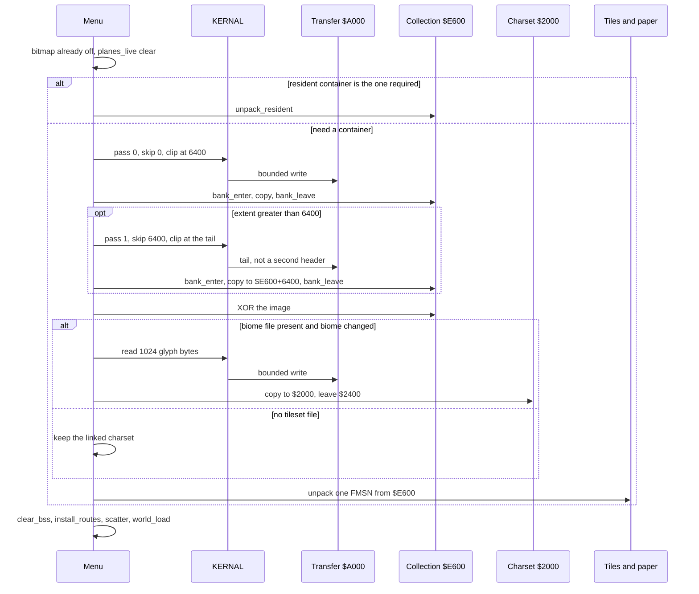
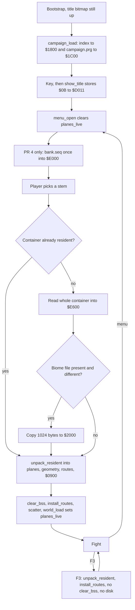

# One map per mission, packed in containers

| | |
|---|---|
| Author | design |
| Date | 2026-10-11 |
| Status | Draft |
| Area | FORCE catalog, Tiled pipeline, SDL play bounds, C64 container load |

## Overview

FORCE currently authors two 80×40 maps and cuts several missions out of each with a rectangle in `assets/missions.txt`. The rectangle is the playable world. `exit-west` on Hold the Farm is that rectangle's west edge, x=40 on `normandy.tmx`, not the map's west edge. Rooms, cover, portals, and the baked route page are properties of the shared map, so two missions that need different cuts cannot share it.

This design makes one `.tmx` and one script per mission. The stem in the catalog is the mission id, the map file, and the script file. The whole map is the playable bounds. There is no mission rectangle. Cells are `0 .. width-1` and `0 .. height-1`. Exit edges are the map edges, so the farm file is cropped to the old 40×20 fight and its west rooms sit on x=0.

On the C64 the missions are packed, in campaign order, into container files that must fit in the resident collection home `$E600–$FFFA` (6650 bytes). A load reads one whole container into that home and leaves it there. The mission that starts is unpacked from that image into the live planes. The planes and the KERNAL transfer buffer are the same RAM (`$A000–$B900`), so a disk read during a fight would destroy the map. Container loads happen at the menu or between missions, and only when the container already resident is not the one required. Restart and same-container relaunch do not touch the disk. SDL keeps compiling the same catalog, the same cropped maps, and the same scripts. It does not grow a second catalog.

The figures in the brief match `assets/c64-layout.json` unless a section below says otherwise. Two names in the brief do not match the layout, and one published memory note is stale. Those are called out in Current state. Nothing in the current tree makes a locked decision impossible.

## Background and motivation

### What hurts

A mission is not a file. It is a name, a shared map, a rectangle, a script stem, and a Tiled layer whose name is that stem. `tools/gen_sdl.py` and `tools/gen_c64.py` both discover the layer from the catalog. The C64 then packs every mission that names a map into one FMAP. Same-map relaunch skips the disk because the planes never change. That is the right cost model and the wrong content model.

The farm, the river, and the ridge are different cuts of `assets/maps/normandy.tmx`. Colour 12 (the ridge road) is one rectangle on that map, `x0=30, y0=20, w=12, h=20`, so it crosses the base mission's east edge at x=40. Take the Base and Take the Ridge cannot both own that rectangle. Chips cannot express the cut. The route table is baked from the rectangles plus walls and water (`tools/c64_routes.py`, `bake_routes`). A shared map with a per-mission property overlay was rejected for that reason.

The C64 cannot keep paying a 1541 open between every mission, and it cannot keep a 6650-byte cache as a heap of individually evicted records. The collection home is one resident image. It is replaced as a whole.

### Current state

#### Catalog

`assets/missions.txt` is the campaign, in file order. The grammar implemented by `load_missions` in `tools/gen_sdl.py` is:

```text
name  map  x,y,w,h  [script]  [cam=x,y]  ["title"]
```

`peel_title` requires the quoted title, when present, to be the last field and 1..27 characters of ASCII 32..126. `TITLE_MAX = 27` in `src/c64/menu.asm` is the same limit. Omitted, the title is the name with underscores turned into spaces, truncated to 27. `cam` omitted means the rect origin. A cam that would hang the 40×20 window outside the rect is pulled back inside (`clamp` in `src/sdl/game/world.c` and `clamp_window` in `src/c64/world.asm`). A cam outside the map entirely is a compile error (`cam_x >= mw` in `gen_sdl.py`).

The six rows are:

```text
hold_farm normandy 40,0,40,20 farm "Hold the Farm"
cross_river normandy 0,0,40,20 cross "Cross the river"
hold_river normandy 0,0,40,20 river "Hold the river"
take_base normandy 0,0,40,40 base cam=0,0 "Take the ridge base"
take_ridge normandy 0,20,80,20 ridge cam=0,20 "Take the Ridge"
hold_bastogne bastogne 40,0,40,20 bastogne "Something Else"
```

Both `.tmx` files are `width="80" height="40"`. `normandy.tmx` layers are `color`, `rooms`, `tiles`, `properties`, `farm`, `cross`, `river`, `base`, `ridge`. `bastogne.tmx` layers are `color`, `rooms`, `tiles`, `properties`, `bastogne`. There is no `actors` layer.

`IDENT_RE` is `^[A-Za-z_][A-Za-z0-9_]*$`. C64 name slots are `NAME_MAX = 16` (`src/c64/menu.asm`). Script names are capped at 15 significant characters plus a NUL (`FORCE_SCRIPT_NAME_MAX` in `gen_sdl.py`).

#### Play rect, camera, exit

The rect is stored in the mission record and copied to `play_x/y/w/h` by `world_load`. The view is 40×20 (`COLS`, `FIELD_ROWS` in `src/c64/equ.inc`), smaller when the rect is smaller. `exit_face` in `src/c64/move.asm` picks a room whose edge equals the play edge (`rom_room_x0 == play_x` for west) and that overlaps the rect (`room_on_play`). SDL does the same in `exit_face_cell` (`src/sdl/game/world.c`). `agents/game.md` states the farm west exit as x=40. The script text is `order B M exit-west`; the coordinate is not in the script. It is the rect.

Compiled rooms on `normandy.tmx` (colour, x0, y0, w, h), from `extract_rooms`:

| Colour | x0 | y0 | w | h | Which rect contains it |
|---|---:|---:|---:|---:|---|
| 1 | 61 | 0 | 19 | 20 | farm, fully |
| 2 | 53 | 0 | 8 | 20 | farm, fully |
| 3 | 46 | 0 | 7 | 20 | farm, fully |
| 4 | 40 | 0 | 6 | 20 | farm, fully; this is the west room |
| 6 | 9 | 11 | 17 | 9 | cross/river/base, fully |
| 7 | 32 | 0 | 8 | 20 | cross/river/base, fully |
| 8 | 9 | 0 | 23 | 11 | cross/river/base, fully |
| 9 | 0 | 0 | 9 | 11 | cross/river/base, fully |
| 10 | 0 | 20 | 16 | 20 | base fully; ridge fully |
| 11 | 16 | 20 | 14 | 20 | base fully; ridge fully |
| 12 | 30 | 20 | 12 | 20 | base clipped (x 30..39); ridge fully |
| 13 | 42 | 20 | 14 | 20 | ridge only |
| 14 | 56 | 20 | 12 | 20 | ridge only |
| 15 | 68 | 20 | 12 | 20 | ridge only |
| 16 | 0 | 11 | 9 | 9 | cross/river/base, fully |
| 18 | 26 | 11 | 6 | 9 | cross/river/base, fully |

Colour 4's x0 is 40, which is `play_x` for Hold the Farm. That is why `exit-west` resolves. Sixteen rooms fills `FORCE_ROOM_MAX` / `ROOM_MAX`. Bastogne is not a byte copy of Normandy: it has 10 rooms, 35 cover, 12 portals, 0 decks. Its colours 1–4 match the farm rectangles above. Colours 6–11 differ, and 7 of its 12 portals sit outside the NE rect. Crop `bastogne.tmx`, do not reuse the Normandy crop.

Farm opening stamps, from the generated mission, are x = 66, 66, 64, 66, 66, 66, 66 and y = 6, 7, 8, 8, 9, 10, 11. All seven are inside colour 1. Cross has 8 stamps inside its rect. River and base have 0. Ridge has 7 inside the south strip. Bastogne has 7, same pattern as the farm. No stamp sits outside its mission rect, so cropping does not drop a stamp.

`world_load` spawns only class `goodguys` from the stamp list. Enemies come from the script. That stays.

#### Spawn-layer contract

`LAYER_NAMES` in `tools/gen_sdl.py` is `color`, `tiles`, `properties`, `rooms`. `META_LAYERS` is `properties` and `rooms`. Any other layer name must be a script stem.

`spawn_layers_for_map` walks the catalog. For one map it returns every distinct script stem, and separately the first row's stem. `load_tmx` errors on a duplicate name, a non-CSV layer, a flipped GID, an unknown name (not in `LAYER_NAMES` and not a stem), or a missing stem. `compile_map` calls `extract_spawns` only for that first stem and writes the map SoA. Every other mission uses `mission_spawn_lists` on `planes[stem]`, which does not touch the map SoA. `gen_c64._compute` ignores the map SoA and calls `extract_spawns` again per catalog row. A spawn must be class `goodguys` or `enemies`, inside a room, and within `FORCE_SPAWN_MAX` (32). Tiles 128+ on `color`, `tiles`, or a spawn layer fail `reject_editor_paint`.

So today's "spawn layer" is not a fixed name. It is "the script stem." The first stem on Normandy is `farm`, which is why the map SoA has the farm stamps and `agents/game.md` says so.

#### FMAP, collection, transfer

`tools/gen_c64.py` `map_bundle` writes one FMAP v3 per map stem. The on-disk file is a two-byte load address `$A000` plus the payload (`build/c64/normandy.seq` is 4660 bytes, `bastogne.seq` is 3777). `tools/c64_package.py` `parse_map` then requires the payload to fit in the transfer home, magic `FMAP`, version 3, kind 1, layout id `COMPAT`, XOR8 of the whole payload equal to 0, and every schema in `assets/c64-layout.json`.

Header, 26 bytes, as declared in the layout: `magic[4], version, kind, mission_count, reserved, layout u16, xor, reserved, extent u16, reserved[10], reserved, count`. Directory entry, 10 bytes: `schema, codec, offset u16, stored u16, destination u16, capacity u16`.

| Schema | Id | Dest | Capacity | Codec |
|---|---:|---|---:|---|
| geometry | 1 | `$B900` | 870 | raw |
| collection (MSET) | 2 | `$E600` | 6650, stored size in the entry | raw |
| tiles | 3 | `$A000` | decoded 3200 | raw or LZSS |
| paper | 4 | `$AC80` | decoded 3200 | raw or LZSS |
| routes | 5 | `$1C00` | 818 | raw |
| routing program | 6 | `$BF00` | 256 | raw |
| record validator | 7 | `$E000` | up to 1536 | raw |

Schema 7 is not produced by `gen_c64.py`. `c64_package.py` appends the linked `BANK_VALIDATION` segment after assembly (1123 bytes in the current memory report) and rewrites the directory. `startup_regions` does not include `bank_validation`, because `$E000` is the title bitmap during boot. The validator arrives with the first map load, after the bitmap is off.

MSET v1 (`tools/c64_missions.py`) is the schema 2 payload. Header 6 bytes: `count, version, layout u16, extent u16`. Entry 10 bytes: `offset, stored, expanded, body, codec, xor`. Count is 1..16. A record is `pack_mission_body` plus NUL-terminated objective strings. LZSS is used only when it is strictly shorter. The selected record is expanded into `$0900–$0B55`. Objective operands are record-relative until `relocate_objectives` runs.

Current collection sizes, from `build/c64/memory-report.md`: Normandy 628/6650 stored, expanded records `[236, 89, 21, 21, 214]` (581 bytes of expanded records). Bastogne 216/6650 stored, one record of 204. Those expanded lengths match `c64_missions.record` on the current scripts (farm 236, cross 89, river 21, base 21, ridge 214, bastogne 204).

`map_bundle` refuses a routing bundle whose payload end is past `$B900` (`0xA000 + offset > 0xB900`). That is the same 6400-byte transfer cap. The reason it exists is overlap: the file is read into `$A000`, which is the tile plane, and `$B900` is the geometry home. `place_planes` in `src/c64/load.asm` stages a source that still sits inside the tile destination before it decodes. `agents/c64-loading.md` states the rule: stage unread plane sources before placing destinations.

#### Addresses that the brief got right

Checked against `assets/c64-layout.json` and `src/c64/equ.inc`. Sizes are `end - start`.

| Name | Start | End (exclusive) | Bytes | Notes |
|---|---|---|---:|---|
| `mission` / `PACK_HOME` | `$0900` (2304) | `$0B55` (2901) | 597 | Selected expanded record. Deck starts at `$0B55`. |
| `charset` / `CHARSET` | `$2000` (8192) | `$2800` (10240) | 2048 | Playfield glyphs are the first 1024 (128×8). |
| `scratch` / `GEO_IMAGE` | `$1C00` (7168) | `$2000` (8192) | 1024 | Routes staged here; campaign image too. |
| `tiles` | `$A000` (40960) | `$AC80` (44160) | 3200 | |
| `paper` | `$AC80` (44160) | `$B900` (47360) | 3200 | |
| `transfer` | `$A000` (40960) | `$B900` (47360) | 6400 | Same RAM as tiles+paper. |
| `geometry` | `$B900` (47360) | `$BC66` (48230) | 870 | |
| `active` | `$BC80` (48256) | `$BF00` (48896) | 640 | Scattered columns, not the 597-byte record. |
| `routing_program` | `$BF00` (48896) | `$C000` (49152) | 256 | |
| `collection` | `$E600` (58880) | `$FFFA` (65530) | 6650 | Under the KERNAL. Excludes the 6 vector bytes. |
| `title_bitmap` | `$E000` (57344) | `$FF40` (65344) | 8000 | Overlays collection and bank validation. |
| `bank_validation` | `$E000` (57344) | `$E600` (58880) | 1536 | Abuts the collection. Actual code 1123. |

`MAP_W = 80`, `MAP_ROWS = 40`, `PORTAL_BYTES = 400` (`80*40/8`), `COLS = 40`, `FIELD_ROWS = 20`. `portal_addr` in `src/c64/move.asm` uses a stride of 10 bytes per row (`y*8 + y*2`), which is `MAP_W/8`, then rejects coordinates outside `map_w` × `map_h`. A map no wider than 80 and no taller than 40 cannot index past the 400-byte bitset. `build_rows` in `src/c64/map.asm` already steps by the runtime `map_w`, not by the constant 80.

Two checks still require the old board exactly. `gen_c64._compute` errors unless `compiled.width == 80`, and errors when `height > 40`. `geo_expand` in `src/c64/load.asm` requires `GEO_IMAGE == MAP_W` and `GEO_IMAGE+1 == 40`, equality, not a maximum. `allow_plane` requires raw `src_len` and the capacity field to equal `PLANE_BYTES` (3200). `lzss_decode` then loads that same immediate into `zT2`/`zT3` and jumps to `lzss_sized`. `span_len` loads it too, but only as the `ranges_hit` span for `tile_span` / `paper_span`, not as the LZSS length. `validate_record` in `tools/c64_missions.py` rejects a play rect with `x+w > 80` or `y+h > 40`. SDL's own cap is looser: `FORCE_MAP_W_MAX` 80 and `FORCE_MAP_H_MAX` 50. The C64 packer must keep rejecting height above 40 and width above 80. This design does not raise either cap, and it does not raise `FORCE_ROOM_MAX`.

Room width and height above 40 fail `gen_c64.py` ("room edges are capped at 40"). None of the cropped rooms below exceed that.

#### Where the brief's names differ

The brief calls `$0900–$0B55` the active mission record. The layout calls that region `mission`, equate `PACK_HOME`, owner "selected immutable mission." The region named `active` is the 640-byte scatter home at `$BC80`. Both stay. Scatter does not move objective text out of `PACK_HOME`. Game code reads `rom_*` / `sc_*` at `$BC80` (`homes_text` in `gen_c64.py`). Objective pointers land back inside `$0900`.

`agents/c64-loading.md` says DECK is 4259/4267 with 8 bytes free, and CODE has 3 bytes free. `build/c64/memory-report.md`, generated from the current assembly, says DECK 2247/4267 (2020 free) and CODE 24560/24576 (16 free). SPARE is 6016/6016. Use the memory report. Deck code ends at `$0B55 + 2247 = $141C`. The 2020-byte tail is unused deck-segment space, not a free region an agent may squat in without a layout edit. CODE cannot grow by more than 16 bytes. The menu index does not go in CODE.

`agents/assets.md` still says FMAP version 2 added route chunks of 818 and 256 bytes. The bytes are right; the version byte is 3. `bake_routes` returns 24+24 from-to bytes, 256 hops, and 514 door bytes = 818. `bridge_variants` pads the program to 256. Routing homes are `portal_from` at 50961 (`$C711`) and `door_n` at 52526 (`$CD2E`), from `c64-layout.json` `routing_homes`. They are not contiguous. `install_routes` copies the 818-byte image in two pieces after `clear_bss`.

#### Same-map relaunch and F3

`resident` in `src/c64/menu.asm` starts at `$FF`. `menu_launch` compares `miss_map[menu_played]` with `resident`. Equal means skip `set_load_name` / `map_load` and only `mission_activate`. The five Normandy rows share `normandy.seq`. Switching among them does not open a file. Switching to Bastogne does. `map_load` reads the CBM name through the bounded reader into `TRANSFER_HOME` (`$A000`), with the end pointer at `$B900`.

F3 sets `in_restart` (`src/c64/input.asm`). `game_tick` calls `world_load` and `session_init`. It does not call `map_load` or `clear_bss`. `world_load` restamps tile 80 via `deck_arm` and restores routing state 0 via `initial_routes`. The compressed records stay at `$E600`. The scattered columns at `$BC80` are not rebuilt. `tools/test_c64_play_flow.py` breaks on `read_file` during F3 and during the second launch of mission index 1, and expects neither to hit the disk. Mission index 1 is Cross (`objective "Build a bridge"`). The probe's 64 masks and 4×4 route transitions are the six deck cells on that map, not a property of the farm.

#### Menu and scores

The C64 menu is two columns, `MAP_MAX = 4` and `MISS_MAX = 16`. Left column is map names, right column is missions on that map. `campaign_load` KERNAL-loads `CAMPAIGN` with secondary address 0 into `camp_file` at `$1C00` (limit `$2000`). The image is parsed into CODE tables (`miss_id`, `miss_title`, `miss_score`, `miss_map`, `miss_ord`). Those tables are what survive a later map load. `$1C00` does not survive: schema 5 is staged there.

`gen_c64.write_campaign` writes `build/c64/campaign.prg` with load address `00 10` and one line per mission:

```text
NORMANDY 0 - hold_farm Hold the Farm
```

Fields are uppercase map name, per-map index, score or `-`, mission id, title. Scores already on disk are kept by matching the mission id (`_score_by_id`). SDL `src/sdl/game/menu.c` reads and writes the same file. A missing file is a fresh menu, every score `0xFF`. The SDL self-test (`force_menu_selftest`) does not use authored names. It builds three missions on two fake maps (`north` / `south`) and asserts the map column, including `cells[8][0] == 'N'` and the title at column 10. Frontier, F8, and the score round-trip are index-based and should survive a flat list. The map-column assertions will not.

`tools/test_c64_campaign_io.py` asserts the saved bytes contain `NORMANDY 1 7 cross_river`.

Tile identity, global, not per biome: water is tile 118 and C64 paper index 6 (`PAPER_WATER` in `equ.inc`, `FORCE_COLOR_WATER` in `world.h`). Unbuilt deck is tile 80. Finished deck is tile 81. Colour chips 112–127 and editor chips 128–159 keep the meanings in `gen_sdl.py` and `assets/properties.txt`. `tiles.txt` classes are global. The charset linked by startup chunk `game01.seq` is the pictures for tiles 0–127 plus the font at chars 128–223. Chars 224–255 are runtime soldier composites (`gen_c64.py`).

## Goals and non-goals

### Goals

- One `.tmx` and one script per mission. The stem is the mission id, `assets/maps/<stem>.tmx`, and `assets/scripts/<stem>.txt`.
- The map's width and height, read from the `.tmx`, are the playable bounds. Exit edges are the map edges. The farm west exit stays the old seam because the file is cropped.
- Catalog grammar `biome stem [cam=x,y] "Title"`, campaign order = file order, titles still 1..27.
- Tiled layers exactly `color`, `tiles`, `rooms`, `properties`, `actors`. The stem-named spawn layer is deleted.
- Both SDL and the C64 consume that catalog and those files. SDL may keep generated C. It may not keep a private catalog or a private rectangle.
- C64 containers, packed in campaign order, size-capped at 6650, closed on a biome change. Load the whole container into `$E600`. Unpack one mission. Restart and same-container play do not read the disk.
- A resident menu index, written by the packer, loaded once at the first menu. Scores key the stem.
- A biome is a 1024-byte replacement of playfield glyphs at `$2000`. One resident charset. The 1024 bytes are not stored in the container and not copied into every mission.
- New RAM is declared in `assets/c64-layout.json` before any code uses it. Bounded transfer, XOR, `bank_enter` / `bank_leave`, no KERNAL call with ROM hidden.

### Non-goals

- Combat, cover grades, approach rules, or the one-axis room rule.
- New art. A second tileset file is not authored. The install path is tested with a fixture.
- The 40×20 view (`COLS`, `FIELD_ROWS`).
- Raising `FORCE_ROOM_MAX`, `ROOM_MAX`, `MAP_W`, `MAP_ROWS`, or the 3200-byte plane homes.
- Putting the charset, or any 1024-byte glyph image, in the 6650-byte collection.
- Partial replacement of a tile range. Two bushes and a bridge are out of scope.
- Per-biome tile ids.
- Deduplicating identical planes across missions inside a container. Each mission blob is self-contained.
- A runtime SDL container loader. SDL compiles the same inputs.

## Key Decisions

1. **The stem replaces the mission name and the map name.** `hold_farm` on map `normandy` becomes stem `farm`. Scores, save lines, and the menu index key that stem. The old id is not an identity. A one-time reader accepts the six old lines so existing `campaign.prg` scores survive the first load, then the next save writes only stems.

2. **Crop to the old rect, then delete the rect.** Play bounds are `0,0,width,height` of that cropped file. Every current `cam` equals the rect origin, so after the crop the cam is `0,0` and the field is omitted. The grammar still accepts `cam`. The illustrative rows in the brief (`normandy base cam=0,20`, `bastogne relief "Hold the town"`) are not the migration. Titles stay the quoted strings in the file, including `"Something Else"`.

3. **Colour 12 is clipped on base and kept whole on ridge.** That is the cut. The base script's `room road = colour 12` still resolves. The rectangle changes from w=12 to w=10. No shared property overlay.

4. **`actors` replaces the stem-named layer.** One map, one spawn plane. Unknown layer names still fail the build. Scripted enemies still come from the script.

5. **Plane homes stay 3200 bytes. Stored planes are tight, `width*height`.** `geo_expand` accepts `1..80` by `1..40` instead of requiring 80 and 40. `portal_addr` keeps stride 10. `build_rows` keeps using `map_w`. A map outside that box fails the build. SDL's height cap of 50 is not a C64 cap.

6. **The 597-byte record and the 640-byte scatter home both stay.** Play rect bytes stay in the record so `homes.inc` does not move. Their values become `0, 0, width, height`. Objective text stays at `PACK_HOME` after scatter.

7. **The container is the unit of load and the unit of fit.** It is one file of at most 6650 bytes, one biome, replaced as a whole. A mission larger than 6650 fails the build. Missions are not split, not evicted, and not packed into a single campaign-long image.

8. **A container load's committed home is `$E600`, never the live planes.** The KERNAL read is bounded into the 6400-byte transfer buffer, and only while `planes_live` is clear. `read_file` today cannot do the second pass: it always reopens at byte 0, discards only the two-byte PRG header, and `pop_error`s on a byte that would land on the exclusive limit (`src/c64/transfer.inc`). PR 4 widens that reader with a 16-bit payload skip and a clip flag before any container larger than 6400 is legal. The copy into `$E600` is inside `bank_enter`. Unpacking reads `$E600`, which does not overlap any scatter destination, so the old "file must end at `$B900`" rule does not apply to a container.

9. **The menu index lives at a new `$1800–$1C00` region**, not in CODE (16 bytes free) and not at `$1C00` (routes and the campaign image). Deck's exclusive end moves from `$1C00` to `$1800`. Deck code ends at `$141C`, so 996 bytes remain under the new deck ceiling. The index and `campaign.prg` load inside `campaign_load`, once per boot, while the title bitmap is still up. `$1800` does not intersect `title_bitmap` at `$E000`. `bank.seq` stays on `menu_open`, after `show_title` stores `$0B` to `$D011`.

10. **The menu is one list in campaign order.** The map column goes away in PR 3, not in PR 2. Biome is not a column. `+`, frontier, F8, and RETURN-to-start stay index-based. Left and right are ignored. Delete `ui_col`. PR 2 keeps the two columns and `MAP_MAX = 4`, and groups by biome so six stems do not become six maps.

11. **Schema 7 does not ride in every container.** `bank.seq` is a PR 4 file, loaded once from `menu_open` after `show_title` has stored `$0B` to `$D011`, into `$E000`. It is not loaded from `campaign_load`, and PR 3 must not add it. Schema 2 (multi-mission MSET) is retired when containers land. A new schema 8 is one mission record aimed at `PACK_HOME`.

12. **One charset stays resident.** A biome file, when it exists, is 1024 bytes at `assets/tilesets/<biome>.bin` and is copied over `$2000–$23FF` only. Chars 128–255 stay. No tileset file is authored in this work. The catalog still records the biome. A container names one biome; a biome change closes the container even when bytes remain.

13. **Restart unpacks the selected mission from the resident container, then calls `install_routes`, scatter, `world_load`, and `session_init`.** No disk. No `clear_bss`. `in_restart` and the key latches stay. `deck_arm` and `initial_routes` still run. F3 must not call `read_file`. `session_init` stays where `game_tick` already calls it, after `world_load`.

## Proposed design

### Catalog grammar

```text
biome stem [cam=x,y] "Title"
```

`#` to end of line is a comment, as today. `biome` and `stem` match `IDENT_RE` and are 1..15 characters. Sixteen characters still matches `IDENT_RE` and is a parse error. The cap is the 16-byte NUL-padded directory slot (container biome, container stem, index stem) and the existing `FORCE_SCRIPT_NAME_MAX` (15 significant characters plus a NUL). The title is required, last, 1..27, ASCII 32..126, via the existing `peel_title`. There is no `x,y,w,h` and no separate script token.

`load_missions` returns one record per row, in file order:

```text
stem, biome, cam_x, cam_y, title
```

The map path is `assets/maps/<stem>.tmx`. The script path is `assets/scripts/<stem>.txt`. A missing file, a repeated stem, or a script `room` colour the cropped map does not paint is a build error, as today's missing script and missing colour already are.

`cam` omitted is `0,0`. Negative is a parse error. The compiler clamps a non-negative cam into the legal window origin:

```text
max_x = max(0, width - 40)
max_y = max(0, height - 20)
cam_x = min(cam_x, max_x)
cam_y = min(cam_y, max_y)
```

Today a cam outside the map is a hard error, and a cam inside the map is then clamped to the rect. The locked rule is clamp, including a cam past the last legal origin. A 40-tall map with `cam=0,20` opens on rows 20..39. A 20-tall map with `cam=0,20` clamps to `0,0`. The view size is still 40×20, reduced to the map when the map is smaller (`world_load` already does `play_w < COLS`).

Play bounds written into the mission record and into `force_mission` are `x=0, y=0, w=width, h=height`. `force_mission.name` is the stem. Add `biome`. Drop the idea that `map->name` is a shared board. `force_map.name` is the stem, one struct per file. It is not the menu column key in any PR: six stems under `MAP_MAX = 4` truncate the campaign. PR 2 groups by `biome` (two names). PR 3 stops grouping and paints one list.

Production file after the migration:

```text
# biome stem [cam=x,y] "Title"
# stem is the mission id, assets/maps/<stem>.tmx, and assets/scripts/<stem>.txt.
# cam omitted is 0,0, then clamped so the 40x20 view fits.

normandy farm "Hold the Farm"
normandy cross "Cross the river"
normandy river "Hold the river"
normandy base "Take the ridge base"
normandy ridge "Take the Ridge"
bastogne bastogne "Something Else"
```

### Migration of the six rows

Coordinates below are after subtracting the old rect origin. Room colour numbers do not change. `room N = colour K` lines do not change. Update comments that cite the pre-crop origin: the seam `x=40` in `farm.txt` and `bastogne.txt`, and `rows 20-39` in `ridge.txt`. Leave `room` lines alone. Leave the cross, river, and base local coordinate comments alone, including `base.txt`'s already-local `x32-39`.

| Old id | New stem | Biome | Script (unchanged file) | Crop of the source `.tmx` | New size | Cam after crop |
|---|---|---|---|---|---|---|
| `hold_farm` | `farm` | `normandy` | `assets/scripts/farm.txt` | `normandy.tmx` x=40,y=0,w=40,h=20 | 40×20 | omit (`0,0`) |
| `cross_river` | `cross` | `normandy` | `assets/scripts/cross.txt` | `normandy.tmx` x=0,y=0,w=40,h=20 | 40×20 | omit |
| `hold_river` | `river` | `normandy` | `assets/scripts/river.txt` | same window as cross, its own file | 40×20 | omit |
| `take_base` | `base` | `normandy` | `assets/scripts/base.txt` | `normandy.tmx` x=0,y=0,w=40,h=40 | 40×40 | omit (old explicit `cam=0,0`) |
| `take_ridge` | `ridge` | `normandy` | `assets/scripts/ridge.txt` | `normandy.tmx` x=0,y=20,w=80,h=20 | 80×20 | omit (old `cam=0,20` was the rect origin) |
| `hold_bastogne` | `bastogne` | `bastogne` | `assets/scripts/bastogne.txt` | `bastogne.tmx` x=40,y=0,w=40,h=20 | 40×20 | omit |

`cross` and `river` share a window and will share pixels, rooms, and decks. They are still two files. River has an empty `actors` layer. Cross has 8 stamps. Their scripts differ. Do not point both stems at one `.tmx`.

**Farm exit.** Old play rect `40,0,40,20`, so `play_x = 40`. Colour 4 is `x0=40, w=6, h=20`. `exit_face` requires `rom_room_x0 == play_x`. After the crop, `farm.tmx` is 40×20, `play_x = 0`, and colour 4 is `x0=0, y0=0, w=6, h=20`. West exit is x=0, the new map edge, which is the old seam. East exit is x=39. The other farm rooms land at local x0 = 21, 13, and 6 (colours 1, 2, 3). The seven stamps land at local x = 26, 26, 24, 26, 26, 26, 26, y unchanged, still inside colour 1. Copying the uncropped 80×40 and setting play bounds to the whole map would leave colour 4 at x0=40 while `play_x` became 0, and `exit-west` would miss it. That is why this phase crops. Update the seam comment as the migration section says. Do not change the `order B M exit-west` line.

**Base, colour 12.** Intersection of `x0=30,w=12` with x=0..39 is local `x0=30, y0=20, w=10, h=20`. Colours 10 and 11 stay whole. Colours 13–15 are outside and drop. The base script names 6, 7, 8, 9, 16, 18, 10, 11, and 12. It does not name 13–15. Six deck cells at (32..34, 2..3) stay. Two of four scouts stay (the east pair belongs to the ridge). Opening view is rows 0..19 of a 40-tall map, which is the old `cam=0,0`. The player still scrolls south.

**Ridge.** Colours 10–15 stay whole. Local y is map y minus 20, so colour 12 is `x0=30, y0=0, w=12, h=20` on `ridge.tmx` and `x0=30, y0=20, w=10, h=20` on `base.tmx`. Those are different rectangles. Opening view is the west 40 columns. Width 80 still scrolls east. Four scouts stay. No portals and no decks on this strip.

**Bastogne.** Crop its own NE 40×20. Colours 1–4 match the farm. Colours 6–11 and the 7 portals outside that rect drop. All 35 cover chips are inside the rect and stay. The script only names colours 1–4. Title remains `Something Else`.

Delete `assets/maps/normandy.tmx` and `assets/maps/bastogne.tmx` once the six files compile. Do not leave a shared board "for reference."

### Layer contract

`LAYER_NAMES` becomes:

```text
color, tiles, rooms, properties, actors
```

`actors` is a meta plane in the same sense as today's spawn stem: Tiled GID 0 is absence, tile 0 is a legal stamp, tile 112 is knockout. `load_tmx` no longer takes a stem list. A name outside those five is `unknown layer(s)` and fails. A missing `actors` layer fails the same way a missing stem layer fails today. An empty `actors` plane (river, base) is legal. `extract_spawns` reads `actors` only. `spawn_layers_for_map` is deleted. `mission_spawn_lists` is unnecessary once each map has one spawn plane; one call fills both the map SoA and the mission record. Editor-tile rejection still applies to `color`, `tiles`, and `actors`.

`gen_c64._compute` stops looping catalog rows inside one map. One stem, one script, one `actors` plane, play rect `0,0,width,height`.

### C64 maps that are not 80×40

This is required for the crop, not a new cap.

- `gen_c64.py` deletes the `width != 80` error. It keeps `width > 80` and `height > 40` as errors, and `width * height > 3200` as an error. Room edge cap 40 stays.
- Geometry header bytes 0 and 1 are the real width and height. The rest of the geometry blob is unchanged: 6 count bytes, then tight columns for rooms (13), cover (4), portals (2), scouts (3), then `deck_n`, `deck_x`, `deck_y`. Home capacity stays 870. `geo_expand` accepts width `1..MAP_W` and height `1..MAP_ROWS`.
- Tile and paper payloads are `width*height` bytes, row-major, stride `width`, not padded to 80. LZSS still wins only when it is strictly shorter than that tight size, not when it is shorter than 3200. `stored_plane` today picks LZSS whenever the compressed form is shorter than the 3200-byte home, which is true of an 800-byte crop even when the LZSS body is larger than the 800 raw bytes. Compare against the tight length.
- The FMAP v3 directory entry stays 10 bytes: `schema, codec, offset, stored, destination, capacity` (`assets/c64-layout.json` `formats.FMAP`). Do not add a decoded-length field. That field belongs on the 16-byte FMSN entry in PR 4. While FMAP v3 is what PR 2 emits, the capacity field for schemas 3 and 4 stays 3200. The decoded length is geometry bytes 0 and 1 of the schema-1 payload.
- `parse_map` in `tools/c64_package.py` currently rejects a plane unless `expanded != 3200` is false, then requires the raw bytes or the LZSS output to be 3200 long. That check is mandatory to change in PR 2, not conditional. Host rule: capacity field is 3200; raw `stored` equals `width*height`; LZSS uses `lzss.decode` with that exact length and is accepted only when `stored` is strictly less than the tight size. A capacity of 800 is a reject. Two fixtures, both with capacity 3200 and geometry `40, 20`: a raw plane of 800 bytes must pass `parse_map`, and an LZSS plane of an 800-byte body (stored strictly under 800) must pass with decoded length 800. Decoding that LZSS stream with expected length 3200 must fail.
- `allow_plane` runs in the directory walk, before `entries_done`. `map_load` calls `prepare_routes` only after that walk, and `prepare_routes` is what calls `geo_expand`, the first store to `rom_map_w`. BSS is `noemit`, so `rom_map_w` is leftover RAM on the first load and the previous map on the next. Do not read it from `allow_plane`. The header and directory are already at `INDEX_HOME` (the copy length is `26 + 10*nchunk`), and the payloads are still at `TRANSFER_HOME` (`$A000`). Scan those directory entries for schema 1. Its codec byte must be 0. Its offset field is the file offset. Width and height are the two bytes at `$A000 + offset`. Raw `src_len` must equal that product. LZSS `src_len` stays `<= 4096`. The capacity compare against `PLANE_BYTES` stays. A missing schema-1 entry is `fail5`. The product is at most 3200. Do not use `mul_tab`: those bytes are the scatter column widths (`3, 4, 1, 5, 4, 3, 5`).
- `span_len` stays `lda #<PLANE_BYTES` / `lda #>PLANE_BYTES`. `tile_span` and `paper_span` use it only as the `ranges_hit` span, and the plane home is still 3200 bytes. Do not retarget it at the tight length.
- `lzss_decode` is the decoded-length immediate. It loads `#<PLANE_BYTES` / `#>PLANE_BYTES` into `zT2`/`zT3` and jumps to `lzss_sized`. `emit_staged` is the caller, and it runs from `place_planes`, which `map_load` calls after `prepare_routes`. By then `geo_expand` has written `rom_map_w` and `rom_map_h`, and `stage_routes` has overwritten `GEO_IMAGE` with the route image, so the product comes from `rom_map_w` and `rom_map_h`, not from `$1C00`. Replace those two immediates with that product. Farm's tile plane is the real case: stored 161, tight 800, so a decoder that still demands 3200 rejects the mission. PR 4 does not call `lzss_decode`. It calls `lzss_sized` with `zT2`/`zT3` set from the FMSN entry's `decoded` field.
- `validate_record`'s `x+w > 80` / `y+h > 40` stays as the plane-home ceiling. With play rect `0,0,width,height` it is the same ceiling. Do not special-case it into a second rectangle.
- `portal_addr` is not rewritten. Document in `equ.inc` that `MAP_W` is the maximum stride of the bitset, not the only legal map width.
- `MAP_ROWS` stays 40. Base uses all 40 rows. Do not grow `row_lo`.

Until containers exist, each stem is still one FMAP v3 whose payload must fit in 6400 bytes, with schema 2 a one-entry MSET and schema 7 still appended by `c64_package.py`. Tight planes make that fit: the cropped bundles measured below are about 1.7–2.1 KB before the 1123-byte validator. PR 2 cannot leave `parse_map`'s `expanded != 3200` check in place. Every cropped bundle would fail it.

### Measured size of one mission

Measured by cropping the current planes with the current `lzss.encode`, `pack_mission_body`, `c64_missions.record`, and `bridge_variants`. The inner header in the measurement was a 61-byte stand-in. The real FMSN header specified below is 12 + 6×16 = 108 bytes, about 47 bytes more per mission. Routes are 818 and the program is 256 even when the map has no portals (ridge) or one route state (farm). That fixed cost dominates.

| Stem | Cells | Rooms | Record stored | Planes stored (tiles+paper) | Geo | Blob with the 61-byte stand-in |
|---|---:|---:|---:|---:|---:|---:|
| farm | 800 | 4 | 236 raw | 161+149 | 209 | 1890 |
| cross | 800 | 6 | 89 raw | 195+225 | 175 | 1819 |
| river | 800 | 6 | 17 LZSS | 195+225 | 175 | 1747 |
| base | 1600 | 9 | 17 LZSS | 294+321 | 316 | 2083 |
| ridge | 1600 | 6 | recompute | 212+203 | 293 | recompute |
| bastogne | 800 | 4 | 200 LZSS | 161+124 | 209 | 1829 |

Cross keeps 6 deck cells and 4 route variants, which is what `test_c64_play_flow.py` already walks (64 physical masks collapsing through the 16-byte mask table, then 4×4 transitions). Point that probe at `cross` after the split, not at a map named `normandy`.

These numbers are evidence, not a second source of truth. The packer recomputes. Adding ~50 bytes of header per mission does not change the grouping below. A future noisy 80×40 whose planes do not compress (6400 bytes of planes plus 818 plus 256) cannot fit in 6650. The build fails that mission. Do not pad, do not split the mission, do not raise the home.

Farm 236 raw, cross 89 raw, river 17 LZSS, base 17 LZSS, and bastogne 200 LZSS match the current seq files (`normandy.seq` records 0–3 and `bastogne.seq` record 0; expanded sizes 236, 89, 21, 21, 204). Ridge does not. `normandy.seq` record 4 is stored 213, expanded 214, codec 1. The earlier 204 was neither that file nor a finished crop, and the blob total 2047 included it. Do not hardcode 204 or 213. `compile_script` stores `colour_index` slots (`gen_sdl.py`), and the cropped room list renumbers colours 10–15, so the ridge record bytes change for a reason the other five records do not. The packer recomputes that stored size. Nine bytes either way do not pull ridge into `c0` or bastogne into `c1`.

### Mission blob (FMSN)

Each mission inside a container, and each single-mission file in the intermediate PR, is one blob:

```text
 0  char[4]  'FMSN'
 4  u8       version = 1
 5  u8       chunk_count = 6
 6  u16      layout id (COMPAT)
 8  u16      extent, equals the blob length
10  u16      reserved 0
12  6*16     directory, fixed order
```

`chunk_count` is the number of directory entries, always 6. It is not a mission count. The container's `mission_count` is the other field. The six entries are always, in this directory order: record, geometry, routes, program, tiles, paper. Unpack does not walk them in that order. It uses the `map_load` order below.

Directory entry, 16 bytes:

```text
 0  u8   schema
 1  u8   codec          0 raw, 1 LZSS
 2  u8   xor            record only; XOR8 of the expanded bytes; else 0
 3  u8   reserved 0
 4  u16  offset         from byte 0 of this blob
 6  u16  stored
 8  u16  destination
10  u16  capacity       home size
12  u16  decoded        output length
14  u16  body           scatter-body length for schema 8; else 0
```

Required set, in this order, no duplicates, no extras:

| Order | Schema | Id | Dest | Capacity | Decoded | Codec |
|---|---|---:|---|---:|---|---|
| 1 | record | 8 | `PACK_HOME` `$0900` | 597 | expanded record | 0 or 1 |
| 2 | geometry | 1 | `$B900` | 870 | stored | 0 |
| 3 | routes | 5 | `$1C00` | 818 | 818 | 0 |
| 4 | routing program | 6 | `$BF00` | 256 | 256 | 0 |
| 5 | tiles | 3 | `$A000` | 3200 | `width*height` | 0 or 1 |
| 6 | paper | 4 | `$AC80` | 3200 | `width*height` | 0 or 1 |

Schema 8's payload is the bytes `c64_missions.record` already produces. `body` is the scatter-body length (`pack_mission_body`), `decoded` is the expanded length including objective text, `xor` is the XOR the validator already compares. LZSS only when shorter. Schema 2 is not used inside the blob. Schema 7 is not used inside the blob.

Add `"record": 8` under `formats` / `schemas` in `assets/c64-layout.json` in the same change that the producer and the loader learn it. `c64_layout.generate` emits `MAP_SCHEMA_COUNT`. Do not require every schema on every file once FMAP v3 is no longer the runtime format. While the intermediate one-mission FMAP still exists, `parse_map` keeps requiring the v3 set including schema 7. FMSN has its own parser.

Geometry and routes share `$1C00` over time, not at once. `unpack_resident` is this order, which is not the directory order:

1. Copy geometry from the blob to `GEO_IMAGE` and `geo_expand` it out to `$B900`.
2. Then stage routes at `$1C00` and the program at `$BF00`.
3. Decode planes from the blob to `$A000` and `$AC80`. Codec 0 is a copy of `decoded` bytes. Codec 1 calls `lzss_sized` with `zT2`/`zT3` equal to the FMSN `decoded` field (`width*height`). Do not call `lzss_decode`. That wrapper still exists for the PR 2 FMAP path and forces whatever length it was last edited to load.
4. Decode the record to `PACK_HOME`, `validate_record`, `relocate_objectives`.

The fresh-launch tail, and only that tail, then does:

5. `clear_bss`.
6. `install_routes` (copies the 818 bytes into BSS after the clear).
7. Scatter the body onto `$BC80` (`mission_activate`'s existing scatter).

F3 does steps 1–4 and then `install_routes` and scatter. It skips step 5.

Steps 1–4 read the container, so they run inside `bank_enter` / `bank_leave` once the source is `$E600`. No KERNAL call in that window. Call that sequence `unpack_resident`. It does not call `clear_bss`.

Two callers, and they are not the same:

- Fresh launch, from `menu_launch`, after the disk work if any: `unpack_resident`, then `clear_bss`, then `install_routes`, then scatter (`mission_activate`), then `world_load`. `clear_bss` is legal here. `game_tick` is not on the stack. `menu.asm` says the menu tables live in CODE so this clear cannot wipe them.
- F3, from `game_tick` when `in_restart` is set: `unpack_resident`, then `install_routes`, then scatter, then `world_load`, then `session_init`. Do not call `clear_bss`. `session_init` is the call `game_tick` already makes after `world_load`. Keep it.

`clear_bss` zeros `bss_start` through `bss_end` (`src/c64/force.asm`). That range includes `in_restart`, `key_now`, `key_hit`, `key_lvl`, and `key_seen` (`src/c64/bss.asm`). `input_poll` clears `in_restart` and then sets it on the F3 edge. `game_tick` branches on that byte, calls `world_load`, and jumps to `logic`, which reads `in_restart` again and skips outcome handling while it is set. Zeroing it inside the restart falls through into outcome handling. The comment on `cover_claim` and `world.asm` both say F3 does not run `clear_bss`. Keep that.

Routes do live in BSS (`portal_from`, `door_n`). F3 still calls `install_routes` so a rebuilt plane gets route state 0. `world_load` still writes `NONE` (`$FF`) over every `unit_cover` and zeros `cover_claim`. A BSS zero would be chip id 0. That store is why F3 does not need the clear.

F3 preserves `in_restart` and the key latches. The probe checks both: `read_file` is not entered, `$0900` matches a fresh unpack, and `in_restart` is still set when `logic` reads it. A zeroed `key_now` is a failed restart.

### Container (FCTR)

```text
 0  char[4]  'FCTR'
 4  u8       version = 1
 5  u8       mission_count  1..16
 6  u16      layout id
 8  u8       xor8, chosen so the XOR of every byte in the container is 0
 9  u8       biome_len  1..15
10  char[16] biome stem, NUL-padded
26  u16      extent, FCTR payload length, <= 6650
28  20*n     directory
```

Directory entry, 20 bytes:

```text
 0  u16  offset from byte 0 of the container
 2  u16  stored size of the FMSN blob
 4  char[16] stem, NUL-padded
```

Payloads are concatenated in campaign order, each an FMSN blob. The container is not LZSS'd as a whole. The directory is readable with the bank open and without decoding a neighbour. Cross and river will both store their planes. That duplication is accepted.

Packing:

```text
containers = []
current = empty
for mission in catalog order:
    blob = encode_fmsn(mission)
    if len(blob) > 6650 - container_overhead(1):
        fail the build
    if current is not empty and mission.biome != current.biome:
        close current
    if current is not empty and size(current with mission) > 6650:
        close current
    append mission to current
    current.biome = mission.biome
close current
```

`container_overhead(n) = 28 + 20*n`. Close on biome even when bytes remain. Do not reorder the campaign to pack tighter. Do not split a blob. Using the measured blobs plus the larger 108-byte FMSN header, the expectation is:

| Container | Biome | Missions | Why it closed |
|---|---|---|---|
| `c0` | normandy | farm, cross, river | base does not fit |
| `c1` | normandy | base, ridge | next mission is a different biome, and bytes remain |
| `c2` | bastogne | bastogne | biome boundary |

Rough totals, stand-in header, plus the container overhead: `c0` about 5546, `c1` about 4200, `c2` about 1879, all under 6650. `c1` still has on the order of 2 KB free and must not absorb bastogne. If a real header pushes `c0` over 6650, the algorithm splits earlier. That is correct. Do not hardcode the groups.

`extent` is the byte length of the image that lives at `$E600`, from the `FCTR` magic through the last payload byte. It is not the `.seq` length. Today's `normandy.seq` is 4660 bytes on disk and 4658 bytes of payload: `read_file` discards the two-byte PRG address before the first payload byte. A 6650-byte container is a 6652-byte `.seq`. The header field and the fit check both use 6650.

Directory bytes and `SETNAM` bytes are the same uppercase PETSCII, `$41`–`$5A`: `C0`, `C1`, `C2`, `INDEX`, `BANK`, `CAMPAIGN`. `camp_name` is already the bytes `CAMPAIGN`. `write_campaign` uppercases the map token, and `set_load_name` copies those bytes into `cat_load_name`. That is why a lowercase `c64_disk.sh` argument still loads. `src/c64/CMakeLists.txt` passes `normandy,s`. c1541 folds that the way it will fold `c0,s`. The disk-script argument stays lowercase (`c0,s`, `index,s`, `bank,s`, `campaign`). The loader must keep the uppercase step. `SETNAM` of `$63 $30` (`c0`) does not open `C0`. Host filenames stay `build/c64/c0.seq` and so on. Do not take either spelling from a mission title.

### Overlap rule

Source of an unpack is `[COLLECTION_HOME, COLLECTION_HOME + extent)`, that is `$E600` through at most `$FFFA`.

Destinations that must not intersect that range, and must not intersect their own source interval:

| Dest | Range |
|---|---|
| record | `$0900–$0B55` |
| geometry | `$B900–$BC66` |
| routes staging | `$1C00–$1F32` (818 bytes; scratch ends `$2000`) |
| program | `$BF00–$C000` |
| tiles | `$A000` for `width*height` bytes, home ends `$AC80` |
| paper | `$AC80` for `width*height` bytes, home ends `$B900` |
| scatter | `$BC80–$BF00`, written after the record is decoded |

`$E600–$FFFA` intersects none of these. `bank_validation` at `$E000–$E600` abuts the collection and is not a container destination. The old check `payload end <= $B900` applied because the source was the transfer buffer. Delete it for FCTR. Keep a host assert: no chunk destination interval intersects `$E600–$FFFA`, and no chunk source interval intersects its destination.

The transfer buffer may hold a transient copy during the read. It is not the resident container. After the banked copy, unpack overwrites `$A000` from `$E600`, so a fight that followed would see planes, not the file image. `place_planes`' "stage if the source hits the tile dest" path is unused for a container source. Leave the function until the last FMAP-in-transfer caller is gone, then do not call it for FCTR.

### Reading a container

`read_file` stays the only disk reader. As written in `src/c64/transfer.inc` it cannot load a 6401..6650 byte payload. It sets a one-byte `read_skip` to 2, discards the PRG address, stores every following byte, and on a byte that would land on the exclusive limit takes `pop_error` ("No writes beyond limit, even for an oversized file"). A second call opens the file from the start. There is no position argument. PR 4 changes the reader before any container is loaded. Do not treat a green run of the six measured blobs (all under 6400) as proof the 6650-byte home works.

Reader change, same proc, two new static inputs next to `read_status`. Every caller sets both. They are not BSS, and `clear_bss` does not zero them.

- `read_extra`, a 16-bit count of payload bytes to discard after the two-byte PRG header. Existing callers (`bootstrap.asm`, the FMAP path in `load.asm`) store 0.
- `read_clip`, one byte. Existing callers store 0, and the oversized-file `pop_error` stays. Non-zero means reaching the exclusive limit is success: do not store the byte that would land on the limit, close the file, return C clear.

The countdown inside the proc becomes 16-bit, initialized to `2 + read_extra`. EOF with that countdown still nonzero is still an error (the header, or the requested skip, was not in the file). Discarded bytes are read through `$FFCF` and dropped. The 1541 has no seek. Pass 1 reopens and throws away 6402 bytes, then stores the tail.

X/Y stay the exclusive end (`read_ptr`). The caller subtracts the start it passed in `zDst`. That difference is the count stored. Do not add a return register.

`planes_live` is a new byte in `bss.asm`, immediately after `in_restart`. It is not `in_restart` and not `screen_hold`. `world_load` stores 1 as its last act, on both the menu path and the F3 path. `menu_open` stores 0 before it draws. The only return from a fight is `in_leave` → `menu_top` → `menu_open` (`src/c64/force.asm`), so that store is the inter-mission clear. `container_load` refuses when the byte is 1. The call sites are the real constraint: the only caller is `menu_launch`. It is not called from `game_tick`, from `world_load`, or from the F3 path. A forgotten clear must still not open the disk during a fight, because those sites do not call it.

A container load:

1. Refuse when `planes_live` is set. `in_restart` does not count as either a fight or a permission.
2. Bitmap must already be off. `show_title` stores `$0B` to `$D011` only after the key, and `campaign_load` runs before that store (`src/c64/title.asm`). `container_load` runs from `menu_launch`, which is after that store. `menu_vic` also stores `$0B`. Do not call `container_load` from `campaign_load`.
3. Pass 0: `read_extra = 0`, `read_clip = 1`, destination `TRANSFER_HOME`, end `TRANSFER_HOME+6400`. Require the returned count to equal `min(extent, 6400)`. Then `bank_enter`, copy that many bytes to `$E600`, `bank_leave`.
4. If extent > 6400, pass 1: `read_extra = 6400`, `read_clip = 1`, destination `TRANSFER_HOME`, end `TRANSFER_HOME+(extent-6400)`. The remainder is at most 250 bytes. Require the returned count to equal `extent-6400`. Then `bank_enter`, copy to `$E600+6400`, `bank_leave`. A short count, a long count, or a drive error clears `resident` to none and does not unpack. Do not splice the tail onto a previous container.
5. XOR the image at `$E600` inside the bank. The byte is included. The XOR of every container byte is 0, the same rule as `c64_missions.checksum` plus `parse_map`. Mismatch is the existing load error path (`fail` / `LOAD ERROR`, Return to the menu). Unpack only after the XOR matches. Do not write planes before that.
6. If the header biome differs from the resident glyph biome and `assets/tilesets/<biome>.bin` is on the disk, install those 1024 bytes before unpack. The install uses the transfer buffer. A missing file skips the read and leaves the linked charset. This step is a no-op until PR 5's fixture; the call site is still this slot, between XOR and unpack, so a later reader does not overwrite `$A000` before the charset is read.
7. `unpack_resident` of the selected directory entry, then the fresh-launch tail (`clear_bss`, `install_routes`, scatter). Not the F3 tail.
8. Set `resident` to the container id. `world_load`, reached through step 7's tail, sets `planes_live`.

`extent` in steps 3 and 4 is the FCTR payload length, not the `.seq` length.

A jump loads the whole container that holds the mission, even if the other missions in it are not started. Sequential play stays on `resident` until the next mission's container id differs, then one read brings the next container. F3 does not run this list. It runs `unpack_resident` and the F3 tail, and it does not call `read_file`.

The host fixture for the second pass is a 6500-byte FCTR payload (a 6502-byte `.seq`). Pass 0 stores payload bytes `[0, 6400)`. Pass 1 stores payload bytes `[6400, 6500)`, and those 100 bytes must not equal payload bytes `[0, 100)`. Commit base is `COLLECTION_HOME`. The same call is refused when `planes_live` is 1.



### Menu index

New layout region, added before the code that uses it:

```json
{
  "name": "menu_index",
  "start": 6144,
  "end": 7168,
  "phases": ["menu", "transfer", "install", "prepare", "game"],
  "owner": "resident campaign index",
  "equate": "MENU_INDEX",
  "alignment": 256
}
```

`$1800–$1C00` is 1024 bytes. Shrink the `deck` region's `end` from 7168 to 6144. Update `force.asm`'s `endof("DECK") .le GEO_IMAGE` so it also requires `endof("DECK") .le MENU_INDEX`. Current deck end `$141C` is 996 bytes below `$1800`.

The index is not a startup chunk. Load it from `campaign_load`, once per boot, while the title bitmap is still up. That is the current order: `show_title` calls `campaign_load`, waits for the key, and only then stores `$0B` to `$D011` (`src/c64/title.asm`). `$1800` and `$1C00` do not intersect `title_bitmap` at `$E000–$FF40`, which is why the campaign image already lives at `$1C00` under the picture. The KERNAL destination is `MENU_INDEX` with end `MENU_INDEX+1024`, not `$A000` and not `$1C00`. The file is smaller than 1024, so one unclipped `read_file` succeeds. `SETNAM` is `INDEX`. The disk-script argument is `index,s`. Host file `build/c64/index.seq`. Do not load `bank.seq` or a container from this call.

PR 4 header, which is the resident layout once containers exist:

```text
 0  char[4]  'FIDX'
 4  u8       version = 1
 5  u8       mission_count  1..16 (MISS_MAX)
 6  u8       biome_count    1..4
 7  u8       container_count 1..16
 8  u16      layout id
10  u8       xor, included; XOR of every index byte is 0
11  u8       reserved 0
12  u16      extent
14  biome_count * 16    biome stems, NUL-padded
then container_count bytes, each the biome index for that container
then mission_count entries of 49 bytes:
    stem_len u8, stem 15 bytes
    title_len u8, title 27 bytes
    container u8
    offset u16
    stored u16
```

PR 3 has no container, so its header does not contain `container_count` or the per-container byte array. `1..16` is the PR 4 rule for that count. A zero does not mean "no containers yet."

```text
 0  char[4]  'FIDX'
 4  u8       version = 1
 5  u8       mission_count  1..16
 6  u8       biome_count    1..4
 7  u16      layout id
 9  u8       xor, same rule as above
10  u8       reserved 0
11  u16      extent
13  biome_count * 16    biome stems, NUL-padded
then mission_count entries of 45 bytes:
    stem_len u8, stem 15 bytes
    title_len u8, title 27 bytes
    biome index u8
```

PR 4 inserts `container_count` at byte 7 and shifts the layout id, xor, reserved, and extent by one. It then inserts the per-container biome-index bytes after the biome stem table, and widens each entry from 45 to 49 by appending `container`, `offset`, and `stored`.

The XOR byte is chosen the same way as the container byte: zero the field, XOR the image, store that XOR, and the total of every byte is 0. Reject the index before paint when the total is not 0. Do not treat the field as "the XOR of the other bytes" (that rule makes the total equal the field, and `parse_map` would reject it).

Worst case for the PR 4 file, 16 missions, 4 biomes, 16 containers: 14 + 64 + 16 + 784 = 878 bytes. The PR 3 file, same mission and biome caps and no container array, is 13 + 64 + 720 = 797 bytes (`16 * 45`). Both sit under 1024. `MISS_MAX` stays 16. A 17th mission fails the packer. Biome cap 4 matches the bytes budgeted in this 1024-byte region, not the old map column. Six missions and two biomes are far inside it. If a later campaign needs a fifth biome, that is a layout change, not a silent overflow.

The 49-byte mission entry is the PR 4 file. The PR 3 entry is 45 bytes: `stem_len` (1), stem (15), `title_len` (1), title (27), biome index (1). That is 1+15+1+27+1, not 44. It does not store `container`, `offset`, or `stored`. A zero container byte is not an interim spelling of `c0`. PR 3's launch does not read those fields and does not call `container_load`. It calls `map_load` on the uppercased stem (`FARM`, `CROSS`, `RIVER`, `BASE`, `RIDGE`, `BASTOGNE`). PR 4 is the first PR that writes `container_count`, the per-container bytes, and the three entry fields, and the first PR whose launch reads them.

CODE keeps `miss_score[16]`, the cursor, `resident`, and `menu_played`. It does not keep a second copy of titles. Paint and `SETNAM` read `MENU_INDEX`. Delete `map_names`, `miss_map`, `miss_ord`, `miss_id`, and `miss_title` once paint no longer uses them. That frees CODE. Do not add a parallel 1040-byte table.

The menu paints one column of titles in index order and the score at the right, using the existing `Survivors:` header. Drop `Map:`. `+` reveals the next index. Frontier is the first score of `0xFF`, unchanged. RETURN on a shown row starts it. Left and right are ignored (`menu_handle` returns without changing the cursor). Delete `ui_col` rather than leaving it stuck at 1. Up and down still move the one list. The SDL self-test stops asserting a map glyph at `cells[8][0]` and asserts the title in the single title column and the score on the right.

This paint is PR 3. PR 2 still has two columns. See that PR for the interim.

Launch, PR 4 and after:

```text
row = MENU_INDEX mission entry for menu_played
if row.container != resident:
    container_load(row.container)   ; refuses when planes_live is set
unpack_resident(row.offset, row.stored)
clear_bss
install_routes
mission_activate
world_load                         ; sets planes_live
```

Launch, PR 3, pinned: `set_load_name` of the uppercased stem, `map_load`, `mission_activate`, `world_load`. No container id. Schema 7 is still inside that FMAP. `bank.seq` does not exist yet.

### Scores

`campaign.prg` stays the mutable file. It is no longer the catalog. New line, after the `00 10` load address:

```text
farm 7
cross -
```

Stem, then a score `0..99` or `-`. The title is not stored here. This two-token writer is PR 3. PR 2 still emits the current four-field line, with the biome in the map field and the stem in the id field, so `parse_line` and SDL `sscanf "%16s %d %7s %16s"` keep working. A rewritten file after PR 3 contains only the two-token form.

Classify by field count. Do not classify by "the second token is an integer." `farm 7` is a real score, and that predicate would parse it as `MAP INDEX SCORE OLD_ID`.

- Exactly two tokens, and token 2 is `-` or an integer `0..99`: `stem score`. Match the stem.
- Four or more tokens, token 2 is `-` or an integer `0..99`, and token 3 is one of the six old ids: legacy `MAP INDEX SCORE OLD_ID title...`. Translate token 3 once, through the table below. Ignore the map token and the index token.
- Anything else: ignore the line. Not fatal.

`tools/gen_c64.py` `write_campaign` today writes `f"{map_name.upper()} {index} {score} {name} {title}"`. SDL `apply_line` requires four fields and keys `catalog_missions[i].name`. Both change in PR 3, not in PR 2. The unit test feeds `farm 7`, `cross -`, and `NORMANDY 1 7 cross_river Cross the river`. The first scores `farm`. The second scores `cross` as unscored. The third scores `cross` from the legacy id. `farm 7` must not enter the legacy arm.

Translate `OLD_ID` once:

| Legacy id | Stem |
|---|---|
| `hold_farm` | `farm` |
| `cross_river` | `cross` |
| `hold_river` | `river` |
| `take_base` | `base` |
| `take_ridge` | `ridge` |
| `hold_bastogne` | `bastogne` |

Unknown ids are ignored, not fatal. The next successful save rewrites the file in the new form only. SDL and C64 use the same rules. `test_c64_campaign_io.py` must expect `cross 7`, not `NORMANDY 1 7 cross_river`.

### Biome image

Tile ids do not change. `tiles.txt`, chip numbers, water 118, deck 80/81, and the font stay.

Authoring path, when a second skin exists later: `assets/tilesets/<biome>.bin`, exactly 1024 bytes, C64 multicolour glyph bytes for tiles 0–127, the same encoding as `charset.bin[0:1024]` from `gen_c64.py`. This work does not add that file for `normandy` or `bastogne`. The charset installed by `game01.seq` remains the pictures. The index and the container still name the biome.

Install, only when the container biome differs from the resident glyph biome and the file is on the disk:

1. During the container-load window, before unpack, KERNAL-read 1024 bytes into the transfer buffer.
2. `memcpy` to `CHARSET` for 1024 bytes. Do not touch `$2400–$27FF`.
3. Remember the biome id. A later container with the same biome does not open the file.

No file means no read and the linked charset stays. The host test writes a fixture of 1024 known bytes, runs the copy, and checks `$2000` matches and `$2400` does not. The fixture is not committed as art. A container never contains those 1024 bytes.

### What stays where after scatter

| RAM | After a successful unpack and scatter | Survives F3? |
|---|---|---|
| `$E600` container | Compressed FCTR, all missions of that container, untouched | Yes. F3 reads it. No disk. |
| `$0900` 597 bytes | Expanded record, objective strings, operands relocated to absolute pointers | Rebuilt from the container. |
| `$BC80` 640 bytes | Zeroed, then tight columns at the fixed strides (`homes.inc`). Play rect is `0,0,width,height`. | Rebuilt by scatter, then `world_load` reads it. |
| `$B900` geometry | Scattered rooms, cover, portals, scouts, decks | Rebuilt from the container. |
| `$A000` / `$AC80` | Tight planes, stride `width`. Tail of the 3200-byte home is unused. | Rebuilt, so a built deck (tile 81) returns to tile 80 before `deck_arm` stamps 80 again. |
| `$BF00` program and BSS route tables | Fresh launch installs them after `clear_bss`. F3 calls `install_routes` and does not call `clear_bss`. | Rebuilt, then `initial_routes` selects state 0. |
| `in_restart`, `key_now`, `key_hit`, `key_lvl`, `key_seen` | Not part of the mission image | Preserved. F3 must not zero them. |
| `planes_live` | Set at the end of `world_load` | Stays 1. `menu_open` clears it. |
| `$1800` index | Not part of the mission | Yes, for the whole session. |
| `$2000` glyphs | Playfield half replaced only when the biome file is installed | Yes. F3 does not touch it. |

`deck_arm` still walks `deck_x/y` and stores tile 80. That is idempotent after a fresh unpack and is what restores tile 80 if a future path restarts without unpacking planes. Do not remove it. The locked restart rule is still "unpack from the resident image," because planes now differ per mission and are not a shared map that `deck_arm` can fully repair.

### SDL

`tools/gen_sdl.py` remains the compiler for `src/sdl/generated/force_data.c`. `force_mission` gains `biome`. `x,y,w,h` are `0,0,width,height`. `cam_x/cam_y` are the clamped cam. Spawn arrays come from `actors`. There is no runtime FCTR parser in this design. The bytes on disk and the bytes in the C array are both outputs of the same `.tmx`, the same script, and the same catalog row.

`./build/src/sdl/force --smoke` still paints mission 0, which is `farm`, one 40×20 screen, no scroll. The west edge of that screen is the exit.

### Load picture



`bank.seq` is absent in PR 2 and PR 3. The arrow into `pick` still holds: those PRs go from `menu_open` straight to the pick, and the mission file is still an FMAP read by `map_load` into the transfer buffer. The container node is PR 4.

## API and interface changes

### Catalog line

Before:

```text
hold_farm normandy 40,0,40,20 farm "Hold the Farm"
```

After:

```text
normandy farm "Hold the Farm"
```

### `force_mission`

Before (`src/sdl/generated/force_data.h`):

```c
typedef struct force_mission {
    const char *name;          /* hold_farm */
    const char *title;
    const force_map *map;      /* shared normandy */
    uint16_t x, y, w, h;       /* mission rect */
    const force_script *script;
    uint16_t cam_x, cam_y;
    uint8_t spawn_count;
    const uint8_t *spawn_x, *spawn_y, *spawn_tile;
} force_mission;
```

After:

```c
typedef struct force_mission {
    const char *name;          /* stem: farm */
    const char *biome;         /* normandy */
    const char *title;         /* still 1..27 */
    const force_map *map;      /* assets/maps/farm.tmx, whole map */
    uint16_t x, y, w, h;       /* 0, 0, map width, map height */
    const force_script *script;
    uint16_t cam_x, cam_y;     /* clamped window origin */
    uint8_t spawn_count;       /* actors layer */
    const uint8_t *spawn_x, *spawn_y, *spawn_tile;
} force_mission;
```

`world_load` on both ports already treats `play_*` as the scroll and exit limit. Filling those fields from the map size is the play-bounds change. Do not add a second bounds channel.

### Campaign line

Before: `NORMANDY 1 7 cross_river Cross the river`

After: `cross 7`

### Disk directory

Before: `normandy,s`, `bastogne,s`, `campaign`, `game00`–`game0b`.

Disk-script arguments, once containers land: `c0,s`, `c1,s`, `c2,s`, `index,s`, `bank,s`, `campaign`, and the same startup chunks. `SETNAM` bytes are `C0`, `C1`, `C2`, `INDEX`, `BANK`, `CAMPAIGN`. PR 2's per-stem files use the same split: script argument `farm,s`, `SETNAM` `FARM`, and the same for `cross`, `river`, `base`, `ridge`, `bastogne`. Those names are removed when FCTR replaces them. `src/c64/CMakeLists.txt` lists `normandy.seq` and `bastogne.seq` as `OUTPUT` and as `disk` inputs. Those lists move with the files.

### Layout schemas

Add schema 8 `record`. Do not renumber 1–7. `parse_map` for FMAP v3 stays available to the package tests until the producer stops writing FMAP. The runtime loader after the container PR accepts `FCTR` and `FMSN`, not a directory of per-map FMAPs.

## Data model

No change to room, cover, portal, scout, objective, mine, or deck chip schemas. Geometry column layout is unchanged. Mission body layout is unchanged except the four play bytes and two cam bytes:

```text
px, py, pw, ph, cam_x, cam_y, spawn_n
```

become `0, 0, width, height, cam_x, cam_y, spawn_n`. Script scalars still follow the spawn columns. `mission_activate` still copies 7 bytes then the spawn groups then 13 script scalars. Do not insert a biome byte into that body. Biome lives on the container and in the index.

Objective text stays appended to the record, record-relative until relocation, 1..38 characters, the existing `validate_record` rules.

Migration of the on-disk campaign file is the legacy-line reader above. There is no other persistent schema. Map bundles are rebuilt, not upgraded in place.

## Alternatives considered

### Shared map, properties per mission

Rejected. The room rectangle is the cut. Colour 12 is w=12 on the ridge and w=10 on the base. Cover chips only decorate a rectangle. `bake_routes` walks those rectangles, the walls, and the water. A second property plane on one Normandy file cannot give Take the Base and Take the Ridge different road rectangles or different route pages. Sixteen rooms already fill `ROOM_MAX`, so the shared file cannot grow a parallel set either.

### A second full map file, loaded one at a time, no cache

Rejected. A 1541 open is most of a map load (the existing notes put a real-disk mission-to-mission replacement near 1.5 seconds, and a cold disk mount in tens of seconds). Sequential play of farm, then cross, then river would open three files that fit in one 6650-byte image. The container exists so that run opens once.

### Evict one cached mission of equal or larger size

Rejected. The collection home is 6650 bytes with no allocator. Freeing a hole between two live blobs fragments it. The resident object is the container. It is replaced as a whole or left alone.

### One image of the whole campaign

Rejected. The unit of fit is the 6650-byte home, and the unit of a jump is one read. A single image large enough for every future mission does not fit in `$E600–$FFFA`, and a jump would still have to read only a slice. Containers are that slice, packed until the home is full. The measured campaign wants three containers, not one.

### Per-biome tile numbers, or replacing two bushes and a bridge

Out of scope. Tile 118 is water on every biome. Tile 80/81 are the deck. Chips 112–159 keep their meanings. The swappable image is glyphs 0–127, the whole 1024 bytes, or nothing.

### Pad every cropped map back out to 80×40 so `geo_expand` need not change

Rejected. Padding makes the legal map bigger than the fight. Exit-east on the farm would become the padded edge, and the camera could scroll into empty cells. It also puts 6400 raw plane bytes into a 6650-byte container before geometry and routes. The equality checks in `geo_expand` and `gen_c64.py` are what change instead.

## Security and privacy

There is no account and no network. The threat is a hostile or corrupt disk image, which is the threat the current loader already treats.

- The container XOR covers the whole image before any plane is written. A bad XOR takes the existing load-error path and clears `resident`.
- Schema, destination, and capacity are an allowlist. A directory entry whose destination is not one of the six homes, or whose decoded length exceeds that home, is a hard failure. The same rule the FMAP loader uses.
- Destination intervals must not intersect `$E600–$FFFA` or the source interval. That is checked on the host at pack time and again by the loader before the copy.
- `bank_enter` / `bank_leave` stay the only way to touch `$E600`. No KERNAL call runs with ROM hidden. The multi-pass read returns to the KERNAL between copies.
- The index is XOR'd and size-capped at 1024. A bad index does not launch a mission. Scores are not in the index, so a hostile index cannot rewrite `campaign.prg` by itself.
- The legacy score translation accepts only the six ids in the table. It does not treat the title tail as a path or a filename.
- CBM names are the packer's uppercase `C0` / `INDEX` / `BANK` strings, not bytes taken from a mission title, and not the lowercase script argument.
- This is not a cryptographic signature. The existing note in `agents/c64-loading.md` still applies: XOR8 and the layout id catch ordinary corruption and mismatched builds.

## Observability

Host packer prints one line per mission and one line per container: stem, stored blob size, codec of each chunk, container id, offset, bytes used, bytes left, biome. That replaces the current `gen_c64: mission` / `collection stored` lines.

`build/c64/memory-report.md` gains a container section: file name, stored size, 6650 cap, biome, stems, and the free tail. The report fails the build if a container exceeds the cap, if two biomes share a container, or if any chunk destination intersects the collection.

Runtime failures stay the load-error screen and Return to the menu. No new status codes. `LOAD_STATUS` remains the metadata byte. Log the container id and the stem in the host probes (`test_c64_play_flow.py`, `test_c64_campaign_io.py`), not on the 40-column screen.

The play-flow probe already distinguishes "F3 did not enter `read_file`" from "relaunch did not enter `read_file`." Extend it: a cross-container launch enters `read_file`, the destination pointer equals `TRANSFER_HOME`, and after `bank_leave` the bytes at `$E600` start with `FCTR` while `$A000` does not.

## Rollout

Five pull requests, in order. Each one leaves `cmake --build build -j` and `./build/src/sdl/force --smoke` green. C64 package tests stay green at the end of each PR, updated in that PR when the bytes change. There is no feature flag. The catalog file switches in PR 2, atomically with the cropped maps and the loader's width check. Shipping a full-map play bound on the uncropped 80×40 is the exit bug, so that combination is not an intermediate.

Rollback of a PR is a revert. There is no on-disk migration except `campaign.prg`, and the legacy reader means an old file still loads after PR 3. Reverting PR 3 without restoring the old campaign writer strands a file that was already rewritten; the legacy table is one-directional on purpose, and the PR description should say to keep a copy of `build/c64/campaign.prg` if scores matter.

Do not reload a container during the title. The bitmap overlay is the existing `title_bitmap` / `collection` transition. The index and `campaign.prg` load inside `campaign_load`, while the bitmap is still up, because neither address intersects `$E000`. `bank.seq` and every container copy wait until after `show_title` stores `$0B` to `$D011`. That is `menu_open` for `bank.seq` and `menu_launch` for a container. They do not sit in the `campaign_load` window.

## Risks

| Risk | Severity | What goes wrong | Mitigation |
|---|---|---|---|
| 1541 open | Medium | Each new file is another directory search. A naive per-mission file is six opens per campaign. | Containers. Sequential farm-cross-river is one open. The measured campaign is three opens plus one index and one `bank.seq`, against today's two map opens. Do not add a file per mission in the final layout. |
| One fat mission | High if it happens | An incompressible 80×40 is 6400 bytes of planes plus 1074 of routes before geometry. It cannot sit in 6650. | Build fails. Current crops are about 2 KB. Authors crop or accept LZSS. Do not raise `$FFFA` and do not spill into the vector bytes. |
| Title bitmap | High if ignored | A read into `$E600` or `$E000` while the bitmap is up corrupts the picture and the IRQ bank. | Index and `campaign.prg` may load during `campaign_load` (`$1800`, `$1C00`). `bank.seq` and containers wait until after the `$D011` store. |
| Source overlaps destination | High if the old rule is copied blindly | Unpacking from `$A000` into `$A000` eats unread chunks. The `$B900` end check was that guard. | Source is `$E600`. Host and loader assert the ranges are disjoint. Multi-pass KERNAL reads may use `$A000` only as a bounce buffer, and only when `planes_live` is clear. |
| Campaign scores | Medium | `hold_farm` stops matching, and a detector that treats "second token is an integer" as legacy also drops `farm 7`. | Field-count split. Legacy table for the six ids, then rewrite. The test covers `farm 7` and `cross -`. |
| F3 | Medium | A restart that only calls `world_load` keeps the previous mission's planes. A restart that calls `clear_bss` zeros `in_restart` and the key latches, and `logic` then handles an outcome. | F3 runs `unpack_resident`, `install_routes`, scatter, `world_load`, `session_init`. No `clear_bss`. No `read_file`. Probe: `$0900` matches a fresh unpack; `in_restart` is still set at the `logic` check. |
| CODE overflow | High if the index is copied into CODE | The segment has 16 free bytes. Titles alone are 448. | Index region at `$1800`. CODE drops the old map tables instead of growing. |
| `geo_expand` equality | High if left in place | Every cropped file except an accidental 80×40 fails on device after a green host pack. | PR 2 changes the compare and adds a host fixture whose geometry byte 0 is 40. |
| Cross and river stored twice | Low | About 400 bytes of repeated compressed planes. | Accepted. Self-contained blobs. They still share `c0`. |
| Stale DECK figure | Low | An agent trusts `agents/c64-loading.md` (8 bytes free) and avoids the deck tail, or trusts it the other way and writes at `$0B55+4259`. | Memory report: deck ends `$141C`. The new ceiling is `$1800`. |

## Tests

Existing tests an agent must update, not delete:

| File | Why it breaks |
|---|---|
| `tools/test_c64_packages.py` | `load_missions` map set; `build/c64/normandy.seq`; asserts the Normandy collection is larger than 597 because it holds five records. |
| `tools/test_c64_banked_runtime.py` | Reads `normandy.seq` twice. |
| `tools/test_c64_loading_failures.py` | Corrupts `normandy.seq`. Point it at `c0.seq` after PR 4, and at the per-stem file in PR 2. |
| `tools/test_c64_play_flow.py` | `_compute('normandy')`, `ui_col` / `ui_miss` as a map column, same-map relaunch, F3. After the split the resident routes are the cross mission's. |
| `tools/test_c64_campaign_io.py` | Expects `NORMANDY 1 7 cross_river`. |
| `tools/test_objectives.py` | Stays valid while `pack_mission_set` exists. PR 4 keeps `c64_missions.record` and updates the test if the MSET wrapper goes away. |
| `src/sdl/game/menu.c` `force_menu_selftest` | Map column, `miss_map` equality, paint at column 0 vs 10. Keep frontier, score, F8, and the file round-trip. |
| `src/c64/CMakeLists.txt` | Output names `normandy.seq` and `bastogne.seq`. |
| `tools/c64_disk.sh` callers | The `disk` target's file list. |

`tools/test_c64_routes.py`, `tools/test_c64_components.py`, and `tools/test_objectives.py`'s syntax cases do not know the catalog. Leave them.

New tests:

- `tools/test_catalog.py`. New grammar accepts the six production lines, rejects a rect, rejects a title of 28, rejects a repeated stem, rejects a 16-character biome and a 16-character stem, clamps `cam=0,20` on a 20-tall map to `0,0`, and leaves `cam=0,20` on a 40-tall map alone. Old grammar is rejected once PR 2 lands. Score-line cases live in the campaign test, not here: `farm 7` is a stem score, `cross -` is unscored, and `NORMANDY 1 7 cross_river` is legacy for `cross`.
- Container fit. A synthetic packer test: three small blobs share a container; the next blob that would pass 6650 opens a new one; a blob bigger than the overhead-adjusted cap fails; two biomes never share a container even when the second blob would fit. Use the real six once PR 4 encodes them, and assert bastogne is not in the ridge container.
- Biome boundary is its own case, not only an implication of the fit test.
- Disk destination. A host test of the loader contract: pass 0 end pointer is `TRANSFER_HOME+6400`, pass 1 of a 6500-byte payload stores bytes `[6400, 6500)` and not bytes `[0, 100)`, committed copy base is `COLLECTION_HOME`, and `container_load` is refused when `planes_live` is 1. `in_restart` does not grant or refuse the read. A chunk whose destination is `$A000` while its source is also `$A000` fails the overlap assert. An FMAP fixture with geometry byte 0 = 40, byte 1 = 20, raw plane stored = 800, and capacity field = 3200 passes `parse_map`. A second fixture, LZSS of those 800 bytes, passes at decoded length 800 and fails a decode that expects 3200. The device length is `lzss_decode`, fed from `rom_map_w` after `geo_expand`, not `span_len` and not `rom_map_w` inside `allow_plane`. Play-flow: F3 does not enter `read_file`, does not enter `clear_bss`, and leaves `in_restart` set; a same-container relaunch does not enter `read_file`; a different container does, and `$E600` starts with `FCTR`.
- Farm geometry. After PR 2, compiled `farm` is 40×20, colour 4 has `x0=0`, play rect is `0,0,40,20`, and `exit-west` resolves to x=0. Base colour 12 has `w=10`. Ridge colour 12 has `w=12`.
- Glyph fixture. 1024 bytes copied to `$2000`, `$2400` unchanged, and the bytes are not present inside the container image.

Gate, from `agents/testing.md`:

```bash
cmake --build build -j
./build/src/sdl/force --smoke
python3 tools/test_catalog.py
python3 tools/test_c64_packages.py
python3 tools/test_objectives.py
python3 tools/test_c64_components.py
python3 tools/test_c64_routes.py
```

Emulator probes (`test_c64_play_flow.py`, `test_c64_campaign_io.py`, `test_c64_loading_failures.py`) run when a control port is available. A PR that changes load destinations is not done on the host tests alone if the probe can be run; if it cannot, the PR says so and the host overlap test is the stand-in.

## Open questions

None that block an implementer. The locked decisions fit the homes, the 597-byte record, the 640-byte scatter, the 818-byte route image, and the six current crops. `geo_expand`'s equality check is a code change, not a conflict with the crop.

The biome-name cap of 4 is a consequence of the 1024-byte index, not a content limit anyone has asked to exceed. Two biomes are used. Raising it means a layout edit, which is the normal path.

## References

- `assets/missions.txt`, `assets/maps/normandy.tmx`, `assets/maps/bastogne.tmx`, `assets/scripts/*.txt`
- `assets/c64-layout.json`, `tools/c64_layout.py`, `tools/c64_package.py`, `tools/c64_missions.py`, `tools/c64_routes.py`
- `tools/gen_sdl.py` (`load_missions`, `spawn_layers_for_map`, `load_tmx`, `compile_map`), `tools/gen_c64.py` (`map_bundle`, `pack_mission_body`, `write_campaign`)
- `src/c64/load.asm`, `src/c64/mission.asm`, `src/c64/menu.asm`, `src/c64/world.asm`, `src/c64/move.asm` (`exit_face`, `portal_addr`), `src/c64/equ.inc`, `src/c64/deck.asm`
- `src/sdl/game/menu.c`, `src/sdl/game/world.c`, `src/sdl/generated/force_data.h`
- `agents/c64-loading.md`, `agents/assets.md`, `agents/game.md`, `agents/c64-port.md`, `agents/testing.md`
- `build/c64/memory-report.md` (authoritative sizes; the DECK line in `agents/c64-loading.md` is stale)
- `design/map-mission-bundle.md` is the 2026-09-25 draft. The homes it describes were superseded by the layout file. Do not implement from it.

## PR Plan

### PR 1 — Catalog parser and bounds helper, production file unchanged

**Title:** Add the stem catalog parser without retargeting missions

**Files:** `tools/gen_sdl.py`, `tools/test_catalog.py` (new).

**Depends on:** none.

**Changes:** Add a parser for `biome stem [cam=x,y] "Title"` and a bounds helper that returns `0,0,width,height` plus the cam clamp. Unit-test both, including the six intended production lines as strings. Do not switch `assets/missions.txt`. Do not point `load_missions` at the new grammar yet. `gen_c64.py` and the SDL build keep calling the old parser, so `cmake --build build -j` stays green. Do not apply full-map bounds to `normandy.tmx`. That would move the farm exit from x=40 to x=0 while colour 4 still sits at x=40.

**Done when:** `python3 tools/test_catalog.py` passes, including the 16-character biome and stem rejects, and `cmake --build build -j` plus `./build/src/sdl/force --smoke` still pass. A test shows the old six lines still parse through `load_missions`.

### PR 2 — Crop the maps, switch the catalog, teach the C64 the real size

**Title:** One cropped map per mission and tight C64 planes

**Files:** `assets/missions.txt`, `assets/maps/farm.tmx`, `cross.tmx`, `river.tmx`, `base.tmx`, `ridge.tmx`, `bastogne.tmx`, delete `normandy.tmx` and the old `bastogne.tmx`, `assets/scripts/farm.txt`, `bastogne.txt`, `ridge.txt` (the pre-crop comments named above; not `base.txt`, `cross.txt`, or `river.txt`), `tools/gen_sdl.py`, `tools/gen_c64.py` (`stored_plane` compares against the tight length), `tools/c64_package.py` (`parse_map` plane rule, required), `src/c64/load.asm` (`geo_expand`, `allow_plane`, `lzss_decode`; `span_len` stays 3200), `src/c64/equ.inc` (comment on `MAP_W`), `src/c64/CMakeLists.txt`, `src/c64/menu.asm` (`set_load_name` copies the stem; `miss_map` indexes the biome), `src/sdl/game/menu.c` (`build_catalog` groups by biome), `src/sdl/generated/force_data.h` via the generator, the tests in the table that name `normandy.seq`.

**Depends on:** PR 1.

**Changes:** Production catalog becomes the six new lines. Each stem is a cropped `.tmx` with layers `color`, `tiles`, `rooms`, `properties`, `actors` and no stem-named layer. Play bounds are the whole file. Delete the old grammar. `gen_c64` emits one FMAP v3 per stem (schema 2 is a one-entry MSET, schema 7 still appended, file still loaded through the 6400-byte buffer). Planes are `width*height`. The 10-byte directory does not grow a decoded field. Capacity stays 3200. `parse_map` takes the decoded length from geometry bytes 0 and 1. `allow_plane` reads those two bytes from the schema-1 payload in the transfer image, not from `rom_map_w`. `lzss_decode` loads the product of `rom_map_w` and `rom_map_h`, which `geo_expand` has written before `place_planes`. `span_len` is not edited. LZSS is chosen only when it is strictly shorter than the tight size. `geo_expand` accepts `1..80` by `1..40`. CMake outputs the six seq names instead of `normandy.seq` and `bastogne.seq`. `SETNAM` is the uppercased stem (`FARM` …). The disk-script argument stays `farm,s` and so on.

Do not flatten the menu and do not raise `MAP_MAX`. Both menus stay at 4. The column key is the biome, and this campaign has two (`normandy`, `bastogne`). `force_map.name` is the stem and is not passed to `build_catalog`'s map list. `miss_map` indexes the biome. `resident` and `set_load_name` use the stem, so farm→cross still calls `map_load`. Campaign lines keep four fields: `NORMANDY 1 7 cross Cross the river`. The id token is the stem. The six-id translator is not in this PR. An old `hold_farm` line does not match until PR 3. The SDL self-test keeps its two-column fixture and its map-column asserts. `ui_col` stays.

**Done when:** `--smoke` shows the farm. A host assert says `farm` is 40×20, colour 4 has `x0=0`, play rect is `0,0,40,20`. Base colour 12 has `w=10`. Ridge colour 12 has `w=12`. `parse_map` accepts a fixture whose geometry is `40, 20`, whose raw plane is 800 bytes, and whose capacity field is 3200, and rejects that plane when the capacity field is 800. A second fixture, LZSS of an 800-byte body with stored length under 800, passes `parse_map` at decoded length 800 and fails a decode that expects 3200. `python3 tools/test_c64_packages.py` passes against the new seq files, including the farm file whose tile chunk is LZSS of 800 bytes rather than 3200. The campaign parse yields `miss_count == 6` under two biome names, and the fifth stem is not dropped. Launching cross after farm enters `read_file`. `MAP_MAX` is still 4. `cmake --build build -j` passes. Old rect lines are rejected. `span_len` still loads `PLANE_BYTES`.

### PR 3 — Resident index, flat menu, scores keyed by stem

**Title:** Menu index and stem scores, one mission file each

**Files:** `assets/c64-layout.json` (the `menu_index` region and the deck end), `tools/c64_layout.py` consumers, `src/c64/menu.asm`, `src/c64/force.asm` (deck assert), `tools/gen_c64.py` (`write_campaign` and the index writer), `src/sdl/game/menu.c`, `tools/test_c64_campaign_io.py`, `tools/test_c64_play_flow.py`.

**Depends on:** PR 2.

**Changes:** Packer writes `index.seq` (`FIDX`) with the PR 3 header: magic, version, `mission_count`, `biome_count`, layout id, xor, reserved, extent, then the biome stem table, then one 45-byte row per stem (`stem_len`, 15 stem bytes, `title_len`, 27 title bytes, one biome-index byte). That header has no `container_count` and no per-container byte array. The entry does not contain `container`, `offset`, or `stored`. Do not write those fields as zeros, and do not write `container_count` as 0. Loader reads the index once from `campaign_load` into `$1800`, while the bitmap is still up, not per mission, and not into `$A000`. `SETNAM` is `INDEX`. CODE stops holding a second title table. Campaign lines become `stem score`. The loader distinguishes two tokens from four-or-more tokens. `farm 7` is a stem score. Legacy ids translate through the six-row table. The menu is one list. Left and right are ignored. Delete `ui_col`. The self-test asserts the title column and the score, not a map glyph at column 0. Each mission file is still the PR 2 FMAP. Launch still calls `map_load` on the uppercased stem. This PR does not call `container_load`, does not add `bank.seq`, and does not remove schema 7 from the FMAP. `c64_package.py` keeps appending schema 7.

**Done when:** The index round-trips the six titles and stems. The file has no `container_count`, no per-container byte, and a 45-byte stride (the byte after each 27-byte title is the biome index, and the next entry's `stem_len` is the byte after that index, not a container id). A legacy `campaign.prg` containing `hold_farm` loads as a score on `farm`, and the following save does not contain `hold_farm`. A line `farm 7` scores `farm` and is not parsed as legacy. SDL self-test and `test_c64_campaign_io.py` expect `cross 7` and also accept `farm 7` as a scored stem. `endof("DECK")` is below `$1800`. The index load's destination equate is `MENU_INDEX`, not `TRANSFER_HOME`, and the load is inside `campaign_load` before the `$D011` store. Launch of `cross` still `SETNAM`s `CROSS` and reads that FMAP. No `bank.seq` is produced.

### PR 4 — Containers, whole-image load, unpack one mission

**Title:** Pack missions into 6650-byte containers and unpack from `$E600`

**Files:** `tools/gen_c64.py`, `tools/c64_package.py`, `tools/c64_missions.py` (record helper kept; MSET collection no longer the runtime object), `assets/c64-layout.json` (schema 8), `src/c64/transfer.inc` (`read_extra`, `read_clip`, 16-bit skip), `src/c64/load.asm`, `src/c64/bss.asm` (`planes_live`), `src/c64/world.asm` (set the byte), `src/c64/menu.asm` (clear it in `menu_open`; `container_load` from `menu_launch` only), `src/c64/game.asm` (F3 tail, no `clear_bss`), `src/c64/CMakeLists.txt`, `tools/c64_disk.sh` usage, `tools/test_c64_packages.py`, `tools/test_c64_loading_failures.py`, `tools/test_c64_play_flow.py`, `tools/test_c64_banked_runtime.py`. New `tools/test_container.py`.

**Depends on:** PR 3.

**Changes:** Replace per-stem FMAP files with `c0.seq`, `c1.seq`, `c2.seq` (`FCTR`). Disk-script arguments are `c0,s`, `c1,s`, `c2,s`. `SETNAM` is `C0`, `C1`, `C2`. Each mission is an `FMSN` blob with `chunk_count` 6 and schemas 8, 1, 5, 6, 3, 4 in that directory order. Unpack order stays geometry, routes, program, planes, record. Schema 7 leaves the mission file. `bank.seq` is added in this PR, `SETNAM` `BANK`, loaded once from `menu_open` after the `$D011` store, into `$E000`. Not from `campaign_load`. Pack with the 6650 cap and the biome close. The header gains `container_count` at byte 7, the per-container biome-index bytes, and each entry grows from 45 to 49 with `container`, `offset`, and `stored`. Launch reads those three fields. Plane LZSS calls `lzss_sized` with the FMSN `decoded` field and does not call `lzss_decode`. `resident` is the container id. `read_file` gains the 16-bit skip and the clip flag. Pass 0 is `read_extra=0`, clip at 6400. Pass 1, only when extent > 6400, is `read_extra=6400` and the tail. Extent is the FCTR length. `container_load` refuses when `planes_live` is set. F3 calls `unpack_resident` and `install_routes` and does not call `clear_bss` or `read_file`. Same-container relaunch does not call `read_file`. Delete the `$B900` end check for this path and add the disjoint-range assert. Bootstrap and FMAP callers of `read_file` pass `read_extra=0` and `read_clip=0` so an oversized file still errors.

**Done when:** `python3 tools/test_container.py` shows a biome split with room to spare, a size split at 6650, and a hard failure above the cap. The six real missions pack without a mission over the cap, and bastogne is not in the ridge container. A 6500-byte payload fixture stores bytes `[6400, 6500)` on pass 1, and those bytes are not bytes `[0, 100)`. Host overlap test: no destination intersects `$E600–$FFFA`. `container_load` with `planes_live` set does not call `read_file`. Play-flow, if the probe is up: F3 does not enter `read_file` or `clear_bss`, and `in_restart` is still set; relaunch of cross after farm does not enter `read_file`; a launch of base does; `$E600` begins with `FCTR`; `$A000` does not. `cmake --build build -j` and `--smoke` pass.

### PR 5 — Biome name and the 1024-byte glyph install

**Title:** Wire biome through the container and install a glyph fixture

**Files:** `tools/gen_c64.py`, `src/c64/load.asm` (the install is step 6 of `container_load`, after the XOR and before `unpack_resident`; not `menu.asm`), `tools/test_biome.py`. No new art under `assets/tilesets/`. No change to `assets/png/tiles.png` or the linked charset.

**Depends on:** PR 4.

**Changes:** The container header's biome is checked against the resident glyph biome inside `container_load`, after the XOR and before `unpack_resident`, while the transfer buffer is still free. If `assets/tilesets/<biome>.bin` is absent, that step does not read and the charset from `game01.seq` remains. The test plants a 1024-byte fixture, runs the copy, and checks `$2000` for 1024 bytes and `$2400` unchanged. The fixture bytes must not appear inside `c0.seq`. A synthetic catalog whose second mission changes biome closes the container even when the byte budget would allow it. Tile ids are not touched.

**Done when:** The fixture test passes, `test_container.py` still passes, no file `assets/tilesets/normandy.bin` or `bastogne.bin` is added, and `--smoke` still paints the linked farm glyphs.
