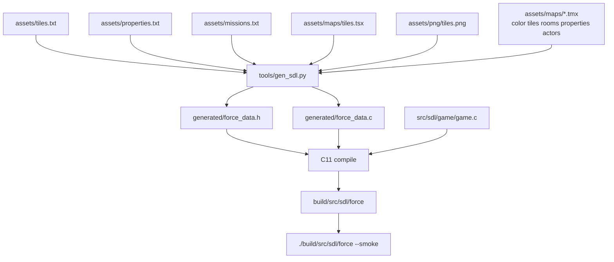
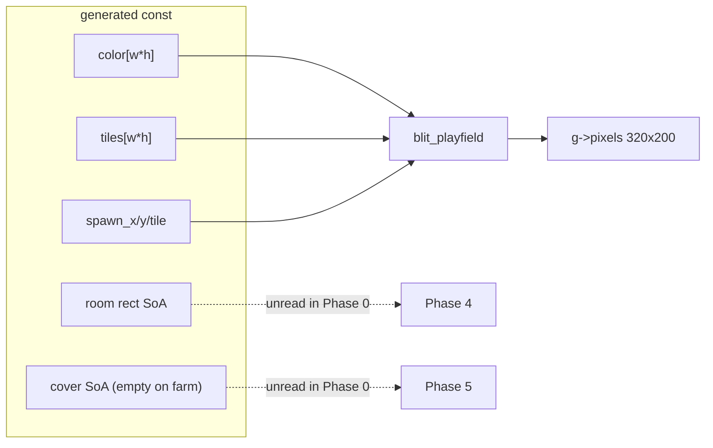

# Phase 0 — Pipeline honesty

| Field | Value |
| --- | --- |
| Author | FORCE design session |
| Date | 2026-09-13 |
| Status | **Draft** (index: **active**) |
| Last worked on | 2026-09-13 |
| Repo path | [`design/phase-0-pipeline.md`](phase-0-pipeline.md) |
| Plan | [`development-plan.md`](development-plan.md) (Phase 0 frozen) |
| Source | `tools/gen_sdl.py`, `src/sdl/game/game.c`, `src/sdl/CMakeLists.txt`, `assets/maps/farm.tmx` |
| Intent | [`../doc/FORCE_06_Tiles_Memory_and_Sprites.md`](../doc/FORCE_06_Tiles_Memory_and_Sprites.md), [`../doc/FORCE_07_Rooms_Cover_and_Farm.md`](../doc/FORCE_07_Rooms_Cover_and_Farm.md), [`../doc/FORCE_03_Maps_Regions_and_Sim.md`](../doc/FORCE_03_Maps_Regions_and_Sim.md) |
| Binary as it is | [`../agents/assets.md`](../agents/assets.md), [`../agents/game.md`](../agents/game.md) |

Paint stays in Tiled. The compiler extracts lists. A text file names the
chips. Terrain (and SDL colour) stay dense. Caps are real. No sim; the farm
still draws.

---

## Overview

`tools/gen_sdl.py` currently dumps five parallel dense `uint8_t` planes
(`color`, `tiles`, `properties`, `actors`, `rooms`) into
`src/sdl/generated/force_data.{h,c}`. Farm is 40×20 (800 bytes/plane). A
standard board is ~80×50 (~4000 bytes/plane). Three of those planes are
sparse paint. [`FORCE_06`](../doc/FORCE_06_Tiles_Memory_and_Sprites.md)
already says: one terrain array, lists for the rest. The SDL dump has not
started telling that truth.

Phase 0 keeps the named TMX layers as the authoring path. In the same
compiler pass it extracts rooms as rectangles, properties as typed SoA
tables (cover / portal / scout / objective / mine), and actors as a spawn
list. Generated C is already-unpacked parallel arrays with hard caps.
`force_map` drops the `properties`, `actors`, and `rooms` pointers.
`src/sdl/game/game.c` stamps occupancy from the spawn list, not
`map->actors[idx]`. Farm still draws. `./build/src/sdl/force --smoke`
still exits 0.

This is not LZSS, not a RAM world copy, not live units, not a C64 emitter.

---

## Background & Motivation

### Current compile

CMake (`src/sdl/CMakeLists.txt`) runs `tools/gen_sdl.py --root <repo>
--out src/sdl/generated` whenever the script, `assets/tiles.txt`,
`assets/missions.txt`, the PNG, the TSX, or `assets/maps/*.tmx` change.
There is no runtime file load.

`load_tmx` in `gen_sdl.py` keys layers by name, converts Tiled GIDs to
0-based tile ids (`gid - firstgid`, `firstgid = 1` on farm), and stores
five dense arrays. Tiled `0` on `color`/`tiles` becomes
`FORCE_TILE_EMPTY` (112). Tiled `0` on `properties`/`actors`/`rooms`
becomes `0`. That last collapse is the bug Phase 0 removes: tileset
tile 0 is `goodguys` (`tiles.txt` `0-7 goodguys`), so GID 0 (eraser)
and GID `firstgid` (first soldier chip) are the same integer in today’s
blob. Flip bits fail the compile. Unknown layer names fail the
compile. Missing meta layers emit a zero plane.

`write_generated` emits, per map:

```c
static const uint8_t force_map_farm_color[800];
static const uint8_t force_map_farm_tiles[800];
static const uint8_t force_map_farm_properties[800];
static const uint8_t force_map_farm_actors[800];
static const uint8_t force_map_farm_rooms[800];
```

`force_map` holds five pointers. `blit_playfield` in
`src/sdl/game/game.c` walks the mission window and stamps
`map->actors[idx]` when it is not 0, then `map->tiles[idx]`. Nothing
reads `properties` or `rooms`.

### Pain

- 2400 bytes of farm meta (12000 on an 80×50 board; five-plane totals
  4000 / 20000) exist so the game can later *not* scan them.
- A stray Tiled GID 113 on a meta layer becomes tile 112 in the blob
  (`force_map_farm_properties[6*40+21] == 112`,
  `force_map_farm_actors[7*40+26] == 112`). `game.c` treats `!= 0` as a
  stamp, so the empty chip is a phantom actor. The same `!= 0` test
  **drops tileset tile 0** (`goodguys`, Tiled GID 1), which today’s
  `load_tmx` stores as integer 0 — indistinguishable from the eraser.
- There is no vocabulary for “this colour chip means cover grade 2 facing
  south.” `tiles.txt` class numbers (`walls=1`) are terrain classes, not
  property tokens.
- Room paint is a colour flood. FORCE_03 wants non-overlapping rectangles.
  The compiler does not check.

### Farm today (verified in `assets/maps/farm.tmx`)

Map is 40×20. Tileset `firstgid="1"`, 128 tiles, 8×8. Stored id =
`gid - 1`.

| Layer | What is actually painted |
| --- | --- |
| `color` | Dense. GID 118 (tile 117) field, GID 120 (tile 119) lane, GID 113 (tile 112) knockout patches under roofs. |
| `tiles` | Walls, roofs, barriers, Tiled `0` / GID 113 both stored as 112. |
| `rooms` | Three colour chips, full coverage of the 40×20. GID 114/115/116 → tiles 113/114/115 → colours 1/2/3. |
| `properties` | Almost all Tiled `0`. **One cell: GID 113 at (21, 6)** → stored tile **112**. |
| `actors` | Eight goodguy stamps (GID 7 → tile 6, GID 3 → tile 2) plus **one GID 113 at (26, 7)** → stored tile **112**. |

`tiles.txt` classes: `empty=0`, `walls=1`, `roofs=2`, `barriers=3`,
`goodguys=4`, `enemies=5`, `colors=6`. Tile **112** is named `empty`
(Tiled GID **113**). That chip is knockout / background. Colour **0** is
that same tile. Room / property paint that means something starts at
colour **1** = tile **113** = Tiled GID **114**.

Farm rooms, cell-accurate:

| Tiled GID | Tile id | Colour | Painted set | Filled rect? |
| --- | --- | --- | --- | --- |
| 114 | 113 | 1 | x=21, y=0, w=19, h=20 | yes — the compound |
| 115 | 114 | 2 | x=0, y=0, w=21, h=7 **and** x=0, y=9, w=21, h=11 | **no** — two blobs, lane in between |
| 116 | 115 | 3 | x=0, y=7, w=21, h=2 | yes — the lane |

Three colours, **not** three rectangles. Colour 2’s bounding box is
21×20 but rows 7–8 are colour 3. Phase 0’s room rule will fail this map
until the rooms layer is repaired (four colour chips, four rects). That
repair is in scope for the landing PR; see Proposed Design and PR Plan.

Farm actors that survive knockout:

| x | y | tile id | class |
| --- | --- | --- | --- |
| 32 | 6 | 6 | goodguys |
| 26 | 8 | 6 | goodguys |
| 24 | 9 | 2 | goodguys |
| 26 | 9 | 6 | goodguys |
| 26 | 10 | 6 | goodguys |
| 26 | 11 | 6 | goodguys |
| 26 | 12 | 6 | goodguys |
| 26 | 13 | 6 | goodguys |

Eight spawns. The GID 113 at (26, 7) is not one of them.

Farm properties after knockout: **zero records**. An empty cover table
is a valid Phase 0 ship. Rooms extractor must still produce the rects.
Actors extractor must still produce the eight stamps.

---

## Goals & Non-Goals

### In (Phase 0)

- Compiler extractors for `properties`, `rooms`, and `actors` in the same
  `gen_sdl.py` pass that already loads TMX.
- Generated API is SoA tables with hard caps (`#define`s in
  `force_data.h`).
- Cut the dense meta planes. No dual representation “for debug”.
- Enough `game.c` change that actors still stamp from the spawn list.
- New `assets/properties.txt` naming colour-chip presets.
- Compiler errors on cap overflow, non-rectangle rooms, unknown chips,
  knockout-as-property (binding tile 112 as a chip).
- CMake `DEPENDS` includes `properties.txt`.
- Farm still draws. `--smoke` still passes.
- `agents/assets.md`, `agents/game.md`, `agents/known-gaps.md`,
  `agents/architecture.md`, and `agents/testing.md` updated in the
  landing PR (this document stays in `design/`). Closed-shape sentence
  in `known-gaps.md` is rewritten, not deleted: TMX still has five
  named layers; compiled `force_map` is two dense planes plus lists.

### Out (later phases)

| Later | Why it is not Phase 0 |
| --- | --- |
| LZSS / compressed terrain (Phase 10) | Terrain stays a dense decompressed `uint8_t` array in generated C. |
| Mission load into a working RAM terrain buffer (Phase 1) | Generated `const` arrays are the world. |
| Live `force_unit` pool / section table (Phase 2) | Spawn list is stamps, not movers. |
| Stepper, portal from/to, next-hop (Phase 4) | Portal cells only. |
| Cover assignment, approach bits (Phase 5) | Tables exist; nothing claims a slot. |
| Combat, mission script, overview, C64 emitter (Phases 6–10) | — |
| A second property tileset | Escape hatch later; 15 chips is the budget. |
| Tiled object layers | Paint stays. |
| Runtime tagged/TLV parse | Python emits unpacked SoA. |

---

## Key Decisions

Locked. Not reopened as Open Questions.

1. **Paint stays in Tiled.** Existing named TMX planes. Colour chips
   113–127 (tile ids; Tiled GID = id + `firstgid`) are the paint. Rooms
   already use that row on the `rooms` layer. Properties get their own
   15 chips on the `properties` layer. **Layers do not share a
   namespace:** tile 113 on `rooms` is colour 1; tile 113 on
   `properties` is whatever `properties.txt` binds.

2. **`properties.txt` is a new file**, same comment style as
   `tiles.txt`. Do not overload tile class numbers. A chip is a **named
   preset**, not a raw type nibble plus a mystery byte. File is
   **required** (CMake depend + `gen_sdl` open). Zero chip-binding lines
   is a valid empty vocabulary. Unknown painted chips still error.
   Grammar is specified under Proposed Design.

3. **Tagged runs (`type, subtype, count, x,y…`) are compiler-internal
   grouping only.** The game never parses that stream. Python emits
   already-unpacked SoA. Runtime is `cover_x[], cover_y[], cover_grade[],
   cover_facing[]` and the same idea for portals, scouts, spawns, rooms.

4. **Typed extractors, not one universal property list.** No 256-entry
   “anything with x,y,type” pool.

   | Plane | Authoring | Phase 0 runtime |
   | --- | --- | --- |
   | `tiles` (+ `color`) | dense paint | dense arrays, unchanged |
   | `rooms` | colour flood | `region[]` rects: x0, y0, w, h + colour |
   | `properties` | chips as presets | cover / portal / scout / objective / mine tables (only kinds `properties.txt` defines) |
   | `actors` | spawn stamps | spawn list: x, y, tile id. **Not** the live unit pool |

5. **Rooms compile to rectangles.** One colour (tile 113–127 → colour
   1–15) → one room. Rule: **the bounding box is solid and equals the
   painted set** (a filled axis-aligned rect). Absence (`None`, Tiled
   GID 0) and knockout (tile 112) are not a room. Doughnuts, L-shapes,
   and two blobs of the same colour fail the compile. Cap
   `FORCE_ROOM_MAX` is **16** (FORCE_03 nibble / Phase 1 RAM). Paint
   can fill at most **15** rooms (one per colour chip); slot 16 is
   reserved and unused. Rectangles must not overlap **cells** (shared
   edges are allowed; shared cells are not). Overlap test is half-open
   on both axes; see `rects_overlap_cells`.

6. **Actors are a spawn list.** After Phase 0, `blit_playfield` iterates
   `spawn_count` and stamps those cells, then re-stamps `tiles` on the
   same cell so roofs still hide men. Do not create `force_unit` records.

7. **Portals in Phase 0 are cells only.** If a preset kind is `portal`,
   extract `x, y`. Do **not** infer from/to room ids. Shared-edge
   inference is Phase 4. Ambiguous edges are why.

8. **Cover is painted, not inferred.** Each painted cell is one slot
   (tank ring = four painted cells). Grade + facing come from the
   preset. Scout slots similarly. Do not walk `force_tile_class` looking
   for walls.

9. **Caps** (compiler-enforced; `#define`s; error if exceeded) — see
   table in Proposed Design. Picked: **16 rooms** (nibble/RAM; paint
   fills at most 15), 24 portals, **12 cover per room** and **128 cover
   global**, 32 spawns, **4 scouts per room** and **32 scouts global**,
   8 objectives, 32 mines.

10. **Cut dense planes.** `force_map` drops `properties`, `actors`,
    `rooms` pointers. Keep `color` and `tiles` dense. Do not keep the
    old planes as debug.

11. **LZSS is out.** Terrain remains a raw `uint8_t` array in generated C.

12. **6502 shape** in generated C and game-side tables: SoA, `uint8_t`
    ids, fixed caps, no malloc, no STL. SDL C is allowed `const`
    generated arrays. Counts are `uint8_t`. Cell coordinates in tables
    are `uint8_t`; the compiler rejects maps with width or height > 255.

13. **Colour plane stays dense on SDL** (authoring pretty). C64
    colour-RAM window is Phase 10.

14. **Knockout on meta planes is only tile 112.** Once extractors own
    `properties` / `actors` / `rooms`, Tiled GID 0 is **absence**
    (`None`), not stored `0`. Tile 0 is a legal spawn (class
    `goodguys`). Painted tile 112 (`FORCE_TILE_EMPTY`, Tiled GID 113
    with `firstgid=1`) is the knockout chip: no property, no spawn, no
    room. Binding tile 112 (or any id outside 113–127) as a chip in
    `properties.txt` is a compile error. Dense `color`/`tiles` still
    collapse Tiled GID 0 to 112 — that path is unchanged.

15. **Cover attachment is base + count into a global SoA**, not
    pointer-to-subarray. Walk rooms in colour order with a running
    base: `cover_base[i] = running; cover_count[i] = n; running += n`.
    Same for scouts. Always emit the per-room base/count arrays at
    length `room_count`. Extractors run **rooms first**, then
    properties, then actors. 6502: `LDX base / LDA cover_x,x`.

16. **Portal / cover / scout / objective / mine cells must sit inside
    some room rect.** Spawn cells must too (Phase 2 needs a region id).
    A cell on no room fails the compile with x, y.

17. **Farm rooms layer is repaired in the landing PR.** Colour 2 is not
    a filled rect today. Split the two field blobs onto two chips so
    the extractor emits four rooms. Details under Proposed Design.

18. **Spawn payload is `x, y, tile id`.** Class is `force_tile_class[tile]`
    (existing 128-byte table). Do not store a fourth array. A spawn
    tile’s class must be `goodguys` or `enemies`; anything else (except
    absence / knockout, which are skipped) fails. Tile **0** is
    `goodguys` and is a legal spawn.

19. **Empty global tables are legal.** For cover / portal / scout /
    objective / mine / spawn: `count == 0` iff that kind’s pointers are
    `NULL`. Per-room arrays (`room_x0` … `room_scout_count`) are always
    emitted at length `room_count` when `room_count > 0`, including
    all-zero `room_cover_base` / `room_cover_count` when global
    `cover_count == 0`. Game code indexes only when `i < count`.

20. **`properties.txt` ships with a 14-chip vocabulary** (tile 127
    unbound spare). Farm does not have to paint those chips in Phase 0.

---

## Proposed Design

### Compile pipeline



CMake change: add `${FORCE_ROOT}/assets/properties.txt` to
`FORCE_GEN_INPUTS` in `src/sdl/CMakeLists.txt`, next to `tiles.txt` and
`missions.txt`. The `CONFIGURE_DEPENDS` glob on `*.tmx` already picks up
farm. Missing `properties.txt` is wrapped as `Error` (`gen_sdl:
assets/properties.txt: not found`) — `main` only catches `Error`, so a
bare `FileNotFoundError` would print a traceback instead of the
promised line.

`LAYER_NAMES` stays `("color", "tiles", "properties", "actors", "rooms")`.
Authoring is unchanged. Only the **emit** changes: `color` and `tiles`
remain dense; the three meta planes are consumed by extractors and not
written.

`load_tmx` return becomes `(stem, width, height, planes, firstgid)`.
`firstgid` is required so extractor errors can print both tile id and
Tiled GID (`tid + firstgid`).

- `color` / `tiles`: dense `list[int]`. Tiled GID 0 → `FORCE_TILE_EMPTY`
  (112). Unchanged.
- `properties` / `actors` / `rooms`: `list[int | None]`. Tiled GID 0 →
  `None` (absence). Any other GID → `gid - firstgid`, **including tile
  0**. Missing meta layer → `[None] * (w * h)`, not a plane of zeros.

### Knockout vs colour chips

This is the authoring bug the compiler must make impossible to miss.

`farm.tmx` `firstgid="1"`. Tile id = GID − 1. After extractors own the
meta planes, GID 0 is no longer stored as integer 0.

| What you think you painted | Tiled GID | Meta cell after load | Meaning |
| --- | --- | --- | --- |
| Tiled eraser / empty | 0 | `None` | absence — no stamp |
| First tileset tile (`goodguys`) | **1** | **0** | legal **spawn** on `actors`; error on `rooms`/`properties` (not a colour chip) |
| Colour 0 / empty chip / knockout | **113** | **112** | knockout — no stamp |
| Colour 1 (first real chip) | **114** | **113** | first usable room colour / first bindable property chip |
| Colour 2 | 115 | 114 | |
| Colour 15 (last chip) | 128 | 127 | |

Farm’s single properties cell is GID **113** → tile **112** → knockout
→ **no property record**. It is not “colour 0 as a preset” and it is
not chip 113. If a mapper wants the first property preset, they paint
the chip whose tile id is 113 (GID 114). Erasing the cell (Tiled GID 0)
is also no-stamp, via absence rather than knockout.

The compiler never treats tile 112 as a chip. `properties.txt` may only
bind 113–127. Tile 0 is not knockout.

### `properties.txt` grammar

Same comment rule as `tiles.txt`: `#` to end of line, then strip.
Blank lines ignored. Identifiers match existing `IDENT_RE`
(`^[A-Za-z_][A-Za-z0-9_]*$`). **No case-folding.** Kinds, keys, facing
values, and preset names are lowercase as shipped; `Cover`, `S`, and
`Grade` are errors.

**Line classifier** (after strip). Tokens are `str.split()` (whitespace).
A value is one token; it contains no spaces.

1. Empty → skip.
2. Else if the line contains no `=` **and** the first token parses as
   `int` (full match, no sign tricks beyond a normal integer) → **chip
   statement**. Must be **exactly two tokens**: `<int> <ident>`. Extra
   tokens (`113 cover_hard_none leftover`) error. `<ident>` must match
   `IDENT_RE`.
3. Else if the line contains `=` and `IDENT_RE` matches the text to the
   **left of the first `=`** (stripped) → **preset statement**. Split
   the right-hand side on whitespace. First token is `<kind>`. Every
   remaining token must match `key=value` (exactly one `=` per token,
   non-empty key matching `IDENT_RE`, non-empty value). A leftover
   non-`key=value` token (`cover_good_s=cover grade=2 s`) errors.
4. Else → error `assets/properties.txt:N: expected chip '<id> <name>'
   or preset '<name>=<kind> …'`.

`113=cover` is not a chip (it contains `=`) and not a preset (`113`
fails `IDENT_RE`) → classifier error. That is the wanted failure.

```text
# comments with #

# Chip bindings: one tile id in 113–127, then a preset name.
113 cover_hard_none
114 cover_good_s
115 portal
116 scout_south

# Preset definitions: name=kind then optional key=value fields.
cover_hard_none=cover grade=3 facing=none
cover_good_s=cover grade=2 facing=s
portal=portal
scout_south=scout facing=s
```

**Statements**

| Form | Meaning |
| --- | --- |
| `<int> <ident>` | Chip binding. `<int>` is a tile id, 113–127 inclusive. |
| `<ident>=<kind> [key=value ...]` | Preset definition. First token after `=` is the kind. Remaining tokens are `key=value`. |

Kinds and required fields:

| Kind | Required fields | Notes |
| --- | --- | --- |
| `cover` | `grade={1,2,3}`, `facing={n,e,s,w,none}` | One slot per painted cell. |
| `portal` | *(none)* | Cell only. Extra keys fail. |
| `scout` | `facing={n,e,s,w}` | `none` is illegal (a scout watches an approach). |
| `objective` | *(none)* | Extra keys fail. |
| `mine` | *(none)* | Extra keys fail. |

Kinds, keys, and values are compared exactly as written. Facing is one
of `n`, `e`, `s`, `w`, `none` (and `none` is illegal on `scout`). Grade
is one of `1`, `2`, `3`. Unknown kind, unknown key, missing required
field, bad value, extra tokens, unrecognized statement, duplicate chip
id, duplicate preset name, chip naming an undefined preset, chip id
outside 113–127, non-integer chip id: all
`gen_sdl: assets/properties.txt:N: …` and exit 1.

**Two passes**

1. Walk every non-empty line. Classify. Accumulate
   `chips: dict[int, str]` (tile id → preset name) and
   `presets: dict[str, Preset]` (name → kind + fields). Form errors,
   duplicate ids, and duplicate preset names fail in this pass. Chip
   names are not resolved yet, so a chip line may appear above its
   preset.
2. For each chip, look up the preset name. Missing name → error
   `chip {id} names undefined preset '{name}'`. Result is
   `chip_to_preset: dict[int, Preset]`.

A preset with no chip pointing at it is allowed (documentation). A chip
must name a defined preset. Unlisted tile ids 113–127 are simply
unbound: painting one on the properties layer is “unknown chip”.

**Shipped vocabulary** (`assets/properties.txt` in the parser PR).
Fourteen chips, tile 127 spare:

```text
# FORCE property chips. Colour row 113–127 on the properties layer.
# Tile 112 / Tiled GID 113 is knockout, never a chip.

113 cover_hard_none
114 cover_good_s
115 cover_good_n
116 cover_good_e
117 cover_good_w
118 cover_good_none
119 cover_scrap_none
120 portal
121 scout_south
122 scout_north
123 scout_east
124 scout_west
125 objective
126 mine

cover_hard_none=cover grade=3 facing=none
cover_good_s=cover grade=2 facing=s
cover_good_n=cover grade=2 facing=n
cover_good_e=cover grade=2 facing=e
cover_good_w=cover grade=2 facing=w
cover_good_none=cover grade=2 facing=none
cover_scrap_none=cover grade=1 facing=none
portal=portal
scout_south=scout facing=s
scout_north=scout facing=n
scout_east=scout facing=e
scout_west=scout facing=w
objective=objective
mine=mine
```

Fifteen chips is the whole row. A second tileset is out. If a later
board needs a new facing/grade combo, reuse a chip or drop an unused
one; do not invent a parallel properties sheet in Phase 0.

### Caps

Emitted in `force_data.h`. Python has the same integers and errors
before emit.

```c
#define FORCE_ROOM_MAX           16
#define FORCE_PORTAL_MAX         24
#define FORCE_COVER_MAX          128
#define FORCE_COVER_PER_ROOM     12
#define FORCE_SPAWN_MAX          32
#define FORCE_SCOUT_MAX          32
#define FORCE_SCOUT_PER_ROOM     4
#define FORCE_OBJECTIVE_MAX      8
#define FORCE_MINE_MAX           32
```

| Cap | Value | Rationale |
| --- | --- | --- |
| rooms | 16 | FORCE_03 nibble / RAM size. Paint can fill at most 15 (colours 1–15); the 16th slot is reserved, unused. The cap never fires from colour-chip paint alone. |
| portals | 24 | FORCE_06 sketch. |
| cover per room | 12 | FORCE_07 “8–12 slots per room”. |
| cover global | 128 | Tighter than 16×12=192; fits `uint8_t` counts and bases. |
| spawns | 32 | FORCE_06 unit cap. Phase 0 list size = Phase 2 pool size. |
| scouts per room | 4 | One per compass, FORCE_07. |
| scouts global | 32 | 16×4 would be 64; 32 is enough for v1 boards. |
| objectives | 8 | Only if a preset exists; still capped. |
| mines | 32 | Same. |

Exceeding a per-room cap or a global cap is a compile error naming the
map, the kind, and the cell that overflowed.

Facing bytes (generated):

```c
#define FORCE_FACE_NONE  0
#define FORCE_FACE_N     1
#define FORCE_FACE_E     2
#define FORCE_FACE_S     3
#define FORCE_FACE_W     4
```

### Extract algorithms

Run **rooms first**, then properties, then actors. Properties and actors
both call `room_index_containing`. All scans are row-major (`y` from 0,
`x` from 0) so emit order is deterministic.

Meta cells are `int | None`. Helpers:

```
absent(cell)      := cell is None          # Tiled GID 0
knockout(cell)    := cell == empty_tile    # tile 112 only
skip_meta(cell)   := absent(cell) or knockout(cell)
```

`empty_tile` is 112 from `tiles.txt`. Tile **0 is not skip**. Every new
extractor error that names a painted tile includes both ids:
`tile {tid} (Tiled GID {tid+firstgid})`.

On `properties` and `rooms`, a non-skip cell that is not in 113–127
fails (not a colour chip). On `actors`, a non-skip cell whose class is
not `goodguys` or `enemies` fails.

#### Rooms

```
extract_rooms(plane, w, h, firstgid):
    buckets: colour 1..15 -> list of (x,y)
    for y in 0..h-1:
        for x in 0..w-1:
            cell = plane[y*w+x]
            if skip_meta(cell): continue
            tid = cell
            if tid < 113 or tid > 127:
                error "{map} rooms ({x},{y}): tile {tid} "
                      "(Tiled GID {tid+firstgid}) is not a colour chip"
            buckets[tid-112].append((x,y))
    rooms = []
    for colour in 1..15:
        cells = buckets[colour]
        if not cells: continue
        xs = [p[0] for p in cells]; ys = [p[1] for p in cells]
        x0, y0, x1, y1 = min(xs), min(ys), max(xs), max(ys)
        rw, rh = x1-x0+1, y1-y0+1
        if rw*rh != len(cells):
            error "{map} rooms colour {colour}: not a filled rect "
                  "(bbox {x0},{y0},{rw},{rh} has {len} painted cells)"
        rooms.append(Room(x0,y0,rw,rh,colour))
    if len(rooms) > FORCE_ROOM_MAX:
        error "{map}: {n} rooms > {FORCE_ROOM_MAX}"
    for each pair i < j:
        if rects_overlap_cells(rooms[i], rooms[j]):
            error "{map}: rooms colour {a} and {b} overlap"
    return rooms   # stable order: ascending colour
```

Half-open cell test. Shared edges are not overlap; shared cells are.

```
rects_overlap_cells(a, b):
    return (a.x0 < b.x0 + b.w and b.x0 < a.x0 + a.w and
            a.y0 < b.y0 + b.h and b.y0 < a.y0 + a.h)
```

Farm repair (landing PR, `assets/maps/farm.tmx` `rooms` layer):

| Colour | Tile / GID | Rect | Role (comment only; names are not generated) |
| --- | --- | --- | --- |
| 1 | 113 / 114 | 21, 0, 19, 20 | FARM compound (unchanged) |
| 2 | 114 / 115 | 0, 0, 21, 7 | FIELD north of the lane |
| 3 | 115 / 116 | 0, 7, 21, 2 | LANE (unchanged) |
| 4 | 116 / 117 | 0, 9, 21, 11 | FIELD south of the lane (was the second colour-2 blob) |

Shared-edge check on that repair, using the half-open test:

- FIELD_N `(0,0,21,7)` vs LANE `(0,7,21,2)`: `7 < 0+7` is false. Edge
  `y=7` belongs to LANE only.
- LANE vs FIELD_S `(0,9,21,11)`: `9 < 7+2` is false. Edge `y=9` belongs
  to FIELD_S only.
- FARM `(21,0,19,20)` vs FIELD_N: `21 < 0+21` is false. Edge `x=21`
  belongs to FARM only. Same against LANE and FIELD_S.

Four filled rects, no overlapping cells, full 40×20 coverage. Colour 4
is tile 116 — unused on farm rooms today. Playfield pixels do not
change (rooms layer is not drawn).

#### Properties

```
extract_properties(plane, w, h, chip_to_preset, rooms, firstgid):
    cover, portal, scout, objective, mine = [], [], [], [], []
    for y in 0..h-1:
        for x in 0..w-1:
            cell = plane[y*w+x]
            if skip_meta(cell): continue
            tid = cell
            if tid not in chip_to_preset:
                error "{map} properties ({x},{y}): unknown chip "
                      "tile {tid} (Tiled GID {tid+firstgid})"
            preset = chip_to_preset[tid]
            ri = room_index_containing(rooms, x, y)  # or error
            record = {x, y, room=ri, ...preset fields}
            append to the kind's list
    # optional compiler-internal: group identical presets into runs
    # while scanning, then expand. Runtime never sees the run stream.
    group each kind by room index (stable: room order, then row-major
    within a room — already the scan order if we bucket while walking)
    running_cover = 0
    running_scout = 0
    for i in 0..room_count-1:
        n_cover = count of cover records with room == i
        n_scout = count of scout records with room == i
        if n_cover > FORCE_COVER_PER_ROOM: error
        if n_scout > FORCE_SCOUT_PER_ROOM: error
        room_cover_base[i]  = running_cover
        room_cover_count[i] = n_cover
        running_cover += n_cover
        room_scout_base[i]  = running_scout
        room_scout_count[i] = n_scout
        running_scout += n_scout
    concatenate cover records in room order into the global SoA
    (same for scouts)
    if running_cover > FORCE_COVER_MAX: error
    same for portal, scout, objective, mine global caps
    return tables
```

Always fill `room_cover_base` / `room_cover_count` / `room_scout_base`
/ `room_scout_count` to length `room_count`, even when
`running_cover == 0` (all bases 0, all counts 0). Do not omit empty
rooms from those arrays. Do not set `base = i * FORCE_COVER_PER_ROOM`.

Example: three rooms, cover only in room index 1 (five slots). Then
`room_cover_base = {0, 0, 5}`, `room_cover_count = {0, 5, 0}`,
`cover_count = 5`. Room 2’s base is 5 so a later stamp in that room
appends after room 1’s slots.

`room_index_containing` is a linear scan of ≤16 rects using the same
half-open test (`x0 <= x < x0+w && y0 <= y < y0+h`). Cover is not
inferred from walls. A tank ring is four chips.

Farm today: the only non-absent properties cell is knockout (tile 112)
→ empty global cover table (`cover_count = 0`, `cover_* = NULL`),
every room `cover_base=0`, `cover_count=0`. Valid. The four per-room
arrays are still emitted because `room_count = 4`.

#### Actors

```
extract_spawns(plane, w, h, class_table, rooms, firstgid):
    spawns = []
    for y in 0..h-1:
        for x in 0..w-1:
            cell = plane[y*w+x]
            if skip_meta(cell): continue
            tid = cell          # 0 is a legal goodguys tile
            cls = class_table[tid] if tid < count else empty
            if cls not in (goodguys, enemies):
                error "{map} actors ({x},{y}): tile {tid} "
                      "(Tiled GID {tid+firstgid}) class {cls} "
                      "is not a spawn"
            if room_index_containing(rooms, x, y) is None:
                error "{map} actors ({x},{y}): spawn outside any room"
            spawns.append(Spawn(x, y, tid))
    if len(spawns) > FORCE_SPAWN_MAX:
        error "{map}: {n} spawns > {FORCE_SPAWN_MAX}"
    return spawns
```

Farm: eight rows. GID 113 at (26, 7) is tile 112 → skipped as knockout.
A mapper who stamps Tiled GID 1 (tile 0, `goodguys`) gets a ninth spawn,
not a silent skip.

### Generated API

`force_tile_class`, `force_tileset`, `FORCE_TILESET_COUNT`,
`FORCE_TILE_PX`, `FORCE_TILE_EMPTY`, `enum force_tile_class`,
`force_mission`, `force_missions[]`, `force_mission_count` are
**unchanged**. Missions stay windows into a map (`x,y,w,h`).

#### Before

```c
typedef struct force_map {
    const char *name;
    uint16_t width;
    uint16_t height;
    const uint8_t *color;
    const uint8_t *tiles;
    const uint8_t *properties;
    const uint8_t *actors;
    const uint8_t *rooms;
} force_map;
```

Five plane pointers. Farm: five × 800 bytes.

#### After

```c
#define FORCE_ROOM_MAX        16
#define FORCE_PORTAL_MAX      24
#define FORCE_COVER_MAX       128
#define FORCE_COVER_PER_ROOM  12
#define FORCE_SPAWN_MAX       32
#define FORCE_SCOUT_MAX       32
#define FORCE_SCOUT_PER_ROOM  4
#define FORCE_OBJECTIVE_MAX   8
#define FORCE_MINE_MAX        32

#define FORCE_FACE_NONE  0
#define FORCE_FACE_N     1
#define FORCE_FACE_E     2
#define FORCE_FACE_S     3
#define FORCE_FACE_W     4

typedef struct force_map {
    const char *name;
    uint16_t width;
    uint16_t height;
    const uint8_t *color;          /* width * height, dense */
    const uint8_t *tiles;          /* width * height, dense */

    uint8_t room_count;
    const uint8_t *room_x0;        /* [room_count] */
    const uint8_t *room_y0;
    const uint8_t *room_w;
    const uint8_t *room_h;
    const uint8_t *room_colour;    /* 1..15 */
    const uint8_t *room_cover_base;
    const uint8_t *room_cover_count;
    const uint8_t *room_scout_base;
    const uint8_t *room_scout_count;

    uint8_t cover_count;
    const uint8_t *cover_x;
    const uint8_t *cover_y;
    const uint8_t *cover_grade;    /* 1..3 */
    const uint8_t *cover_facing;   /* FORCE_FACE_* */

    uint8_t portal_count;
    const uint8_t *portal_x;
    const uint8_t *portal_y;

    uint8_t scout_count;
    const uint8_t *scout_x;
    const uint8_t *scout_y;
    const uint8_t *scout_facing;   /* FORCE_FACE_N..W, never NONE */

    uint8_t spawn_count;
    const uint8_t *spawn_x;
    const uint8_t *spawn_y;
    const uint8_t *spawn_tile;

    uint8_t objective_count;
    const uint8_t *objective_x;
    const uint8_t *objective_y;

    uint8_t mine_count;
    const uint8_t *mine_x;
    const uint8_t *mine_y;
} force_map;
```

SDL host: pointers into `static const` arrays in `force_data.c`. Counts
are `uint8_t`. Exact-sized arrays, not pre-sized to the cap. Phase 1
will copy into fixed RAM buffers sized to the `#define`s.

Pointer / length rules:

| Arrays | When `count == 0` | When `count > 0` |
| --- | --- | --- |
| Global cover / portal / scout / spawn / objective / mine SoA | pointers `NULL` | length = that kind’s count |
| Per-room `room_x0` … `room_scout_count` (nine arrays) | `NULL` only if `room_count == 0` | always length = `room_count`, including all-zero cover/scout base+count |

Callers must not index when `i >= count`. Per-room base/count arrays
are not omitted just because global `cover_count == 0`.

Room *i*’s cover slots are `cover_x[room_cover_base[i] + k]` for
`k = 0 .. room_cover_count[i]-1`. Same for scouts. Portals / objectives
/ mines / spawns are global lists (no per-room base in Phase 0). Phase 4
may add `portal_from` / `portal_to` as extra SoA columns; it must not
rebuild a plane.

`force_map_farm` after the rooms repair (sketch):

```c
static const uint8_t force_map_farm_color[800] = { /* unchanged */ };
static const uint8_t force_map_farm_tiles[800] = { /* unchanged */ };

static const uint8_t force_map_farm_room_x0[4]     = { 21, 0, 0, 0 };
static const uint8_t force_map_farm_room_y0[4]     = {  0, 0, 7, 9 };
static const uint8_t force_map_farm_room_w[4]      = { 19,21,21,21 };
static const uint8_t force_map_farm_room_h[4]      = { 20, 7, 2,11 };
static const uint8_t force_map_farm_room_colour[4] = {  1, 2, 3, 4 };
static const uint8_t force_map_farm_room_cover_base[4]  = { 0, 0, 0, 0 };
static const uint8_t force_map_farm_room_cover_count[4] = { 0, 0, 0, 0 };
static const uint8_t force_map_farm_room_scout_base[4]  = { 0, 0, 0, 0 };
static const uint8_t force_map_farm_room_scout_count[4] = { 0, 0, 0, 0 };

static const uint8_t force_map_farm_spawn_x[8]    = { 32, 26, 24, 26, 26, 26, 26, 26 };
static const uint8_t force_map_farm_spawn_y[8]    = {  6,  8,  9,  9, 10, 11, 12, 13 };
static const uint8_t force_map_farm_spawn_tile[8] = {  6,  6,  2,  6,  6,  6,  6,  6 };

const force_map force_map_farm = {
    .name = "farm",
    .width = 40,
    .height = 20,
    .color = force_map_farm_color,
    .tiles = force_map_farm_tiles,
    .room_count = 4,
    .room_x0 = force_map_farm_room_x0,
    .room_y0 = force_map_farm_room_y0,
    .room_w = force_map_farm_room_w,
    .room_h = force_map_farm_room_h,
    .room_colour = force_map_farm_room_colour,
    .room_cover_base = force_map_farm_room_cover_base,
    .room_cover_count = force_map_farm_room_cover_count,
    .room_scout_base = force_map_farm_room_scout_base,
    .room_scout_count = force_map_farm_room_scout_count,
    .cover_count = 0,
    .cover_x = NULL,
    .cover_y = NULL,
    .cover_grade = NULL,
    .cover_facing = NULL,
    .portal_count = 0,
    .portal_x = NULL,
    .portal_y = NULL,
    .scout_count = 0,
    .scout_x = NULL,
    .scout_y = NULL,
    .scout_facing = NULL,
    .spawn_count = 8,
    .spawn_x = force_map_farm_spawn_x,
    .spawn_y = force_map_farm_spawn_y,
    .spawn_tile = force_map_farm_spawn_tile,
    .objective_count = 0,
    .objective_x = NULL,
    .objective_y = NULL,
    .mine_count = 0,
    .mine_x = NULL,
    .mine_y = NULL,
};
```

Emit **C99 designated initializers** for every `force_map` (`.spawn_count
= 8`, `.cover_x = NULL`, …). The struct has ~40 fields; positional
`NULL` runs swap silently the first time someone inserts `portal_from`.
C11 (the project dialect) includes designated initializers.

No `force_map_farm_properties`, `_actors`, or `_rooms` arrays.

#### Data flow at runtime (SDL, Phase 0)



### `game.c` actor stamp

Today (`blit_playfield`):

```c
fill_cell(...);
if (map->actors[idx] != 0u) {
    stamp_tile(g->pixels, x, y, map->actors[idx]);
}
stamp_tile(g->pixels, x, y, map->tiles[idx]);
```

After: paint colour + tiles for the window, then walk the spawn list.
Re-stamp tiles on the spawn cell so roofs still cover men (same draw
order as now: colour, actor, tiles).

```c
/* colour + tiles, mission window */
for (y = 0; y < h; ++y) {
    for (x = 0; x < w; ++x) {
        /* fill from map->color[idx], stamp map->tiles[idx] */
    }
}

/* occupancy from the spawn list, still under tiles */
for (i = 0; i < (int)map->spawn_count; ++i) {
    int sx = (int)map->spawn_x[i];
    int sy = (int)map->spawn_y[i];
    if (sx < origin_x || sy < origin_y ||
        sx >= origin_x + w || sy >= origin_y + h) {
        continue;
    }
    stamp_tile(g->pixels, sx - origin_x, sy - origin_y, map->spawn_tile[i]);
    stamp_tile(g->pixels, sx - origin_x, sy - origin_y,
               map->tiles[sy * (int)map->width + sx]);
}
```

O(window) for terrain, O(spawns) for men. Do not scan 32 spawns per
cell. Do not rebuild a dense actors plane as a draw cache.

`game.h` is unchanged (`force_game` does not grow a unit pool).

### Python emit sketch

`write_generated` today loops `LAYER_NAMES` and dumps every plane.
Replace that inner loop with:

1. Emit `color` and `tiles` exactly as now (`emit_u8_plane`).
2. Call extractors **in order**: rooms, properties, actors. Fail before
   writing files if any extractor errors (keep the current `Error` →
   stderr `gen_sdl: …` → return 1 path).
3. Emit per-room arrays iff `room_count > 0` (length `room_count`).
   Emit each global SoA iff that kind’s count > 0; otherwise pointers
   are `NULL`.
4. Fill `force_map` with **C99 designated initializers**.

Optional internal grouping: while scanning properties, collapse a run
of identical presets into `(kind, payload, count, x0,y0, x1,y1, …)`
then expand to SoA. Useful if a later emitter wants a packed stream;
Phase 0 C does not include it.

Success stdout, maps in load order (sorted `*.tmx` as today):

```text
gen_sdl: {tiles} tiles, {n} map(s), {m} mission(s), {per_map} -> {out}
```

where `per_map` is

```python
", ".join(
    f"{name} {rooms} rooms {spawns} spawns {cover} cover"
    for name, rooms, spawns, cover in maps
)
```

One map: `gen_sdl: 128 tiles, 1 map(s), 1 mission(s), farm 4 rooms 8 spawns 0 cover -> src/sdl/generated`.
Two maps: `…, farm 4 rooms 8 spawns 0 cover, town 12 rooms 20 spawns 16 cover -> …`.

### Byte budget (after cut)

| Piece | Farm 40×20 | Standard ~80×50 |
| --- | --- | --- |
| `color` + `tiles` | 1600 | 8000 |
| rooms SoA (4 / 16 × ~9 bytes) | ~36 | ~144 |
| spawns (8 / 32 × 3) | 24 | 96 |
| cover / portal / scout / obj / mine | 0 until painted | ≤ 128×4 + 24×2 + 32×3 + 8×2 + 32×2 ≈ 800 |
| **was** five dense planes | 4000 | 20000 |
| **meta saved** | 2400 | 12000 |

Matches FORCE_06’s “about 5–6K for the world, not 12K of parallel maps”
once Phase 1 adds the unit pool on top of this.

---

## API / Interface Changes

| Surface | Change |
| --- | --- |
| `generated/force_data.h` `force_map` | Drop three plane pointers; add SoA fields and cap `#define`s. Build product; do not hand-edit. |
| `generated/force_data.c` | Stop emitting `*_properties`, `*_actors`, `*_rooms` arrays. |
| `src/sdl/game/game.c` `blit_playfield` | Spawn-list stamp. Compile fails if it still names `map->actors`. |
| `src/sdl/CMakeLists.txt` | Depend on `assets/properties.txt`. |
| `assets/properties.txt` | New input. Required. |
| `assets/maps/farm.tmx` | Rooms layer split to four filled rects. Properties GID 113 may stay (knockout, tile 112) or be erased to Tiled 0 (absence); both are no-stamp. |
| `assets/tiles.txt`, `assets/missions.txt` | Unchanged. |
| `force_mission` | Unchanged. |
| `core/` | Unchanged. No SDL, no map pointers. |
| `agents/assets.md` | Compiler inputs, TMX load (`None` vs 112), generated `force_map`. |
| `agents/game.md` | Spawn-list stamp, not `map->actors`. |
| `agents/known-gaps.md` | Rooms/properties no longer unread planes. Closed-shape rewrite: TMX still has five named layers; compiled `force_map` is two dense planes plus lists. |
| `agents/architecture.md` | `assets/` tree gains `properties.txt`. |
| `agents/testing.md` | Touch `properties.txt` must rerun `gen_sdl`. |

Any other C that included `force_data.h` and named the old fields will
fail the compile. Today that is only `game.c`.

---

## Data Model Changes

No runtime heap, no migration, no versioning. Regenerating
`force_data.c` is the migration. `src/sdl/generated/` remains a
gitignored build product.

Authoring data model is still five named TMX layers. The **compiled**
data model is two dense planes plus typed lists. Mappers keep painting.
The compiler starts telling FORCE_06’s truth.

Phase 1 will copy `tiles` (and later decompressed terrain) into one RAM
buffer and point at these tables. Phase 2 will allocate 32 unit records
from the spawn list. Phase 0 must not pre-shape those RAM copies; it
only has to be a list the copy can consume.

---

## Alternatives Considered

### Keep dense meta planes on SDL “because RAM is cheap on host”

Rejected. `development-plan.md` 6502 filter: write the SDL C and the
data it consumes as if the CPU were a 6502. Dual representation “for
debug” is explicitly out of the program of work. A host-only plane
becomes the thing `game.c` walks. Cut it.

### Runtime TLV / tagged-run parse

Rejected. Tagged runs are allowed **inside the compiler** as a grouping
pass. The game loads `LDA cover_x,x`. A 6502 does not walk a stream
every frame to find slot 7.

### One generic property pool (`x, y, type` × 256)

Rejected. Cover has grade+facing, portals are cells, scouts have an
approach, spawns have a tile id. A universal record becomes a tagged
union the 6502 then switches on. Typed extractors emit typed columns.

### Tiled object layers instead of paint

Rejected. Paint stays. Discoverability is for the editor; the mapper
already floods rooms with colour chips. Objects would be a second
authoring path and a second parser. Escape hatch later, not Phase 0.

### Overload `tiles.txt` class ids (`walls=1` as a property token)

Rejected. Terrain class is “what the scenery is.” A property preset is
“what this cell means to the sim.” Same colour row, different files,
different layers.

### Infer cover from terrain class (walls → cover slots)

Rejected. FORCE_07: hiding spots are authored numbered holes. A yard
wall is many cells and only a few slots. A tank ring is four painted
cells, not “paint the wreck.” Inferring from class produces the drunk
search the design exists to avoid.

---

## Security & Privacy Considerations

Not a networked service. No accounts, no auth, no PII, no telemetry.

The actual threat is **bad or hostile authoring input** at compile time
(a huge TMX, flipped GIDs, a chip that is not a preset, a colour flood
that is not a rect). Mitigations already in `gen_sdl.py`, extended:

- Flip bits (`0xE0000000`) still fail.
- GIDs outside the tileset still fail.
- Unknown layer names still fail.
- **New:** cap overflow, non-rect rooms, overlapping rooms, unknown
  property chips, knockout bound as a chip, spawn class not
  goodguys/enemies, meta cell outside any room, map width/height > 255.
- Generated storage is `const`. No `malloc`. Counts fit in `uint8_t`.

Do not collapse Tiled eraser (GID 0) and tileset tile 0 to the same
integer. Eraser is absence; tile 0 is a unit graphic; tile 112 is
knockout. Colour-0 chip (GID 113) is still not a property.

---

## Observability

No metrics stack, no log daemon, no tracing.

| Signal | Where |
| --- | --- |
| Compile failure | `gen_sdl: …` on stderr; CMake fails the `force` target. Message includes file, map, layer, cell, tile id, and Tiled GID. |
| Compile success | One stdout line: tile / map / mission counts, then `", ".join(f"{name} {rooms} rooms {spawns} spawns {cover} cover" …)` in TMX load order. |
| Runtime bring-up | `./build/src/sdl/force --smoke` — one frame, exit 0. Still needs a display. |
| Visual | Farm: green field, yellow lane, grey walls and roofs, blue soldiers at the gate (same as `agents/testing.md`). Rooms and properties are not drawn. |
| Actor regression | Eight goodguy stamps visible; the old phantom tile-112 cell at (26, 7) must not become a ninth. |

There is no ctest. Do not add a `tests/` tree in Phase 0.

---

## Rollout Plan

No feature flags. No staged dual-read. The generated API change and
`game.c` land together so `map->actors` cannot linger.

1. Parser PR lands first: ship `assets/properties.txt`, add it to
   `FORCE_GEN_INPUTS`, parse and validate **the text file only**. Wrap
   a missing file as `Error`. Farm still emits five planes. Do **not**
   walk TMX meta planes in this PR.
2. Landing PR: extractors (rooms first), cut planes, `game.c` spawn
   stamp, farm rooms repair, `agents/` handoff including
   `architecture.md` and `testing.md`. One CMake build. `--smoke`.
   Farm rooms repair can optionally land first as a pure TMX change
   (five planes still compile) if someone wants to de-risk; it is not
   required to be a third PR.
3. Rollback is `git revert` of that PR. There is no runtime switch.

Verification, from repo root (same as `agents/testing.md`):

```bash
cmake -B build -S . -DCMAKE_BUILD_TYPE=Debug
cmake --build build -j
./build/src/sdl/force --smoke
```

A properties grammar error, a non-rect room, or a missed `game.c`
update fails **the build**, not smoke. That is the gate.

---

## Risks

| Risk | Sev | Mitigation |
| --- | --- | --- |
| Farm properties stray GID 113 (tile 112) becomes a phantom cover/spawn | **High** | Knockout is tile 112 only. Tiled GID 0 is absence (`None`). Binding 112 as a chip errors. Farm properties table stays empty. |
| Tiled GID 0 collapsed with tileset tile 0 (`goodguys`) | **High** | Meta load stores GID 0 as `None`. Tile 0 is a legal spawn. |
| Farm rooms colour 2 is not a filled rect — landing PR fails `--smoke` if the TMX is not edited | **High** | Repair rooms in the same PR as the extractor. Four chips, four rects, documented above. Playfield pixels unchanged. |
| 15-chip preset exhaustion | **Med** | Ship a 14-chip vocabulary, one spare. Second tileset is out. Rebind unused chips when a board needs a new combo. |
| Spawn list vs later unit pool duplication | **Med** | Phase 0 list is the **authoring** snapshot. Phase 2 copies it into 32 unit records and draws from the pool. Do not keep stamping spawns after units exist. Call this out in `agents/known-gaps.md`. |
| CMake glob misses `properties.txt` | **High** | Add it explicitly to `FORCE_GEN_INPUTS`, like `tiles.txt`. Do not rely on a glob. Touch the file, `cmake --build`, confirm `gen_sdl` reruns. |
| Mapper paints colour 0 (GID 113) thinking it is chip 113 | **Med** | Error message on unknown chips names tile id **and** Tiled GID (`tid + firstgid`). `agents/assets.md` table after landing. |
| `game.c` re-stamp of tiles on spawn cells misses a roof | **Low** | Same order as today (actor then tiles). Visual check: soldiers at the gate, roofs hide anything under them. |
| Pointer-rich `force_map` on SDL vs 6502 | **Low** | SDL convenience. Columns are SoA `uint8_t`. Phase 10 emitter packs; Phase 0 does not invent that emitter. |
| Cover global 128 vs 16×12=192 | **Low** | Per-room 12 still holds. A board that paints 13 in one room fails on the per-room cap first. 128 fits `uint8_t` bases. |

---

## Open Questions

None. Defaults that could have been questions are Key Decisions 7
(portal cells only), 9 (cap numbers, 16 rooms as nibble with 15
paintable), 14 (Tiled GID 0 is `None`; knockout is tile 112 only),
15 (running base+count, rooms first), 17 (farm four rects), 18
(spawn is x,y,tile; tile 0 is legal), 19 (global NULL vs per-room
arrays of length `room_count`), 20 (shipped vocabulary).

---

## References

- [`development-plan.md`](development-plan.md) — Phase 0 bounds, 6502 filter
- [`../doc/FORCE_06_Tiles_Memory_and_Sprites.md`](../doc/FORCE_06_Tiles_Memory_and_Sprites.md) — one map, lists for the rest
- [`../doc/FORCE_07_Rooms_Cover_and_Farm.md`](../doc/FORCE_07_Rooms_Cover_and_Farm.md) — cover grades, tank ring, scout slots
- [`../doc/FORCE_03_Maps_Regions_and_Sim.md`](../doc/FORCE_03_Maps_Regions_and_Sim.md) — rooms as non-overlapping rects, portals
- [`../doc/FORCE_08_Units_Sections_and_Tick.md`](../doc/FORCE_08_Units_Sections_and_Tick.md) — actors plane → unit records at load (Phase 2, not now)
- [`../agents/assets.md`](../agents/assets.md) — compiler as it is
- [`../agents/game.md`](../agents/game.md) — `blit_playfield` as it is
- [`../agents/known-gaps.md`](../agents/known-gaps.md) — rooms/properties in the blob, unread; closed-shape TMX sentence
- [`../agents/architecture.md`](../agents/architecture.md) — `assets/` tree
- [`../agents/testing.md`](../agents/testing.md) — regen inputs
- `tools/gen_sdl.py` — `LAYER_NAMES`, `load_tmx`, `write_generated`
- `src/sdl/CMakeLists.txt` — `FORCE_GEN_INPUTS`
- `src/sdl/game/game.c` — `blit_playfield`
- `assets/maps/farm.tmx` — 40×20, five named layers
- `assets/tiles.txt` — classes and tile 112 empty

---

## PR Plan

Independently reviewable. No PR ships both dense meta planes and the
new SoA “for debug.” Parser-only comes first because it does not touch
`force_map`.

### PR 1 — `properties.txt` parser and CMake depend

| | |
| --- | --- |
| **Title** | Add properties.txt vocabulary and parse it in gen_sdl |
| **Depends on** | nothing |
| **Files** | `assets/properties.txt` (new, shipped 14-chip vocabulary), `tools/gen_sdl.py` (`load_properties_txt`, two-pass grammar, wrap missing file as `Error`), `src/sdl/CMakeLists.txt` (`FORCE_GEN_INPUTS` += `properties.txt`) |
| **Does not change** | `force_map`, `game.c`, farm TMX, `agents/`, TMX load path |
| **Description** | File is required. Parse and validate **the text file only** (classifier, exactly two tokens on chip lines, `key=value` remainder, case-sensitive lowercase, two-pass resolve). Do not walk TMX meta planes. Zero chip lines would be legal; we ship the vocabulary anyway. Duplicate ids, bad kinds, chip 112, id outside 113–127 fail the compile. Map emit is still five dense planes, so farm `--smoke` stays green. |
| **Gate** | `cmake --build build -j` reruns `gen_sdl` when `properties.txt` is touched; a missing file prints `gen_sdl: assets/properties.txt: not found` (not a traceback); `./build/src/sdl/force --smoke` |

### PR 2 — Extractors, cut dense meta planes, spawn-list draw, farm rooms, agents

| | |
| --- | --- |
| **Title** | Compile rooms, properties, and actors to SoA tables |
| **Depends on** | PR 1 |
| **Files** | `tools/gen_sdl.py` (`load_tmx` returns `firstgid` and `None` for Tiled GID 0 on meta; extract_rooms / extract_properties / extract_spawns; running `cover_base`; designated initializers; cut plane emit; cap `#define`s; multi-map success line), `src/sdl/game/game.c` (`blit_playfield` spawn loop), `assets/maps/farm.tmx` (rooms layer: four filled rects as in Key Decision 17), `agents/assets.md`, `agents/game.md`, `agents/known-gaps.md` (closed-shape rewrite), `agents/architecture.md` (`assets/` gains `properties.txt`), `agents/testing.md` (touch `properties.txt` retriggers `gen_sdl`), `design/README.md` (Phase 0 index **active** → **landed** once this merges — only if the implementation actually landed; not part of the design-only change) |
| **Does not** | keep `map->properties` / `actors` / `rooms` for debug; create `force_unit`; infer portal from/to; paint cover on farm; treat stored `0` as empty |
| **Description** | One pass extracts lists (rooms, then properties, then actors). Generated `force_map` matches the After struct with designated initializers. Farm emits 4 rooms, 8 spawns, 0 cover. Knockout GID 113 (tile 112) on properties and actors is not a record; Tiled GID 0 is absence, not tile 0. `game.c` stamps from the spawn list and re-stamps tiles. Handoff: TMX still has five named layers; compiled `force_map` is two dense planes plus lists; spawn list is not the unit pool (Phase 2). |
| **Gate** | Build fails on the old `map->actors` if `game.c` is missed. `./build/src/sdl/force --smoke` paints the farm with eight soldiers, roofs covering, no ninth phantom. Interactive: same as `agents/testing.md` visual row. |

Do not split PR 2 into “new structs + keep old planes” then “delete
planes.” The user-visible API has no dual. If PR 2 is too large in
review, the rooms TMX repair can move to a PR 2a that still does not
change `force_map` (paint-only; five planes still compile). Extractors
and the cut stay together.

`agents/` updates belong in PR 2, not in a follow-up, so the handoff
matches `src/` on the same merge.
