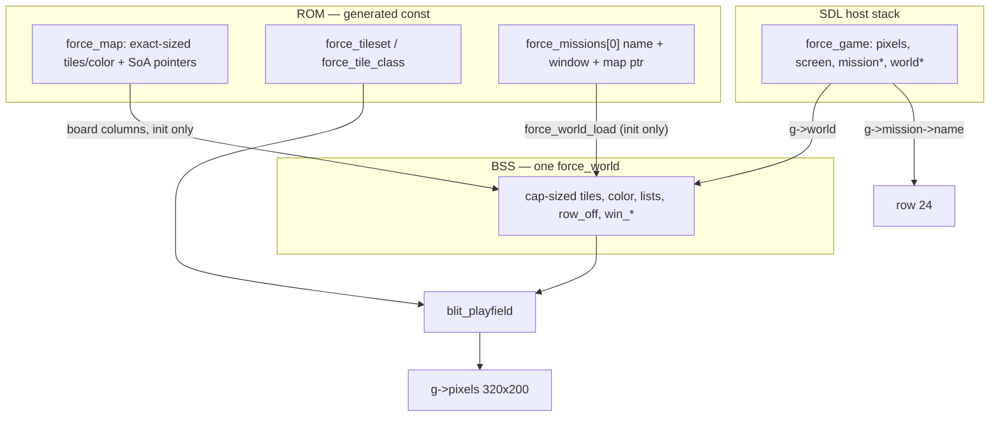
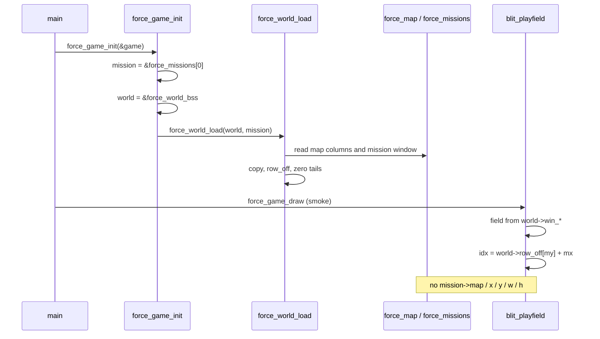

# Phase 1 — RAM world, 6502-shaped

| Field | Value |
| --- | --- |
| Author | FORCE design session |
| Date | 2026-09-13 |
| Status | **Draft** (index: **active**) |
| Last worked on | 2026-09-13 |
| Repo path | [`design/phase-1-ram-world.md`](phase-1-ram-world.md) |
| Plan | [`development-plan.md`](development-plan.md) (Phase 1 frozen) |
| Source | `src/sdl/game/game.c`, `src/sdl/game/game.h`, `src/sdl/CMakeLists.txt`, `tools/gen_sdl.py`, `src/sdl/generated/force_data.h` |
| Intent | [`../doc/FORCE_06_Tiles_Memory_and_Sprites.md`](../doc/FORCE_06_Tiles_Memory_and_Sprites.md) |
| Binary as it is | [`../agents/game.md`](../agents/game.md), [`../agents/architecture.md`](../agents/architecture.md), [`../agents/known-gaps.md`](../agents/known-gaps.md) |

Mission load copies the board into one RAM world. Generated `force_map` stays
const (ROM). After `force_world_load`, gameplay and playfield draw do not
index `mission->map`. Fixed arrays, integer ids, no malloc. Farm still
draws. Still no orders and no movers.

This design-only writeup does **not** mark the index **landed**. That flip
happens in the implementation PR that merges `world.c`.

---

## Overview

Phase 0 left the board in generated `const` arrays. `blit_playfield` in
`src/sdl/game/game.c` indexes `g->mission->map->color`, `map->tiles`, and
`map->spawn_*` every frame, with cell index `y * map->width + x`. That is a
ROM world. Engineer patches, explosions, and every later sim system need a
writable terrain buffer and writable lists. FORCE_06 already says one dense
terrain array and lists for the rest; the SDL host has not started living
in that RAM.

Phase 1 adds `force_world`: cap-sized SoA columns in file-scope BSS, filled
once by `force_world_load(world, mission)`. `force_game` holds a
`force_world *world` that points at the single BSS instance.
`blit_playfield` reads `world->color`, `world->tiles`, `world->spawn_*`,
indexed by `world->row_off[y] + x`. The compiler grows three caps
(`FORCE_MAP_W_MAX 80`, `FORCE_MAP_H_MAX 50`, `FORCE_MAP_CELLS_MAX 4000`)
and rejects oversized maps. Farm is 40×20 and still looks the same.
`./build/src/sdl/force --smoke` still exits 0.

This is not LZSS, not units, not a stepper, not a C64 emitter.

---

## Background & Motivation

### Current runtime (Phase 0, landed)

`force_game_init` sets `g->mission = &force_missions[0]` (`farm_mission`).
There is no load step. `field_w` / `field_h` read `g->mission->w` /
`g->mission->h`. `blit_playfield` takes `const force_map *map =
g->mission->map` and walks the mission window:

```c
const int idx = my * (int)map->width + mx;
/* fill from map->color[idx], stamp map->tiles[idx] */
```

Then a spawn loop stamps `map->spawn_tile[i]` and re-stamps
`map->tiles[sy * (int)map->width + sx]` so roofs still cover men.

Generated farm (`src/sdl/generated/force_data.c`):

| Column | Farm |
| --- | --- |
| `color` / `tiles` | `static const uint8_t …[800]` |
| rooms | 4 rects, nine SoA columns length 4 |
| cover / portal / scout / objective / mine | count 0, pointers `NULL` |
| spawns | 8 rows, `x,y,tile` |

`force_map` pointers into those exact-sized `const` arrays are the world.
`force_game` already holds `uint32_t pixels[FORCE_FB_W * FORCE_FB_H]`
(256000 bytes) and is a **stack** local in `src/sdl/main.c`.

### Pain

- The board is read-only. Phase 9 engineer jobs and explosions patch
  terrain in place (FORCE_06: the grass never left; occupancy is not in
  the tile byte). You cannot patch `const uint8_t force_map_farm_tiles[]`.
- `y * map->width` is in the draw hot path. A 6502 does not have a free
  16-bit multiply; the row base belongs in a table filled at load.
- Lists are ROM pointers that are `NULL` when `count == 0`. Game code
  that later mutates cover or spawns cannot write through those pointers
  and must not `memcpy` from `NULL`.
- Caps `FORCE_ROOM_MAX` etc. already exist in `force_data.h`. Terrain
  has no cap: `compile_map` in `tools/gen_sdl.py` only rejects width or
  height **> 255** (`uint8_t` coordinates). An 80×50 board is 4000 cells
  and is the FORCE_06 standard; a 200×200 TMX would still compile today
  (200 ≤ 255) and blow any honest RAM budget.
- Putting the board inside `force_game` would land 9K of “6502 BSS” on
  the SDL stack next to a 256K framebuffer, hiding the real budget and
  making a second instance trivially easy. The 6502 truth is **one**
  world in BSS.

### What Phase 0 already got right

Typed SoA, hard caps, `count == 0` ⇒ pointers `NULL`, spawn list not a
unit pool, no dense meta planes, `game/` has no SDL. Phase 1 copies that
shape into RAM. It does not invent a second representation.

---

## Goals & Non-Goals

### In (Phase 1)

- One `force_world` in BSS: cap-sized tiles, colour (SDL), lists, window
  rect, `row_off[]`.
- `force_world_load` is the only reader of `force_map` board columns.
- After load, `blit_playfield`, cursor clamp, and `field_w` / `field_h`
  read the world, not `g->mission->map` and not `g->mission->x/y/w/h`.
- `g->mission` remains for name / identity (chrome row 24). `game.c`
  may mention `g->mission->name` only.
- Compiler rejects maps with width > 80, height > 50, or
  width × height > 4000. Caps emitted into `force_data.h`.
- `force_copy_u8` as the 6502 block-copy seam. Never copy from `NULL`.
- Zero the unused tail of every cap array on load.
- CMake compiles `game/world.c`.
- Farm pixels unchanged. `--smoke` exits 0.
- `agents/game.md`, `agents/architecture.md`, `agents/known-gaps.md`,
  `agents/assets.md`, and `agents/README.md` updated in the landing PR.

### Out (later phases)

| Later | Why it is not Phase 1 |
| --- | --- |
| LZSS / compressed terrain (Phase 10) | Load is a straight copy. Decompress replaces the copy body later. |
| Live `force_unit` pool / section table (Phase 2) | Spawn list is still stamps. |
| Command object, wizard (Phase 3) | Chrome stays a poster. |
| Stepper, portal from/to, next-hop (Phase 4) | Portal cells are copied, unused. |
| Cover assignment (Phase 5) | Tables are copied, unused. |
| Combat, mission script, overview camera (Phases 6–8) | Window is copied; camera does not pan. |
| Engineer cell jobs, debug crater poke (Phase 9) | Terrain is writable so those can land later. No poke in Phase 1. |
| C64 emitter, colour-RAM window, charset pack (Phase 10) | Colour stays a full-board SDL copy. No `src/c64/`. |
| Occupancy bitmap | Phase 2/4. Do not rebuild a dense actors plane as a draw cache. |
| `malloc`, VLA, padded-to-256 terrain | Forbidden now and later. |

---

## Key Decisions

Locked. Not reopened as Open Questions.

1. **ROM vs RAM, one rule.** Generated `force_map` / tileset /
   `force_tile_class` / name strings stay `const` (ROM). After
   `force_world_load`, gameplay and playfield draw do **not** index
   `mission->map->tiles` or any other world column on `force_map`. Load
   is the only reader of `force_map` for board data. Tileset pixels and
   class bytes stay global ROM; they are not board columns.

2. **Copy everything that is the board**, not only terrain:

   | Column | Phase 1 |
   | --- | --- |
   | `tiles` | copy (engineer / explosion patches later) |
   | `color` | copy on SDL (one world; colour-RAM window is Phase 10) |
   | rooms, cover, portal, scout, objective, mine | copy into **cap-sized** BSS |
   | spawns | copy (stamps, not units; Phase 2 consumes this list) |
   | tileset, class table, names | stay ROM |

3. **Generated arrays stay exact-sized; RAM arrays are max-sized**
   (`FORCE_ROOM_MAX` etc.). `count == 0` → do not read a ROM `NULL`;
   RAM count is 0. Zero the unused tail of cap arrays on load. A second
   load of a smaller map must not leak the previous tail.

4. **Terrain cap:** `FORCE_MAP_W_MAX 80`, `FORCE_MAP_H_MAX 50`,
   `FORCE_MAP_CELLS_MAX 4000`. Flat `uint8_t tiles[4000]`, not
   `[50][80]`. Compiler currently rejects width/height > 255 (`uint8_t`
   coords). Phase 1 also rejects maps over 80×50 or over 4000 cells.
   Farm 40×20 fits. `FORCE_MAP_CELLS_MAX` equals
   `FORCE_MAP_W_MAX * FORCE_MAP_H_MAX`.

5. **`row_off[y]`** filled at load: `uint16_t row_off[FORCE_MAP_H_MAX]`,
   `row_off[y] = y * width`. Cell index is `row_off[y] + x`. Do not pad
   width to 256. Do not `y * width` in the draw hot path after load.

6. **Not inside `force_game`.** That struct already holds
   `pixels[320*200]` and is a stack local in `main`. New `force_world`
   in `src/sdl/game/world.h` + `world.c`: counts + SoA columns as
   **file-scope BSS**, no malloc, no VLA. One instance (the 6502 truth).
   `force_game` holds `force_world *world` pointing at
   `force_world_bss` so the pointer is explicit and testable.

7. **Load:** `force_world_load(world, mission)` copies columns, builds
   `row_off`, stores width/height and the mission window. Handle ROM
   `NULL` when count==0. `force_game_init` loads mission 0. SDL may use
   `memcpy`; `force_copy_u8(dst, src, n)` is the 6502 block-copy seam.
   Never memcpy from NULL. `n == 0` returns without reading `src`.

8. **Draw:** `blit_playfield` reads `world->color`, `world->tiles`,
   `world->spawn_*`, index via `row_off`. Same visual: colour fill,
   tiles, spawn stamp, re-stamp tiles for roofs. `--smoke` still exits
   0. Farm still looks the same. Draw of the **window** still walks
   40×20 cells of terrain (painting, not sim). Spawn draw is O(spawns).
   Do not rebuild a dense actors plane.

9. **Window lives on the world.** Copy `mission->x,y,w,h` onto
   `world->win_*` at load so draw and cursor clamp do not need
   `force_map` or `force_mission` geometry. Keep `g->mission` for the
   name string only (`SDL  %s  JOY` on row 24). Do not store a
   `const force_map *` on the world.

10. **Caps are emitted by `gen_sdl.py` into `force_data.h`**, next to
    `FORCE_ROOM_MAX`. Python integers and the header stay in lockstep
    because Python writes the header. `world.h` includes
    `generated/force_data.h` and does **not** re-`#define` the caps.
    Python `assert`s `CELLS_MAX == W_MAX * H_MAX` next to the integers
    that write the header (PR 1 cannot emit a drifted triple). A C
    `#error` in `world.h` guards the same equality at compile time.

11. **`force_copy_u8` is public; tail-zero is not.** Callers with
    `count == 0` skip the copy. A file-static `zero_u8` of
    `[count, cap)` lives in `world.c` for `uint8_t` columns. `row_off`
    tail-zero is a separate `uint16_t` loop over entries, never
    `zero_u8` counted in rows.

12. **Still no:** units, sections, orders, stepper, occupancy bitmap,
    next-hop, portal from/to, cover assignment, LZSS, malloc, debug
    crater poke, C64 emitter.

13. **Dependency direction unchanged.** `game/` has no SDL. `world.c`
    is game-layer. `core/` unchanged.

---

## Proposed Design

### Runtime data flow



After init, the arrow from `force_map` to draw does not exist.

### Sequence: init then one smoke frame



### `force_world` struct

New files: `src/sdl/game/world.h`, `src/sdl/game/world.c`.

Columns are **arrays in the struct**, not pointers to sub-buffers. ROM
`force_map` uses pointers because generated arrays are exact-sized. RAM
uses inline cap-sized arrays because the 6502 BSS **is** those labels.
One instance: no extra indirection.

```c
/* src/sdl/game/world.h */
#ifndef FORCE_WORLD_H
#define FORCE_WORLD_H

#include "generated/force_data.h"

#if (FORCE_MAP_W_MAX * FORCE_MAP_H_MAX) != FORCE_MAP_CELLS_MAX
#error "FORCE_MAP_CELLS_MAX must equal FORCE_MAP_W_MAX * FORCE_MAP_H_MAX"
#endif

typedef struct force_world {
    uint8_t  width;
    uint8_t  height;
    uint8_t  win_x;
    uint8_t  win_y;
    uint8_t  win_w;
    uint8_t  win_h;

    uint16_t row_off[FORCE_MAP_H_MAX];

    uint8_t  tiles[FORCE_MAP_CELLS_MAX];
    uint8_t  color[FORCE_MAP_CELLS_MAX];   /* SDL; Phase 10 drops this 4K */

    uint8_t  room_count;
    uint8_t  room_x0[FORCE_ROOM_MAX];
    uint8_t  room_y0[FORCE_ROOM_MAX];
    uint8_t  room_w[FORCE_ROOM_MAX];
    uint8_t  room_h[FORCE_ROOM_MAX];
    uint8_t  room_colour[FORCE_ROOM_MAX];
    uint8_t  room_cover_base[FORCE_ROOM_MAX];
    uint8_t  room_cover_count[FORCE_ROOM_MAX];
    uint8_t  room_scout_base[FORCE_ROOM_MAX];
    uint8_t  room_scout_count[FORCE_ROOM_MAX];

    uint8_t  cover_count;
    uint8_t  cover_x[FORCE_COVER_MAX];
    uint8_t  cover_y[FORCE_COVER_MAX];
    uint8_t  cover_grade[FORCE_COVER_MAX];
    uint8_t  cover_facing[FORCE_COVER_MAX];

    uint8_t  portal_count;
    uint8_t  portal_x[FORCE_PORTAL_MAX];
    uint8_t  portal_y[FORCE_PORTAL_MAX];

    uint8_t  scout_count;
    uint8_t  scout_x[FORCE_SCOUT_MAX];
    uint8_t  scout_y[FORCE_SCOUT_MAX];
    uint8_t  scout_facing[FORCE_SCOUT_MAX];

    uint8_t  spawn_count;
    uint8_t  spawn_x[FORCE_SPAWN_MAX];
    uint8_t  spawn_y[FORCE_SPAWN_MAX];
    uint8_t  spawn_tile[FORCE_SPAWN_MAX];

    uint8_t  objective_count;
    uint8_t  objective_x[FORCE_OBJECTIVE_MAX];
    uint8_t  objective_y[FORCE_OBJECTIVE_MAX];

    uint8_t  mine_count;
    uint8_t  mine_x[FORCE_MINE_MAX];
    uint8_t  mine_y[FORCE_MINE_MAX];
} force_world;

extern force_world force_world_bss;

void force_copy_u8(uint8_t *dst, const uint8_t *src, uint16_t n);
void force_world_load(force_world *world, const force_mission *mission);

#endif
```

Width/height and the window fit in `uint8_t` because the compiler cap is
80×50. `force_map` / `force_mission` keep `uint16_t`; load narrows after
the compiler has already rejected anything that would not fit.
`row_off` is `uint16_t` because `y * width` reaches 49×80 = 3920.

No `const force_map *`, no `const force_mission *`, no tileset pointer,
no name string on the world. Identity stays on `g->mission`.

### BSS layout and byte budget

`force_world force_world_bss;` at file scope in `world.c`. C BSS,
zero-initialized, then load fills it. Not `static` — `game.c` takes
`&force_world_bss`. Not a member of `force_game`.

C11 layout: six `uint8_t` header fields occupy 6 bytes. Offset 6 is
already 2-aligned, so there is **no** pad before `uint16_t row_off[50]`.
Payload is 9089 bytes. Struct alignment 2 may add 1 trailing byte → 9090.

| Field | Bytes | Notes |
| --- | ---: | --- |
| `width`…`win_h` | 6 | no pad; offset 6 is 2-aligned |
| `row_off[50]` | 100 | 16-bit row bases |
| `tiles[4000]` | 4000 | dense terrain |
| `color[4000]` | 4000 | SDL only; C64 colour-RAM is Phase 10 |
| rooms (count + 9×16) | 145 | `16*9` columns + count |
| cover (count + 4×128) | 513 | |
| portal (count + 2×24) | 49 | |
| scout (count + 3×32) | 97 | |
| spawn (count + 3×32) | 97 | stamps; Phase 2 pool is separate |
| objective (count + 2×8) | 17 | |
| mine (count + 2×32) | 65 | |
| **SDL data** | **9089** | 9090 if trailing align to 2 |
| **without `color`** | **5089** | 6502-relevant board (5090 with trailing align) |

FORCE_06’s “about 5–6K for the world” is the no-colour figure plus the
later unit pool (~320–384). Phase 1 is that skeleton without units.
The extra 4K colour is an SDL authoring tax, called out, not smuggled
into the 6502 budget.

Farm occupancy of those caps:

| Column | Used / cap |
| --- | --- |
| tiles / color | 800 / 4000 |
| row_off | 20 / 50 |
| rooms | 4 / 16 |
| cover / portal / scout / objective / mine | 0 |
| spawns | 8 / 32 |

Compare: `force_game.pixels` is 256000 bytes on the stack. World BSS is
the number that has to fit a 64K machine later, not that framebuffer.

### `force_copy_u8`

```c
void force_copy_u8(uint8_t *dst, const uint8_t *src, uint16_t n)
{
    if (n == 0u) {
        return;
    }
    memcpy(dst, src, (size_t)n);
}
```

`world.c` includes `"game/world.h"` and `<string.h>` (libc `memcpy`,
not SDL). `"world.h"` does not resolve: CMake’s include directory is
`src/sdl`. The public header is required in that TU so it sees the
struct of `force_world_bss`.

`n` is `uint16_t` because a terrain copy is up to 4000 bytes. The 6502
body is a block-copy loop behind the same signature; do not scatter
`memcpy` through `force_world_load`. Never call with `n > 0` and
`src == NULL`.

File-static tail zero (not public):

```c
static void zero_u8(uint8_t *dst, uint16_t n)
{
    uint16_t i;
    for (i = 0; i < n; ++i) {
        dst[i] = 0u;
    }
}
```

A `memset` here is acceptable on SDL; a loop is already 6502-shaped.
Either is fine if it stays inside `world.c`.

Column helper (file-static):

```c
static void copy_column(uint8_t *dst, const uint8_t *src,
                        uint8_t count, uint16_t cap)
{
    if (count > 0u) {
        force_copy_u8(dst, src, (uint16_t)count);
    }
    if ((uint16_t)count < cap) {
        zero_u8(dst + count, (uint16_t)(cap - (uint16_t)count));
    }
}
```

When `count == 0`, `src` is not read (ROM pointer may be `NULL`). The
whole cap range is zeroed. Do not pass `row_off` through `zero_u8` or
`copy_column`: those count **bytes**. `row_off` is `uint16_t[]`; an
entry-count fed as a byte count would zero 30 bytes on farm (height 20)
instead of 30 entries and leave stale tails after a restartable load.

### `force_world_load`

`void`. No status. The compiler already rejected oversized maps and
`missions.txt` already rejected a window outside the map.
`force_game_init` always passes `&force_missions[0]`. Load must be
restartable (tails cleared) even though Phase 1 only ever loads once.

Copy order:

1. Dimensions and window (narrow `uint16_t` → `uint8_t`).
2. `row_off[0 .. height)` = `y * width` (**map** width, not `win_w`).
   Tail is a `uint16_t` loop, not `zero_u8` counted in entries.
3. Dense `tiles` then `color`: `cells = width * height` bytes, then
   zero `[cells, CELLS_MAX)`. `map->tiles` / `map->color` are never
   NULL (Phase 0 always emits both planes).
4. Rooms: nine columns + `room_count`.
5. Cover, portal, scout, spawn, objective, mine — each kind’s count
   then columns.

```
force_world_load(world, mission):
    map = mission->map
    world->width  = (uint8_t)map->width
    world->height = (uint8_t)map->height
    world->win_x  = (uint8_t)mission->x
    world->win_y  = (uint8_t)mission->y
    world->win_w  = (uint8_t)mission->w
    world->win_h  = (uint8_t)mission->h

    for y in 0 .. height-1:
        world->row_off[y] = (uint16_t)y * (uint16_t)width   # map width, not win_w
    for y in height .. H_MAX-1:
        world->row_off[y] = 0   # uint16_t entries, not H_MAX-height bytes

    cells = (uint16_t)width * (uint16_t)height
    force_copy_u8(world->tiles, map->tiles, cells)
    zero tiles[cells .. CELLS_MAX)
    force_copy_u8(world->color, map->color, cells)
    zero color[cells .. CELLS_MAX)

    world->room_count = map->room_count
    copy_column(world->room_x0, map->room_x0, room_count, ROOM_MAX)
    … same for y0, w, h, colour, cover_base, cover_count,
      scout_base, scout_count

    world->cover_count = map->cover_count
    copy_column(world->cover_x, map->cover_x, cover_count, COVER_MAX)
    … y, grade, facing

    … portal, scout, spawn, objective, mine likewise
```

Do not re-check 80×50 at runtime. Do not walk cells to “validate”
tiles. Do not copy `map->name`. Do not take a `force_map *` argument
alongside the mission; the mission is the handle, and it already
points at the map for this one call.

### `force_game` and `game.c`

```c
/* game.h */
#include "core/types.h"
#include "game/world.h"

typedef struct force_game {
    force_screen screen;
    uint32_t pixels[FORCE_FB_W * FORCE_FB_H];
    const force_mission *mission;   /* name / identity only after load */
    force_world *world;             /* &force_world_bss */
    int cursor_x;
    int cursor_y;
    uint32_t frames;
    bool joy_present;
} force_game;
```

`game.h` drops its direct `#include "generated/force_data.h"`;
`world.h` brings that header in.

```c
void force_game_init(force_game *g)
{
    g->mission = &force_missions[0];
    g->world = &force_world_bss;
    force_world_load(g->world, g->mission);
    g->cursor_x = field_w(g) / 2;
    g->cursor_y = field_h(g) / 2;
    g->frames = 0;
    g->joy_present = false;
}
```

Load **before** `field_w` / `field_h`, which now read the window on the
world:

```c
static int field_w(const force_game *g)
{
    int w = (int)g->world->win_w;
    if (w > FORCE_COLS) {
        w = FORCE_COLS;
    }
    return w;
}

static int field_h(const force_game *g)
{
    int h = (int)g->world->win_h;
    if (h > FORCE_FIELD_ROWS) {
        h = FORCE_FIELD_ROWS;
    }
    return h;
}
```

The `FORCE_COLS` / `FORCE_FIELD_ROWS` caps stay: a later 80×50 board
still paints a 40×20 window on this screen (Phase 8 is camera). Farm’s
window is already 40×20, so the cap is a no-op today.

`blit_playfield` after (same visual order: colour, tiles, spawn, roof
re-stamp):

```c
static void blit_playfield(force_game *g)
{
    const force_world *w = g->world;
    const int origin_x = (int)w->win_x;
    const int origin_y = (int)w->win_y;
    const int fw = field_w(g);
    const int fh = field_h(g);
    int x, y, i;

    for (y = 0; y < fh; ++y) {
        for (x = 0; x < fw; ++x) {
            const int mx = origin_x + x;
            const int my = origin_y + y;
            const int idx = (int)w->row_off[my] + mx;
            uint8_t color_id = w->color[idx];
            uint32_t fill = 0xFF000000u;

            if (color_id < FORCE_TILESET_COUNT) {
                uint32_t sample = force_tileset[color_id][0][0];
                if ((sample >> 24) != 0u) {
                    fill = opaque(sample);
                }
            }
            fill_cell(g->pixels, x, y, fill);
            stamp_tile(g->pixels, x, y, w->tiles[idx]);
        }
    }

    for (i = 0; i < (int)w->spawn_count; ++i) {
        int sx = (int)w->spawn_x[i];
        int sy = (int)w->spawn_y[i];
        if (sx < origin_x || sy < origin_y ||
            sx >= origin_x + fw || sy >= origin_y + fh) {
            continue;
        }
        stamp_tile(g->pixels, sx - origin_x, sy - origin_y, w->spawn_tile[i]);
        stamp_tile(g->pixels, sx - origin_x, sy - origin_y,
                   w->tiles[(int)w->row_off[sy] + sx]);
    }
}
```

Farm is `0,0,40,20` on a 40×20 map (`world->width == win_w`,
`win_x == win_y == 0`). `--smoke` cannot catch map-vs-window mixups.
Do **not** add a second TMX. Review checklist next to this snippet:

1. Index `row_off` with **map** `y` (`my` in the terrain loop, spawn
   `sy`), not the window-relative loop `y`. `row_off[y]` with window
   `y` is silent on farm and wrong as soon as `win_y != 0` (Phase 8
   camera).
2. Build `row_off[y] = y * world->width` from **map** width, not
   `win_w`.
3. Size the field from `win_w` / `win_h` (capped at `FORCE_COLS` /
   `FORCE_FIELD_ROWS`), not `world->width` / `world->height`.

`force_game_draw` chrome is unchanged except it already uses
`g->mission->name` — that stays. `force_game_tick` clamp stays
`field_w` / `field_h`. `src/sdl/main.c` is unchanged.

**After-load uses of `g->mission`:** `g->mission->name` only. Not
`mission->map`, not `mission->x/y/w/h`. `world.c` is the only file
that reads ROM board columns and mission geometry (and only inside
`force_world_load`). Landing gate — empty output is the pass:

```bash
rg 'mission->(map|x|y|w|h)\b|map->(tiles|color|spawn_)' src/sdl/game/game.c
```

That fails leftover `g->mission->w` / `h` in `field_w` / `field_h` and
`g->mission->x` / `y` as blit origin, as well as `mission->map` and
`map->tiles`. `g->mission->name` does not match.

### Compiler caps (`tools/gen_sdl.py`)

Next to the existing `FORCE_ROOM_MAX = 16` integers:

```python
FORCE_MAP_W_MAX = 80
FORCE_MAP_H_MAX = 50
FORCE_MAP_CELLS_MAX = 4000
assert FORCE_MAP_CELLS_MAX == FORCE_MAP_W_MAX * FORCE_MAP_H_MAX
```

`write_generated` emits, next to `FORCE_ROOM_MAX`:

```c
#define FORCE_MAP_W_MAX          80
#define FORCE_MAP_H_MAX          50
#define FORCE_MAP_CELLS_MAX      4000
```

`compile_map` today:

```python
if width > 255 or height > 255:
    raise Error(f"{name}: size {width}x{height} exceeds 255")
```

Phase 1 keeps that `uint8_t`-coord guard and adds:

```python
if width > FORCE_MAP_W_MAX or height > FORCE_MAP_H_MAX:
    raise Error(
        f"{name}: size {width}x{height} exceeds "
        f"{FORCE_MAP_W_MAX}x{FORCE_MAP_H_MAX}"
    )
if width * height > FORCE_MAP_CELLS_MAX:
    raise Error(
        f"{name}: {width}x{height} = {width * height} cells > "
        f"{FORCE_MAP_CELLS_MAX}"
    )
```

The `assert` runs at import, so a drifted triple fails `gen_sdl`
before emit (PR 1, not deferred to the `world.h` `#error` in PR 2).
`compile_map`’s cells check is redundant while the assert holds; it
stays as a named error if a map somehow exceeds `CELLS_MAX` without
exceeding W/H (only possible if the constants drift and the assert is
removed).

Order: 255 first (coord type), then 80×50 (RAM cap), then cells.
Farm 40×20 passes all three. An 81×20 TMX fails the W_MAX line. A
200×200 TMX still fails 255 first. Do not add an oversized map to
`assets/` to prove the error.

`force_map` struct is otherwise unchanged. Exact-sized generated
arrays stay exact-sized. No C64 emitter.

### CMake

`src/sdl/CMakeLists.txt` `add_executable(force …)` gains `game/world.c`
next to `game/game.c`. No new include directory
(`${CMAKE_CURRENT_SOURCE_DIR}` is already `src/sdl`, so
`"game/world.h"` resolves and `"world.h"` does not). No new Python
depend (the script is already in `FORCE_GEN_INPUTS`). Warnings
(`-Wall -Wextra -Wpedantic`) already apply to every file in the
executable.

### Includes and ownership

```text
main.c       -> game + sdl/host          (unchanged)
game/game.c  -> core/screen + "game/world.h"
game/world.c -> "game/world.h" + <string.h>
sdl/host     -> sdl/input + core/types + SDL3
core/*       -> (no world, no generated map)
generated    -> (none)
```

`world.c` includes `"game/world.h"` (which pulls
`generated/force_data.h`) and `<string.h>` for `memcpy`. It does not
include `game.h` (no cycle) and does not include SDL headers. `core/`
still has no map pointers.

### `agents/` handoff (landing PR, not this design-only writeup)

| File | Change |
| --- | --- |
| `agents/game.md` | State grows `force_world *world`. Init loads mission 0 into BSS. Draw/clamp/field size read the world. `g->mission` is name only. Spawn stamps still O(spawns); no actors plane. |
| `agents/architecture.md` | Tree: `src/sdl/game/world.{h,c}`. Dependency line: `game -> core + generated`. “Where to change code”: world load / BSS. Ownership: `force_world_bss` is the one board; `force_game` does not own the arrays. |
| `agents/known-gaps.md` | RAM world is **not** a gap. LZSS / section packing still is. Closed-shape add: after load, game code does not index `force_map` board columns. Spawn list is still not the unit pool (Phase 2). |
| `agents/assets.md` | Compiler rejects width > 80, height > 50, cells > 4000. New `#define`s in `force_data.h`. |
| `agents/README.md` | Game row includes `world.{h,c}`; tree mentions the RAM world. An agent given only the README must find the BSS board. |

`design/README.md`: when this file is in `design/`, the index row is
**active**. The implementation merge flips it to **landed** and folds
the durable rules into `agents/` in the same change set. This
design-only output does not mark it landed.

---

## API / Interface Changes

| Surface | Change |
| --- | --- |
| `generated/force_data.h` | Add `FORCE_MAP_W_MAX` / `H_MAX` / `CELLS_MAX`. `force_map` / `force_mission` fields unchanged. |
| `tools/gen_sdl.py` | Matching integers; `compile_map` rejects oversized maps. |
| `src/sdl/game/world.h` | New. Struct, `force_world_bss`, `force_world_load`, `force_copy_u8`. |
| `src/sdl/game/world.c` | New. BSS instance, copy/zero, load. |
| `src/sdl/game/game.h` | `force_world *world`. Include `game/world.h` instead of `force_data.h` directly. |
| `src/sdl/game/game.c` | Init loads. `field_w`/`field_h`/`blit_playfield` read the world via `row_off`. |
| `src/sdl/CMakeLists.txt` | `game/world.c` in `add_executable`. |
| `src/sdl/main.c` | Unchanged. |
| `core/` | Unchanged. |
| `force_tileset` / `force_tile_class` | Unchanged ROM. |
| `agents/game.md`, `architecture.md`, `known-gaps.md`, `assets.md`, `README.md` | Landing PR. |
| `design/README.md` | Index **active** while this design is in-tree; **landed** when `world.c` merges. |

Any other C that indexed `g->mission->map` or `g->mission->w` for
board data will keep compiling (`force_map` / `force_mission` still
have those fields). Discipline + the `rg` gate in Observability is
the check, not a field deletion. Do not delete ROM `tiles` / `color`;
load still needs them.

---

## Data Model Changes

No heap, no versioning, no save format. Regenerating `force_data.c` is
still how authoring reaches the binary. `src/sdl/generated/` remains a
gitignored build product.

**ROM (unchanged shape, plus three `#define`s):** exact-sized `const`
planes and lists. `count == 0` ⇔ pointers `NULL`.

**RAM (new):** one `force_world` of cap-sized columns. `count` is the
live length; `[count, cap)` is zero. Window rect is a copy, not a
pointer into `force_mission`.

**Authoring:** five named TMX layers, unchanged. Farm 40×20,
`farm_mission 0,0,40,20`, unchanged.

Phase 2 will allocate 32 unit records from `world->spawn_*` and stop
stamping the spawn list. Phase 1 must not pre-create those records. The
copied spawn list is the authoring snapshot sitting in RAM so Phase 2
does not have to touch `force_map`.

Phase 10 replaces the `force_copy_u8` of `tiles` with LZSS decode into
the same `tiles[4000]`, and replaces the 4K `color[]` with a colour-RAM
window. Same world struct minus that plane; not a rewrite.

---

## Alternatives Considered

### Keep pointing at const `force_map` on SDL “because host RAM is cheap”

Rejected. `development-plan.md` 6502 filter: write the SDL C, and the
data it consumes, as if the CPU were a 6502. A host-only ROM world
becomes the thing every later system walks. Engineer patches have
nowhere to write. Dual representation “for debug” is explicitly out of
the program of work.

### Copy tiles only, leave lists as ROM pointers

Rejected. Cover, rooms, spawns, mines are the board. Phase 2 consumes
spawns; Phase 4 walks rooms; Phase 5 writes cover assignment. ROM
pointers are `NULL` at count 0 and not writable at count > 0. Copy
every column that is the board. Tileset / class / names stay ROM
because they are not the board.

### Put buffers inside `force_game`

Rejected. `force_game` already holds the 256K framebuffer and is a
stack local in `main`. The world would sit on the host stack, a second
`force_game` would be a second world, and the BSS budget would be
invisible next to `pixels[]`. One file-scope instance; `force_game`
holds a pointer.

### Pad width to 256 for `ASL` indexing

Rejected. `row_off[y] = y * width` is 100 bytes, filled once. Padding
an 80×50 board to 256-wide is 50×256 = 12800 bytes of terrain instead
of 4000. Farm width is 40. The 6502 pays a table lookup, not 8K of
zeros. Do not `y << 8` in C “to look like ASL”.

### `malloc` a world the size of the map

Rejected. No allocator, no VLA, no “exact malloc, cap is just a
check.” Caps are the arrays. Farm uses 800 of 4000 and the tail is
zero. A 6502 does not `malloc(width*height)`.

### Dual read (RAM if dirty else ROM)

Rejected. One index path after load. A dirty bit plus a ROM fallback
is two draw paths and a bug farm the first time a patch and a spawn
re-stamp disagree. Do not ship a PR that draws from RAM sometimes and
ROM sometimes.

---

## Security & Privacy Considerations

Not a networked service. No accounts, no auth, no PII, no telemetry,
no sandbox beyond “this is a local game binary.”

The actual threat is **bad authoring input** at compile time (a TMX
that does not fit BSS). Mitigations:

- Existing `gen_sdl.py` checks (flip bits, unknown layers, caps on
  rooms/cover/spawns, window inside the map, width/height > 255).
- **New:** width > 80, height > 50, width×height > 4000 fail the
  compile with `gen_sdl: {map}: …`.
- Generated storage stays `const`. RAM world is BSS, not heap. Counts
  fit in `uint8_t`. Cell index is `uint16_t` via `row_off`.
- `force_copy_u8` does not read `NULL`. Load does not parse TMX.

A hostile ROM blob is still just tile ids; draw stamps them. There is
no script interpreter in Phase 1.

---

## Observability

No metrics stack, no log daemon, no tracing, no feature-flag service.

| Signal | Where |
| --- | --- |
| Compile failure | `gen_sdl: …` on stderr; CMake fails the `force` target. Oversized map names width, height, and the cap. |
| Compile success | Existing one-line stdout (`128 tiles, 1 map(s), 1 mission(s), farm 4 rooms 8 spawns 0 cover`). Unchanged. |
| C compile failure | Missing `world.c` in CMake, or `game.c` still compiling against a world API that is not there. |
| Runtime bring-up | `./build/src/sdl/force --smoke` — one frame, exit 0. Still needs a display. |
| Visual | Farm: green field, yellow lane, grey walls and roofs, blue soldiers at the gate (same as `agents/testing.md`). Eight stamps, no ninth phantom. |
| Dual-read regression | `rg` gate below is empty. Farm smoke cannot catch map-vs-window mixups; the review checklist under `blit_playfield` is the rest of the gate. |

Dual-read `rg` (copy from this fence, not from a table). Empty output
is the pass. Allows `g->mission->name` only:

```bash
rg 'mission->(map|x|y|w|h)\b|map->(tiles|color|spawn_)' src/sdl/game/game.c
```

There is no ctest. Do not add a `tests/` tree in Phase 1. Do not add a
debug crater poke “to prove RAM.” Writability is for Phase 9; Phase 1
proves it by drawing from the copy. Do not add a second TMX whose
window is not the whole map.

---

## Rollout Plan

No feature flags. No staged dual-read. No percentage rollout.

1. **Cap PR** (optional split; independently testable): emit
   `FORCE_MAP_*` and reject oversized maps. Farm still compiles. No
   runtime change. `--smoke` still 0.
2. **Landing PR:** `world.c` + load + `game.c` draw/init through the
   world + CMake + `agents/` + `design/README.md` **active → landed**.
   One path after load. Do not land “world exists but blit still reads
   ROM.”

Rollback is `git revert` of that PR. There is no runtime switch.

Verification, from repo root (same as `agents/testing.md`):

```bash
cmake -B build -S . -DCMAKE_BUILD_TYPE=Debug
cmake --build build -j
./build/src/sdl/force --smoke
```

An oversized TMX or a missed CMake `world.c` line fails **the build**,
not smoke. A missed `game.c` cut-over that still names `map->tiles` or
`g->mission->w` builds and looks the same on farm — catch it with the
`rg` gate in Observability, not with pixels. Map-vs-window index bugs
also look the same on farm; catch those with the review checklist, not
a second TMX.

---

## Risks

| Risk | Sev | Mitigation |
| --- | --- | --- |
| Dual read: `blit_playfield` still uses `mission->map`, or `field_w` still uses `mission->w` | **High** | Land load and draw in one PR. Observability `rg` fence must be empty (allows `g->mission->name` only). Review rejects “world + ROM fallback.” |
| Farm-degenerate index: `row_off[window y]`, `row_off[y]=y*win_w`, or `field_w` from `world->width` | **High** | Farm `0,0,40,20` on 40×20 makes all three `--smoke` green. Review checklist next to the blit snippet. No second TMX. |
| `memcpy` from `NULL` when `cover_count == 0` (farm) | **High** | `copy_column` skips copy at count 0. `force_copy_u8` returns on `n == 0`. Farm has 0 cover / portal / scout / objective / mine. |
| `force_game` stack + world-as-member silently ships | **High** | World is `extern force_world force_world_bss`. Pointer on `force_game` only. |
| `row_off` forgotten; `y * width` remains in spawn re-stamp | **Med** | Both terrain loop and spawn re-stamp use `row_off`. Spell it in the snippet; review both sites. |
| `row_off` tail zeroed as bytes (`zero_u8(..., H_MAX - height)`) | **Med** | Load listing is a `uint16_t` loop over entries. Do not feed `row_off` to `zero_u8`. |
| Window still read from `g->mission->w` so a later camera cannot move without touching mission const | **Med** | Copy `win_*` at load; `field_w`/`field_h`/`blit_playfield` use it. `rg` catches leftover `mission->w`. |
| Cap PR skipped, an 81×40 map compiles, load narrows to `uint8_t` and truncates | **Med** | Caps land before or with load. `uint8_t width` is legal only because 80 fits. Keep the 255 check too. |
| BSS ~9K with colour mistaken for the 6502 budget | **Low** | Budget table splits 9089 SDL data vs 5089 without `color`. Comment on the field. |
| Second `force_world` “for tests” on the stack | **Low** | The pointer is testable; the product binary uses one BSS. Do not malloc a second in `main`. |
| `agents/` lag after `world.c` merges | **Med** | Handoff in the same landing PR (`development-plan.md` rule). |

---

## Open Questions

None. Defaults that could have been questions are Key Decisions 6
(`force_game.world` → `force_world_bss`), 7 (`force_copy_u8`), 9
(window copied onto world; `g->mission` is name only), 10 (caps
emitted by `gen_sdl` into `force_data.h`).

---

## References

- [`development-plan.md`](development-plan.md) — Phase 1 frozen name and bounds, 6502 filter
- [`phase-0-pipeline.md`](phase-0-pipeline.md) — landed SoA `force_map`; Phase 1 explicitly out
- [`../doc/FORCE_06_Tiles_Memory_and_Sprites.md`](../doc/FORCE_06_Tiles_Memory_and_Sprites.md) — one map, lists for the rest; 80×50 ≈ 4000
- [`../agents/game.md`](../agents/game.md) — `force_game`, `blit_playfield` as it is
- [`../agents/architecture.md`](../agents/architecture.md) — tree, dependency direction
- [`../agents/known-gaps.md`](../agents/known-gaps.md) — LZSS still a gap; RAM world will not be
- [`../agents/assets.md`](../agents/assets.md) — compiler as it is
- `tools/gen_sdl.py` — `compile_map` 255 check, `write_generated` cap `#define`s
- `src/sdl/game/game.c` — `field_w` / `field_h` / `blit_playfield` / `force_game_init`
- `src/sdl/game/game.h` — `force_game` today
- `src/sdl/main.c` — stack `force_game`, `--smoke`
- `src/sdl/CMakeLists.txt` — executable sources
- `src/sdl/generated/force_data.h` — `force_map`, `force_mission`, list caps
- `assets/maps/farm.tmx` — 40×20
- `assets/missions.txt` — `farm_mission farm 0,0,40,20`

---

## PR Plan

Independently reviewable. No PR draws from RAM sometimes and ROM
sometimes. Two PRs: the cap check is independently testable (farm
still compiles; an 81-wide TMX would not). Do not invent a C64 tree.

When `design/phase-1-ram-world.md` is added to the repo, `design/README.md`
gains a row **active**. That is not implementation. The landing PR
below flips it to **landed**.

### PR 1 — Map-size caps in the compiler

| | |
| --- | --- |
| **Title** | Cap generated maps at 80×50 / 4000 cells |
| **Depends on** | nothing (Phase 0 already landed) |
| **Files** | `tools/gen_sdl.py` (`FORCE_MAP_W_MAX` / `H_MAX` / `CELLS_MAX`, `assert CELLS_MAX == W_MAX * H_MAX`, `compile_map` checks, emit into the header template) |
| **Does not change** | `game.c`, `game.h`, CMake sources, `force_map` fields, farm TMX, `agents/` |
| **Description** | Python integers match the new `#define`s in `force_data.h`. `assert` the product so PR 1 cannot emit a drifted triple. Keep the width/height > 255 error. Add 80×50 and cells > 4000. Farm 40×20 still emits 800-byte planes. No runtime world. |
| **Gate** | `cmake --build build -j` regenerates the header with the three defines; `./build/src/sdl/force --smoke` exits 0. Do not commit a throwaway oversized TMX. |

### PR 2 — RAM world, load, draw through BSS

| | |
| --- | --- |
| **Title** | Load the board into a BSS force_world and draw from it |
| **Depends on** | PR 1 |
| **Files** | `src/sdl/game/world.h`, `src/sdl/game/world.c` (new; includes `"game/world.h"` and `<string.h>`), `src/sdl/game/game.h` (`force_world *world`), `src/sdl/game/game.c` (init load; `field_w`/`field_h`/`blit_playfield` via `row_off` and `win_*`), `src/sdl/CMakeLists.txt` (`game/world.c`), `agents/game.md`, `agents/architecture.md`, `agents/known-gaps.md`, `agents/assets.md` (map-size caps + load is the ROM reader), `agents/README.md` (game row + tree name `world.{h,c}`), `design/README.md` (Phase 1 **active** → **landed**) |
| **Does not** | keep `blit_playfield` on `mission->map` or `field_w` on `mission->w`; put arrays inside `force_game`; malloc; pad width to 256; stamp a dense actors plane; poke a crater; add units/stepper/LZSS; add a C64 emitter; add a second TMX |
| **Description** | One BSS `force_world`. `force_game_init` points `g->world` at it and loads mission 0. Load copies every board column, builds `row_off` from map width, copies the window, zeros `row_off` tails as `uint16_t` entries, never memcpy from NULL. Draw matches today’s pixels. `g->mission` is the chrome name. Handoff: RAM world is no longer a gap; LZSS still is; after load, game code does not index `force_map` board columns or mission geometry. |
| **Gate** | Build includes `world.c`. Dual-read `rg` (Observability fence) is empty. Review checklist: map `y` into `row_off`, `row_off` from map width, field size from `win_*`. `./build/src/sdl/force --smoke` paints the farm with eight soldiers, roofs covering, no ninth phantom. Interactive visual row in `agents/testing.md` unchanged. |

Do not split PR 2 into “add world + still blit ROM” then “switch draw.”
The user-visible API after merge has one reader of board RAM.

`agents/` updates belong in PR 2, not a follow-up, so the handoff
matches `src/` on the same merge.
