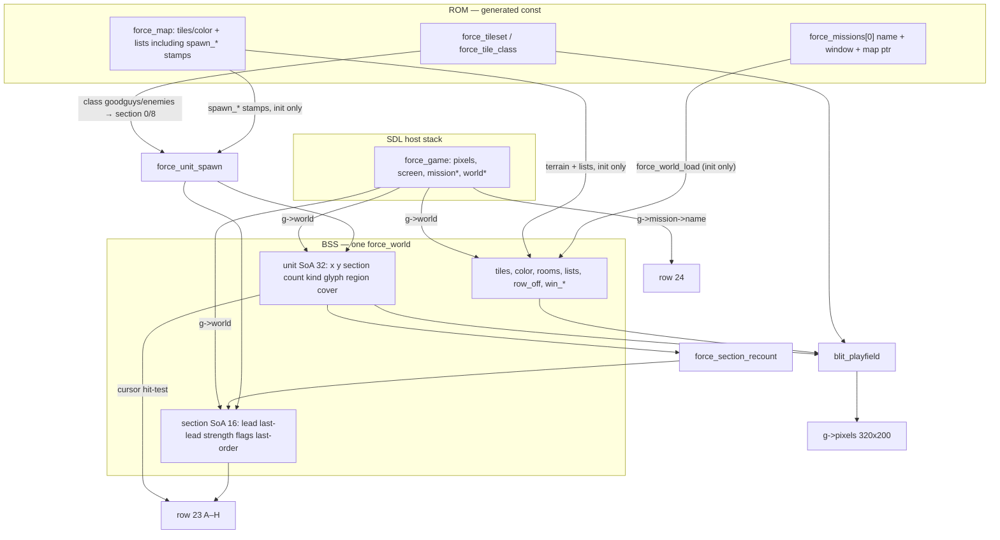
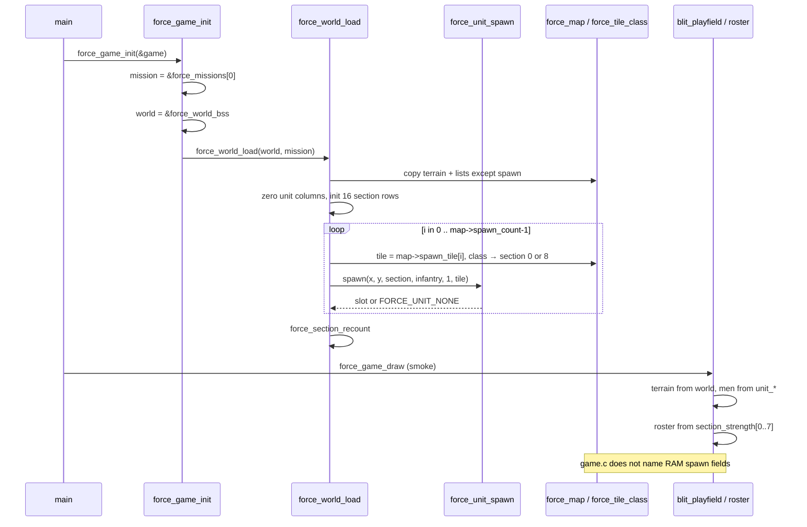

# Phase 2 — Units exist

| Field | Value |
| --- | --- |
| Author | FORCE design session |
| Date | 2026-09-13 |
| Status | **landed** |
| Last worked on | 2026-09-13 |
| Repo path | [`design/phase-2-units-exist.md`](phase-2-units-exist.md) |
| Plan | [`development-plan.md`](development-plan.md) (Phase 2 frozen) |
| Source | `src/sdl/game/world.h`, `src/sdl/game/world.c`, `src/sdl/game/game.c`, `src/sdl/game/game.h`, `tools/gen_sdl.py`, `src/sdl/generated/force_data.h` |
| Intent | [`../doc/FORCE_08_Units_Sections_and_Tick.md`](../doc/FORCE_08_Units_Sections_and_Tick.md), [`../doc/FORCE_06_Tiles_Memory_and_Sprites.md`](../doc/FORCE_06_Tiles_Memory_and_Sprites.md), [`../doc/FORCE_02_Command_Language_and_UI.md`](../doc/FORCE_02_Command_Language_and_UI.md) |
| Binary as it is | [`../agents/game.md`](../agents/game.md), [`../agents/known-gaps.md`](../agents/known-gaps.md) |

Actors become the unit pool. Section table; strip occupancy can start
meaning something. Draw occupancy from the list, not a TMX plane.
Fixed arrays, integer ids, no malloc. Farm still draws. **Still no
orders.**

Index status is **landed**.

---

## Overview

Phase 1 copied ROM board columns into one BSS `force_world`, including
`spawn_count` + `spawn_x/y/tile[FORCE_SPAWN_MAX]`. `blit_playfield` in
`src/sdl/game/game.c` walks those RAM stamps and paints occupancy.
Row 23 paints `A B C D E F G H` all `FORCE_LIGHT_GREY` because there is
no section table. That is still stamps, not a unit pool. FORCE_08
already says the TMX actors plane becomes records at load and is not
the live pool; the SDL host has not started living in that pool.

Phase 2 cuts RAM `world.spawn_*`. `force_map` keeps the ROM stamps.
`force_world_load` reads `map->spawn_*` (load is the ROM reader, same
as Phase 1) and feeds each stamp through one
`force_unit_spawn(world, x, y, section, kind, count, glyph)`. After
load, playfield draw walks live units (`unit_count[i] != 0`), stamps
`unit_glyph`, and re-stamps `tiles` so roofs still cover. The roster
paints player letters 0–7 from `section_strength`: white if that
letter has men, light grey if empty, yellow when the cursor sits on a
player stack of that letter. Farm still has eight soldiers and the
same roofs. Roster A goes white. `./build/src/sdl/force --smoke` still
exits 0.

This is not orders, not a stepper, not a truck, not combat, not a C64
emitter.

---

## Background & Motivation

### Current runtime (Phase 1, landed)

`force_game_init` sets `g->mission = &force_missions[0]`,
`g->world = &force_world_bss`, then `force_world_load`. Load copies
every board column from `mission->map` into cap-sized BSS, including
the spawn stamps:

```c
world->spawn_count = map->spawn_count;
copy_column(world->spawn_x, map->spawn_x, map->spawn_count, FORCE_SPAWN_MAX);
copy_column(world->spawn_y, map->spawn_y, map->spawn_count, FORCE_SPAWN_MAX);
copy_column(world->spawn_tile, map->spawn_tile, map->spawn_count,
            FORCE_SPAWN_MAX);
```

`blit_playfield` then walks `w->spawn_count` and stamps
`w->spawn_tile[i]`, then re-stamps `w->tiles[row_off[sy] + sx]`.

Roster row 23 (`force_game_draw`):

```c
/* A-H roster. All empty (light grey) until a section table exists. */
for (int i = 0; i < 8; i++) {
    force_screen_putc(s, 1 + i * 2, 23, (uint8_t)('A' + i),
                      FORCE_LIGHT_GREY, FORCE_BLACK);
}
```

Generated farm (`src/sdl/generated/force_data.c`):

| Column | Farm |
| --- | --- |
| `color` / `tiles` | 800 cells, copied into BSS |
| rooms | 4 rects (FARM / FIELD_N / LANE / FIELD_S) |
| cover / portal / scout / objective / mine | count 0 |
| spawns | 8 rows, all `FORCE_CLASS_GOODGUYS` |

Farm spawn stamps, row-major from `extract_spawns` in
`tools/gen_sdl.py`:

| i | x | y | tile | class |
| --- | ---: | ---: | ---: | --- |
| 0 | 32 | 6 | 6 | goodguys |
| 1 | 26 | 8 | 6 | goodguys |
| 2 | 24 | 9 | 2 | goodguys |
| 3 | 26 | 9 | 6 | goodguys |
| 4 | 26 | 10 | 6 | goodguys |
| 5 | 26 | 11 | 6 | goodguys |
| 6 | 26 | 12 | 6 | goodguys |
| 7 | 26 | 13 | 6 | goodguys |

Tiles 2 and 6 are facing / variant chips (`assets/tiles.txt` `0-7
goodguys`), **not** letters A–H. Zero enemy stamps. All eight sit
inside room 0 (FARM: `x0=21, y0=0, w=19, h=20`).

`force_game` holds `force_world *world` pointing at file-scope BSS.
Units must stay on that world (Phase 1 Key Decision 6).

### Pain

- Occupancy is still a copy of the authoring snapshot. A later truck,
  wave, peel, or death has nowhere to write a live record, and draw
  would keep stamping men who are gone.
- Dual representation: RAM `world.spawn_*` sitting next to a unit pool
  is the thing the program of work forbids after a phase has cut it.
  Phase 1 copied stamps “so Phase 2 does not have to touch
  `force_map`.” That was a load-seam, not a licence to keep both.
- The roster cannot mean occupancy without a section table. FORCE_02
  and [`section-roster-strip.md`](section-roster-strip.md) already
  specify white / grey / yellow; `game.c` still paints eight greys.
- FORCE_08 wants dest on the **section**, a lead index, and a scan of
  32. None of those bytes exist. Inventing them as a side table inside
  `force_game` would hide the BSS budget and make a second instance
  easy.
- Scanning the map for men is the 6502-filter failure. The access
  pattern is walk 32.

### Why the unused section bytes exist

FORCE_08 last-order (verb, WHERE, force) and a flags byte are the
section’s standing job and later in-contact / breaking bits. Fight /
flight, contact cooldown, and M-vs-A interrupt are **locked for
Phases 5–7**. Phase 2 allocates the bytes and leaves them 0. It does
not specify combat behaviour. Units pull last order later; they are
not pushed. Adding SoA columns for a stepper, `move_wait`, `fire_wait`,
weapon, or `last_shooter` is easy when those phases land; guessing the
packing now is not.

### What Phase 1 already got right

One BSS world, ROM `force_map` unread after load for board columns,
`row_off`, `force_copy_u8`, tails zeroed, `g->mission` name-only,
`game/` has no SDL. Phase 2 extends that world. It does not invent a
second BSS object and does not put the pool inside `force_game`.

---

## Goals & Non-Goals

### In (Phase 2)

- One unit SoA on `force_world`, 32 slots. Slot index is identity.
  Empty is `unit_count[i] == 0`.
- One `force_unit_spawn` used by load (and later by trucks / waves /
  `J`). Silent fail returns `FORCE_UNIT_NONE`.
- 16 section rows. `0–7` player A–H, `8–15` enemy A–H. Section id is
  side. Strength rebuilt by `force_section_recount`.
- Cut RAM `world.spawn_*`. ROM stamps stay on `force_map`. Load reads
  them; draw and gameplay do not.
- Playfield draws live units, not stamps. Roofs still cover.
- Player roster occupancy: white / grey / yellow from strength and a
  cursor hit-test.
- Caps `FORCE_UNIT_MAX`, `FORCE_SECTION_MAX`, `FORCE_LETTER_MAX`
  emitted by `gen_sdl.py` into `force_data.h`.
- Farm pixels on the playfield unchanged. Roster A white, B–H grey.
  Cursor on a soldier turns A yellow. `--smoke` exits 0.
- `agents/game.md`, `agents/architecture.md`, `agents/known-gaps.md`,
  `agents/assets.md` (caps), `agents/testing.md` (visual A white;
  interactive yellow), and `agents/README.md` if the tree line needs
  it (if touched, drop `design/ (empty index)`), updated in the
  landing PR.
- Product sketches in `doc/FORCE_06` and `doc/FORCE_08` updated in
  that same PR: 16 rows / side-in-section-id; player still types A–H
  (eight letters is the command-line cap; scripts name 8–15); kind
  classifies, a glyph byte lives on the unit.

### Out (later phases)

| Later | Why it is not Phase 2 |
| --- | --- |
| Command object, wizard, bind `M` (Phase 3) | Chrome occupancy is not orders. Last-order bytes stay 0. |
| Stepper, portal from/to, next-hop (Phase 4) | Region is filled at spawn; nothing walks. |
| Cover assignment, `D` (Phase 5) | `unit_cover = $FF`. Tables already in RAM, unused. |
| Combat, ROE, firefight interrupt (Phase 6) | No weapon, no waits, no `last_shooter`. |
| Mission script, waves, truck jump-outs (Phase 7 / 9) | `spawn()` is the seam. The truck is not implemented. |
| Intel, camera (Phase 8) | Window is still the load copy. |
| Engineer jobs, `S` / `J` verbs (Phase 9) | Peel/join need the pool; they are not Phase 2 work. |
| LZSS, colour-RAM window, C64 emitter (Phase 10) | Colour stays a full-board SDL copy. No `src/c64/`. |
| Occupancy bitmap | Optional later for the greedy stepper. Do not rebuild a dense actors plane as a draw cache. |
| Count overlay (1 / few / many) | Everything is count 1. FORCE_06 stack overlay is later. |
| Tiled letter / section-authoring chips | TMX default is A / enemy A. Follow-on when a mission must start with B. |
| `malloc`, VLA, `tests/` tree | Forbidden now and later. |

---

## Key Decisions

Locked. Not reopened as Open Questions.

1. **One SoA, 32 slots, not split by side.** Slot index is identity.
   Empty is `count == 0`. Walk the 32. That is the access pattern.
   Do not compact-on-death. Do not linked-list per section. Do not
   `friendly[16] + enemy[16]`. Do not store a live-length /
   occupied-slot count; walk `FORCE_UNIT_MAX`. `unit_count[i]` is
   stack size (FORCE_08 headcount); `0` means free. Keep the name
   `count`.

2. **Spawn is find a hole, fill it.** First `i` with
   `unit_count[i] == 0`. If no hole, or `count == 0`, or
   `section >= FORCE_SECTION_MAX`: **silent fail**, return
   `FORCE_UNIT_NONE` (`$FF`). No beep unless a later *player* verb
   caused it. Wave / truck scripts stay quiet. A truck (one vehicle
   slot) plus eight jump-outs needs nine free holes; short stick on
   overflow, not a queue. Phase 2 does not implement the truck.

3. **16 section rows. Section id is side.** `0–7` player A–H,
   `8–15` enemy A–H. `unit_section` is `0–15`. `section >=
   FORCE_LETTER_MAX` (8) is enemy. No extra owner / side byte.
   Command line (Phase 3) only ever names `0–7`. Mission scripts name
   the high bank. The plan one-liner “Section table A–H” is the
   **player strip / typed WHO**, not a cap of eight rows in RAM.

4. **Dest lives on the section** (already FORCE_08). Last-order
   bytes (verb, where x, y, force) exist on the row and stay 0.
   Units pull last order later; they are not pushed. Flags byte
   exists and stays 0 (in-contact / breaking are Phases 5–7).

5. **Lead and last-lead are stored; strength is recounted.** Per
   letter: lead unit index (`$FF` if empty) + last lead cell. If a
   spawn’s section lead is `$FF`, that slot becomes lead and last-lead
   is set to its cell. Strength (sum of `count`) and occupied-letter
   (any live slot ⇒ `strength[i] > 0`) are **rebuilt by scanning 32**,
   not incrementally maintained. Result lives on the section row so
   chrome / scripts do not rescan. “Tell everyone in A” for later
   events (cover roster): walk 32, compare `section`.

6. **Cut RAM `world.spawn_*`.** `force_map` keeps ROM stamps
   (`x, y, tile`). `force_world_load` may read `map->spawn_*` (load is
   the ROM reader). After load, draw and gameplay do not index spawn
   stamps. Do not keep stamping `world->spawn_*` after units exist.
   Dual representation after the cut is out of the program of work.

7. **Load is the first client of the same `spawn()`.** Signature:

   ```c
   uint8_t force_unit_spawn(force_world *world,
                            uint8_t x, uint8_t y,
                            uint8_t section, uint8_t kind,
                            uint8_t count, uint8_t glyph);
   ```

   Always takes a cell and a section id `0–15` (plus kind, count,
   glyph). TMX default, because stamps have no letter column yet:
   `FORCE_CLASS_GOODGUYS` → section 0 (player A),
   `FORCE_CLASS_ENEMIES` → section 8 (enemy A). One stamp = one
   record, **count = 1**. Glyph = spawn tile (farm tiles 2 and 6 stay
   distinct). Kind = infantry for both classes. Tiles `0–7` / `8–15`
   are facing / variant, **not** letters A–H. Do not invent Tiled
   letter chips. Follow-on: a spawn-section authoring column when a
   mission must start with B. Not Phase 2.

8. **Empty A is legal.** First new body becomes A’s lead and they
   take A’s last order, not B’s. If the original eight are later
   peeled into B, a script that spawns into A still creates **A**. It
   does not chase living men.

9. **Glyph + kind on the unit.** Kind classifies (infantry / vehicle
   / emplacement). Draw uses a **glyph** byte (facing / variant). At
   load, glyph = spawn tile (farm 2 and 6 stay distinct). FORCE_08
   currently says “glyph comes from kind, not a map tile id”: that
   forbids treating the TMX actors plane as live occupancy; it does
   not forbid a facing chip on the record. The landing PR rewrites
   FORCE_08 / FORCE_06 to that. `unit_cover = $FF`. Fill
   `unit_region` at spawn: point-in-rect over the 16 room rects
   already in RAM, first containing room (rooms should not overlap —
   compiler already rejects overlap; if they do, first in list wins).
   No room ⇒ region `$FF` (load never hits this; `extract_spawns`
   already rejects a stamp outside any room).

10. **Do not invent stepper packing, `move_wait`, `fire_wait`,
    weapon, or `last_shooter` in Phase 2.** Adding SoA columns later
    is easy; guessing stepper layout is not.

11. **Units stay on `force_world`.** Not a second BSS object, not
    inside `force_game` (Phase 1 Key Decision 6). `spawn()` and
    `recount()` live in `world.c` / `world.h`. Do not add `units.c`
    yet.

12. **Caps are emitted by `gen_sdl.py` into `force_data.h`**, same
    pattern as Phase 1. Python integers and the header stay in
    lockstep. `world.h` includes `generated/force_data.h` and does
    **not** re-`#define` the caps.

    | Symbol | Value | Where |
    | --- | ---: | --- |
    | `FORCE_UNIT_MAX` | 32 | generated; `assert == FORCE_SPAWN_MAX` |
    | `FORCE_SECTION_MAX` | 16 | generated |
    | `FORCE_LETTER_MAX` | 8 | generated; player roster / command-line WHO |
    | `FORCE_UNIT_NONE` | `0xFF` | `world.h`; empty lead, spawn-fail, unassigned cover |

    Kind enum (infantry / vehicle / emplacement) is sim, not
    generated — `world.h`. Only infantry is used in Phase 2.

13. **Playfield:** walk live units (`count != 0`), stamp glyph,
    re-stamp `tiles` so roofs still cover. Skip outside the window.
    Same eight farm men, same roofs. No ninth phantom. Do not rebuild
    a dense actors plane. **Roster:** player letters 0–7 only. White
    if `section_strength[i] > 0`; light grey if empty; **yellow**
    when the cursor sits on a player stack of that letter (walk 32;
    skip `count == 0`, skip cell miss, skip `section >=
    FORCE_LETTER_MAX`; first slot wins implied WHO if two records
    share a cell). Playfield last writer wins the pixels on a shared
    cell (stamp loop is slot order). Phase 2 farm has no stacks.
    Count overlay deferred.

14. **Still no:** orders, command wizard, M/A/H/D, peel/join verbs,
    stepper, cover assignment, combat, ROE, firefight interrupt,
    mission script, truck jump-outs, occupancy bitmap, LZSS, C64
    emitter, malloc, dense actors plane, a second TMX, `tests/` tree.

15. **One landing cut.** Do not split “add pool but blit still reads
    spawn stamps” then “switch draw.” That is the dual-read
    anti-pattern Phase 1 rejected.

16. **Product docs in the landing PR.** Update `doc/FORCE_08` and
    `doc/FORCE_06` so intent matches the binary:

    (a) 16 section rows, two banks of A–H, section id is side;
    (b) player still types A–H; eight letters is the command-line
    cap; mission scripts name 8–15;
    (c) kind classifies; a glyph byte (facing / variant, sourced from
    the stamp at load) lives on the unit; do not treat the TMX
    actors plane as live occupancy. FORCE_06 unit sketch: add glyph,
    keep kind. Budget: 16 × ~9 with strength, not “8 × ~8.”

---

## Proposed Design

### Runtime data flow



After init, the arrow from `force_map.spawn_*` to draw does not exist.
RAM `world.spawn_*` does not exist.

### Sequence: load then one smoke frame



### Caps (`tools/gen_sdl.py` → `force_data.h`)

Next to the existing `FORCE_SPAWN_MAX = 32` integers:

```python
FORCE_SPAWN_MAX = 32
FORCE_UNIT_MAX = 32
FORCE_SECTION_MAX = 16
FORCE_LETTER_MAX = 8
assert FORCE_UNIT_MAX == FORCE_SPAWN_MAX
assert FORCE_SECTION_MAX == FORCE_LETTER_MAX * 2
```

`write_generated` emits, next to `FORCE_SPAWN_MAX`:

```c
#define FORCE_SPAWN_MAX          32
#define FORCE_UNIT_MAX           32
#define FORCE_SECTION_MAX        16
#define FORCE_LETTER_MAX         8
```

`FORCE_SPAWN_MAX` remains the ROM stamp cap (`extract_spawns` already
errors at 32). `FORCE_UNIT_MAX` is the RAM pool cap. They are equal
because a map cannot author more stamps than the pool, and runtime
spawn shares those holes. The Python `assert`s run at import, so a
drifted pair fails `gen_sdl` before emit. The emit is **required** in
whichever PR first compiles `world.h` against these macros; it is not
deferred to the `#error`. Splitting emit into its own PR is optional.

`extract_spawns` is otherwise unchanged: only `goodguys` / `enemies`,
must sit inside a room, cap 32. No letter column.

### `force_world` struct

`src/sdl/game/world.h` drops the four spawn fields and grows unit +
section columns. Arrays stay **in the struct**, not pointers to
sub-buffers.

```c
/* src/sdl/game/world.h */
#ifndef FORCE_WORLD_H
#define FORCE_WORLD_H

#include "generated/force_data.h"

#if (FORCE_MAP_W_MAX * FORCE_MAP_H_MAX) != FORCE_MAP_CELLS_MAX
#error "FORCE_MAP_CELLS_MAX must equal FORCE_MAP_W_MAX * FORCE_MAP_H_MAX"
#endif
#if FORCE_UNIT_MAX != FORCE_SPAWN_MAX
#error "FORCE_UNIT_MAX must equal FORCE_SPAWN_MAX"
#endif
#if FORCE_SECTION_MAX != (FORCE_LETTER_MAX * 2)
#error "FORCE_SECTION_MAX must be two banks of FORCE_LETTER_MAX"
#endif

#define FORCE_UNIT_NONE  0xFFu

enum force_unit_kind {
    FORCE_KIND_INFANTRY = 0,
    FORCE_KIND_VEHICLE,
    FORCE_KIND_EMPLACEMENT
};

typedef struct force_world {
    uint8_t  width;
    uint8_t  height;
    uint8_t  win_x;
    uint8_t  win_y;
    uint8_t  win_w;
    uint8_t  win_h;

    uint16_t row_off[FORCE_MAP_H_MAX];

    uint8_t  tiles[FORCE_MAP_CELLS_MAX];
    uint8_t  color[FORCE_MAP_CELLS_MAX];   /* SDL; Phase 10 drops this 4K */

    uint8_t  room_count;
    uint8_t  room_x0[FORCE_ROOM_MAX];
    uint8_t  room_y0[FORCE_ROOM_MAX];
    uint8_t  room_w[FORCE_ROOM_MAX];
    uint8_t  room_h[FORCE_ROOM_MAX];
    uint8_t  room_colour[FORCE_ROOM_MAX];
    uint8_t  room_cover_base[FORCE_ROOM_MAX];
    uint8_t  room_cover_count[FORCE_ROOM_MAX];
    uint8_t  room_scout_base[FORCE_ROOM_MAX];
    uint8_t  room_scout_count[FORCE_ROOM_MAX];

    uint8_t  cover_count;
    uint8_t  cover_x[FORCE_COVER_MAX];
    uint8_t  cover_y[FORCE_COVER_MAX];
    uint8_t  cover_grade[FORCE_COVER_MAX];
    uint8_t  cover_facing[FORCE_COVER_MAX];

    uint8_t  portal_count;
    uint8_t  portal_x[FORCE_PORTAL_MAX];
    uint8_t  portal_y[FORCE_PORTAL_MAX];

    uint8_t  scout_count;
    uint8_t  scout_x[FORCE_SCOUT_MAX];
    uint8_t  scout_y[FORCE_SCOUT_MAX];
    uint8_t  scout_facing[FORCE_SCOUT_MAX];

    uint8_t  objective_count;
    uint8_t  objective_x[FORCE_OBJECTIVE_MAX];
    uint8_t  objective_y[FORCE_OBJECTIVE_MAX];

    uint8_t  mine_count;
    uint8_t  mine_x[FORCE_MINE_MAX];
    uint8_t  mine_y[FORCE_MINE_MAX];

    uint8_t  unit_x[FORCE_UNIT_MAX];
    uint8_t  unit_y[FORCE_UNIT_MAX];
    uint8_t  unit_section[FORCE_UNIT_MAX];
    uint8_t  unit_count[FORCE_UNIT_MAX];  /* stack size; 0 = free */
    uint8_t  unit_kind[FORCE_UNIT_MAX];
    uint8_t  unit_glyph[FORCE_UNIT_MAX];
    uint8_t  unit_region[FORCE_UNIT_MAX];
    uint8_t  unit_cover[FORCE_UNIT_MAX];

    uint8_t  section_lead[FORCE_SECTION_MAX];
    uint8_t  section_last_x[FORCE_SECTION_MAX];
    uint8_t  section_last_y[FORCE_SECTION_MAX];
    uint8_t  section_strength[FORCE_SECTION_MAX];
    uint8_t  section_flags[FORCE_SECTION_MAX];
    uint8_t  section_order_verb[FORCE_SECTION_MAX];
    uint8_t  section_order_x[FORCE_SECTION_MAX];
    uint8_t  section_order_y[FORCE_SECTION_MAX];
    uint8_t  section_order_force[FORCE_SECTION_MAX];
} force_world;

extern force_world force_world_bss;

void force_copy_u8(uint8_t *dst, const uint8_t *src, uint16_t n);
void force_world_load(force_world *world, const force_mission *mission);
uint8_t force_unit_spawn(force_world *world,
                         uint8_t x, uint8_t y,
                         uint8_t section, uint8_t kind,
                         uint8_t count, uint8_t glyph);
void force_section_recount(force_world *world);

#endif
```

`unit_count[i]` is FORCE_08 stack size (headcount). `0` means the slot
is free. Do not add a live-length / occupied-slot count; walk
`FORCE_UNIT_MAX`. No `const force_map *` on the world. `force_game` is
unchanged (`force_world *world` already exists).

`FORCE_UNIT_NONE` is the empty-lead / spawn-fail / unassigned-cover
sentinel. Region-none is the same `$FF` byte; do not add a second
macro.

### BSS layout and byte budget

`force_world force_world_bss;` stays file-scope in `world.c`. C BSS,
zero-initialized, then load fills it.

Phase 1 payload was 9089 bytes (9090 with trailing align to 2), of
which 97 were RAM spawn stamps. Drop those 97. Add 32 × 8 unit columns
= 256 and 16 × 9 section columns = 144. Net +303.

C11: six `uint8_t` header fields, then `uint16_t row_off[50]` at
offset 6 (no pad), then all `uint8_t`. Payload 9392 is even → **no**
trailing pad.

| Field | Bytes | Notes |
| --- | ---: | --- |
| `width`…`win_h` | 6 | unchanged |
| `row_off[50]` | 100 | unchanged |
| `tiles[4000]` | 4000 | unchanged |
| `color[4000]` | 4000 | SDL only; C64 colour-RAM is Phase 10 |
| rooms (count + 9×16) | 145 | unchanged |
| cover (count + 4×128) | 513 | unchanged |
| portal (count + 2×24) | 49 | unchanged |
| scout (count + 3×32) | 97 | unchanged |
| ~~spawn (count + 3×32)~~ | ~~97~~ | **cut** |
| objective (count + 2×8) | 17 | unchanged |
| mine (count + 2×32) | 65 | unchanged |
| units (8×32) | 256 | no live-length byte; walk 32 |
| sections (9×16) | 144 | includes strength; last-order unused |
| **SDL data** | **9392** | |
| **without `color`** | **5392** | 6502-relevant board |

FORCE_06’s “about 5–6K for the world” included ~320–384 for 32 units
× 10–12 bytes and ~64 for 8 section rows. Phase 2 is 8 bytes/unit
(headroom for stepper / waits / weapon) and 9 bytes × 16 rows
(two banks + strength). 5392 without colour still sits in that
sketch. The extra 4K colour is the SDL authoring tax, called out, not
smuggled into the 6502 budget.

Farm occupancy of those caps:

| Column | Used / cap |
| --- | --- |
| tiles / color | 800 / 4000 |
| rooms | 4 / 16 |
| cover / portal / scout / objective / mine | 0 |
| units | 8 live / 32 (`count == 1`, all section 0, region 0) |
| sections | section 0 strength 8, lead 0, last-lead (32, 6); 1–15 empty |

Compare: `force_game.pixels` is 256000 bytes on the stack. World BSS
is the number that has to fit a 64K machine later.

### `force_unit_spawn`

Public. Returns slot index or `FORCE_UNIT_NONE`.

Fail silent (no write, no beep) if:

- no hole (`unit_count[i] != 0` for all 32),
- `count == 0`,
- `section >= FORCE_SECTION_MAX`.

Do **not** range-check `x,y` against `width`/`height` (compiler
already did for stamps; later scripts are the author’s problem). Do
not fail on `kind`. Do not rebuild strength here.

On success:

```c
uint8_t force_unit_spawn(force_world *world,
                         uint8_t x, uint8_t y,
                         uint8_t section, uint8_t kind,
                         uint8_t count, uint8_t glyph)
{
    uint8_t i;
    uint8_t slot;
    uint8_t region;

    if (count == 0u || section >= FORCE_SECTION_MAX) {
        return FORCE_UNIT_NONE;
    }
    slot = FORCE_UNIT_NONE;
    for (i = 0u; i < FORCE_UNIT_MAX; ++i) {
        if (world->unit_count[i] == 0u) {
            slot = i;
            break;
        }
    }
    if (slot == FORCE_UNIT_NONE) {
        return FORCE_UNIT_NONE;
    }

    region = FORCE_UNIT_NONE;
    for (i = 0u; i < world->room_count; ++i) {
        uint8_t x0 = world->room_x0[i];
        uint8_t y0 = world->room_y0[i];
        uint8_t x1 = (uint8_t)(x0 + world->room_w[i]);
        uint8_t y1 = (uint8_t)(y0 + world->room_h[i]);
        if (x >= x0 && x < x1 && y >= y0 && y < y1) {
            region = i;
            break;
        }
    }

    world->unit_x[slot] = x;
    world->unit_y[slot] = y;
    world->unit_section[slot] = section;
    world->unit_count[slot] = count;
    world->unit_kind[slot] = kind;
    world->unit_glyph[slot] = glyph;
    world->unit_region[slot] = region;
    world->unit_cover[slot] = FORCE_UNIT_NONE;

    if (world->section_lead[section] == FORCE_UNIT_NONE) {
        world->section_lead[section] = slot;
        world->section_last_x[section] = x;
        world->section_last_y[section] = y;
    }
    return slot;
}
```

Point-in-rect is half-open, same test as Python
`room_index_containing` (`tools/gen_sdl.py`). `x0 + w` fits
`uint8_t` because rooms sit inside a map of width ≤ 80. First
containing room wins. Pull the room loop into a file-static
`unit_region_at` if the function body wants it; do not export it.

The room scan is ≤ 16 rects at spawn, not per frame. Draw never
walks rooms.

### `force_section_recount`

Public. Zeros 16 strengths, then walks 32. Load calls it once after
the spawn loop. Later ticks / events (death, peel, join, waves) will
call it too; export it now so they do not invent an incremental
counter.

```c
void force_section_recount(force_world *world)
{
    uint8_t i;

    for (i = 0u; i < FORCE_SECTION_MAX; ++i) {
        world->section_strength[i] = 0u;
    }
    for (i = 0u; i < FORCE_UNIT_MAX; ++i) {
        uint8_t c = world->unit_count[i];
        uint8_t s;
        if (c == 0u) {
            continue;
        }
        s = world->unit_section[i];
        if (s < FORCE_SECTION_MAX) {
            world->section_strength[s] =
                (uint8_t)(world->section_strength[s] + c);
        }
    }
}
```

Does **not** rebuild lead. Lead succession on death / peel is
FORCE_08 and is not Phase 2 (no death). Occupied-letter for chrome is
`section_strength[i] > 0`. `uint8_t` wrap is a non-issue: Phase 2
count is 1, cap is 32.

### `force_world_load`

`void`. No status. Restartable (tails and unit slots cleared) even
though Phase 2 only ever loads once.

Copy order:

1. Existing terrain / list copies **except do not copy spawn into
   RAM**. Drop the three `copy_column` calls and `world->spawn_count
   = map->spawn_count`.
2. Zero unit columns. `count == 0` is enough for recount and spawn
   hole-find; still zero the other seven so a second load of a
   smaller stamp list does not leak glyph / section tails.
3. Init 16 section rows: lead = `FORCE_UNIT_NONE`, strength 0, flags
   0, last-order 0, last-lead 0. “Never used this mission” is
   `lead == $FF` **and** last-order verb 0. Ignore last-lead until a
   body has been lead. Farm cell `(0,0)` is real terrain (FIELD_N);
   last-lead 0 is not a rally. FORCE_08 join fallback reads last-lead
   only after a letter has existed. Phase 2 does not read last-lead.
4. For `i` in `0 .. map->spawn_count-1`: map
   `force_tile_class[tile]` to section 0 or 8, kind infantry, count
   1, glyph = tile; `force_unit_spawn(...)`. If class is neither
   `FORCE_CLASS_GOODGUYS` nor `FORCE_CLASS_ENEMIES`, skip that stamp
   (compiler already class-checked). Load still uses `spawn()` so a
   future 33rd is silent.
5. `force_section_recount`.

```
force_world_load(world, mission):
    map = mission->map
    … existing width/height/win_*, row_off, tiles, color,
      rooms, cover, portal, scout, objective, mine …

    # no copy of map->spawn_* into world

    zero_u8(world->unit_x, FORCE_UNIT_MAX)
    … same for y, section, count, kind, glyph, region, cover

    for s in 0 .. FORCE_SECTION_MAX-1:
        world->section_lead[s]        = FORCE_UNIT_NONE
        world->section_last_x[s]      = 0
        world->section_last_y[s]      = 0
        world->section_strength[s]    = 0
        world->section_flags[s]       = 0
        world->section_order_verb[s]  = 0
        world->section_order_x[s]     = 0
        world->section_order_y[s]     = 0
        world->section_order_force[s] = 0

    for i in 0 .. map->spawn_count-1:
        tile = map->spawn_tile[i]
        cls  = force_tile_class[tile]   # ROM, not a world column
        if cls == FORCE_CLASS_GOODGUYS:
            section = 0
        else if cls == FORCE_CLASS_ENEMIES:
            section = FORCE_LETTER_MAX  # 8
        else:
            continue
        force_unit_spawn(world,
                         map->spawn_x[i], map->spawn_y[i],
                         section, FORCE_KIND_INFANTRY, 1u, tile)

    force_section_recount(world)
```

`force_tile_class` stays global ROM (Phase 1 Key Decision 1). Load
may read it. `map->spawn_*` is the only remaining spawn read, and
only inside this function.

Farm after load:

| Slot | x | y | section | count | kind | glyph | region | cover |
| ---: | ---: | ---: | ---: | ---: | --- | ---: | ---: | --- |
| 0 | 32 | 6 | 0 | 1 | infantry | 6 | 0 | `$FF` |
| 1 | 26 | 8 | 0 | 1 | infantry | 6 | 0 | `$FF` |
| 2 | 24 | 9 | 0 | 1 | infantry | 2 | 0 | `$FF` |
| 3–7 | 26 | 9–13 | 0 | 1 | infantry | 6 | 0 | `$FF` |
| 8–31 | — | — | — | 0 | — | — | — | — |

Section 0: lead = 0, last-lead = (32, 6), strength = 8. Sections
1–15: lead `$FF`, strength 0. Glyph 2 vs 6 is the intended facing
variant; both are player A.

### Draw

Replace the spawn loop in `blit_playfield`. Same visual order:
colour, tiles, occupier, roof re-stamp.

```c
for (i = 0; i < (int)FORCE_UNIT_MAX; ++i) {
    int sx, sy;
    if (w->unit_count[i] == 0u) {
        continue;
    }
    sx = (int)w->unit_x[i];
    sy = (int)w->unit_y[i];
    if (sx < origin_x || sy < origin_y ||
        sx >= origin_x + fw || sy >= origin_y + fh) {
        continue;
    }
    stamp_tile(g->pixels, sx - origin_x, sy - origin_y, w->unit_glyph[i]);
    stamp_tile(g->pixels, sx - origin_x, sy - origin_y,
               w->tiles[(int)w->row_off[sy] + sx]);
}
```

O(32) for men, O(window) for terrain. Do not scan 32 units per cell.
Do not rebuild a dense actors plane. Index `row_off` with **map** `sy`,
not the window-relative loop `y` (Phase 1 checklist still applies).

Roster in `force_game_draw`, player bank only:

```c
{
    const force_world *w = g->world;
    const int mx = (int)w->win_x + g->cursor_x;
    const int my = (int)w->win_y + g->cursor_y;
    uint8_t implied = FORCE_UNIT_NONE;
    uint8_t i;

    for (i = 0u; i < FORCE_UNIT_MAX; ++i) {
        if (w->unit_count[i] == 0u) {
            continue;
        }
        if ((int)w->unit_x[i] != mx || (int)w->unit_y[i] != my) {
            continue;
        }
        if (w->unit_section[i] >= FORCE_LETTER_MAX) {
            continue;
        }
        implied = w->unit_section[i];
        break;   /* first slot wins */
    }
    for (i = 0u; i < FORCE_LETTER_MAX; ++i) {
        uint8_t fg = FORCE_LIGHT_GREY;
        if (w->section_strength[i] > 0u) {
            fg = FORCE_WHITE;
        }
        if (implied == i) {
            fg = FORCE_YELLOW;
        }
        force_screen_putc(s, 1 + (int)i * 2, 23,
                          (uint8_t)('A' + i), fg, FORCE_BLACK);
    }
}
```

Colours are the existing VIC-II indices in `src/sdl/core/types.h`
(`FORCE_WHITE`, `FORCE_LIGHT_GREY`, `FORCE_YELLOW`). “Letter just
typed” is Phase 3; Phase 2 implied WHO is the cursor stack only.

Farm: eight goodguys in A, zero enemies. Roster A white, B–H grey.
Cursor on any of those eight cells turns A yellow. Playfield pixels
match today’s stamps (glyph 6 or 2, then roof re-stamp).

Shared cell (two live records, same `x,y`): playfield **last writer**
wins the pixels (the stamp loop is slot order); chrome **first slot**
wins implied WHO. Phase 2 farm has no stacks. Do not invent an
occupancy bitmap to pick a winner.

Review checklist next to these snippets (farm `win_* == 0,0,40,20`
on a 40×20 map makes origin bugs `--smoke` green):

1. Unit draw and roof re-stamp index `row_off` with **map** `sy`.
2. Cursor hit-test uses `win_x + cursor_x`, `win_y + cursor_y`, not
   raw `cursor_x == unit_x`.
3. Roster walks `FORCE_LETTER_MAX` (8), not `FORCE_SECTION_MAX` (16).
   Enemy strength does not paint the strip.
4. Yellow overrides white when implied matches; empty letters stay
   grey even under a stray cursor (no unit on the cell).
5. Shared-cell paint is last writer; chrome is first slot. Farm has
   no stacks, so `--smoke` cannot catch a disagreement.

`force_game_tick` is unchanged. `src/sdl/main.c` is unchanged.
`force_game` grows no fields.

### Dual-read / dual-rep `rg` gates

**Landing check:** deleting the four RAM spawn fields makes a leftover
`w->spawn_tile` in `blit_playfield` a **compile** error. That is the
cut-over gate.

**Stay-cut check:** `rg` after that deletion. Patterns are field names,
not the substring `spawn_`, so `FORCE_SPAWN_MAX` in the `#error` and
explanatory comments stay legal. `world.c` load may read
`map->spawn_*`.

Keep Phase 1’s fence. Empty output is the pass. Allows
`g->mission->name` only:

```bash
rg 'mission->(map|x|y|w|h)\b|map->(tiles|color|spawn_)' src/sdl/game/game.c
```

Phase 2 stay-cut (both empty):

```bash
rg 'spawn_(count|x|y|tile)\b' src/sdl/game/world.h src/sdl/game/game.c
rg 'world->spawn_' src/sdl
```

The first catches a reintroduced `spawn_x` / `w->spawn_tile` in
`world.h` / `game.c` without matching `FORCE_SPAWN_MAX`. The second
catches a leftover `copy_column(world->spawn_x, …)` in `world.c` and
does not match `map->spawn_*`.

### Includes, CMake, ownership

No new TU. `src/sdl/CMakeLists.txt` already compiles `game/world.c`.
No new include directory.

```text
main.c       -> game + sdl/host          (unchanged)
game/game.c  -> core/screen + "game/world.h"
game/world.c -> "game/world.h" + <string.h>
sdl/host     -> sdl/input + core/types + SDL3
core/*       -> (no world, no generated map)
generated    -> (none)
```

`world.c` does not include `game.h` and does not include SDL headers.
`core/` still has no map pointers. Dependency direction unchanged.

### `agents/` handoff (landing PR, not this design-only writeup)

| File | Change |
| --- | --- |
| `agents/game.md` | Spawn stamps are gone. Draw walks `unit_*`. Roster occupancy from `section_strength[0..7]` + cursor hit-test. Still no orders. Farm: A white, B–H grey; cursor on a soldier turns A yellow. |
| `agents/architecture.md` | `force_world_bss` owns units + sections as well as the board. “Where to change code”: `world.*` gains `force_unit_spawn` / `force_section_recount`. Ownership: the pool is not inside `force_game`. |
| `agents/known-gaps.md` | Unit pool / section table / roster occupancy are **not** gaps. Closed-shape add: after load, game code does not index spawn stamps; occupancy is the 32-slot SoA. Remaining: no orders, no stepper, no combat. Spawn list as stamps stays true of **ROM** `force_map`, not of RAM. |
| `agents/assets.md` | New `#define`s. SDL draw step 2 is the unit loop, not the spawn list. Compiler spawn cap still 32; `FORCE_UNIT_MAX == FORCE_SPAWN_MAX`. Load maps class → section 0 or 8. |
| `agents/README.md` | Only if the game-row / tree line still says “stamps not a unit pool.” An agent given only the README must find the pool on `force_world`. If this file is touched, drop `design/ (empty index)` — the design index is not empty. |
| `agents/testing.md` | Visual row: eight soldiers, roofs covering, roster A white / B–H grey. Interactive: cursor on a soldier turns that letter yellow. |
| `doc/FORCE_08_Units_Sections_and_Tick.md` | 16 rows, two banks of A–H; section id is side. Player still types A–H; eight letters is the command-line cap; mission scripts name 8–15. Kind classifies; a glyph byte (facing / variant, sourced from the stamp at load) lives on the unit. Do not treat the TMX actors plane as live occupancy. |
| `doc/FORCE_06_Tiles_Memory_and_Sprites.md` | Sketch `section[8]` → `section[16]`; budget 16 × ~9 with strength. Unit sketch: add glyph, keep kind. Occupancy list is the live pool. |
| `design/README.md` | Index **active** while this design is in-tree; **landed** when the pool merges. |

This design-only output does not mark it landed.

---

## API / Interface Changes

| Surface | Change |
| --- | --- |
| `generated/force_data.h` | Add `FORCE_UNIT_MAX` / `FORCE_SECTION_MAX` / `FORCE_LETTER_MAX`. `force_map.spawn_*` **unchanged** (ROM stamps). |
| `tools/gen_sdl.py` | Matching integers; `assert UNIT_MAX == SPAWN_MAX`; `assert SECTION_MAX == LETTER_MAX * 2`. `extract_spawns` unchanged. |
| `src/sdl/game/world.h` | Drop `spawn_*`. Add unit + section columns, `FORCE_UNIT_NONE`, `enum force_unit_kind`, `force_unit_spawn`, `force_section_recount`. Two `#error` guards. |
| `src/sdl/game/world.c` | Load skips spawn copy; zeros units; inits sections; spawn loop; recount. New spawn / recount bodies. |
| `src/sdl/game/game.c` | `blit_playfield` walks units. Roster uses strength + cursor hit-test. |
| `src/sdl/game/game.h` | Unchanged. |
| `src/sdl/CMakeLists.txt` | Unchanged (`world.c` already listed). |
| `src/sdl/main.c` | Unchanged. |
| `core/` | Unchanged. |
| `force_tileset` / `force_tile_class` | Unchanged ROM. Load reads class. |
| `agents/*.md` listed above | Landing PR. |
| `doc/FORCE_06`, `doc/FORCE_08` | Landing PR: 16 rows / side-in-section-id; player types A–H (scripts name 8–15); glyph byte + kind. |
| `design/README.md` | Index **active** while this design is in-tree; **landed** when the pool merges. |

Any other C that indexed `world->spawn_*` will fail to compile after
the field deletion. That is the **landing** check for RAM stamps.
`rg` (Observability) is the stay-cut check. ROM `map->spawn_*` stays
because load needs it.

---

## Data Model Changes

No heap, no versioning, no save format. Regenerating `force_data.c`
is still how authoring reaches the binary. `src/sdl/generated/`
remains a gitignored build product.

**ROM (unchanged shape, plus three `#define`s):** exact-sized `const`
planes and lists, including spawn stamps `x, y, tile`. `count == 0`
⇔ pointers `NULL`. Class table maps tile → `goodguys` / `enemies`.

**RAM:** one `force_world`. Spawn stamp columns **removed**. Unit SoA
32 and section SoA 16 added. `unit_count[i] == 0` is free. Window
rect is still the Phase 1 copy.

**Authoring:** five named TMX layers, unchanged. Farm 40×20, eight
goodguys, zero enemies, unchanged. No letter chip, no second TMX.

Phase 3 will write last-order bytes from the command wizard. Phase 4
will add stepper columns on the unit. Phase 9 will call the same
`spawn()` for `J` / truck jump-outs. Phase 10 replaces the
`force_copy_u8` of `tiles` with LZSS decode into the same
`tiles[4000]`. Same world struct minus the colour plane; not a
rewrite.

---

## Alternatives Considered

### Eight section rows (FORCE_08 sketch)

Rejected. FORCE_08 and FORCE_06 sketch `section[8]`. The frozen plan
one-liner is “Section table A–H.” That is the **player strip / typed
WHO** (`FORCE_LETTER_MAX` 8), not a cap of eight rows in RAM. Dest,
last-order, and lead must exist for enemy waves too. Keeping eight
rows would mean enemies with no section table, or an owner byte on
the unit — both desync from `section` (see extra side / owner byte).
Player A and enemy A cannot share last-order. Sixteen rows, two banks
of A–H; the command line still names 0–7.

### Split friendly / enemy pools (`friendly[16] + enemy[16]`)

Rejected. Side is `section >= 8`. Two pools double the hole-find, the
draw loop, and every later “tell everyone in A.” The 6502 walks 32
with `,x`. A truck and an enemy wave share the same holes; a split
cap would let 16 friendlies spawn while 16 enemy slots sat empty, or
the reverse, which is not the product cap.

### Compact-on-death

Rejected. Death (later) writes `count = 0` and leaves a hole. Spawn
finds holes. Compacting shifts identities; slot index **is** identity
(lead stored as an index, cover roster later, debug). 32 is small
enough that packing for “dense iteration” is a lie.

### Per-section linked lists

Rejected. “Tell everyone in A” is walk 32, compare `section`. A next
index per slot is a second identity graph, insert/remove on peel, and
a 6502 that already can scan 32. Do not store `head` + `next`.

### Keep RAM `world.spawn_*` next to the unit pool

Rejected. Phase 1 copied stamps so load had a RAM snapshot. After
units exist, the snapshot is a second occupancy picture. Draw would
have two sources; the first death or truck would desync them. The
program of work forbids dual representations after a phase has cut
them. ROM `force_map.spawn_*` stays; RAM does not.

### Map tile 0–7 to letters A–H

Rejected. Those eight ids are facing / variant (`tiles.txt` `0-7
goodguys`, `8-15 enemies`). Farm already uses tiles 2 and 6 as two
glyphs of the same class. Treating tile 2 as letter C would silently
split the gate into two sections and paint C white. TMX default is
all goodguys → player A, all enemies → enemy A. A spawn-section
authoring column is a follow-on, not Tiled letter chips in Phase 2.

### Put units inside `force_game`

Rejected. Phase 1 Key Decision 6: the world is file-scope BSS, not
inside `force_game` (that struct already holds the 256K framebuffer
and is a stack local in `main`). Units are occupancy of that world.
A second `force_game` must not be a second army.

### Extra side / owner byte on the unit

Rejected. `section >= FORCE_LETTER_MAX` is the test. A second byte
is a desync waiting for the first spawn that writes section 3 and
owner enemy. Command line names 0–7; scripts name 8–15.

### Incremental strength instead of recount

Rejected. Spawn, death, peel, join, and `count` changes all have to
hit the same increment. Miss one and chrome lies. 16 zeros + 32 adds
is cheap at 1 MHz and is the same walk draw already does. Export
`force_section_recount`; call it after the load spawn loop and later
after events. Do not add inside every `spawn()` during load (eight
calls would walk 32 eight times for nothing; one recount at the end
is enough). Later single-spawn events (a truck jump-out) may recount
once after the batch.

### Invent Tiled section chips in Phase 2

Rejected. Stamps have no letter column yet. Every current mission
starts as A / enemy A. Authoring a chip row now is a second
vocabulary (`properties.txt` already owns 113–127) and a farm repair
that does not change pixels. Follow-on when a mission must start
with B.

### Two-phase land (pool exists, draw still stamps)

Rejected. Dual-read anti-pattern Phase 1 already named. A PR that
leaves `blit_playfield` on `world->spawn_*` while `spawn()` fills
units ships two occupancy pictures. The landing PR cuts RAM spawn,
loads via `spawn()`, draws from units, and paints roster occupancy
together.

### A second BSS `force_units` object / new `units.c`

Rejected. Prefer not adding `units.c` yet. The file split is not
justified: spawn, region-from-rooms, and recount all touch
`force_world` columns that already live in `world.c`. A second BSS
symbol is a second “one instance” to keep honest.

---

## Security & Privacy Considerations

Not a networked service. No accounts, no auth, no PII, no telemetry,
no sandbox beyond “this is a local game binary.”

The actual threat is **bad authoring input** at compile time and
**silent overflow** at runtime:

- Existing `gen_sdl.py` checks (spawn class, spawn-in-room, cap 32)
  still gate ROM stamps.
- Runtime `spawn()` fails silent at 32 live slots. That is a product
  rule (short stick), not an exploit surface. Load of farm is 8.
- Counts fit in `uint8_t`. Slot / section / region ids fit in
  `uint8_t`. `FORCE_UNIT_NONE` is `$FF`, not a valid index into 32
  or 16.
- RAM world is BSS, not heap. Load does not parse TMX.
- A hostile ROM blob is still tile ids; draw stamps `unit_glyph`.
  There is no script interpreter in Phase 2.

Do not beep on a failed script spawn. A beep is a player-verb
channel (Phase 3+).

---

## Observability

No metrics stack, no log daemon, no tracing, no feature-flag service.

| Signal | Where |
| --- | --- |
| Compile failure | `gen_sdl: …` on stderr; CMake fails the `force` target. Cap drift fails the Python `assert` or the `world.h` `#error`. |
| Compile success | Existing one-line stdout (`128 tiles, 1 map(s), 1 mission(s), farm 4 rooms 8 spawns 0 cover`). Unchanged — spawn **stamps** are still 8. |
| C compile failure | Landing check: `game.c` still naming `w->spawn_*` after the four RAM fields are deleted. Missing `FORCE_UNIT_MAX` in the generated header if the cap emit was skipped. |
| Runtime bring-up | `./build/src/sdl/force --smoke` — one frame, exit 0. Still needs a display. |
| Visual | Farm: green field, yellow lane, grey walls and roofs, blue soldiers at the gate (same as `agents/testing.md`). Eight stamps, no ninth phantom. **New:** roster A white, B–H light grey. |
| Interactive | Cursor on a soldier turns A yellow. Cursor off men returns A to white. |
| Dual-rep regression | `rg` gates below are empty. Farm smoke cannot catch map-vs-window mixups; the review checklist under Draw is the rest of the gate. |

Dual-rep `rg` (copy from these fences, not from a table). Empty
output is the pass. Field deletion is the landing check; `rg` is
stay-cut (patterns are field names, not the substring `spawn_`):

```bash
rg 'mission->(map|x|y|w|h)\b|map->(tiles|color|spawn_)' src/sdl/game/game.c
rg 'spawn_(count|x|y|tile)\b' src/sdl/game/world.h src/sdl/game/game.c
rg 'world->spawn_' src/sdl
```

There is no ctest. Do not add a `tests/` tree in Phase 2. Do not add
a debug spawn “to prove the pool.” The roster going white is the
proof. Do not add a second TMX with enemies just to paint a grey A;
farm’s eight goodguys are the intended chrome change.

---

## Rollout Plan

No feature flags. No staged dual-read. No percentage rollout.

The compiler-cap emit (`FORCE_UNIT_MAX` / `SECTION_MAX` /
`LETTER_MAX` in `gen_sdl.py` → `force_data.h`) is **required work**.
Splitting it into its own PR is optional. A combined landing PR
**includes** `tools/gen_sdl.py`. Do not land the pool without the
`#define`s: `world.h` `#error`s on those macros, and an undefined
`FORCE_UNIT_MAX` is 0. Keep the “do not split pool-then-draw” rule.

1. **Cap PR** (optional *split*; independently testable): emit
   `FORCE_UNIT_MAX` / `FORCE_SECTION_MAX` / `FORCE_LETTER_MAX` and
   the two Python `assert`s. Farm still compiles. No runtime change.
   `--smoke` still 0. Header grows three `#define`s; `world.h` does
   not yet consume them (the `#error` guards land with the struct
   change). Same-day split, or a one-line `agents/assets.md` note so
   the generated caps are not undocumented.
2. **Landing PR:** cut RAM spawn, load via `spawn()`, draw from
   units, roster occupancy, `agents/` + `FORCE_06` / `FORCE_08` +
   `design/README.md` **active → landed**. If the cap split was
   skipped, this PR also edits `tools/gen_sdl.py`. One occupancy
   picture after load. Do not land “pool exists but blit still reads
   stamps.”

Rollback is `git revert` of that PR. There is no runtime switch.

Verification, from repo root (same as `agents/testing.md`):

```bash
cmake -B build -S . -DCMAKE_BUILD_TYPE=Debug
cmake --build build -j
./build/src/sdl/force --smoke
```

A missed CMake line is not the failure mode (no new TU). A missed
`game.c` cut-over that still names `w->spawn_tile` **fails to
compile** once the fields are gone (landing check). The `rg` gates
catch a later reintroduction (stay-cut). Skipping the cap emit
fails at `#error` / undefined `FORCE_UNIT_MAX`. Map-vs-window index
bugs look the same on farm; catch those with the review checklist,
not a second TMX.

---

## Risks

| Risk | Sev | Mitigation |
| --- | --- | --- |
| Dual rep: `blit_playfield` still uses `world->spawn_*`, or load still copies stamps into RAM next to units | **High** | Land cut + spawn-load + draw in one PR. Field deletion is the landing check (leftover `w->spawn_tile` does not compile). Stay-cut `rg` fences must be empty. Review rejects “pool + stamp fallback.” |
| Cap emit skipped; `FORCE_UNIT_MAX` undefined (0) and `#error` fires | **High** | Emit is required work. Combined landing PR includes `tools/gen_sdl.py`. Only the *split* is optional. |
| Farm-degenerate cursor hit-test: `cursor_x == unit_x` without `win_x` | **High** | Farm `0,0,40,20` on 40×20 makes it `--smoke` green. Review checklist next to the roster snippet. No second TMX. |
| Roster paints 16 letters or yellows an enemy section | **Med** | Loop `FORCE_LETTER_MAX`. Hit-test skips `section >= 8`. Farm has 0 enemies, so this is review, not smoke. |
| Tile 2 vs 6 mapped to letters B vs G | **High** | Class → section 0 or 8, never `tile & 7`. Farm would split A and light extra letters. Visual gate: only A white. |
| `spawn()` recounts on every load stamp (8 × walk 32) *or* never recounts | **Low** | Load calls `force_section_recount` once after the loop. Spawn itself does not touch strength. |
| Lead not set because recount was expected to pick one | **Med** | Spawn sets lead if `$FF`. Recount does not rebuild lead. Farm lead = slot 0 at (32, 6). |
| Room overlap / miss at runtime | **Low** | Compiler rejects overlap and stamp-outside-room. First-in-list wins; no room ⇒ `$FF`. Documented. |
| Silent overflow mistaken for a bug when a later truck + 8 jump-outs needs 9 holes | **Med** | Locked product rule, called out in KD 2. Phase 2 farm is 8/32. Do not add a queue “to be safe.” |
| Unused last-order / flags bytes treated as a licence to spec combat | **Med** | KD 10 / 14. Background explains why they exist. PR description: unused. |
| `agents/` / FORCE_06 / FORCE_08 lag after the pool merges | **Med** | Handoff in the same landing PR (`development-plan.md` rule). |
| BSS ~9.4K with colour mistaken for the 6502 budget | **Low** | Budget table splits 9392 SDL vs 5392 without `color`. |
| Second `force_world` “for tests” on the stack | **Low** | The pointer is testable; the product binary uses one BSS. Do not malloc a second in `main`. |

---

## Open Questions

None. Defaults that could have been questions are Key Decisions 1–3
(one 32-slot SoA, silent fail, 16 rows / side-in-section-id), 6 (cut
RAM spawn), 7 (TMX default A / enemy A, no letter chips), 11 (units
on `force_world`, no `units.c`), 12 (caps from `gen_sdl`), 13 (roster
white / grey / yellow).

---

## References

- [`development-plan.md`](development-plan.md) — Phase 2 frozen name and bounds, 6502 filter
- [`phase-0-pipeline.md`](phase-0-pipeline.md) — spawn list extracted; not the live pool
- [`phase-1-ram-world.md`](phase-1-ram-world.md) — BSS world; RAM spawn copied as stamps
- [`section-roster-strip.md`](section-roster-strip.md) — A–H chrome; occupancy colours
- [`../doc/FORCE_08_Units_Sections_and_Tick.md`](../doc/FORCE_08_Units_Sections_and_Tick.md) — units, sections, dest-on-section, lead
- [`../doc/FORCE_06_Tiles_Memory_and_Sprites.md`](../doc/FORCE_06_Tiles_Memory_and_Sprites.md) — occupancy is a short list; TMX actors are stamps
- [`../doc/FORCE_02_Command_Language_and_UI.md`](../doc/FORCE_02_Command_Language_and_UI.md) — roster white / grey / yellow
- [`../agents/game.md`](../agents/game.md) — `force_game`, blit and roster as they are
- [`../agents/architecture.md`](../agents/architecture.md) — tree, dependency direction, BSS ownership
- [`../agents/known-gaps.md`](../agents/known-gaps.md) — roster occupancy and unit records are gaps today
- [`../agents/assets.md`](../agents/assets.md) — compiler spawn list
- [`../agents/testing.md`](../agents/testing.md) — smoke + farm visual row
- `tools/gen_sdl.py` — `extract_spawns`, `FORCE_SPAWN_MAX`, `room_index_containing`
- `src/sdl/game/world.h` — `force_world` with `spawn_*`
- `src/sdl/game/world.c` — `force_world_load` copies spawn columns
- `src/sdl/game/game.c` — `blit_playfield` spawn loop; roster all grey
- `src/sdl/generated/force_data.h` — `FORCE_SPAWN_MAX`, `FORCE_CLASS_GOODGUYS` / `ENEMIES`
- `src/sdl/generated/force_data.c` — farm 8 stamps, tiles `{6,6,2,6,6,6,6,6}`
- `assets/tiles.txt` — `0-7 goodguys`, `8-15 enemies`

---

## PR Plan

Independently reviewable. No PR draws occupancy from stamps sometimes
and units sometimes. The compiler-cap emit is **required**. Splitting
it into PR 1 is optional and independently testable (farm still
compiles; new `#define`s appear). A combined landing PR **includes**
`tools/gen_sdl.py`. The landing work must still cut RAM spawn, load
via `spawn()`, draw from units, and paint roster occupancy together —
do not split pool-then-draw. Do not invent a C64 tree. Do not add
`units.c`. Do not implement the truck.

When `design/phase-2-units-exist.md` is added to the repo,
`design/README.md` gains a row **active**. That is not implementation.
The landing PR below flips it to **landed**.

### PR 1 — Unit / section caps in the compiler

| | |
| --- | --- |
| **Title** | Emit FORCE_UNIT_MAX / SECTION_MAX / LETTER_MAX next to SPAWN_MAX |
| **Depends on** | nothing (Phase 1 already landed) |
| **Files** | `tools/gen_sdl.py` (`FORCE_UNIT_MAX`, `FORCE_SECTION_MAX`, `FORCE_LETTER_MAX`, `assert UNIT_MAX == SPAWN_MAX`, `assert SECTION_MAX == LETTER_MAX * 2`, emit into the header template); one-line `agents/assets.md` (“three extra `#define`s; unused until the pool lands”) |
| **Does not change** | `world.h`, `world.c`, `game.c`, `game.h`, CMake sources, `force_map` fields, farm TMX |
| **Description** | **Same-day split** with PR 2, or the assets.md line so a caps-only commit is not a stale handoff. Python integers match the new `#define`s in `force_data.h`. `assert`s so PR 1 cannot emit a drifted pair. `FORCE_SPAWN_MAX` stays 32 and still gates `extract_spawns`. Farm still emits 8 stamps. No runtime pool. Skip this PR only by folding `tools/gen_sdl.py` into PR 2. |
| **Gate** | `cmake --build build -j` regenerates the header with the three defines; `./build/src/sdl/force --smoke` exits 0. Playfield and roster unchanged (all grey). |

### PR 2 — Unit pool, cut RAM spawn, draw and roster from units

| | |
| --- | --- |
| **Title** | Load TMX actors into a 32-slot unit pool and paint roster occupancy |
| **Depends on** | PR 1, **or** includes `tools/gen_sdl.py` if the split is skipped |
| **Files** | `tools/gen_sdl.py` (required in a combined PR; already done if PR 1 landed), `src/sdl/game/world.h` (drop the four RAM spawn fields; unit + section columns; `FORCE_UNIT_NONE`; kind enum; `force_unit_spawn`; `force_section_recount`; `#error` guards), `src/sdl/game/world.c` (load skips spawn copy; zero units; init sections; spawn loop via `map->spawn_*` + `force_tile_class`; recount), `src/sdl/game/game.c` (`blit_playfield` unit loop; roster white/grey/yellow), `agents/game.md`, `agents/architecture.md`, `agents/known-gaps.md`, `agents/assets.md`, `agents/testing.md` (visual + interactive yellow), `agents/README.md` if needed (drop `design/ (empty index)` if touched), `doc/FORCE_06_Tiles_Memory_and_Sprites.md`, `doc/FORCE_08_Units_Sections_and_Tick.md`, `design/README.md` (Phase 2 **active** → **landed**) |
| **Does not** | keep `blit_playfield` on `world->spawn_*`; copy stamps into RAM; put units inside `force_game`; add `units.c`; split friendly/enemy pools; compact; linked-list; extra side byte; eight section rows; map tile 0–7 to A–H; Tiled letter chips; orders / wizard / M/A/H/D; stepper / waits / weapon; cover assignment; combat; truck jump-outs; occupancy bitmap; malloc; LZSS; C64 emitter; a second TMX; `tests/` |
| **Description** | One 32-slot SoA on `force_world`. Load is the first client of `force_unit_spawn`. TMX goodguys → section 0, enemies → section 8, count 1, glyph = tile, kind infantry. Cut RAM spawn. Draw walks live units; roofs still cover. Roster A–H from `section_strength`; cursor on a player stack yellows that letter. Handoff: unit pool and roster occupancy are no longer gaps; orders still are; after load, game code does not name RAM spawn fields. Product docs: (a) 16 rows, two banks, section id is side; (b) player still types A–H, eight letters is the command-line cap, scripts name 8–15; (c) kind classifies, glyph byte on the unit, actors plane is not live occupancy. |
| **Gate** | Landing check: leftover `w->spawn_tile` does not compile. Stay-cut `rg` (Observability fences) empty. Review checklist: map `sy` into `row_off`, cursor hit-test uses `win_*`, roster loops 8 not 16, class→section not tile→letter. `./build/src/sdl/force --smoke` paints the farm with eight soldiers, roofs covering, no ninth phantom, roster A white / B–H grey. Interactive: cursor on a soldier turns A yellow. |

Do not split PR 2 into “add pool + still blit stamps” then “switch
draw.” The user-visible API after merge has one reader of occupancy.

`agents/` and FORCE_06 / FORCE_08 updates belong in PR 2, not a
follow-up, so the handoff matches `src/` on the same merge.
