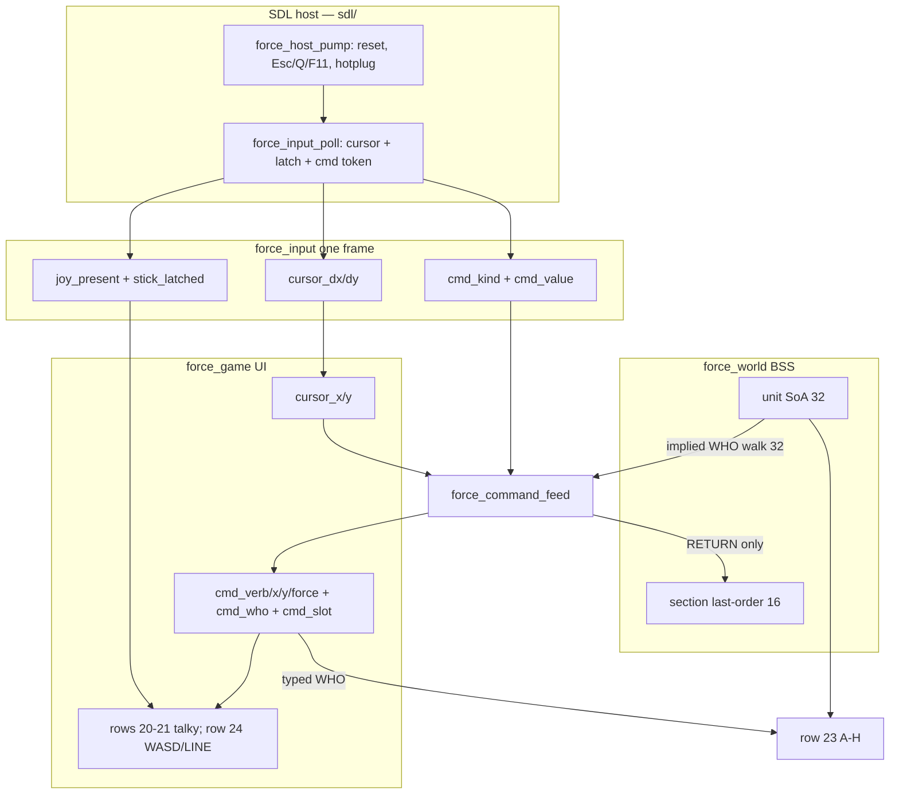

# Phase 3 — Command line

| Field | Value |
| --- | --- |
| Author | FORCE design session |
| Date | 2026-09-13 |
| Status | **landed** |
| Last worked on | 2026-09-13 |
| Repo path | [`design/phase-3-command-line.md`](phase-3-command-line.md) |
| Plan | [`development-plan.md`](development-plan.md) (Phase 3 frozen) |
| Source | `src/sdl/core/types.h`, `src/sdl/sdl/input.c`, `src/sdl/sdl/input.h`, `src/sdl/sdl/host.c`, `src/sdl/game/game.c`, `src/sdl/game/game.h`, `src/sdl/game/world.h`, `src/sdl/main.c` |
| Intent | [`../doc/FORCE_02_Command_Language_and_UI.md`](../doc/FORCE_02_Command_Language_and_UI.md), [`../doc/FORCE_05_Command_Card.md`](../doc/FORCE_05_Command_Card.md) |
| Binary as it is | [`../agents/README.md`](../agents/README.md), [`../agents/input.md`](../agents/input.md), [`../agents/game.md`](../agents/game.md), [`../agents/known-gaps.md`](../agents/known-gaps.md) |

Four-slot wizard, 4-byte command object. Bind `M` first. Chrome stops
being a poster. `Q` / `Esc` stay quit.

Index status is **landed**. The wizard is in `src/`.

---

## Overview

Phase 2 left a live unit pool and a section table whose last-order
bytes stay 0. The portable strip still paints a legend
(`VERB   WHO   WHERE   FORCE`), a constant `READY`, `CURSOR xx,yy`,
and an A–H roster that already means occupancy. Nothing parses. WASD
and arrows always feed `cursor_dx/dy`. `Q` / `Esc` quit in the host
event switch. `joy_present` is “pad-or-joy pointer non-NULL,” and
row 24 prints `JOY YES/NO`. That is a poster with a cursor.

Phase 3 makes the line real. Input grows an edge-triggered command
token and a stick-play **latch** (not `joy_present`). A wizard on
`force_game` fills a 4-byte in-progress object plus a parser-state
byte. `RETURN` commits onto `section_order_verb/x/y/force` for a
player letter 0–7. Parse `M`, `D`, `H`. Execute nothing that walks.
`A` in the VERB hole is illegal until Phase 6. Farm still draws.
`--smoke` still exits 0 after one frame; it cannot play the wizard.

This is not a stepper, not cover assignment, not combat, not `S` /
`J`, not a C64 emitter.

---

## Background & Motivation

### Current runtime (Phase 2, landed)

`force_input` (`src/sdl/core/types.h`) is five fields:

```c
typedef struct force_input {
    int cursor_dx;
    int cursor_dy;
    bool quit;
    bool toggle_fullscreen;
    bool joy_present;
} force_input;
```

`force_host_pump` (`src/sdl/sdl/host.c`) resets that struct every
frame, drains events, then `force_input_poll`. The event switch eats
non-repeat `Esc` / `Q` (quit) and `F11` (fullscreen). Letter keys are
not events. `input.c` ORs keyboard **state** for arrows **and** WASD
into `dx/dy`, then OR of first pad (dpad + left stick past
`STICK_DEAD` 16000) or else raw joy (hat 0 + axes 0/1). A static
repeat gate (`REPEAT_DELAY` 14, `REPEAT_RATE` 4) turns a hold into
cell steps. `joy_present = (pad != NULL || joy != NULL)`.

`force_game` (`src/sdl/game/game.h`) holds screen, 256K pixels,
`mission*` (name only), `world*` at `&force_world_bss`, cursor,
`frames`, `joy_present`. Tick applies `cursor_dx/dy`, clamps to the
world window, copies `joy_present`. Draw paints rows 20–24 from
string literals, then playfield from BSS units, then a yellow cursor.

Row 23 already hit-tests the cursor stack (walk 32, skip
`count == 0`, skip cell miss, skip `section >= FORCE_LETTER_MAX`,
first slot wins) and yellows that letter. That is implied WHO. It is
not a parser.

Section last-order columns exist and stay 0 (`world.c` init):

```c
world->section_order_verb[i]  = 0u;
world->section_order_x[i]     = 0u;
world->section_order_y[i]     = 0u;
world->section_order_force[i] = 0u;
```

FORCE_02 already specifies the language: four slots, defaults on
RETURN, 4-byte object + 1-byte parser state, illegal keys ignored.
FORCE_05 is the card. The binary has none of it. `agents/known-gaps.md`
and `agents/input.md` still name “no Tab-to-line” as the gap. That
Tab sentence is also still in `doc/FORCE_02`. Both are wrong for the
product this phase ships.

### Pain

- The strip is a poster. SHIFT+M does nothing. Last-order stays 0.
  Phase 4 has nothing to walk.
- WASD is both “move the camera-hand” and the Attack / Defend /
  Split mnemonics. A second mode (Tab-to-line) is how a player
  walks left when they meant assault, or drops a half-order because
  they thought they were talking.
- `joy_present` is device non-NULL. A pad sitting on the desk would
  steal WASD if presence were the mapping switch. It must not.
- Host KEY_DOWN ignores SDL repeat for quit, but letters today ride
  the cursor **hold** gate. Command keys that auto-repeat would
  spray `MMMMM` into the verb hole.
- FORCE_02 still tells implementers to Tab-focus the line. Leaving
  that sentence in `doc/` while shipping a live cursor is two
  languages.

### What Phase 2 already got right

One BSS world, units on that world, last-order bytes allocated and
zero, roster yellow = cursor stack, `game/` has no SDL, `core/` has
no SDL, host already opens first pad-or-joy and hotplugs, input
already resets every pump. Phase 3 writes the allocated last-order
from a wizard. It does not invent a second order table and does not
put SDL in `game/`.

---

## Goals & Non-Goals

### In (Phase 3)

- Four-slot wizard. Current hole is the only mode. No Tab, no
  command-mode / cursor-mode toggle.
- Cursor always live: unshifted WASD (keyboard play), arrows
  (every mapping), stick (when that device owns cursor). SHIFT+WASD
  talks, it does not step.
- Keyboard play: SHIFT+letter talks; unshifted A/D/S/W move the
  cursor; digits / comma / space / RETURN / DEL / BACKSPACE
  unshifted; SHIFT+letter always, including `M`.
- Stick play latched on first real pad/joy cursor move past
  `STICK_DEAD` (16000), not on `joy_present`. WASD released to
  letters. Unplug / stick closed clears the latch.
- Parse `M`, `D`, `H`. `A` in VERB is illegal (flash, ignore).
- `RETURN` commits the 4-byte object onto
  `section_order_verb/x/y/force` for WHO 0–7. Execute nothing.
- In-progress object lives on `force_game`. Half-orders do not
  touch the section.
- Chrome: mark the hole; talky values as the player types; committed
  line after RETURN; READY when idle; roster yellow = implied WHO
  (cursor stack) or the letter just typed.
- Illegal key: ignore, not buffered; flash the hole. No mixer.
- `--smoke` still one frame, exit 0. Interactive SHIFT+M path is
  the wizard gate. Stick latch is manual if a device is present;
  no-stick must not fail CI.
- Farm pixels unchanged. No new TMX. Do not restamp cover.
- `agents/input.md`, `agents/game.md`, `agents/known-gaps.md`,
  `agents/testing.md`, `agents/architecture.md` if `force_input` /
  the tree changes, `design/README.md` (this doc **active** →
  **landed** when implemented). Product Tab language dies in
  `doc/FORCE_02` (and the card if it needs SHIFT) in the **same**
  landing PR.
- `design/development-plan.md` only when behaviour is in `src/`
  (not this design-only file).

### Out (later phases)

| Later | Why it is not Phase 3 |
| --- | --- |
| Execute walking (Phase 4) | Last-order is written; the stepper does not run. |
| Cover assignment, `D` as a cover fill (Phase 5) | Phase 3 writes the Defend bytes. Assignment is Phase 5. |
| Combat, `A`, `K`, ROE (Phase 6) | `A` is illegal in VERB. Do not bind Attack. |
| Intel, camera, `Z` / `C` / `E` (Phase 8) | Unbound. Window is still the load copy. |
| `S` / `J`, engineers (Phase 9) | FORCE still defaults to 10. Do not bind Split. |
| F1–F4 macros | C64 has F1/F3/F5/F7. Deferred. |
| CTRL+letter for orders | OS collisions. CTRL hold is cheat sheet later. |
| Verbs on 0–9 | WHERE and FORCE are digits. Mnemonic is A=Attack. |
| RUN-STOP / Esc cancel | Esc/Q stay quit. DEL pops the wizard. |
| SID / mixer | No audio device. Flash the hole. |
| LZSS, colour-RAM, C64 emitter (Phase 10) | No `src/c64/`. |
| `malloc`, VLA, `tests/` tree, mouse | Forbidden now and later. |

---

## Key Decisions

Locked. Not reopened as Open Questions. Product conversation
2026-09-13 plus FORCE_02 defaults.

1. **Kill Tab-as-mode.** There is no command-mode / cursor-mode
   toggle. The wizard already has a mode: the current slot. Tab
   (FORCE_02 “Tab focuses the line” / “Tab out of the line”) is
   rejected. A second mode is how you drop half-orders. The landing
   PR **must** patch `doc/FORCE_02_Command_Language_and_UI.md` (and
   the command card if it mentions Tab — it does not today) so
   product intent matches. `agents/known-gaps.md` and
   `agents/input.md` currently name “no Tab-to-line” as a gap;
   replace that with the mapping below.

2. **Cursor is always live.** WASD (keyboard play), arrows (every
   mapping), and stick (when stick play is latched) always move the
   cell cursor, including mid-order. WHERE can stay “cell under
   cursor” plus optional digits. Never steal the body to talk.

3. **Keyboard play (cold start, and whenever the latch is clear).**
   Cursor: unshifted WASD + arrows. Talk to the line: **SHIFT+letter**.
   Digits, comma, space, RETURN, DEL/BACKSPACE: unshifted.
   Unshifted A/D/S/W move the cursor; they do not start
   Attack/Defend/Split. **SHIFT+WASD does not move the cursor** —
   that frame is a letter token only. Poll must gate WASD with
   `!stick_latched && !shift`, not “WASD same as today.” One
   keyboard rule: SHIFT is push-to-talk for A–Z going into the
   current hole. Do **not** alias unshifted `M` as Move on keyboard
   (`M` is not WASD, but teaching “SHIFT only when it collides” is
   how people walk left when they meant assault). SHIFT+letter
   always works.

4. **Stick play is a latch, not presence.** A pad sitting on the
   desk must not steal WASD. `joy_present` (device non-NULL) is
   **not** the mapping switch. Cold start: keyboard mapping.
   **First real stick/pad cursor move past existing `STICK_DEAD`
   (16000)** — analog, dpad, or hat — latches stick play. Stick
   play: stick + arrows own the cursor; **WASD is released** (those
   keys become letters); unshifted letters go to the line;
   SHIFT+letter still goes to the line. Unplug / stick closed:
   latch clears, back to WASD + SHIFT. Arrows always move the
   cursor in every mapping (no letter collision; keyboard escape
   hatch). Gamepad (first pad) and raw joystick are the same latch.
   Host already opens first pad-or-joy and hotplugs
   (`src/sdl/sdl/host.c`). **Leave `host.c` unchanged.** Unplug is
   `close_sticks` then `open_first_stick` in the **same** pump, so
   poll almost never sees both pointers NULL on a device swap.
   Latch clears when both pointers are NULL **or the pad/joy
   identity changed** since last poll (see poll snippet). A
   replacement device waits for its own move. Latch does **not**
   clear when the stick recentres.

5. **Row 24 shows the mapping, not just presence.** Exact chrome
   (col 1, same `snprintf` shape as today, mission name unchanged):

   ```text
   SDL  farm_mission  JOY NO  WASD
   SDL  farm_mission  JOY YES  WASD
   SDL  farm_mission  JOY YES  LINE
   ```

   Format string: `"SDL  %s  JOY %s  %s"` with `YES`/`NO` from
   `joy_present` and `WASD`/`LINE` from `stick_latched`. `LINE`
   means unshifted A is a letter, not left. `JOY NO` is always
   `WASD` (latch already cleared). Do not print `JOY YES` as if
   that were the mapping.

6. **Verbs Phase 3 parses: `M`, `D`, `H`.** Execute nothing that
   walks. `RETURN` commits the 4-byte object onto the section
   last-order bytes that already exist. `A` in the VERB slot is
   illegal until Phase 6 (flash / ignore). Do not bind `S` / `J`
   (Phase 9), `Z` / `C` / `E` (Phase 8), `K` (Phase 6). Do not put
   verbs on 0–9. Do not use F-keys as the verb alphabet. Do not
   use CTRL+letter for orders.

7. **Defaults on RETURN (FORCE_02, locked).** WHO: section under
   cursor (same player-stack hit-test as roster yellow), else last
   section used. WHERE: cursor **map** cell. FORCE: 10 (we do not
   bind `S` this phase). **One RETURN commits**, applying those
   defaults to every still-empty hole. FORCE_02’s `D, RETURN,
   RETURN, RETURN` lists the three defaults, not three required
   keystrokes; `A, C, RETURN` is the speed path and is the
   behaviour. The landing PR restates that on the card so the
   triple-RETURN line cannot be read as a stepper.

8. **In-progress line is not last-order until RETURN.** Do not leak
   a half-order onto the section. Parser + 4-byte draft live on
   `force_game` (UI). Last-order stays world columns. Verb values
   are a small enum, **not** ASCII `'M'`. WHO is 0–7 or `$FF`
   unset; the command line never names 8–15. FORCE is a nibble
   0–10 stored in the existing full byte (`section_order_force`);
   do not pack two nibbles.

9. **Command keys are edge-triggered.** One token per press, at
   most one per frame. They must **not** ride the cursor hold gate
   (`REPEAT_DELAY` / `REPEAT_RATE`). Host already calls
   `force_input_reset` at the start of every pump; do not
   accumulate command keys across frames. `game/` has no SDL.
   Input arrives as data on `force_input`.

10. **Stick latch is a `static` in `force_input_poll`**, next to
    existing `hold` / `last_dx` / `last_dy`, plus `prev_pad` /
    `prev_joy` for identity. Same caveat: survives teardown / one
    host. Poll copies the latch onto `force_input` every frame.
    Do not put it on `force_host` (opaque SDL; game never sees
    that struct).

11. **Parser lives in `game/command.c`.** UI state machine + strip
    talky paint. No SDL. `world.c` stays occupancy. `game.c` stays
    tick / blit / roster / cursor. See Alternatives.

12. **Illegal keys are ignored, not buffered.** Flash the current
    hole (`FORCE_LIGHT_RED`, **8 draws**). Tick decrements
    `cmd_flash` at the **start** of the frame, before feed, so a
    feed that sets 8 is still red on that frame’s draw and on the
    next seven. No SID, no `SDL_Audio`, no mixer. DEL/BACKSPACE
    pops (exact order under Proposed Design). On an empty verb
    slot (idle) it is a no-op. Esc/Q stay **quit**. Do not steal
    Esc for RUN-STOP.

13. **Talky chrome while learning.** Row 20 marks the hole. Row 21
    shows `MOVE A AT 10,20 FORCE 10` as slots fill; `READY` when
    idle; the committed line after RETURN. Compact `ATK…` is later.
    Roster yellow still means implied WHO (cursor stack); the letter
    just typed overrides to yellow. Farm still draws. No new TMX.

14. **Seed `cmd_last_who` at init** from the first player letter
    with `section_strength[i] > 0`, else `$FF`. Farm → A. Cold-start
    `M` RETURN on empty grass then still has a WHO default. “Never
    used” last-order verb 0 is unchanged (that is the section row,
    not the UI last-who).

15. **One landing cut.** Do not ship “input mapping exists but
    chrome is still a poster” or “parser writes last-order into the
    void.” SHIFT+M must be visible. Optional tiny `force_input`
    struct PR only if it still compiles and behaves identically.

16. **Still no:** walking, cover fill, combat, `A`/`K`/`S`/`J`/`Z`/
    `C`/`E`, F-macros, CTRL-orders, verbs-on-digits, Tab mode,
    mouse, malloc, C64 emitter, a second TMX, `tests/` tree,
    stealing Esc, a mixer.

---

## Proposed Design

### Runtime data flow



After init, the arrow from draft to last-order exists **only** on
the RETURN commit path.

### Sequence: one SHIFT+M, RETURN

```mermaid
sequenceDiagram
  participant host as force_host_pump
  participant poll as force_input_poll
  participant tick as force_game_tick
  participant cmd as force_command_feed
  participant world as section_order_*
  participant draw as force_game_draw

  host->>host: force_input_reset
  host->>poll: pad/joy pointers
  poll->>poll: WASD cursor if !latched && !shift
  poll->>poll: letter edge + SHIFT → cmd_kind=LETTER, value=M
  tick->>tick: cursor += dx/dy
  tick->>cmd: feed(g, in)
  cmd->>cmd: VERB M legal → slot WHO, verb MOVE
  Note over cmd,world: no last-order write
  draw->>draw: hole WHO marked; row 21 "MOVE"
  Note over host,draw: later RETURN
  cmd->>cmd: defaults WHO/WHERE/FORCE
  cmd->>world: section_order_*[who] = verb,x,y,force
  draw->>draw: row 21 committed line; slot SHOW
```

### Mapping

Two mappings. Switch is the latch, not `joy_present`.

| | Keyboard play (`stick_latched == false`) | Stick play (`true`) |
| --- | --- | --- |
| Cursor | unshifted WASD + arrows + stick/dpad/hat (stick past deadzone also **sets** the latch) | stick/dpad/hat + **arrows only** |
| A–Z into the hole | SHIFT+letter, edge | unshifted **or** SHIFT+letter, edge |
| Unshifted WASD | cursor | letters (A/D/S/W talk) |
| SHIFT+WASD | letter only — **no** cursor step | letter only — **no** cursor step |
| Unshifted M | ignored (not cursor, not talk) | Move |
| Digits / comma / space / RETURN / DEL | scancodes; SHIFT does not turn 1 into `!` | same |
| Arrows | always cursor (even with SHIFT) | always cursor |
| Q / Esc | host quit (event switch, before poll) | same — Q is not a letter this phase |

Latch set when this frame’s **stick vector** `sdx`/`sdy` is
non-zero **before** OR-ing with the keyboard vector and **before**
the repeat gate (analog past 16000, or dpad, or hat). Keyboard
WASD must not set the latch. Do not latch on the summed `dx/dy`
or on `fire`.

Latch **clear** when `pad == NULL && joy == NULL` **or** the pad
pointer or joy pointer differs from last poll. Host unplug is
`close_sticks` then `open_first_stick` in the same pump
(`GAMEPAD_REMOVED` / `JOYSTICK_REMOVED` in `host.c` lines
168–181; `GAMEPAD_ADDED` while a raw joy is open, lines 159–167),
so poll almost never observes a NULL frame on a **swap**. Identity
change is the swap detector. A same-pump unplug with no remaining
device still presents both pointers NULL and clears. A replacement
device does not auto-latch until **it** moves. Leave `host.c`
unchanged.

Accidental nudge latches until unplug or identity change.
Recovery: arrows still move the cursor; SHIFT+letter still talks;
unplug clears. Do not invent a keyboard unlatch chord.

### `force_input` fields

`src/sdl/core/types.h` grows the one-frame struct. `core/` still
has no SDL.

```c
enum force_cmd_kind {
    FORCE_CMD_NONE = 0,
    FORCE_CMD_LETTER,   /* cmd_value 0-25 = A-Z */
    FORCE_CMD_DIGIT,    /* cmd_value 0-9 */
    FORCE_CMD_COMMA,
    FORCE_CMD_SPACE,
    FORCE_CMD_RETURN,
    FORCE_CMD_DEL
};

typedef struct force_input {
    int cursor_dx;
    int cursor_dy;
    bool quit;
    bool toggle_fullscreen;
    bool joy_present;
    bool stick_latched;
    uint8_t cmd_kind;
    uint8_t cmd_value;
} force_input;
```

`force_input_reset` zeroes **all** of the above (`cmd_kind =
FORCE_CMD_NONE`, `cmd_value = 0`, `stick_latched = false`). Poll
fills them. Do not persist a command token across frames.

### `force_input_poll`

Still the only TU that includes SDL for keys/sticks besides host.
Host event switch stays quit / F11 / hotplug. Letters are **not**
host KEY_DOWN. Keyboard **state** + previous-down statics give
edges, so SDL key-repeat cannot spray the wizard.

Statics in the poll function (same teardown / one-host caveat as
today’s `hold` / `last_dx` / `last_dy`):

```c
static int hold, last_dx, last_dy;
static bool stick_latched;
static SDL_Gamepad *prev_pad;
static SDL_Joystick *prev_joy;
static uint32_t prev_letters; /* bit i = letter A+i was down */
static uint16_t prev_digits;  /* bit d = digit d was down */
static uint8_t prev_misc;     /* bit0 RETURN, bit1 DEL, bit2 COMMA, bit3 SPACE */
```

Restructured poll. Two vectors, then the existing hold gate.
Do **not** latch on the summed `dx/dy` or on `fire`. Do **not**
OR stick into the same `dx` as WASD and then ask “did anything
move.”

```c
void force_input_poll(force_input *in, SDL_Gamepad *pad, SDL_Joystick *joy)
{
    const bool *key;
    int kdx = 0, kdy = 0;
    int sdx = 0, sdy = 0;
    int dx, dy;
    bool fire;
    bool shift;

    key = SDL_GetKeyboardState(NULL);
    shift = (SDL_GetModState() & SDL_KMOD_SHIFT) != 0;

    /* Host close_sticks + open_first_stick is the same pump.
       Pointer change or both NULL clears the latch. */
    if ((pad == NULL && joy == NULL) ||
        pad != prev_pad || joy != prev_joy) {
        stick_latched = false;
    }
    prev_pad = pad;
    prev_joy = joy;

    in->joy_present = (pad != NULL || joy != NULL);

    if (key[SDL_SCANCODE_LEFT])  { kdx -= 1; }
    if (key[SDL_SCANCODE_RIGHT]) { kdx += 1; }
    if (key[SDL_SCANCODE_UP])    { kdy -= 1; }
    if (key[SDL_SCANCODE_DOWN])  { kdy += 1; }
    if (!stick_latched && !shift) {
        if (key[SDL_SCANCODE_A]) { kdx -= 1; }
        if (key[SDL_SCANCODE_D]) { kdx += 1; }
        if (key[SDL_SCANCODE_W]) { kdy -= 1; }
        if (key[SDL_SCANCODE_S]) { kdy += 1; }
    }

    if (pad != NULL) {
        Sint16 ax = SDL_GetGamepadAxis(pad, SDL_GAMEPAD_AXIS_LEFTX);
        Sint16 ay = SDL_GetGamepadAxis(pad, SDL_GAMEPAD_AXIS_LEFTY);
        if (SDL_GetGamepadButton(pad, SDL_GAMEPAD_BUTTON_DPAD_LEFT) ||
            ax < -STICK_DEAD) { sdx -= 1; }
        if (SDL_GetGamepadButton(pad, SDL_GAMEPAD_BUTTON_DPAD_RIGHT) ||
            ax >  STICK_DEAD) { sdx += 1; }
        if (SDL_GetGamepadButton(pad, SDL_GAMEPAD_BUTTON_DPAD_UP) ||
            ay < -STICK_DEAD) { sdy -= 1; }
        if (SDL_GetGamepadButton(pad, SDL_GAMEPAD_BUTTON_DPAD_DOWN) ||
            ay >  STICK_DEAD) { sdy += 1; }
    } else if (joy != NULL) {
        Sint16 ax = SDL_GetJoystickAxis(joy, 0);
        Sint16 ay = SDL_GetJoystickAxis(joy, 1);
        Uint8 hat = 0;
        if (SDL_GetNumJoystickHats(joy) > 0) {
            hat = SDL_GetJoystickHat(joy, 0);
        }
        if ((hat & SDL_HAT_LEFT)  || ax < -STICK_DEAD) { sdx -= 1; }
        if ((hat & SDL_HAT_RIGHT) || ax >  STICK_DEAD) { sdx += 1; }
        if ((hat & SDL_HAT_UP)    || ay < -STICK_DEAD) { sdy -= 1; }
        if ((hat & SDL_HAT_DOWN)  || ay >  STICK_DEAD) { sdy += 1; }
    }
    sdx = clamp_dir(sdx);
    sdy = clamp_dir(sdy);
    if (sdx != 0 || sdy != 0) {
        stick_latched = true;   /* stick vector only, not kdx/kdy, not fire */
    }

    dx = clamp_dir(kdx + sdx);
    dy = clamp_dir(kdy + sdy);

    fire = false;
    if (dx == 0 && dy == 0) {
        hold = 0;
    } else if (hold == 0 || dx != last_dx || dy != last_dy) {
        fire = true;
        hold = 1;
        last_dx = dx;
        last_dy = dy;
    } else {
        hold += 1;
        if (hold >= REPEAT_DELAY &&
            ((hold - REPEAT_DELAY) % REPEAT_RATE) == 0) {
            fire = true;
        }
    }

    in->cursor_dx = fire ? dx : 0;
    in->cursor_dy = fire ? dy : 0;
    in->stick_latched = stick_latched;

    /* Command edges below: not fire/hold. cmd_kind starts NONE. */
    ...
}
```

Command path (after the cursor block, **not** using `fire` /
`hold`):

1. `in->cmd_kind = FORCE_CMD_NONE`; `in->cmd_value = 0`.
2. Reuse this frame’s `shift`.
3. Scan **this frame’s edges** in fixed order; first hit wins:

   | Order | Scancodes | Token |
   | ---: | --- | --- |
   | 1 | `RETURN`, `KP_ENTER` | `FORCE_CMD_RETURN` |
   | 2 | `BACKSPACE`, `DELETE` | `FORCE_CMD_DEL` |
   | 3 | `COMMA` | `FORCE_CMD_COMMA` |
   | 4 | `SPACE` | `FORCE_CMD_SPACE` |
   | 5 | `0`–`9`, then `KP_0`–`KP_9` | `FORCE_CMD_DIGIT`, value 0–9 |
   | 6 | `A`–`Z` | `FORCE_CMD_LETTER`, value 0–25 |

4. Letter accepted only if `stick_latched || shift`. Unshifted
   letters in keyboard play are not tokens (WASD already consumed
   as cursor when `!shift`; `M` and the rest are ignored).
5. Digits use **scancodes**, not text input. SHIFT+1 is still digit
   1, never `'!'`. That is the punctuation mitigation.
6. Tab, F-keys (except host F11), CTRL, and everything else: no
   token.
7. Store `prev_*` from this frame’s down state for the next poll.

A new stick that is already past deadzone on its first poll
**does** latch (`sdx || sdy` after the identity clear). A new
stick at rest does not. WASD never sets `stick_latched`.

Q is never a letter: host KEY_DOWN sets `quit` and **skips poll**
(`host.c` returns false before `force_input_poll`). Leave that.
`Q` is not a verb on the card.

### Verb enum (world, not ASCII)

Last-order is a world column. The stepper (Phase 4) will switch on
it without including `game.h`. Put the enum in `world.h` next to
the section columns. Do **not** add `FORCE_VERB_ATTACK` yet — a
value is a licence to write it.

```c
/* src/sdl/game/world.h */
enum force_verb {
    FORCE_VERB_NONE   = 0,  /* never ordered this mission */
    FORCE_VERB_MOVE   = 1,  /* M */
    FORCE_VERB_DEFEND = 2,  /* D */
    FORCE_VERB_HALT   = 3   /* H */
};
```

`0` stays Phase 2’s “never used this mission” (`lead == $FF` **and**
verb 0). After Halt, verb is `FORCE_VERB_HALT`, not 0. FORCE_08: `H`
**writes** last order; it does not clear the field.

### Parser bytes on `force_game`

UI, not BSS world. `force_game` is already a stack local in `main`
with a 256K framebuffer. The 6502 budget is eight zero-page bytes
the C fields stand for, not another 9K.

6502 packing (document; C may split fields):

| Byte | Contents |
| --- | --- |
| object[0] | verb enum |
| object[1] | WHERE x (map cell) |
| object[2] | WHERE y (map cell) |
| object[3] | FORCE 0–10 |
| who | 0–7 or `$FF` |
| state | hole 0–5 in bits 0–2 (`IDLE=0` … `FORCE=4`, `SHOW=5`), digit count in bits 3–4. SHOW is hole 5; no extra SHOW bit. |
| last_who | 0–7 or `$FF` |
| flash | frames remaining |

C11 on `force_game` (`game.h`):

```c
typedef struct force_game {
    force_screen screen;
    uint32_t pixels[FORCE_FB_W * FORCE_FB_H];
    const force_mission *mission;
    force_world *world;
    int cursor_x;
    int cursor_y;
    uint32_t frames;
    bool joy_present;
    bool stick_latched;
    uint8_t cmd_verb;
    uint8_t cmd_who;       /* 0-7 or FORCE_UNIT_NONE */
    uint8_t cmd_x;
    uint8_t cmd_y;
    uint8_t cmd_force;     /* 0-10; 0xFF unset */
    uint8_t cmd_slot;      /* enum force_cmd_slot */
    uint8_t cmd_digits;    /* 0-2 in the current number */
    uint8_t cmd_last_who;  /* 0-7 or FORCE_UNIT_NONE */
    uint8_t cmd_flash;     /* 0 = off */
} force_game;

enum force_cmd_slot {
    FORCE_SLOT_IDLE = 0,   /* waiting for verb; READY */
    FORCE_SLOT_WHO,
    FORCE_SLOT_WHERE_X,
    FORCE_SLOT_WHERE_Y,
    FORCE_SLOT_FORCE,
    FORCE_SLOT_SHOW        /* committed line on row 21 */
};
```

There is no sitting `FORCE_SLOT_VERB`: idle **is** “VERB hole
waiting.” After a legal verb, slot becomes `WHO`. After popping
WHO empty, slot returns to `IDLE` and verb is cleared.

`FORCE` unset sentinel is `0xFF` (`cmd_force`). `0` is a legal
nibble (contact → break). WHO unset is `FORCE_UNIT_NONE`. Do not
use `FORCE_LETTER_MAX` (8) as unset — that is enemy A.

### `game/command.c`

New TU. `src/sdl/CMakeLists.txt` lists it next to `game/world.c`.
No SDL headers. Does not include `sdl/host.h`.

```c
/* src/sdl/game/command.h */
void force_command_init(force_game *g);
void force_command_feed(force_game *g, const force_input *in);
void force_command_paint(force_game *g);          /* rows 20-21 */
uint8_t force_command_implied_who(const force_game *g);
```

`force_command_implied_who` is the Phase 2 roster walk, exported so
RETURN defaults and row 23 share one scan of 32:

```c
uint8_t force_command_implied_who(const force_game *g)
{
    const force_world *w = g->world;
    const int mx = (int)w->win_x + g->cursor_x;
    const int my = (int)w->win_y + g->cursor_y;
    uint8_t i;

    for (i = 0u; i < FORCE_UNIT_MAX; ++i) {
        if (w->unit_count[i] == 0u) {
            continue;
        }
        if ((int)w->unit_x[i] != mx || (int)w->unit_y[i] != my) {
            continue;
        }
        if (w->unit_section[i] >= FORCE_LETTER_MAX) {
            continue;
        }
        return w->unit_section[i];   /* first slot wins */
    }
    return FORCE_UNIT_NONE;
}
```

`force_command_init` (from `force_game_init`, **after**
`force_world_load` — KD 14 seeds from `section_strength`):

```c
static void draft_reset(force_game *g)
{
    g->cmd_verb = FORCE_VERB_NONE;
    g->cmd_who = FORCE_UNIT_NONE;
    g->cmd_x = 0;
    g->cmd_y = 0;
    g->cmd_force = 0xFFu;
    g->cmd_slot = FORCE_SLOT_IDLE;
    g->cmd_digits = 0;
    g->cmd_flash = 0;
    /* cmd_last_who is not this function */
}

void force_command_init(force_game *g)
{
    uint8_t i;

    draft_reset(g);
    g->cmd_last_who = FORCE_UNIT_NONE;
    for (i = 0u; i < FORCE_LETTER_MAX; ++i) {
        if (g->world->section_strength[i] > 0u) {
            g->cmd_last_who = i;
            break;
        }
    }
}
```

Farm → last-who 0 (A). SHOW→IDLE and SHOW+legal-verb call
`draft_reset` only — they **do not** reseed `cmd_last_who`.
`force_game_init` also sets `g->stick_latched = false` next to
the existing `g->joy_present = false`.

`command.c` includes `"game/command.h"`, `"core/screen.h"`, and
`<stdio.h>` (talky `snprintf`, same as `game.c`).

### Feed

`force_game_tick` order:

1. If `g->cmd_flash > 0`: `g->cmd_flash -= 1`. **Before** feed, so
   a feed that sets 8 is still 8 on this draw (8 draws literal).
2. Existing cursor apply + clamp (window).
3. `g->joy_present = in->joy_present;`
   `g->stick_latched = in->stick_latched;`
4. `force_command_feed(g, in);` — may set `cmd_flash = 8`.
5. `g->frames += 1`.

Cursor moves **before** feed so RETURN in the same frame uses the
new cell. Command token is this frame only.

Illegal: `cmd_flash = 8`, no other state change, no buffering.
SHOW has no marked hole; an illegal letter on SHOW flashes VERB
(the hole that letter would fill).

Map cell helpers (feed and paint):

```c
uint8_t map_x = (uint8_t)(g->world->win_x + g->cursor_x);
uint8_t map_y = (uint8_t)(g->world->win_y + g->cursor_y);
```

Digit count of a live accumulator (pop-back; lossy for `00` vs
`0`, accepted):

```c
static uint8_t digits_of(uint8_t v)
{
    if (v >= 10u) {
        return 2u;
    }
    if (v > 0u) {
        return 1u;
    }
    return 0u;
}
```

#### Slot × token

One `switch (g->cmd_slot) { switch (in->cmd_kind) }` in
`force_command_feed`. SPACE is identical to COMMA (column SEP).
`FORCE_CMD_NONE` is a no-op in every slot. Actions: **nop**,
**flash** (set 8, no other change), **accept**, **commit**
(RETURN path below), **pop**.

| Slot | NONE | LETTER | DIGIT | SEP | RETURN | DEL |
| --- | --- | --- | --- | --- | --- | --- |
| `IDLE` | nop | verb† | flash | flash | nop | nop |
| `SHOW` | nop | verb† or flash | nop | nop | nop | dismiss‡ |
| `WHO` | nop | A–H accept; I–Z flash | flash | flash | commit | pop WHO |
| `WHERE_X` | nop | flash | X digit / 3rd flash | X→Y if digits>0 else flash | commit | pop X |
| `WHERE_Y` | nop | flash | Y digit / 3rd flash | Y→FORCE if digits>0 else flash | commit | pop Y |
| `FORCE` | nop | flash | nibble / 11 or 3rd flash | flash | commit | pop F |

† Verb letter: `M`→`FORCE_VERB_MOVE`, `D`→`FORCE_VERB_DEFEND`,
`H`→`FORCE_VERB_HALT`, slot `WHO`, digits 0. `A` and any other
letter: **flash**, stay. From `SHOW` a legal verb first
`draft_reset` (keep `cmd_last_who`), then the same accept. From
`IDLE` the draft is already empty.

‡ Dismiss: `draft_reset` (keep `cmd_last_who`), slot `IDLE`.
Last-order already written. Roster yellow returns to cursor-stack
implied WHO because `cmd_who` is `$FF`. Row 21 is `READY`.

Halt never enters `WHERE_*` / `FORCE`. After a Halt WHO letter,
stay on `WHO` (waiting RETURN). After a Move/Defend WHO letter:
`cmd_who = value`, slot `WHERE_X`, `cmd_digits = 0`.

Digit rules (WHERE_X / WHERE_Y / FORCE):

- Accumulator is `cmd_x` / `cmd_y` / `cmd_force`.
- `value = value * 10 + d` then `cmd_digits += 1`, but:
- **Third digit** (`cmd_digits == 2` already): flash, keep the
  2-digit value. Do not wrap `uint8_t`.
- FORCE first digit (`cmd_digits == 0`, `cmd_force == 0xFF`):
  `cmd_force = d`, `cmd_digits = 1`. `d` is 0–9.
- FORCE second digit: accept only if `cmd_force * 10 + d <= 10`
  (so `10` is the only two-digit nibble). `11` flashes, keeps `1`.
- FORCE `cmd_digits == 0` **is** unset: `cmd_force` must be `0xFF`.
- WHERE clamp to `width-1` / `height-1` **on commit**, not per
  key (`g->world->width/height`, not the window). Typed 99 on
  farm 40×20 becomes 39,19. Legal to name a cell off the current
  window; Phase 8 scrolls. Phase 3 just stores it.

SEP (comma or space):

- `WHERE_X` and `cmd_digits > 0`: slot `WHERE_Y`, `cmd_digits = 0`,
  `cmd_y = 0`.
- `WHERE_Y` and `cmd_digits > 0`: slot `FORCE`, `cmd_digits = 0`,
  `cmd_force = 0xFF`.
- Else: flash (FORCE_02: comma starts Y **after X digits**).

DEL:

| Slot | Condition | Result |
| --- | --- | --- |
| `IDLE` | — | nop |
| `SHOW` | — | `draft_reset`, keep last-who → `IDLE` |
| `WHERE_X` / `WHERE_Y` / `FORCE` | `cmd_digits > 0` | `value /= 10`, `cmd_digits -= 1`; if FORCE and digits hits 0: `cmd_force = 0xFF`. Stay. |
| `FORCE` | digits 0 | slot `WHERE_Y`, `cmd_force = 0xFF`, `cmd_digits = digits_of(cmd_y)` |
| `WHERE_Y` | digits 0 | slot `WHERE_X`, `cmd_digits = digits_of(cmd_x)` (keep `cmd_x`) |
| `WHERE_X` | digits 0 | slot `WHO`, `cmd_who = $FF`, `cmd_x = 0` |
| `WHO` | who `$FF` | `draft_reset`, keep last-who → `IDLE` |
| `WHO` | who 0–7 (Halt, waiting RETURN) | `cmd_who = $FF`, stay `WHO` |

Esc is not in this table.

Skeleton:

```c
void force_command_feed(force_game *g, const force_input *in)
{
    uint8_t kind = in->cmd_kind;
    uint8_t val  = in->cmd_value;

    if (kind == FORCE_CMD_NONE) {
        return;
    }
    if (kind == FORCE_CMD_SPACE) {
        kind = FORCE_CMD_COMMA;
    }
    switch (g->cmd_slot) {
    case FORCE_SLOT_IDLE: /* LETTER → accept_verb; RETURN/DEL nop; else flash */ break;
    case FORCE_SLOT_SHOW: /* LETTER → draft_reset+accept_verb; DEL → draft_reset; RETURN/DIGIT/SEP nop; else flash */ break;
    case FORCE_SLOT_WHO:  /* LETTER A-H; RETURN commit; DEL pop; else flash */ break;
    case FORCE_SLOT_WHERE_X:
    case FORCE_SLOT_WHERE_Y:
    case FORCE_SLOT_FORCE: /* DIGIT / SEP / RETURN commit / DEL pop; LETTER flash */ break;
    default: break;
    }
}

static void accept_verb(force_game *g, uint8_t letter)
{
    if (letter == 12u) {          /* M */
        g->cmd_verb = FORCE_VERB_MOVE;
    } else if (letter == 3u) {    /* D */
        g->cmd_verb = FORCE_VERB_DEFEND;
    } else if (letter == 7u) {    /* H */
        g->cmd_verb = FORCE_VERB_HALT;
    } else {
        g->cmd_flash = 8u;        /* A and the rest */
        return;
    }
    g->cmd_slot = FORCE_SLOT_WHO;
    g->cmd_who = FORCE_UNIT_NONE;
    g->cmd_digits = 0;
}
```

SHOW + legal verb: `draft_reset(g)` then `accept_verb`. SHOW +
`A`: flash, stay SHOW (do not reset). IDLE + legal verb:
`accept_verb` only.

#### RETURN — commit

One RETURN commits. Fill empty holes, write last-order, slot
`SHOW`. Do not write if WHO cannot be resolved.

Resolve WHO:

```
who = cmd_who
if who == FORCE_UNIT_NONE:
    who = force_command_implied_who(g)
if who == FORCE_UNIT_NONE:
    who = cmd_last_who
if who == FORCE_UNIT_NONE:
    illegal, flash WHO, do not commit
```

Resolve WHERE (skipped for Halt):

- If never left WHO (no WHERE digits, slot is `WHO` because Halt,
  or RETURN from WHO on Move/Defend with empty WHERE): cursor map
  cell.
- If `WHERE_X` with `cmd_digits == 0`: cursor map cell.
- If `WHERE_X` with digits, Y never started: X = `cmd_x`, Y =
  cursor map y.
- If `WHERE_Y` with `cmd_digits == 0`: Y = cursor map y, X =
  `cmd_x`.
- If `WHERE_Y` with digits, or slot `FORCE`: X = `cmd_x`, Y =
  `cmd_y`.
- Then clamp X to `width-1`, Y to `height-1`.

Halt WHERE (FORCE_08: write hold-here, do not clear): lead cell if
`section_lead[who] != FORCE_UNIT_NONE` (`unit_x/y` of that slot),
else `section_last_x/y[who]`. Force byte 10 (unused by Halt, written
for a consistent object).

Resolve FORCE (skipped for Halt as a hole; still write 10):

- If `cmd_force == 0xFF` or never entered FORCE: 10.
- Else: the typed 0–10.

Write **only** here:

```c
w->section_order_verb[who]  = g->cmd_verb;
w->section_order_x[who]     = x;
w->section_order_y[who]     = y;
w->section_order_force[who] = force;   /* 0-10 */
g->cmd_who = who;
g->cmd_x = x;
g->cmd_y = y;
g->cmd_force = force;
g->cmd_last_who = who;
g->cmd_slot = FORCE_SLOT_SHOW;
g->cmd_digits = 0;
```

`who` is 0–7. Never index 8–15 from this path. Tick does **not**
read last-order to move units. On SHOW, `cmd_who` stays the
committed letter so the roster stays yellow until dismiss or a
new draft.

### Chrome

`force_game_draw` **deletes** the two poster `puts`
(`"VERB   WHO   WHERE   FORCE"` and `"READY"` at
`src/sdl/game/game.c` lines 178–179). It still `force_screen_clear`,
`force_screen_fill` rows 20–23 with space, then
`force_command_paint` (rows 20–21, **all four** tokens every
frame), then CURSOR row 22 **in `game.c`**, then roster 23, then
host 24. If paint only recolored the current hole, leftover
poster yellow would stay on the other tokens.

Row 20 — `force_command_paint` writes every token every frame
at the columns the poster already used:

| Token | x | cols |
| --- | ---: | --- |
| `VERB` | 1 | 1–4 |
| `WHO` | 8 | 8–10 |
| `WHERE` | 14 | 14–18 |
| `FORCE` | 22 | 22–26 |

Current hole: `FORCE_YELLOW` on `FORCE_BLACK`. Idle marks **VERB**.
`WHERE_X` and `WHERE_Y` both mark `WHERE`. **SHOW: all four
white** (no hole). Flash (`cmd_flash > 0`): that token
`FORCE_LIGHT_RED` on `FORCE_BLACK` instead (on SHOW, flash VERB).
Other tokens `FORCE_WHITE` on `FORCE_BLACK`. Halt’s unused
WHERE/FORCE stay white, never marked.

```c
static const char *const hole_name[4] = { "VERB", "WHO", "WHERE", "FORCE" };
static const int hole_x[4] = { 1, 8, 14, 22 };
/* hole_now: 0 idle/SHOW-flash-VERB, 1 WHO, 2 WHERE_X/Y, 3 FORCE;
   SHOW with flash==0: paint all white (hole_now = 0xFF). */
for (i = 0; i < 4; ++i) {
    uint8_t fg = FORCE_WHITE;
    if (i == (int)hole_now) {
        fg = (g->cmd_flash > 0u) ? FORCE_LIGHT_RED : FORCE_YELLOW;
    }
    force_screen_puts(s, hole_x[i], 20, hole_name[i], fg, FORCE_BLACK);
}
```

Row 21 — talky, `FORCE_LIGHT_GREEN` when `IDLE`/`SHOW`,
`FORCE_WHITE` while drafting. `snprintf` into
`char line[FORCE_COLS + 1]`, `puts` at (1, 21). Patterns (Move
shown; Defend substitutes `DEFEND`; Halt never grows AT/FORCE
while drafting):

| Slot | Fill | `snprintf` / text |
| --- | --- | --- |
| `IDLE` | — | `"READY"` |
| `WHO` | who `$FF` | `"%s"` verb name (`MOVE` / `DEFEND` / `HALT`) |
| `WHO` | who 0–7 (Halt) | `"%s %c"` e.g. `HALT A` |
| `WHERE_X` | digits 0 | `"%s %c"` e.g. `MOVE A` |
| `WHERE_X` | digits >0 | `"%s %c AT %d"` e.g. `MOVE A AT 10` |
| `WHERE_Y` | digits 0 | `"%s %c AT %d,"` e.g. `MOVE A AT 10,` |
| `WHERE_Y` | digits >0 | `"%s %c AT %d,%d"` e.g. `MOVE A AT 10,20` |
| `FORCE` | `cmd_force == 0xFF` | `"%s %c AT %d,%d FORCE"` e.g. `MOVE A AT 10,20 FORCE` |
| `FORCE` | digits >0 | `"%s %c AT %d,%d FORCE %d"` e.g. `MOVE A AT 10,20 FORCE 5` |
| `SHOW` | Halt | `"HALT %c"` |
| `SHOW` | Move/Defend | `"%s %c AT %d,%d FORCE %d"` with committed x/y/force |

Empty FORCE hole (comma after Y, no nibble yet) is the
`FORCE` word with no number. Font is ASCII 32–127 (`font.c`);
comma, digits, letters exist.

Row 22 — CURSOR is **map** cells, so typed WHERE matches the
chrome. Farm `win_* == 0,0,40,20` is identity; the centre is still
`CURSOR 20,10`. This `snprintf` **stays in `game.c`**, not in
`force_command_paint`.

```c
(void)snprintf(line, sizeof(line), "CURSOR %02d,%02d",
               (int)g->world->win_x + g->cursor_x,
               (int)g->world->win_y + g->cursor_y);
```

Row 23 — existing occupancy loop, but implied WHO is
`force_command_implied_who`. If `g->cmd_who < FORCE_LETTER_MAX`,
that letter is yellow (typed overrides cursor stack). FORCE_02:
“implied WHO (cursor stack, or the letter just typed) is yellow.”

Row 24 — Key Decision 5. Drop the old `"JOY %s"`-only format.

Playfield / cursor overlay / roofs: unchanged. No cover restamp.

### Tick / main / smoke

`src/sdl/main.c` unchanged (`--smoke` still one pump/tick/draw/
present then break). Smoke frame: slot `IDLE`, `READY`, last-order
still 0, `JOY NO  WASD` or `JOY YES  WASD` (a desk pad must **not**
print `LINE` on frame 0). Exit 0. The wizard is interactive.

### Dual-rep / layer `rg` gates

Keep Phase 1 / 2 fences. Empty output is the pass:

```bash
rg 'mission->(map|x|y|w|h)\b|map->(tiles|color|spawn_)' src/sdl/game/game.c
rg 'spawn_(count|x|y|tile)\b' src/sdl/game/world.h src/sdl/game/game.c
rg 'world->spawn_' src/sdl
```

Phase 3 layer and half-order fences (empty unless noted):

```bash
# game/ still has no SDL
rg 'SDL_' src/sdl/game

# Tab is not a mode switch
rg 'SCANCODE_TAB|SDLK_TAB' src/sdl

# last-order must not be named from blit/tick
rg 'section_order_' src/sdl/game/game.c

# assignments in command.c: review, only the RETURN block
rg 'section_order_.*= ' src/sdl/game/command.c

# verb is enum, not ASCII
rg "section_order_verb\[.*\] = 'M'" src/sdl
rg "cmd_verb = 'M'" src/sdl
```

`game.c` fence must be empty. `command.c` assignment fence is the
four-line RETURN write; `world.h` / `world.c` are **not** in the
empty-output gate (`world.h` names the columns, `world.c` zeros
them at load). A write in feed outside the RETURN branch is the
half-order bug.

### Includes, CMake, ownership

New TU. One CMake line.

```text
main.c          -> game + sdl/host
game/game.c     -> core/screen + game/world.h + game/command.h
game/command.c  -> game/command.h + core/screen + stdio.h  (command.h pulls game.h)
game/world.c    -> game/world.h + string.h
sdl/host        -> sdl/input + core/types + SDL3
sdl/input       -> core/types + SDL3
core/*          -> (no world, no generated map, no command)
generated       -> (none)
```

`command.c` does not include `game/world.c` internals beyond
`world.h`. `world.c` does not include `command.h`. `core/` still
has no map pointers. Dependency direction: host → input →
`force_input` data → game.

### Product-doc replacement (landing PR pastes these)

`doc/FORCE_02` opening of “Command language and UI” — **replace**
the Tab sentences:

> The command line is a wizard, not a free editor. There is no
> command-mode / cursor-mode toggle. The wizard’s mode is the
> current slot. Each keystroke fills the current slot or backs up.
> DEL / BACKSPACE pops one slot (and drops a digit inside the
> current number). Esc and Q quit; they do not cancel the line.
> Illegal keys for the current slot are ignored, not buffered.

> Keyboard play: unshifted WASD and arrows move the cell cursor at
> all times, including mid-order. SHIFT+letter talks to the current
> hole and does not move the cursor (SHIFT+A is a letter, not left).
> Digits, comma, space, RETURN, and DEL are unshifted. Unshifted
> A/D/S/W never start Attack/Defend/Split. SHIFT+letter always
> works (including M).

> Stick play latches on the first real pad/joystick cursor move
> past the deadzone, not on device presence. Then stick + arrows
> own the cursor, WASD are letters, and unshifted A–Z go to the
> line. Unplug returns to WASD + SHIFT. Arrows always move the
> cursor.

**Delete** the heading “Cursor and popup (Tab out of the line)”
and **replace** that paragraph with:

> WASD, arrows, and stick (when stick play is latched) always move
> a cell cursor. The stack under the cursor is the implied WHO. A
> small popup can show context keys later but must not become a
> second language. Prefer the same letters as the line. There is
> no Tab-to-line.

Guided-line RUN-STOP bullet — **replace** with:

> DEL on an empty first slot is a no-op (the line is already
> empty). Esc does not cancel; Esc quits.

Implementation note — **keep** “A command is a 4-byte object plus
a 1-byte parser state” and **add**:

> The in-progress object lives on the UI. Section last-order is
> written only on RETURN.

`doc/FORCE_05` box, after “DEL pops one hole”, **add**:

> Keyboard: SHIFT+letter talks (and does not move the cursor);
> unshifted WASD/arrows move the cursor. Stick (after first move):
> letters talk; arrows/stick move the cursor. No Tab. Esc/Q quit.
> One RETURN applies remaining defaults (WHO = cursor stack else
> last letter, WHERE = cursor cell, FORCE = 10).

`D RETURN RETURN RETURN` on the card stays as the picture of three
defaults; the landing PR footnote: one RETURN is enough.

### `agents/` handoff (landing PR, not this design-only writeup)

| File | Change |
| --- | --- |
| `agents/input.md` | Mapping table; latch vs `joy_present`; identity clear on pointer change; WASD `!latched && !shift`; command token; edges not hold-gate; Tab-to-line is **not** a gap. Statics: hold + latch + prev_pad/joy + prev_* ; teardown caveat. |
| `agents/game.md` | Strip is a wizard, not a poster. Last-order writes on RETURN. `force_game` parser fields. `command.c`. Cursor chrome is map cells. Row 24 `WASD`/`LINE`. Still no walking. |
| `agents/known-gaps.md` | Command wizard / `M` `D` `H` / 4-byte object are **not** gaps. Closed-shape add: no Tab mode; SHIFT push-to-talk; stick latch. Remaining: no execute, no `A`/`K`/`S`/`J`/camera, no mixer. |
| `agents/testing.md` | Interactive SHIFT+M path (below). SHIFT+WASD must not walk. Stick latch if a device is present; do not fail smoke for no stick. |
| `agents/architecture.md` | `force_input` fields; `game/command.c` in the tree and dependency direction; `force_game` owns parser bytes, not the world. |
| `agents/host.md` | One line: presence ≠ mapping; latch lives in input poll. Only if that note would otherwise lie. |
| `agents/README.md` | Product blurb: strip is no longer “static.” If touched, the design index is not empty. |
| `doc/FORCE_02`, `doc/FORCE_05` | Replacement paragraphs above. Tab language dies. |
| `design/README.md` | This row **active** while Draft/in-tree; **landed** when the wizard merges. |
| `design/development-plan.md` | **Not** this design-only file. Landing PR, when `src/` has the wizard. |

This design-only output does not mark it landed.

---

## API / Interface Changes

| Surface | Change |
| --- | --- |
| `src/sdl/core/types.h` | `enum force_cmd_kind`; `force_input` gains `stick_latched`, `cmd_kind`, `cmd_value`. |
| `src/sdl/sdl/input.c` | Latch on `sdx/sdy` only; identity clear; WASD gated by `!stick_latched && !shift`; command edges; reset zeros new fields. |
| `src/sdl/sdl/input.h` | Unchanged signatures (`reset` / `poll`). |
| `src/sdl/sdl/host.c` | Unchanged (still Esc/Q/F11/hotplug; still skips poll on quit; still `close_sticks` then `open_first_stick` in one pump — poll identity handles the missing NULL frame). |
| `src/sdl/game/world.h` | `enum force_verb`. Last-order columns **unchanged**. |
| `src/sdl/game/world.c` | Unchanged (still zeros last-order at load). |
| `src/sdl/game/game.h` | Parser fields + `stick_latched` on `force_game`. |
| `src/sdl/game/game.c` | `force_game_init` calls `force_command_init` **after** `force_world_load`; tick decrements flash then copies latch then feed; **delete** poster `puts`; draw uses `force_command_paint`; roster uses implied-who + typed who; CURSOR map-cell `snprintf` stays here; row 24 mapping. |
| `src/sdl/game/command.h` / `command.c` | **New.** Init / feed / paint / implied-who. `command.c` includes `<stdio.h>`. |
| `src/sdl/CMakeLists.txt` | Add `game/command.c`. |
| `src/sdl/main.c` | Unchanged. |
| `core/screen.*` / `font.*` | Unchanged. |
| `tools/gen_sdl.py` / generated | Unchanged. No new TMX. |
| `agents/*.md` listed above | Landing PR. |
| `doc/FORCE_02`, `doc/FORCE_05` | Landing PR: Tab dies; SHIFT / latch / one-RETURN. |
| `design/README.md` | Index **active** while this design is in-tree; **landed** when the wizard merges. |

---

## Data Model Changes

No heap, no versioning, no save format. No compiler cap changes.

**ROM:** unchanged.

**RAM world:** last-order columns already exist. After a commit they
hold enum / map-x / map-y / 0–10 for one player letter. Other
letters stay 0 until ordered. Enemy bank 8–15 is not written by
the line.

**UI (`force_game`):** ~10 bytes of parser + `stick_latched`. Not
BSS. 6502 equivalent ≈ 8 zero-page bytes (4-byte object + who +
state + last_who + flash).

**`force_input`:** +`bool stick_latched` + 2 `uint8_t`. Still
reset every pump.

Farm after Phase 3 with no interactive orders: identical to Phase
2 (section 0 strength 8, last-order 0). After `M` RETURN at centre:
section 0 verb `MOVE`, x/y = cursor map cell (20,10 if unmoved),
force 10. Eight soldiers have not walked.

Phase 4 will read those bytes. Phase 10 does not change this
shape.

---

## Alternatives Considered

### Tab mode (command-line focus)

Rejected. FORCE_02 currently says Tab focuses the line and “Tab
out of the line.” A second mode is how you drop half-orders: the
player thinks they are talking and WASD still walks, or thinks they
are walking and types `A`. The wizard already has a mode — the
current slot. Cursor stays live; SHIFT (keyboard) or latch
(stick) is how the same key means two things without a toggle.

### Verbs on 0–9

Rejected. WHERE and FORCE are digits. The mnemonic is A=Attack,
D=Defend, M=Move. Putting Move on `1` makes `M 10,20` unparseable
and throws away the card the player keeps beside the keyboard.

### SHIFT only on colliding WASD letters vs SHIFT for all letters

Rejected. Unshifted `M` is not a cursor key, so a “SHIFT only when
it collides” rule would let keyboard Move start on `M` and Attack
on `SHIFT+A`. That is two rules. Teaching it is how people walk
left when they meant assault. SHIFT+letter **always** works;
unshifted A/D/S/W never start a verb.

### `joy_present` vs first-move latch

Rejected as the mapping switch. Presence is “host opened a
pointer.” A pad sitting on the desk is `JOY YES` today and must
leave WASD alone. First real move past the existing deadzone is
intent. Unplug clears. Presence still paints `JOY YES/NO`; mapping
paints `WASD`/`LINE`.

### Unshifted letters always command, arrows-only cursor (drop WASD)

Rejected. Keyboard play wants WASD. Arrows-only is a real 8-bit
layout and a worse one for the intended machine. Stick play **does**
release WASD to letters, because the stick then owns the cursor.
That is the latch, not the default.

### F-keys as verbs

Rejected. C64 has F1/F3/F5/F7, not a 12-key verb alphabet. F1–F4
macros are deferred. The mnemonic is letters. F11 stays fullscreen
on this host.

### Keep the parser in `game.c` (no `command.c`)

Honest: `game.c` is ~227 lines; the wizard is another ~200–300.
Phase 2 rejected `units.c` because spawn/recount **were** world
columns already in `world.c`. The wizard is not a world column. It
is UI state on `force_game` plus a RETURN write to last-order.
Putting it in `game.c` mixes blit, roof restamp, and a slot machine.
`command.c` has no SDL, does not include `host.h`, and does not
touch `unit_glyph`. That split is justified. Do not put
SDL-aware command code in `sdl/input.c` beyond the token.

### Latch on `force_host` instead of poll statics

Rejected. `force_host` is opaque SDL; game never sees it. Mapping
is input, same as `hold`. Copy onto `force_input` each frame, same
as `joy_present`. Document the static caveat (survives teardown /
one host).

### ASCII `'M'` as the verb byte

Rejected. Small enum matches Phase 2 `force_unit_kind`. Chrome maps
enum → `MOVE`. Phase 4 switches on enum. `'M'` looks like the key
and desyncs from Halt/Defend once compact tokens exist.

### Write last-order as the player types (live half-order)

Rejected. A mid-line `M A 1` would put a Move to (1, 0) on A
before RETURN. Phase 4 would start walking. FORCE_02’s object is
committed on RETURN. Draft stays on `force_game`.

### Steal Esc for cancel / RUN-STOP

Rejected. Esc/Q stay quit. Cancel is DEL back to idle. A second
meaning for Esc is how you kill the process when you meant to
clear WHO.

### One RETURN per hole (triple-RETURN as required keystrokes)

Rejected as the shipped behaviour. FORCE_02 table is “if RETURN
**early**” — remaining defaults apply. `A, C, RETURN` is in-contact
speed. Reading `D, RETURN, RETURN, RETURN` as three keystrokes
fights that table. Landing PR restates it on the card. Do not
invent a hybrid (first RETURN fills one hole, second commits).

### Mixer / `SDL_Audio` beep

Rejected. No SID. Flash the hole. Do not invent an audio graph
for an ignore.

---

## Security & Privacy Considerations

Not a networked service. No accounts, no auth, no PII, no telemetry,
no sandbox beyond “this is a local game binary.”

The actual threat is **bad key data** and **overflow** on the
wizard, not web auth:

- Command tokens are 0–25 / 0–9 / a small kind enum. No text
  input, so no punctuation, no UTF-8, no paste buffer.
- WHO index is 0–7 before any `section_order_*[who]` write.
  `$FF` cannot land in the subscript.
- FORCE 0–10; a digit that would make 11 is ignored. `uint8_t`
  accumulators for WHERE clamp to `width-1` / `height-1` on
  commit (`width` ≤ `FORCE_MAP_W_MAX` 80).
- Draft bytes are on the stack `force_game`, not a heap parser.
  No script interpreter.
- `game/` still has no SDL. A hostile event stream can set quit
  or a token; it cannot call `SDL_*` from sim code.
- Last-order write is a four-byte store on an existing BSS row.
  It does not spawn, does not grow arrays, does not open files.

A flash is a player-verb channel. Do not flash on script or load.
Load still does not touch last-order except the Phase 2 zero.

---

## Observability

No metrics stack, no log daemon, no tracing, no feature-flag
service.

| Signal | Where |
| --- | --- |
| Compile failure | Missing `command.c` in CMake: undefined `force_command_*`. `game/` including SDL: the `rg` fence. |
| Runtime bring-up | `./build/src/sdl/force --smoke` — one frame, exit 0. Still needs a display. Cannot play the wizard. READY, last-order 0, mapping `WASD`. |
| Visual | Farm unchanged (eight soldiers, roofs, roster A white / B–H grey). Row 20 hole mark on VERB. Row 24 `JOY NO  WASD` or `JOY YES  WASD` (not `LINE` until a move). |
| Interactive (required) | SHIFT+M path below. |
| Stick | Manual if a device exists. Do **not** fail CI/smoke for no stick. |
| Layer / half-order regression | `rg 'section_order_' src/sdl/game/game.c` empty; `command.c` assignment only in RETURN. |

Interactive gate (`./build/src/sdl/force`, no args):

1. SHIFT+M → row 21 `MOVE`, row 20 marks WHO. Unshifted WASD still
   moves the cursor (keyboard play). Unshifted M does nothing.
   SHIFT+A/D/S/W must **not** walk the cursor.
2. SHIFT+A → `MOVE A`, marks WHERE. Roster A yellow (typed).
   Cursor cell unchanged from step 1.
3. RETURN → row 21 `MOVE A AT xx,yy FORCE 10` (cursor map cell).
   Section 0 last-order verb `FORCE_VERB_MOVE`, force 10. Men do
   not walk.
4. SHIFT+A on a fresh line → flash VERB, no Attack draft.
5. SHIFT+D, RETURN → Defend here, force 10, on last WHO.
6. SHIFT+H, RETURN → `HALT A`; last-order verb Halt; WHERE = lead
   cell (32,6) on farm.
7. Mid-line DEL: digits drop first, then slots, idle is a no-op.
8. Esc / Q quit.
9. If a pad is present: first dpad/stick move past deadzone → row
   24 `JOY YES  LINE`; unshifted M starts Move; unshifted A is
   WHO, not left; arrows still move. Unplug → `WASD`.

There is no ctest. Do not add a `tests/` tree in Phase 3. Do not
add a debug “dump last-order” overlay. The talky line and a
non-walking farm are the proof.

---

## Rollout Plan

No feature flags. No staged dual-read. No percentage rollout.

The optional split is a **behaviour-identical** `force_input`
growth. A combined landing PR is preferred. Do not split “mapping
without chrome” from “parser writes last-order.”

1. **Struct PR** (optional *split*; independently testable): add
   `enum force_cmd_kind`, `stick_latched` / `cmd_kind` / `cmd_value`
   on `force_input`, zero them in `force_input_reset`, poll leaves
   `cmd_kind = NONE` and `stick_latched = false` always. WASD still
   always cursor. Farm still a poster. `--smoke` still 0. One-line
   `agents/input.md` so the fields are not undocumented.
2. **Landing PR:** latch + edges + `command.c` + chrome + last-order
   write + `agents/` + FORCE_02 / FORCE_05 + `design/README.md`
   **active → landed**. If the struct split was skipped, this PR
   also edits `types.h` / `input.c`. SHIFT+M is visible. Do not
   land “token exists but row 21 is still READY.”

Rollback is `git revert` of that PR. There is no runtime switch.

Verification, from repo root (same as `agents/testing.md`):

```bash
cmake -B build -S . -DCMAKE_BUILD_TYPE=Debug
cmake --build build -j
./build/src/sdl/force --smoke
```

Then the interactive list in Observability. A missed CMake line
fails the link (`force_command_feed`). `game/` SDL include fails
review + `rg`. Smoke cannot type SHIFT+M; do not claim the wizard
works from exit 0 alone.

---

## Risks

| Risk | Sev | Mitigation |
| --- | --- | --- |
| WASD vs A/D/S steal: unshifted A starts Attack or walks when the player meant the other | **High** | Keyboard: SHIFT required for **all** letters. WASD into `kdx` only if `!stick_latched && !shift`. `A` in VERB illegal anyway. Stick: only after an intentional move. Arrows always cursor. |
| SHIFT+WASD also steps the cursor (token + `cursor_dx`) | **High** | Poll snippet: WASD gated by `!shift`. Interactive: SHIFT+A after SHIFT+M must not walk. Checklist item 6. |
| Desk-pad presence false latch | **High** | Latch on `sdx \|\| sdy` past 16000 / dpad / hat, not `joy_present`, not summed `dx`, not `fire`. Smoke/frame 0 must print `WASD` even if `JOY YES`. |
| Hotplug swap keeps `LINE` (host `close_sticks` + `open_first_stick` same pump, poll never sees NULL) | **High** | Track `prev_pad` / `prev_joy`. Identity change or both NULL clears latch. New device waits for its own `sdx/sdy`. Leave `host.c` unchanged. |
| Accidental dpad tap latches until unplug | **Med** | Deadzone stays 16000. Recovery: arrows, SHIFT+letter, unplug. No extra unlatch chord. |
| SHIFT held for the whole line produces punctuation (`!` for 1) | **High** | Scancodes, not text input. SHIFT+1 is digit 1. Letters still need SHIFT in keyboard play. |
| Esc stolen for cancel | **High** | Host event switch unchanged. DEL pops. Review rejects `SDLK_ESCAPE` in `command.c` / `input.c` command path. |
| Half-order written before RETURN | **High** | `section_order_*` assigns only in the RETURN branch. `rg` + review. Phase 4 would walk a half-typed X. |
| `game/` including SDL | **High** | Token on `force_input`. `rg 'SDL_' src/sdl/game` empty. |
| Command keys repeating via the cursor hold gate | **High** | Separate edge statics. Hold/fire path must not set `cmd_*`. Holding M is one verb, not five. |
| Q quit vs future verb | **Low** | No Q on the card. Host still eats Q before poll. Revisit only if a verb wants Q (none planned). |
| Smoke-green / wizard-untested | **High** | `--smoke` is bring-up only. Interactive SHIFT+M is the gate. `agents/testing.md` lists it. |
| Triple-RETURN misimplemented as required | **Med** | KD 7. One RETURN commits. Card footnote in the landing PR. |
| CURSOR window-relative, typed WHERE map-relative (Phase 8 desync) | **Med** | Paint CURSOR as map cells now. Farm identity so `--smoke` cannot catch a miss; review checklist. |
| Stick mapping unshifted A on VERB is illegal Attack | **Low** | Same illegal as SHIFT+A. Flash. Does not walk left (WASD released). |
| `cmd_last_who` unseeded, first M RETURN on grass flashes WHO | **Med** | KD 14: seed from first occupied player letter. Farm A. |
| Parser in `input.c` (SDL-aware command code) | **Med** | Token only in input. Grammar in `command.c`. |

Review checklist next to the snippets (farm identity hides
map-vs-window):

1. Tick decrements `cmd_flash` first, then moves cursor, then feed.
2. Commit indexes `section_order_*[who]` with `who < 8`.
3. Implied WHO uses `win_x + cursor_x`, not raw `cursor_x`.
4. CURSOR chrome uses map cells; `snprintf` stays in `game.c`.
5. `force_input_poll` does not set `cmd_*` from `fire` / `hold`.
6. WASD added to `kdx` only if `!stick_latched && !shift`. Latch only if `sdx \|\| sdy`. Identity change clears latch.
7. `A` does not write `cmd_verb`.
8. No `section_order_*` write outside RETURN.
9. Poster `puts` of `VERB WHO WHERE FORCE` / `READY` are gone; `force_command_paint` writes all four row-20 tokens.
10. SHOW→IDLE / SHOW+verb calls `draft_reset` (keep last-who). Pop-back sets `cmd_digits = digits_of(accumulator)`.
11. `force_game_init` calls `force_command_init` after load.

---

## Open Questions

None. Defaults that could have been questions are Key Decisions
1–5 (Tab dead, cursor live, SHIFT-for-all-letters, latch not
presence, row 24 `WASD`/`LINE`), 6–8 (M/D/H, one RETURN, draft on
`force_game`, verb enum), 9–12 (`force_input` edges, poll static
latch, `command.c`, flash not mixer), 14 (seed last-who).

---

## References

- [`development-plan.md`](development-plan.md) — Phase 3 frozen name and bounds, 6502 filter
- [`phase-2-units-exist.md`](phase-2-units-exist.md) — unit pool, last-order bytes allocated and zero, roster yellow
- [`phase-1-ram-world.md`](phase-1-ram-world.md) — BSS world, `game/` has no SDL
- [`section-roster-strip.md`](section-roster-strip.md) — A–H chrome; yellow = implied WHO
- [`../doc/FORCE_02_Command_Language_and_UI.md`](../doc/FORCE_02_Command_Language_and_UI.md) — wizard, defaults, 4-byte object (Tab language dies in the landing PR)
- [`../doc/FORCE_05_Command_Card.md`](../doc/FORCE_05_Command_Card.md) — card beside the keyboard
- [`../doc/FORCE_08_Units_Sections_and_Tick.md`](../doc/FORCE_08_Units_Sections_and_Tick.md) — dest on the section; Halt writes last-order
- [`../agents/input.md`](../agents/input.md) — `force_input` as it is; Tab-to-line named as a gap
- [`../agents/game.md`](../agents/game.md) — poster strip, roster occupancy
- [`../agents/host.md`](../agents/host.md) — pump order, Esc/Q, stick hotplug
- [`../agents/known-gaps.md`](../agents/known-gaps.md) — wizard is a gap today
- [`../agents/testing.md`](../agents/testing.md) — smoke + interactive cursor
- [`../agents/architecture.md`](../agents/architecture.md) — tree, dependency direction
- `src/sdl/core/types.h` — `force_input`
- `src/sdl/sdl/input.c` — WASD+arrows, `STICK_DEAD` 16000, hold gate
- `src/sdl/sdl/host.c` — reset, Esc/Q/F11, skip poll on quit
- `src/sdl/game/game.c` — tick, poster, roster hit-test
- `src/sdl/game/world.h` — `section_order_verb/x/y/force`

---

## PR Plan

Independently reviewable. No PR maps SHIFT+M into a poster, and no
PR writes last-order without painting the line. The `force_input`
growth is **required**. Splitting it into PR 1 is optional and
independently testable (farm still a poster; new fields stay zero).
A combined landing PR **includes** `types.h` / `input.c`. The
landing work must still latch, parse, paint, and commit together —
do not split mapping-then-chrome. Do not invent a C64 tree. Do not
execute the stepper. Do not bind `A`.

When `design/phase-3-command-line.md` is added to the repo,
`design/README.md` gains a row **active**. That is not
implementation. The landing PR below flips it to **landed**.

### PR 1 — `force_input` grows a command token (optional split)

| | |
| --- | --- |
| **Title** | Add edge-token fields to force_input without changing mapping |
| **Depends on** | nothing (Phase 2 already landed) |
| **Files** | `src/sdl/core/types.h` (`enum force_cmd_kind`, `stick_latched`, `cmd_kind`, `cmd_value`); `src/sdl/sdl/input.c` (`force_input_reset` zeros them; poll leaves `cmd_kind = NONE`, `stick_latched = false`); one-line `agents/input.md` (“three extra fields; unused until the wizard lands”) |
| **Does not change** | WASD always cursor, host event switch, `game.*`, `world.*`, CMake sources, chrome, last-order |
| **Description** | **Same-day split** with PR 2, or the input.md line so a fields-only commit is not a stale handoff. Behaviour identical: `--smoke` still 0, strip still a poster, desk pad still does not latch. Skip this PR only by folding `types.h` / `input.c` into PR 2. |
| **Gate** | `cmake --build build -j`; `./build/src/sdl/force --smoke` exits 0. Playfield and strip unchanged. |

### PR 2 — Wizard, mapping, chrome, last-order

| | |
| --- | --- |
| **Title** | Four-slot command wizard: bind M/D/H, latch stick play, stop being a poster |
| **Depends on** | PR 1, **or** includes `types.h` / `input.c` if the split is skipped |
| **Files** | `src/sdl/core/types.h` (required in a combined PR), `src/sdl/sdl/input.c` (latch on `sdx/sdy`, identity clear, WASD `!latched && !shift`, command edges, no hold-gate for cmd), `src/sdl/game/world.h` (`enum force_verb`), `src/sdl/game/game.h` (parser fields), `src/sdl/game/command.h`, `src/sdl/game/command.c` (init/feed/paint/implied-who; includes `<stdio.h>`), `src/sdl/game/game.c` (`force_game_init` → `force_command_init` **after** `force_world_load`; tick flash-then-feed; **delete** poster `puts`; `force_command_paint`; roster yellow typed-WHO; CURSOR map-cell `snprintf` stays here; row 24 `WASD`/`LINE`), `src/sdl/CMakeLists.txt` (`game/command.c`), `agents/input.md`, `agents/game.md`, `agents/known-gaps.md`, `agents/testing.md` (SHIFT+M interactive; SHIFT+WASD must not walk), `agents/architecture.md`, `agents/host.md` if presence-vs-mapping would otherwise lie, `agents/README.md` if the blurb still says “static” strip, `doc/FORCE_02_Command_Language_and_UI.md` (Tab language dies; replacement paragraphs from this design), `doc/FORCE_05_Command_Card.md` (SHIFT / latch / one RETURN), `design/README.md` (Phase 3 **active** → **landed**), `design/development-plan.md` (phase done when `src/` has the wizard) |
| **Does not** | keep row 21 as `READY` after SHIFT+M; write `section_order_*` before RETURN; put SDL in `game/`; latch on `joy_present`; alias unshifted M on keyboard; bind `A`/`K`/`S`/`J`/`Z`/`C`/`E`; steal Esc; ride the cursor hold gate; execute walking / cover / combat; add a mixer; restamp cover; add a TMX; malloc; C64 emitter; `tests/` |
| **Description** | Keyboard: SHIFT+letter talks, WASD+arrows move. Stick: first move past 16000 latches; WASD become letters; unplug clears. Parse `M` `D` `H`. `A` flashes. RETURN commits 4-byte object onto section last-order for WHO 0–7 with FORCE_02 defaults. Chrome marks the hole and talks (`MOVE A AT 10,20 FORCE 10`). Handoff: wizard is no longer a gap; execute still is; Tab-to-line is not the mapping. Product docs match the binary. |
| **Gate** | `rg` fences (Observability) empty as specified. Review checklist under Risks. `./build/src/sdl/force --smoke` still paints the farm, READY, exit 0, mapping `WASD`. Interactive: SHIFT+M path; last-order on A; men do not walk; SHIFT+A in VERB flashes; Esc/Q quit. Stick: if present, first move prints `LINE` and unshifted M talks. |

Do not split PR 2 into “input mapping exists but chrome is still a
poster” then “parser writes last-order.” The user-visible API after
merge is: SHIFT+M is visible, RETURN writes last-order, farm does
not walk.

`agents/` and FORCE_02 / FORCE_05 updates belong in PR 2, not a
follow-up, so the handoff matches `src/` on the same merge.
