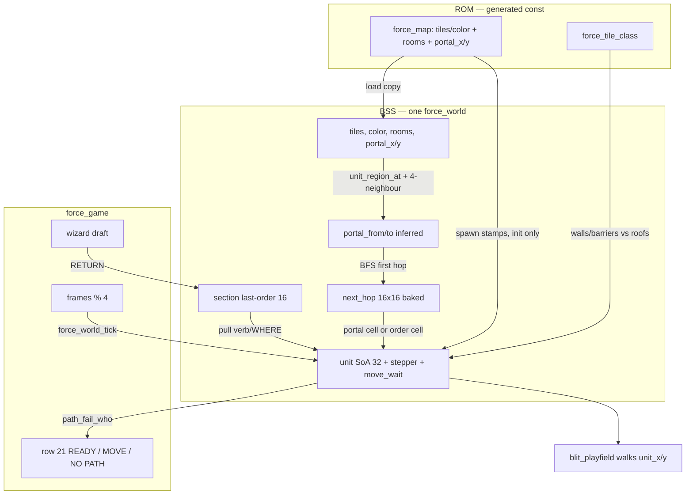

# Phase 4 — Rooms, portals, stepper

| Field | Value |
| --- | --- |
| Author | FORCE design session |
| Date | 2026-09-13 |
| Status | **landed** |
| Last worked on | 2026-09-13 |
| Repo path | [`design/phase-4-rooms-portals-stepper.md`](phase-4-rooms-portals-stepper.md) |
| Plan | [`development-plan.md`](development-plan.md) (Phase 4 frozen) |
| Source | `src/sdl/game/world.h`, `src/sdl/game/world.c`, `src/sdl/game/game.c`, `src/sdl/game/game.h`, `src/sdl/game/command.c`, `src/sdl/generated/force_data.h`, `tools/gen_sdl.py` |
| Intent | [`../doc/FORCE_03_Maps_Regions_and_Sim.md`](../doc/FORCE_03_Maps_Regions_and_Sim.md), [`../doc/FORCE_08_Units_Sections_and_Tick.md`](../doc/FORCE_08_Units_Sections_and_Tick.md) |
| Binary as it is | [`../agents/README.md`](../agents/README.md), [`../agents/game.md`](../agents/game.md), [`../agents/known-gaps.md`](../agents/known-gaps.md) |

Region rects + portal list + next-hop (256 bytes) + Bresenham error
on the unit. `M a` walks. No A*. Authoring promise: if greedy traps,
it was two rooms.

Index status is **landed**. The stepper is in `src/`.

---

## Overview

Phase 3 left a live wizard that writes `section_order_verb/x/y/force`
on RETURN for `M` / `D` / `H`. Tick does not read those bytes.
Room rects, portal `(x,y)` chips, and cover lists already sit in BSS
`force_world`. `unit_region` is filled at spawn by a walk of 16
rects. Nothing walks. Farm’s eight soldiers stay in the east room.

Phase 4 is the mover. `force_world_load` infers `portal_from` /
`portal_to` from the chip cell plus **exactly one** foreign
4-connected neighbour (else the chip is dead), then bakes
`next_hop[from][goal]` (16×16 = 256 bytes, portal index or `$FF`). A logic tick (~15 Hz: every 4
display frames under SDL VSync) scans 32: decrement `move_wait`;
if wait hits 0 and a dest remains, one 4-connected Bresenham step.
Units **pull** last-order; dest stays on the section. `M` and `D`
walk to WHERE then hold. `H` stops stepping. Roofs pass; walls and
barriers do not. Occupancy is another living unit in the dest cell
(scan 32, no bitmap). A disconnected order fails on the strip
(`NO PATH` + flash); men do not walk the void. `--smoke` is still
one frame, exit 0.

This is not cover assignment, not combat, not A*, not a C64
emitter.

---

## Background & Motivation

### Current runtime (Phase 3, landed)

`force_command_feed` commits on RETURN onto the section row
(`src/sdl/game/command.c` `commit`):

```c
w->section_order_verb[who]  = g->cmd_verb;
w->section_order_x[who]     = x;
w->section_order_y[who]     = y;
w->section_order_force[who] = force;
```

`force_game_tick` (`src/sdl/game/game.c`) decrements `cmd_flash`,
clamps the cursor, copies latch, feeds, increments `frames`. It
does not name `section_order_*`. `rg 'section_order_' src/sdl/game/game.c`
is empty on purpose.

`force_world` already has room rects (count + 9×16), portal
`(x,y)` (count + 2×24), cover, and the 32-slot unit SoA plus 16
section rows. `unit_region_at` is file-static in `world.c` and
runs at spawn only. Compiler (`tools/gen_sdl.py`) still emits
portal chips as `x,y` only — `_validate_preset` for `portal`
rejects extra keys; there is no from/to column on `force_map`.

`SDL_SetRenderVSync(host->renderer, 1)` (`src/sdl/sdl/host.c`).
Display is ~60 Hz. FORCE_08’s logic cadence is every 3–4 frames;
every 4 is the working lie.

Generated farm (`src/sdl/generated/force_data.c` — **work against
these tables**, do not hard-code them in C):

| Column | Farm |
| --- | --- |
| map | 40×20, window `0,0,40,20` |
| rooms | **3** rects (colour 3 skipped) |
| portals | **7** empty-tile chips |
| cover | 11 (unused this phase) |
| scouts | 0 |
| units | 8 infantry, section 0, all in room 0 |

Rooms, colour-chip order (first containing rect wins; they do not
overlap):

| i | colour | x0,y0 | w×h | cells | name (intent) |
| ---: | ---: | --- | --- | --- | --- |
| 0 | 1 | 21,0 | 19×20 | x 21–39 | east / FARM |
| 1 | 2 | 6,0 | 15×20 | x 6–20 | middle / LANE |
| 2 | 4 | 0,0 | 6×20 | x 0–5 | west / FIELD |

Portals (row-major extract order):

| i | x,y | tile | containing room | 4-connected other room |
| ---: | --- | --- | ---: | ---: |
| 0 | 5,6 | 112 empty | 2 | 1 via (6,6) |
| 1 | 5,7 | 112 | 2 | 1 |
| 2 | 21,7 | 112 | 0 | 1 via (20,7) |
| 3 | 5,8 | 112 | 2 | 1 |
| 4 | 21,8 | 112 | 0 | 1 |
| 5 | 5,9 | 112 | 2 | 1 |
| 6 | 5,10 | 112 | 2 | 1 |

East wall is tile 16–29 on x=21 except y=7 and y=8 (the two
gaps). West barrier is tile 33 on x=5 except y=6–10 (the five
gaps). Three rooms in a line; the graph is connected.

Spawns (all `FORCE_CLASS_GOODGUYS`, count 1, region 0):

| slot | x | y | glyph |
| ---: | ---: | ---: | ---: |
| 0 (lead) | 26 | 7 | 6 |
| 1 | 26 | 8 | 6 |
| 2 | 24 | 9 | 2 |
| 3–7 | 26 | 9–13 | 6 |

Lead last-lead is (26, 7), not the Phase 2 snapshot (32, 6). A
repaint that moves a stamp must keep working.

`tiles.txt` classes: `empty=0`, `walls=1`, `roofs=2`,
`barriers=3`, `goodguys=4`, `enemies=5`, `colors=6`. **No road.**
Three farm cover cells sit on roof tiles: (26,3), (32,7),
(32,11). Draw already restamps `tiles` over glyphs so roofs
cover.

Unit SoA today is 8 bytes × 32. No `move_wait`, no stepper cache,
no `next_hop`, no `portal_from/to`.

### Pain

- SHIFT+M RETURN writes last-order and the farm does not walk.
  Phase 5 cover fill has no way to get a man to a hole.
- Room rects and portal chips are paint-time leftovers. Without
  from/to and a 256-byte next-hop, a later A* on the 40×20
  (or a scan of 800 cells) is the 6502-filter failure.
- Dest copied onto every unit would be five copies of WHERE for
  one letter. FORCE_08 already forbids it; Phase 2 KD 4 allocated
  last-order on the section and left it 0.
- `tiles.txt` has no road class. Inventing a per-tile speed table
  in ROM this phase is a second vocabulary. One default wait is
  the honest lie until a class exists.
- `--smoke` is one frame. A stepper that only runs after frame 0
  is smoke-green even when broken. Interactive is the gate.

### What Phase 3 already got right

Verb enum in `world.h` (not ASCII `'M'`). Draft on `force_game`;
last-order on the world; RETURN is the only write.
`command.c` is the wizard and does not step. `game/` has no SDL.
Halt already writes last-order (verb HALT, WHERE = lead cell else
last-lead, force 10). Phase 4 reads those bytes. It does not
invent a second dest table.

---

## Goals & Non-Goals

### In (Phase 4)

- Infer `portal_from` / `portal_to` at `force_world_load` from the
  chip cell’s room and **exactly one** 4-connected neighbour in a
  different room (else the chip is dead). Compiler still emits
  `portal_x/y` only.
- Bake `next_hop[FORCE_ROOM_MAX][FORCE_ROOM_MAX]` (256 bytes) at
  load. Encoding: portal index, or `$FF` disconnected / unused.
  No A*. No second 256-byte in-room table.
- Units pull last-order. Dest stays on the section.
- `M` walks to WHERE. `D` walks to WHERE then holds (cover fill
  is Phase 5 and will retarget). `H` stops stepping (hold here).
  Do not bind `A`.
- In-room step: Bresenham error on the unit, 4-connected (x **or**
  y, not both). Not an L. Far (>16) = long run on the major axis,
  cap, look again. Blocked: other axis, then one sidestep, else
  wait and re-aim.
- Passability: walls + barriers block; **roofs do not**; empty
  grass is passable; another living unit in the dest cell blocks
  (scan 32). No occupancy bitmap.
- Region flips on portal cross (only when the portal was the
  next-hop target). Then retarget.
- Logic tick every 4 display frames (~15 Hz). `move_wait`
  countdown; one default reload for every passable cell (no road
  class yet). Fastest mover is `move_wait = 1`. Scan 32 every
  logic tick. Off-screen rooms still tick. Emplacements do not
  step. No fire (`fire_wait` is not allocated).
- Fail disconnected orders on the strip (`NO PATH` + flash). Do
  not walk the void. Farm’s 3 rooms + 7 portals must connect.
- New unit SoA columns + portal from/to + next-hop on
  `force_world`. `command.c` stays the wizard.
- `--smoke` still one frame, exit 0. Interactive: SHIFT+M RETURN,
  men walk toward the cursor cell (or typed WHERE). Halt stops.
  Roofs can be occupied. Walls cannot.
- Work against the generated tables. Do not hard-code farm room
  count, portal cells, or spawn cells in C.
- `agents/game.md`, `agents/known-gaps.md`, `agents/testing.md`,
  `agents/architecture.md` if world columns change, `design/README.md`
  active→landed when implemented. Product notes in FORCE_03 /
  FORCE_08 in the same landing PR (infer-at-load; one wait; 4-frame
  cadence). `design/development-plan.md` only when behaviour is in
  `src/`.

### Out (later phases)

| Later | Why it is not Phase 4 |
| --- | --- |
| Cover assignment, `D` as a roster fill (Phase 5) | `D` walks to WHERE then holds. `unit_cover` stays `$FF`. |
| Combat, `A`, `K`, ROE, `fire_wait` (Phase 6) | No fire. `A` still illegal in VERB. |
| Mission script, waves, truck jump-outs (Phase 7 / 9) | `spawn()` is the seam. The truck is not implemented. |
| Intel, camera, `Z` / `C` / `E` (Phase 8) | Window is still the load copy. |
| `S` / `J`, engineers, portal open/close (Phase 9) | Next-hop is static this phase. A demolished culvert is later. |
| Road / mud wait table | `tiles.txt` has no road class. One default wait. |
| A* / per-hedge search / occupancy bitmap | Rejected. Rooms and doors are the path. |
| LZSS, colour-RAM, C64 emitter (Phase 10) | No `src/c64/`. |
| `malloc`, VLA, `tests/` tree, mouse | Forbidden now and later. |

---

## Key Decisions

Locked. Not reopened as Open Questions. Product conversation
2026-09-13 plus FORCE_03 / FORCE_08.

1. **Units pull last-order.** Phase 3 writes
   `section_order_verb/x/y/force` on RETURN. Phase 4 the stepper
   reads those bytes. Do not push a dest onto every unit. Dest
   lives on the section (FORCE_08, Phase 2 KD 4). Five stacks of
   A share one WHERE.

2. **`M` walks. `H` stops. `D` walks to WHERE then holds.** Halt
   already writes last-order (verb HALT, WHERE = lead cell else
   last-lead, force 10). Halt means **stop stepping** (hold here),
   not walk to the lead. `D` is parsed and stored; do not assign
   cover this phase (Phase 5 will retarget). Treat `D` like `M`
   so the player can see a defend order move men to the cell.
   Do not bind Attack.

3. **Next-hop 16×16 = 256 bytes, baked at load.** Compiler still
   only emits `portal_x/y`. Infer at `force_world_load`: each
   portal cell belongs to a room (`unit_region_at`); a live
   portal has **exactly one** foreign 4-neighbour (that room is
   `portal_to`); 0 or 2+ → dead chip (`to = $FF`, not an edge).
   Then BFS the room graph (≤16 nodes, ≤24 undirected edges) and
   bake `next_hop[from][goal] = portal index` (the **first hop**
   from `from` toward `goal`, list order). Encoding contract,
   one place:

   - Byte = portal index `0..23`, or `$FF`.
   - `$FF` means unused (`from == goal`: dest room targets the
     order cell), disconnected, dead chip, or unvisited. Pull
     never subscripts `$FF` or `>= room_count` for `here` **or**
     `dest_r`.
   - The chip cell may sit in `portal_from` while a traveller
     whose `unit_region` is `portal_to` must **step onto that
     foreign-rect cell** to cross. That step *is* the crossing.
     Reverse travel’s target is not inside `from`’s rect.
   - Portal index, not dest-room. Do not A*. Do not a second
     256-byte in-room table. `#error` if `FORCE_ROOM_MAX != 16`.

4. **In-room step is Bresenham error on the unit, 4-connected.**
   When the target is set, keep two signs, `|dx|` / `|dy|`, and
   an error term `ax - ay`. Each think: **at most one cell**.
   Preferred axis: `s8(err) >= 0` → x, else y (`err -= ay` /
   `err += ax` **only** on preferred-axis success). Zig-zag.
   Never both axes in one tick. Not an L. Far (either axis >
   `FORCE_STEP_FAR` 16): long run on the major axis, cap
   `FORCE_STEP_CAP` 8, look again. Do not apply both signs and
   walk a wrong slope. Blocked: try the other axis, then one
   sidestep (N if preferred-x and `sy==0`; W if preferred-y and
   `sx==0`), else wait, zero the run, re-aim next think. `err`
   does **not** update on fallback / sidestep / failed try.
   `ax==ay==0` is a no-op (already on tgt), not a successful
   step. Signs are `1` / `0` / `0xFF`; add in `int`, not
   `uint8_t`. Copy `try_step` / `stepper_step` below. Portal
   jams and packed cells are content. Do not slide forever.

5. **Passability.** Block **walls and barriers only**. Roofs
   and empty pass. Do **not** consult `goodguys` / `enemies` /
   `colors` on the tiles plane (those ids are stamps / chrome,
   not terrain). Occupancy: another living unit (`count != 0`)
   in the dest cell blocks (scan 32; skip self). Out of
   `width`/`height` is blocked. Do not add an occupancy bitmap.
   Do not scan the map. Cost is O(units × tries × 32), tries ≤ 3.
   Packed / stall is three cases, **do not swap-resolve**:
   (a) same-cell packed = wait; (b) head-on adjacent swap =
   accepted stall this phase; (c) WHERE-on-portal occupies the
   door for the rest of the order. House footprints are walkable
   roof cells (draw hides the occupier). FORCE_03’s “not
   interiors you path through” means **do not author indoor
   rooms**, not a passability exception.

6. **Region flips on portal cross.** Flip when the unit is on
   the **next-hop chip** (`p` from this think) and
   `here != dest_r`: already standing on it (halt-then-`M` west
   from a man left on the door) **or** a step that just landed
   on it. Displacement is not required. Then re-aim; **do not
   take a second cell this think**. If already in the dest room,
   target is the order cell — WHERE-on-portal does **not** flip
   (would oscillate). Do not resync `unit_region` from rects
   after the flip (the cell is still geometrically in
   `portal_from`’s rect; that is the 6502 lie). `p` / `dest_r` /
   `here0` are **locals** in `unit_think`. No `unit_tgt_portal`
   column.

7. **Logic tick ~15 Hz.** Display 50/60; logic every 4 **display**
   frames (`FORCE_LOGIC_PERIOD`). SDL VSync ~60 → 15 Hz is the
   working lie. `move_wait` counts **logic ticks**, not display
   frames. Every passable cell reloads
   `FORCE_MOVE_WAIT_DEFAULT` (7) on a successful step **and** on
   a blocked wait. Do **not** read `force_tile_class` for speed.
   A later road class switches the reload helper, not the
   stepper. Fastest mover is `move_wait = 1` (never leave wait
   at 0 after a step or a blocked wait). RETURN / `commit` does
   **not** poke `unit_move_wait` (a mid-walk `H`/`M` waits out
   the current 7). Do not invent a timing wheel. The `#define`
   lives in `world.h` with the other Phase 4 caps; **only
   `game.c`** may test `g->frames % FORCE_LOGIC_PERIOD`. The
   stepper lives in `world.c`.

8. **Scan 32 every logic tick.** Decrement waits; if `move_wait`
   hits 0 and a dest remains, step. Emplacements do not step
   (`kind == FORCE_KIND_EMPLACEMENT`; none on farm). Off-screen
   rooms still tick. No fire this phase — do not allocate
   `fire_wait`. Spawn leaves `move_wait = 0` so a standing
   first order steps on the next logic tick. A mid-walk new
   order waits out the current 7 (KD 7).

9. **Fail the order on the status line if disconnected.** Dest
   cell outside every room, or `next_hop[here][dest] == $FF`
   while `here != dest`: do not walk. Flash the strip (8 draws,
   `FORCE_LIGHT_RED`) and paint `NO PATH` on row 21. Latch
   `FORCE_SECTION_FLAG_NOPATH` on that letter so it does not
   re-flash every logic tick. RETURN commit clears the bit
   (same write as last-order; that is not stepping). Farm’s 3
   rooms with 7 portal cells must connect — a farm `M` to the
   west field is a pass, not a fail.

10. **Work against the tables.** Do not hard-code farm’s 3 rooms,
    7 portal cells, or 8 spawn cells in C. A Tiled repaint that
    keeps the compiler contracts must keep walking.

11. **New columns on `force_world`, not a second BSS object.**
    Nine unit columns (tgt, signs, ax/ay, err, run, wait) plus
    `portal_from/to`, `next_hop[256]`, `path_fail_who`. **No**
    `unit_tgt_portal` — `p` is a local in `unit_think`. Prefer
    not a new `stepper.c` — `world.c` owns these columns (see
    Alternatives). `command.c` stays the wizard; it must not
    step. `game.c` owns cadence + chrome consume. Append all
    Phase 4 fields after `section_order_force` (end of the
    struct). Do not splice `portal_from/to` after `portal_y`.

12. **`--smoke` still one frame, exit 0.** Frame 0 is a logic
    tick (`frames % FORCE_LOGIC_PERIOD == 0` **before**
    increment) with last-order still 0: verb NONE, so no step
    even though WHERE `(0,0)` is a real west-field cell and
    spawn wait is 0. Smoke cannot prove walking, infer, or BFS
    beyond “did not crash / did not move.” A one-cell drift of
    a farm stamp is a fail. Interactive SHIFT+M RETURN is the
    walk gate. `rg 'force_world_tick' src/sdl/game/game.c` is
    **non-empty**.

13. **One landing cut.** Do not ship “next-hop baked, `M` does
    not walk.” There is no mergeable columns-only PR. An
    internal first commit of zeros is allowed only as commit 1
    of the landing PR, and it must not touch `agents/`.

14. **Still no:** cover fill, combat, `A`/`K`/`S`/`J`/`Z`/`C`/`E`,
    A*, occupancy bitmap, road wait table, fire_wait, timing
    wheel, malloc, C64 emitter, a second TMX, `tests/` tree,
    pushing dest onto units, compiler-emitted from/to.

---

## Proposed Design

### Runtime data flow



After init, `force_map.portal_*` is not read again. RAM
`portal_from/to` and `next_hop` are the live path.

### Sequence: SHIFT+M RETURN, then one logic step

```mermaid
sequenceDiagram
  participant cmd as force_command_feed
  participant sec as section_order_*
  participant tick as force_game_tick
  participant world as force_world_tick
  participant u as unit SoA

  cmd->>sec: RETURN writes MOVE, WHERE, force 10
  cmd->>sec: clear FLAG_NOPATH
  Note over cmd,u: command.c does not step
  tick->>tick: frames % 4 == 0
  tick->>world: force_world_tick
  world->>sec: pull verb/x/y for unit_section
  world->>world: dest region via unit_region_at(WHERE)
  alt here == dest room
    world->>u: aim at WHERE
  else next_hop[here][dest] == $FF
    world->>tick: path_fail_who = letter
    Note over u: no step
  else
    world->>u: aim at portal_x/y[next_hop]
  end
  alt already on next-hop chip and here != dest
    world->>u: flip region; re-aim; no step this think
  else
    world->>u: at most one 4-connected step
    u-->>u: reload move_wait = 7
    alt stepped onto next-hop chip
      u-->>u: flip region; re-aim; no second cell
    end
  end
```

### Caps and constants (`world.h`)

Next to existing `#error` guards:

```c
#if FORCE_ROOM_MAX != 16
#error "next-hop is a 16×16 page; FORCE_ROOM_MAX must stay 16"
#endif

#define FORCE_LOGIC_PERIOD         4u   /* only game.c tests frames % this */
#define FORCE_MOVE_WAIT_DEFAULT    7u
#define FORCE_STEP_FAR             16u
#define FORCE_STEP_CAP             8u
#define FORCE_SECTION_FLAG_NOPATH  0x01u
```

World does not own `g->frames`. Only `game.c` may test
`g->frames % FORCE_LOGIC_PERIOD`. `world.c` sees a logic tick
as a call to `force_world_tick`.

`FORCE_UNIT_NONE` (`$FF`) remains the generic sentinel: empty
lead, unassigned cover, no room, no path, no portal from/to.
Do not add `FORCE_PATH_NONE`. Portal indices are 0..23; `$FF`
cannot collide. `$FF` in `next_hop` is unused / disconnected /
dead / unvisited — pull fails rather than subscripting.

`tools/gen_sdl.py` is **unchanged**. `FORCE_ROOM_MAX` is already
16; `FORCE_PORTAL_MAX` is already 24. No from/to emit.

### `force_world` struct — new columns

**Append** after `section_order_force` (end of the struct). Do
not splice `portal_from/to` after `portal_y` (that would insert
in the middle of scouts). Existing 8 unit columns
(`x,y,section,count,kind,glyph,region,cover`) and
`kind==EMPLACEMENT` skip stay where they are. No
`unit_tgt_portal`. Arrays stay **in the struct**. Do not drop
colour this phase.

```c
    /* existing fields through section_order_force, then Phase 4: */
    uint8_t  unit_tgt_x[FORCE_UNIT_MAX];
    uint8_t  unit_tgt_y[FORCE_UNIT_MAX];
    uint8_t  unit_step_sx[FORCE_UNIT_MAX];  /* 1, 0, or 0xFF = -1 */
    uint8_t  unit_step_sy[FORCE_UNIT_MAX];
    uint8_t  unit_step_ax[FORCE_UNIT_MAX];  /* |dx| at last aim */
    uint8_t  unit_step_ay[FORCE_UNIT_MAX];
    uint8_t  unit_step_err[FORCE_UNIT_MAX]; /* int8 two's complement */
    uint8_t  unit_step_run[FORCE_UNIT_MAX]; /* 0 = Bresenham; >0 far burst */
    uint8_t  unit_move_wait[FORCE_UNIT_MAX];
    uint8_t  portal_from[FORCE_PORTAL_MAX];
    uint8_t  portal_to[FORCE_PORTAL_MAX];
    uint8_t  next_hop[FORCE_ROOM_MAX * FORCE_ROOM_MAX]; /* 256 */
    uint8_t  path_fail_who;  /* 0-7 latched this tick, else $FF */
```

`next_hop[from * FORCE_ROOM_MAX + goal]`. Index with
`uint16_t` so `from * 16` cannot wrap a `uint8_t`.

Public:

```c
void force_world_tick(force_world *world);
```

`unit_region_at` stays file-static. Spawn, infer, and dest-region
lookup share it.

### BSS layout and byte budget

Phase 3 payload was 9392 SDL / 5392 without `color`. All new
fields are `uint8_t` after `row_off`, so they pack.

| Field | Bytes | Notes |
| --- | ---: | --- |
| Phase 3 world | 9392 | |
| `portal_from/to` 2×24 | 48 | inferred; tails `$FF` |
| `next_hop` 16×16 | 256 | the page FORCE_03 spent |
| units +9×32 | 288 | stepper + wait; still no `fire_wait` |
| `path_fail_who` | 1 | |
| **SDL data** | **9985** | odd → C may pad to 9986 |
| **without `color`** | **5985** | 6502-relevant board |

FORCE_06’s “about 5–6K for the world” included stepper bytes.
5985 without colour is the top of that sketch. The extra 4K
colour is still the SDL authoring tax. Compare:
`force_game.pixels` is 256000 bytes on the stack.

Farm occupancy of the new caps:

| Column | Used / cap |
| --- | --- |
| rooms | 3 / 16 |
| portals | 7 / 24 (from/to filled; 17 tails `$FF`) |
| next-hop | 3×3 meaningful; rest `$FF` |
| units | 8 live / 32; stepper cache 0 until first aim |
| cover | 11 / 128, **unread** |

Baked farm next-hop (portal-list order; first edge wins):

| from \ goal | 0 east | 1 mid | 2 west |
| --- | ---: | ---: | ---: |
| 0 east | `$FF` | 2 `(21,7)` | 2 `(21,7)` |
| 1 mid | 2 `(21,7)` | `$FF` | 0 `(5,6)` |
| 2 west | 0 `(5,6)` | 0 `(5,6)` | `$FF` |

`(21,8)` and `(5,7)`…`(5,10)` are equivalent doors, unused by
the table. One cell / a few cells of extra walk. Content can
reorder chips to pick the “main” door. Do not scan 24 for
nearest on every retarget this phase.

Encoding vs geometry (farm, not a C literal): portal 2 is
`(21,7)`, `unit_region_at` → room 0 (east, `x0=21`).
`next_hop[1][0] = 2`. A unit in mid (room 1, `x=6–20`) aims at
`(21,7)`, a cell whose containing rect is east. Stepping onto
that foreign-rect cell **is** the crossing. Reverse travel’s
target is not inside `from`. After the flip, `unit_region` is
0 while the cell is still in room 0’s rect — then the next
think’s dest is the order cell (or the next hop). Do not
“fix” that with `unit_region_at` after every step.

### Infer from/to

After the existing portal `copy_column` of `x/y`, before spawn
(rooms must already be in RAM):

```c
static void infer_portals(force_world *world)
{
    static const int8_t dx[4] = { 0, 1, 0, -1 }; /* N E S W */
    static const int8_t dy[4] = { -1, 0, 1, 0 };
    uint8_t i, d;

    for (i = 0u; i < FORCE_PORTAL_MAX; ++i) {
        world->portal_from[i] = FORCE_UNIT_NONE;
        world->portal_to[i] = FORCE_UNIT_NONE;
    }
    for (i = 0u; i < world->portal_count; ++i) {
        uint8_t x = world->portal_x[i];
        uint8_t y = world->portal_y[i];
        uint8_t from = unit_region_at(world, x, y);
        uint8_t to = FORCE_UNIT_NONE;
        uint8_t n_foreign = 0u;
        uint8_t found = FORCE_UNIT_NONE;

        world->portal_from[i] = from;
        if (from == FORCE_UNIT_NONE) {
            continue;
        }
        for (d = 0u; d < 4u; ++d) {
            int nx = (int)x + (int)dx[d];
            int ny = (int)y + (int)dy[d];
            uint8_t r;
            if (nx < 0 || ny < 0 ||
                nx >= (int)world->width || ny >= (int)world->height) {
                continue;
            }
            r = unit_region_at(world, (uint8_t)nx, (uint8_t)ny);
            if (r != FORCE_UNIT_NONE && r != from) {
                n_foreign = (uint8_t)(n_foreign + 1u);
                found = r;
            }
        }
        if (n_foreign == 1u) {
            to = found;   /* live portal */
        }
        /* 0 or 2+: dead chip (thick wall / T-junction / corner) */
        world->portal_to[i] = to;
    }
}
```

Authoring contract this phase: a **live** portal has exactly
one foreign 4-neighbour; else it is a dead chip (`to = $FF`,
not a BFS edge). Reverse travel steps onto a cell whose
`unit_region_at` is `portal_from`. T-junctions, corner chips,
double-sided chips (a chip on *both* sides of an edge → two
undirected edges), and thick walls are **content bugs**, same
class: first order `NO PATH` or a surprise extra door, not a
load failure. Compiler assert “exactly one foreign
4-neighbour” is a follow-on, not a new ROM column. Farm doors
are 1-cell empty on the room edge and each has exactly one
foreign neighbour; do not write farm-only inference.

### Bake next-hop

16-node BFS, one source at a time. Each portal is an undirected
edge if both `from` and `to` are live rooms.

```c
static uint16_t hop_index(uint8_t from, uint8_t goal)
{
    return (uint16_t)from * (uint16_t)FORCE_ROOM_MAX + (uint16_t)goal;
}

static void bake_next_hop(force_world *world)
{
    uint8_t src;
    uint16_t n;

    /* Do not index 256 entries with uint8_t: (uint8_t)(16*16)==0, so
       `src < 0` never runs and leftovers stay 0 (portal 0), not $FF.
       `uint8_t n; n < 256; n++` wraps 255→0 and infinite-loops. */
    for (n = 0u; n < (uint16_t)FORCE_ROOM_MAX * (uint16_t)FORCE_ROOM_MAX; ++n) {
        world->next_hop[n] = FORCE_UNIT_NONE;
    }
    for (src = 0u; src < world->room_count; ++src) {
        uint8_t visited[FORCE_ROOM_MAX];
        uint8_t q[FORCE_ROOM_MAX];
        uint8_t qh = 0u, qt = 0u, i, u;

        for (i = 0u; i < FORCE_ROOM_MAX; ++i) {
            visited[i] = 0u;
        }
        q[qt++] = src;
        visited[src] = 1u;
        while (qh < qt) {
            u = q[qh++];
            for (i = 0u; i < world->portal_count; ++i) {
                uint8_t a = world->portal_from[i];
                uint8_t b = world->portal_to[i];
                uint8_t v;
                if (a == FORCE_UNIT_NONE || b == FORCE_UNIT_NONE) {
                    continue;
                }
                if (a == u) {
                    v = b;
                } else if (b == u) {
                    v = a;
                } else {
                    continue;
                }
                if (v >= world->room_count || visited[v]) {
                    continue;
                }
                visited[v] = 1u;
                if (u == src) {
                    world->next_hop[hop_index(src, v)] = i;
                } else {
                    world->next_hop[hop_index(src, v)] =
                        world->next_hop[hop_index(src, u)];
                }
                q[qt++] = v;
            }
        }
    }
}
```

Load calls `infer_portals` then `bake_next_hop` after portal
copy, before or after spawn (neither needs units). Zero
`path_fail_who = FORCE_UNIT_NONE`. Zero the nine new unit
columns with the existing `zero_u8` block.

### `force_unit_spawn`

On success, after the existing fills:

```c
world->unit_tgt_x[slot] = x;
world->unit_tgt_y[slot] = y;
world->unit_step_sx[slot] = 0u;
world->unit_step_sy[slot] = 0u;
world->unit_step_ax[slot] = 0u;
world->unit_step_ay[slot] = 0u;
world->unit_step_err[slot] = 0u;
world->unit_step_run[slot] = 0u;
world->unit_move_wait[slot] = 0u;   /* first order steps next logic tick */
```

### Passability

```c
static int cell_free(const force_world *w, uint8_t x, uint8_t y,
                     uint8_t self)
{
    uint8_t tid, cls, i;

    if (x >= w->width || y >= w->height) {
        return 0;
    }
    tid = w->tiles[(int)w->row_off[y] + x];
    cls = force_tile_class[tid];
    if (cls == FORCE_CLASS_WALLS || cls == FORCE_CLASS_BARRIERS) {
        return 0;
    }
    /* Block walls and barriers only. Roofs and empty pass.
       Do not consult goodguys/enemies/colors on the tiles plane. */
    for (i = 0u; i < FORCE_UNIT_MAX; ++i) {
        if (i == self || w->unit_count[i] == 0u) {
            continue;
        }
        if (w->unit_x[i] == x && w->unit_y[i] == y) {
            return 0;
        }
    }
    return 1;
}
```

House footprints are walkable roof cells; draw restamps `tiles`
over the glyph so the occupier disappears under the roof. That
is the product, not a leak. FORCE_03 “not interiors you path
through” means do not author indoor rooms, not a second
passability list.

Cost is O(units × tries × 32) per logic tick, tries ≤ 3
(~3072 compares if everyone is blocked). Still fine. Do not
“optimise” with a map.

### Aim / step

Signs are `1` / `0` / `0xFF` (`FORCE_SX_NEG`). Add in `int` via
`s8`, never `uint8_t x + 0xFF` at `x==0`. `err` is stored as
`uint8_t` two's complement; compare and update through `s8`.
Do **not** use `2*err` in an `int8_t` (80×2 = 160). `ax`/`ay`
up to 80 fit `uint8_t`.

```c
#define FORCE_SX_NEG  0xFFu

static int8_t s8(uint8_t b)
{
    return (int8_t)b;
}

static int add_s(uint8_t pos, uint8_t s)
{
    return (int)pos + (int)s8(s);
}

static void stepper_aim(force_world *w, uint8_t i, uint8_t tx, uint8_t ty)
{
    int dx = (int)tx - (int)w->unit_x[i];
    int dy = (int)ty - (int)w->unit_y[i];
    uint8_t ax = (uint8_t)(dx < 0 ? -dx : dx);
    uint8_t ay = (uint8_t)(dy < 0 ? -dy : dy);

    w->unit_tgt_x[i] = tx;
    w->unit_tgt_y[i] = ty;
    w->unit_step_sx[i] = (dx > 0) ? 1u : (dx < 0) ? FORCE_SX_NEG : 0u;
    w->unit_step_sy[i] = (dy > 0) ? 1u : (dy < 0) ? FORCE_SX_NEG : 0u;
    w->unit_step_ax[i] = ax;
    w->unit_step_ay[i] = ay;
    w->unit_step_err[i] = (uint8_t)(int8_t)((int)ax - (int)ay);
    if (ax > FORCE_STEP_FAR || ay > FORCE_STEP_FAR) {
        uint8_t major = (ax >= ay) ? ax : ay;
        w->unit_step_run[i] =
            (major < FORCE_STEP_CAP) ? major : (uint8_t)FORCE_STEP_CAP;
    } else {
        w->unit_step_run[i] = 0u;
    }
}

static int try_step(force_world *w, uint8_t i, int nx, int ny)
{
    if (nx < 0 || ny < 0 ||
        nx >= (int)w->width || ny >= (int)w->height) {
        return 0;
    }
    if (!cell_free(w, (uint8_t)nx, (uint8_t)ny, i)) {
        return 0;
    }
    w->unit_x[i] = (uint8_t)nx;
    w->unit_y[i] = (uint8_t)ny;
    return 1;
}

/* One cell. Returns 1 if unit_x/y changed.
   err updates only on preferred-axis success.
   Fallback / sidestep / fail: err unchanged; run zeroed on
   fallback, sidestep, and wait. Far-run: if major is blocked,
   still try other-axis then one sidestep; a dodge zeros run. */
static int stepper_step(force_world *w, uint8_t i)
{
    uint8_t ax = w->unit_step_ax[i];
    uint8_t ay = w->unit_step_ay[i];
    uint8_t sx = w->unit_step_sx[i];
    uint8_t sy = w->unit_step_sy[i];
    int8_t err = s8(w->unit_step_err[i]);
    int pref_x;
    int nx, ny;
    int moved = 0;

    if (ax == 0u && ay == 0u) {
        return 0;   /* already on tgt: not a successful step, no flip */
    }
    if (w->unit_step_run[i] > 0u) {
        pref_x = (ax >= ay);
    } else {
        pref_x = (err >= 0);
    }

    if (pref_x && sx != 0u) {
        nx = add_s(w->unit_x[i], sx);
        ny = (int)w->unit_y[i];
        if (try_step(w, i, nx, ny)) {
            if (w->unit_step_run[i] == 0u) {
                w->unit_step_err[i] = (uint8_t)(int8_t)(err - (int8_t)ay);
            } else {
                w->unit_step_run[i]--;
                if (w->unit_step_run[i] == 0u) {
                    stepper_aim(w, i, w->unit_tgt_x[i], w->unit_tgt_y[i]);
                }
            }
            w->unit_move_wait[i] = FORCE_MOVE_WAIT_DEFAULT;
            return 1;
        }
    } else if (!pref_x && sy != 0u) {
        nx = (int)w->unit_x[i];
        ny = add_s(w->unit_y[i], sy);
        if (try_step(w, i, nx, ny)) {
            if (w->unit_step_run[i] == 0u) {
                w->unit_step_err[i] = (uint8_t)(int8_t)(err + (int8_t)ax);
            } else {
                w->unit_step_run[i]--;
                if (w->unit_step_run[i] == 0u) {
                    stepper_aim(w, i, w->unit_tgt_x[i], w->unit_tgt_y[i]);
                }
            }
            w->unit_move_wait[i] = FORCE_MOVE_WAIT_DEFAULT;
            return 1;
        }
    }

    /* Other axis toward target. Do not update err. */
    if (pref_x && sy != 0u) {
        nx = (int)w->unit_x[i];
        ny = add_s(w->unit_y[i], sy);
        moved = try_step(w, i, nx, ny);
    } else if (!pref_x && sx != 0u) {
        nx = add_s(w->unit_x[i], sx);
        ny = (int)w->unit_y[i];
        moved = try_step(w, i, nx, ny);
    }

    /* One sidestep. Preferred-x + sy==0 → N only (never S).
       Preferred-y + sx==0 → W only (never E). */
    if (!moved) {
        if (pref_x) {
            int sdy = (sy != 0u) ? -(int)s8(sy) : -1;
            nx = (int)w->unit_x[i];
            ny = (int)w->unit_y[i] + sdy;
            moved = try_step(w, i, nx, ny);
        } else {
            int sdx = (sx != 0u) ? -(int)s8(sx) : -1;
            nx = (int)w->unit_x[i] + sdx;
            ny = (int)w->unit_y[i];
            moved = try_step(w, i, nx, ny);
        }
    }

    w->unit_step_run[i] = 0u;
    w->unit_move_wait[i] = FORCE_MOVE_WAIT_DEFAULT;
    return moved;
}
```

Never step x and y in one tick. Far-run decrement is **only**
after preferred-axis success; when run hits 0, re-aim at the
same tgt (may now be ≤16). Fallback/sidestep zeros run so the
next think re-aims (do not continue a far-run after a dodge).

### Pull last-order, dest, fail, flip — one `unit_think`

`p`, `dest_r`, `here0` are **locals**. No extra unit column.
Never index `next_hop` with `$FF` or `>= room_count`. Do not
call `unit_region_at` on the unit’s cell after a flip.

```c
static void fail_path(force_world *world, uint8_t sec)
{
    if ((world->section_flags[sec] & FORCE_SECTION_FLAG_NOPATH) == 0u) {
        world->section_flags[sec] =
            (uint8_t)(world->section_flags[sec] | FORCE_SECTION_FLAG_NOPATH);
        if (sec < FORCE_LETTER_MAX) {
            world->path_fail_who = sec;
        }
    }
}

static void portal_flip(force_world *w, uint8_t i, uint8_t p)
{
    if (w->unit_region[i] == w->portal_from[p]) {
        w->unit_region[i] = w->portal_to[p];
    } else {
        w->unit_region[i] = w->portal_from[p];
    }
    /* Do not unit_region_at(unit_x, unit_y): the chip still sits
       in portal_from's rect. */
}

/* Resolve WHERE → dest_r, next-hop p, desired cell.
   Returns 0 if the order fails (caller must not step). */
static int pull_desired(force_world *w, uint8_t i, uint8_t sec,
                        uint8_t *here_out, uint8_t *dest_out,
                        uint8_t *p_out, uint8_t *dx, uint8_t *dy)
{
    uint8_t ox = w->section_order_x[sec];
    uint8_t oy = w->section_order_y[sec];
    uint8_t dest_r = unit_region_at(w, ox, oy);
    uint8_t here = w->unit_region[i];
    uint8_t p = FORCE_UNIT_NONE;

    *here_out = here;
    *dest_out = dest_r;
    *p_out = FORCE_UNIT_NONE;
    if (here == FORCE_UNIT_NONE || here >= w->room_count ||
        dest_r == FORCE_UNIT_NONE || dest_r >= w->room_count) {
        fail_path(w, sec);
        return 0;
    }
    if (here == dest_r) {
        *dx = ox;
        *dy = oy;
        return 1;
    }
    p = w->next_hop[hop_index(here, dest_r)];
    if (p == FORCE_UNIT_NONE || p >= w->portal_count) {
        fail_path(w, sec);
        return 0;
    }
    *p_out = p;
    *dx = w->portal_x[p];
    *dy = w->portal_y[p];
    return 1;
}

static void unit_think(force_world *w, uint8_t i)
{
    uint8_t sec = w->unit_section[i];
    uint8_t verb = w->section_order_verb[sec];
    uint8_t here, dest_r, p, dx, dy;
    uint8_t here0;

    if (verb != FORCE_VERB_MOVE && verb != FORCE_VERB_DEFEND) {
        return;   /* NONE / HALT: hold here. RETURN does not poke wait. */
    }
    if (!pull_desired(w, i, sec, &here, &dest_r, &p, &dx, &dy)) {
        return;
    }
    if (w->unit_x[i] == w->section_order_x[sec] &&
        w->unit_y[i] == w->section_order_y[sec] &&
        here == dest_r) {
        return;   /* arrived; leave wait 0 */
    }
    if (dx != w->unit_tgt_x[i] || dy != w->unit_tgt_y[i]) {
        stepper_aim(w, i, dx, dy);
    }

    here0 = here;
    /* Already on the next-hop chip: flip without displacement. */
    if (p != FORCE_UNIT_NONE &&
        w->unit_x[i] == w->portal_x[p] &&
        w->unit_y[i] == w->portal_y[p] &&
        here != dest_r) {
        portal_flip(w, i, p);
        if (!pull_desired(w, i, sec, &here, &dest_r, &p, &dx, &dy)) {
            return;
        }
        stepper_aim(w, i, dx, dy);
        return;   /* no cell this think */
    }

    if (!stepper_step(w, i)) {
        return;
    }
    /* Landed on the next-hop chip we were aiming at at think start. */
    if (p != FORCE_UNIT_NONE &&
        w->unit_x[i] == w->portal_x[p] &&
        w->unit_y[i] == w->portal_y[p] &&
        here0 != dest_r) {
        portal_flip(w, i, p);
        if (pull_desired(w, i, sec, &here, &dest_r, &p, &dx, &dy)) {
            stepper_aim(w, i, dx, dy);
        }
        /* no second cell */
    }
}
```

`fail_path` does not overwrite last-order. Enemy bank 8–15 can
fail silently (no strip letter); farm has none. Incidental walk
onto a *sibling* gap (`(21,8)` while `p` is `(21,7)`) does not
flip; next think re-aims at the baked chip. WHERE-on-portal in
the dest room: `p` is `$FF`, no flip.

`command.c` `commit`, next to the four last-order stores:

```c
w->section_flags[who] = (uint8_t)(w->section_flags[who] &
                                  (uint8_t)~FORCE_SECTION_FLAG_NOPATH);
g->cmd_nopath = 0;
```

That is a flag clear, not a step. `draft_reset` also sets
`g->cmd_nopath = 0` (alongside `cmd_flash = 0`) so SHOW→IDLE /
a new verb cannot leave `NO PATH` up. A new disconnected order
must be allowed to flash again (commit cleared the bit).

Halt: verb HALT → no dest, even if WHERE is the lead cell across
the map. Men stop in the cell they occupy. A later `M` waits
out any leftover `move_wait`; if wait is already 0 they step
that same logic tick. RETURN does not poke wait.

### `force_world_tick`

```c
void force_world_tick(force_world *world)
{
    uint8_t i;

    world->path_fail_who = FORCE_UNIT_NONE;
    for (i = 0u; i < FORCE_UNIT_MAX; ++i) {
        if (world->unit_count[i] == 0u) {
            continue;
        }
        if (world->unit_kind[i] == FORCE_KIND_EMPLACEMENT) {
            continue;
        }
        if (world->unit_move_wait[i] > 0u) {
            world->unit_move_wait[i]--;
            if (world->unit_move_wait[i] > 0u) {
                continue;
            }
        }
        unit_think(world, i);   /* pull, maybe fail, maybe step */
    }
}
```

Slot order 0..31 is who wins a contested cell this tick. Do not
randomize. Off-screen included.

### Game cadence and chrome

`force_game` grows one UI byte:

```c
uint8_t cmd_nopath;   /* 1 → row 21 paints NO PATH while cmd_flash > 0 */
```

Zero `cmd_nopath` in `force_game_init` **and** in `draft_reset`
(next to `cmd_flash = 0`). Commit also clears it so a connected
RETURN during the 8-frame flash cannot keep painting `NO PATH`.

`force_game_tick` order:

1. If `cmd_flash > 0`: decrement; **if it hits 0, `cmd_nopath = 0`**.
2. Cursor apply + clamp (unchanged).
3. Copy `joy_present` / `stick_latched`.
4. `force_command_feed` (may write last-order, clear NOPATH and
   `cmd_nopath`).
5. **If `(g->frames % FORCE_LOGIC_PERIOD) == 0`:**
   `force_world_tick(g->world)`. If `path_fail_who < FORCE_LETTER_MAX`:
   `g->cmd_nopath = 1`, `g->cmd_flash = 8`.
6. `g->frames += 1`.

Only `game.c` tests `frames % FORCE_LOGIC_PERIOD`. Frame 0 of
`--smoke` **is** a logic tick. Last-order verb is NONE, so no
step even though WHERE `(0,0)` is a real cell in room 2. Invert
the modulus (tick after `+=1`) and smoke never enters
`force_world_tick`; forget the call and smoke still exits 0.
`rg 'force_world_tick' src/sdl/game/game.c` must be **non-empty**.

Paint branch: if `g->cmd_nopath && g->cmd_flash > 0`, row 21 is
`"NO PATH"` in `FORCE_LIGHT_RED` and hole_now is **WHERE**
(not VERB — SHOW+flash today marks VERB). Else the existing
talky / READY / committed line. After flash ends, SHOW’s
`MOVE A AT …` returns. A debug-only disconnected dest is **out
of scope**; farm cannot show `NO PATH` if infer+BFS is correct.
Rely on review of `fail_path` / `pull_desired`.

Draw of men: unchanged loop on `unit_x/y` / `unit_glyph`. Roofs
still restamp. Men on a roof cell are visible under the roof
stamp, same as today’s spawn-on-grass-under-eave. Occupying a
roof is legal; the restamp still covers.

`src/sdl/main.c` unchanged.

### Dual-rep / layer `rg` gates

Keep Phase 1–3 fences. Empty output is the pass:

```bash
rg 'mission->(map|x|y|w|h)\b|map->(tiles|color|spawn_)' src/sdl/game/game.c
rg 'spawn_(count|x|y|tile)\b' src/sdl/game/world.h src/sdl/game/game.c
rg 'world->spawn_' src/sdl
rg 'SDL_' src/sdl/game
rg 'section_order_' src/sdl/game/game.c
rg 'section_order_.*= ' src/sdl/game/command.c   # RETURN block only
```

Phase 4 fences:

```bash
# wizard still does not step (empty)
rg 'force_world_tick|unit_move_wait|next_hop|unit_tgt_' src/sdl/game/command.c

# compiler still does not emit from/to (empty)
rg 'portal_from|portal_to|next_hop' tools/gen_sdl.py

# no A*, no heap, no occupancy bitmap (empty)
rg 'astar|A\*|dijkstra|occupanc(y|y_map|y_bit)' src/sdl/game

# no fire_wait this phase (empty)
rg 'fire_wait' src/sdl

# game.c must call the stepper (NON-empty)
rg 'force_world_tick' src/sdl/game/game.c
```

`world.h` / `world.c` **name** `next_hop` and `portal_from`; they
are not in the empty-output gate. `command.c` may name
`section_flags` for the NOPATH clear.

### Includes, CMake, ownership

No new TU. `src/sdl/CMakeLists.txt` already compiles `world.c`.

```text
main.c          -> game + sdl/host          (unchanged)
game/game.c     -> core/screen + game/world.h + game/command.h
game/command.c  -> game/command.h + core/screen + stdio.h
game/world.c    -> game/world.h + string.h   (now also ticks)
sdl/host        -> sdl/input + core/types + SDL3
core/*          -> (no world, no generated map, no command)
generated       -> (none)
```

`world.c` does not include `game.h` or `command.h`. `command.c`
does not include stepper internals. `core/` still has no map
pointers. Dependency direction unchanged.

### Product-doc replacement (landing PR pastes these)

`doc/FORCE_03` Next-hop paragraph — **replace** “next[from][goal]
= portal or next room” (do not leave that sentence and add after
it). Paste:

> Baked at map load: `next[from][goal]` is a **portal index**
> (first hop, list order), `$FF` if disconnected or unused
> (`from == goal` targets the order cell). 16×16 = 256 bytes.
> The SDL compiler still emits portal chips as `(x,y)` only.
> `force_world_load` infers from/to: the chip’s room, plus
> **exactly one** 4-connected neighbour in a different room
> (else the chip is dead). The chip may sit in `portal_from`;
> a traveller in `portal_to` steps onto that foreign-rect cell
> to cross. Walk: while not in the dest room, the target is
> that portal cell. On the portal cell, flip region id and look
> up again. In the dest room, target is the order cell. Do not
> plan a chain of portals. Do not store dest-room in the byte.

`doc/FORCE_03` In-room step — already matches. **Keep** the
authoring promise. Do not add A*.

`doc/FORCE_08` Tick / `move_wait` — **add**:

> Until `tiles.txt` has a road class, every passable cell reloads
> `move_wait = 7` **logic ticks** at 15 Hz (SDL: every 4 VSync
> frames). Do not read terrain class for speed. A new order does
> not reset wait. Fastest mover is `move_wait = 1`. Emplacements
> do not step. `fire_wait` is not allocated until combat.

`doc/FORCE_08` dest-on-section is already the rule. Do not copy
WHERE onto the unit.

### `agents/` handoff (landing PR, not this design-only writeup)

| File | Change |
| --- | --- |
| `agents/game.md` | Tick: every 4 frames `force_world_tick`. `M`/`D` walk; `H` holds. `NO PATH` on disconnected. Roofs passable, walls not. Still no cover fill, no fire. |
| `agents/architecture.md` | World columns: stepper, `move_wait`, `portal_from/to`, `next_hop[256]`. `force_world_tick` in “where to change.” Cadence in `game.c`. `command.c` still does not step. |
| `agents/known-gaps.md` | Rooms / portals / next-hop / execute last-order are **not** gaps. Remaining: cover fill, combat, `A`/`K`/`S`/`J`/camera. Closed-shape add: greedy stepper; no A*; no occupancy bitmap; dest on the section. |
| `agents/testing.md` | Interactive SHIFT+M walk; Halt stops; roof occupy **and** traverse blob; wall blocked; packed vs stall cases; smoke: stamps unmoved (tables), no walk/infer claim. |
| `agents/assets.md` | Only if a sentence still says portal tables are unused. Compiler still `x,y` only; infer is runtime. |
| `agents/README.md` | Product blurb: men walk. If touched, design index is not empty. |
| `doc/FORCE_03`, `doc/FORCE_08` | Replacement sentences above. |
| `design/README.md` | This row **active** while Draft/in-tree; **landed** when the stepper merges. |
| `design/development-plan.md` | **Not** this design-only file. Landing PR, when `src/` walks. |

This design-only output does not mark it landed.

---

## API / Interface Changes

| Surface | Change |
| --- | --- |
| `src/sdl/game/world.h` | Constants; `#error` ROOM_MAX==16; portal_from/to; next_hop; 9 unit columns; `path_fail_who`; `force_world_tick`; `FORCE_SECTION_FLAG_NOPATH`. |
| `src/sdl/game/world.c` | Infer + bake at load; zero new columns; spawn inits wait 0; `force_world_tick` + file-static aim/step/passable. |
| `src/sdl/game/game.h` | `cmd_nopath`. |
| `src/sdl/game/game.c` | Logic cadence every 4 frames; consume `path_fail_who` → flash + nopath. |
| `src/sdl/game/command.c` | RETURN clears `FLAG_NOPATH` and `cmd_nopath`. `draft_reset` zeros `cmd_nopath`. Paint `NO PATH` + WHERE hole while `cmd_nopath && cmd_flash`. |
| `src/sdl/game/command.h` | Unchanged signatures. |
| `src/sdl/CMakeLists.txt` | Unchanged (no new TU). |
| `src/sdl/main.c` | Unchanged. |
| `core/` / `sdl/input.*` / `sdl/host.*` | Unchanged. |
| `tools/gen_sdl.py` / generated headers | Unchanged. No from/to emit. No new TMX. |
| `agents/*.md` listed above | Landing PR. |
| `doc/FORCE_03`, `doc/FORCE_08` | Landing PR: infer-at-load; one wait; 4-frame cadence. |
| `design/README.md` | Index **active** while this design is in-tree; **landed** when men walk. |

---

## Data Model Changes

No heap, no versioning, no save format. Regenerating
`force_data.c` is still how authoring reaches the binary.

**ROM:** unchanged. Portal chips remain `(x,y)`. Rooms remain
rects. `force_tile_class` still has no road.

**RAM world:** +48 portal from/to, +256 next-hop, +288 unit
stepper/wait, +1 fail who. Last-order columns already exist;
after a walk they still hold the committed verb/WHERE/force.
Arrival does **not** rewrite verb to HALT (`M` stays `M` so a
later joiner walks in). Halt does not clear the field (Phase 3).

**UI (`force_game`):** +1 `cmd_nopath`. Flash channel reused.

**Authoring:** five named TMX layers, unchanged. Farm 40×20, 3
rooms, 7 portals, 11 cover, 8 soldiers. Cover unread.

Phase 5 will retarget `D` onto cover slots using the same
stepper. Phase 6 adds `fire_wait` / shoot half. Phase 10 drops
the colour plane; next-hop and stepper stay.

---

## Alternatives Considered

### A* / per-hedge search

Rejected. FORCE_03 and `known-gaps.md` already name it out of
scope. 6502 divide and a heap are why rooms exist. Authoring
promise: a U-shaped trap is two rooms and a gate, or men piling
on the wall is the correct picture.

### Occupancy bitmap (40×20 or 80×50)

Rejected. Phase 2 already refused a dense actors plane as a
draw cache. A 4000-bit / 4000-byte map is a second occupancy
picture to keep in sync on every step. Scan 32. O(units × tries × 32), tries ≤ 3
(~3072) is fine. Do not “optimise” with a map.

### Compiler-emitted from/to vs infer at load

Infer at load, **locked**. Portal presets have no from/to keys
(`_validate_preset` rejects extras). Emitting them means a
second authoring vocabulary and a farm TMX repair that does not
change pixels. The chip already sits in a room; a live portal has exactly
one foreign 4-neighbour. Thick walls, T-junctions, corners, and
double-sided chips are content bugs (dead chip or an extra
edge). A compiler assert of that contract is a follow-on, not
a new ROM column this phase.

### Store dest-room in next-hop instead of portal index

Rejected for v1. The byte is a portal index. The chip may sit
in `portal_from`; reverse travel steps onto that foreign-rect
cell — that step *is* the crossing. Storing a room id means
scanning 24 chips on every retarget to pick a door. Portal
index is one byte read. Cost: first-in-list door, not nearest.
Farm’s two east gaps are adjacent; west gaps span 4 cells.
Acceptable. Nearest-of-pair can wait. The landing PR drops
FORCE_03’s “portal or next room” so the two sentences cannot
fork.

### Run-X-then-Y L walk

Rejected. FORCE_03 forbids it. An L slides along a wall and
looks drunk on any room that is not a rectangle of empty grass.
Bresenham zig-zag is the same two signs plus an error term; no
divide.

### `D` ignored until Phase 5 vs walk-then-hold

Walk-then-hold, **locked**. Ignoring `D` makes SHIFT+D RETURN
look like a dead key after Phase 3 taught the player it commits.
Cover fill will retarget; walking to WHERE first is visible and
honest.

### Logic tick in `game.c` vs `world.c`

Split: **cadence in `game.c`**, **stepper in `world.c`**. World
does not own `g->frames` or VSync. Game does not write
`unit_x`. `FORCE_LOGIC_PERIOD` still lives in `world.h` next to
the other Phase 4 caps so both TUs see one number; **only
`game.c`** may test `g->frames % FORCE_LOGIC_PERIOD`. Putting
the modulus inside `world_tick` would force a frame counter
onto BSS or a `dt` argument. `void force_world_tick(force_world *)`
is the 6502 “this is a logic tick” call. Do not tick from
`command.c`.

### New `stepper.c` vs keep `world.c`

Keep `world.c`. Phase 2 rejected `units.c` because spawn /
region-from-rooms / recount **were** world columns. The stepper
is more world columns (`unit_*`, `next_hop`, `portal_from/to`).
`world.c` is ~235 lines and will roughly triple. That is fat
and still one owner. A follow-on file split of **static**
helpers with no new public API is allowed if a reviewer chokes;
it is not this phase’s plan. `command.c` is the opposite split
(UI, not occupancy).

### ASCII wait table in ROM vs one default wait

One default, **locked** until a road class exists. FORCE_08’s
grass 7 / road 5 is the ballpark; `tiles.txt` cannot name road
today. A 128-byte class→wait table would be a second vocabulary
and a farm that has no road chips to prove it. Reload 7 from
every successful step and every blocked wait. When a road class
lands, switch the reload, not the stepper.

### Push dest onto each unit when RETURN commits

Rejected. FORCE_08 / Phase 2 KD 4. A new `M` would have to
visit 32 slots. Pull is one section-row read per thinker.

### Convert arrived `M`/`D` into HALT

Rejected. Last-order stays MOVE/DEFEND so a later join (Phase
9) still has a WHERE. Arrival is `x,y` match, not a verb rewrite.

---

## Security & Privacy Considerations

Not a networked service. No accounts, no auth, no PII, no
telemetry, no sandbox beyond “this is a local game binary.”

The actual threat is **bad authoring** and **index overflow**,
not web auth:

- Portal index stored in next-hop is 0..23 or `$FF`. Never use
  `$FF` as a subscript into `portal_x[24]`.
- `from * FORCE_ROOM_MAX + goal` is `uint16_t`. `from` as
  `uint8_t` times 16 must not be done in 8 bits.
- `unit_region` / `portal_from` / dest region are `$FF` or
  `< room_count` before they index `next_hop`. A `$FF` region
  is a fail, not a wrap to room 255.
- WHO on `path_fail_who` is 0–7 before chrome consumes it.
- `section_flags` NOPATH is a bit, not a licence to treat flags
  as a string.
- Occupancy and passability walk 32 and `force_tile_class[tid]`
  with `tid` from the map byte (0–127). No TMX parse at tick.
- RAM world is BSS, not heap. Step does not spawn, does not grow
  arrays, does not open files.
- `game/` still has no SDL.

A flash / `NO PATH` is a **player-verb** channel. Do not flash
on load. Load bakes quietly; a disconnected authored graph
fails the first order, not init.

Do not beep on a packed portal. Wait is the feature.

---

## Observability

No metrics stack, no log daemon, no tracing, no feature-flag
service.

| Signal | Where |
| --- | --- |
| Compile failure | `FORCE_ROOM_MAX != 16` `#error`. Missing `force_world_tick` if `game.c` calls it and `world.c` forgot. |
| Runtime bring-up | `./build/src/sdl/force --smoke` — one frame, exit 0. Still needs a display. Last-order 0, READY. Did not crash / did not move. Does **not** prove infer/BFS. |
| Visual | Smoke: eight farm stamps still on the load cells (tables: `(26,7)…(26,13)` and `(24,9)` — not C literals). A one-cell drift is a fail. Roofs covering, roster A white / B–H grey. |
| Interactive (required) | SHIFT+M path below. Smoke cannot type. |
| Layer / stepper regression | Empty `rg` gates as specified; `rg 'force_world_tick' src/sdl/game/game.c` **non-empty**. |

Interactive gate (`./build/src/sdl/force`, no args):

1. SHIFT+M, RETURN (defaults WHO=A, WHERE=cursor, FORCE=10).
   Men in A walk toward that cell, 4-connected, ~2 cells/s
   (wait 7 at 15 Hz). They do not slide on diagonals in one
   tick. They do not L-walk (all x then all y).
2. Typed WHERE in the west field (x 0–5) or on the lane: they
   take a portal gap (east wall y=7 or 8, then west gaps as
   needed). They do not walk through the wall column.
3. SHIFT+H, RETURN: walking stops. They hold the cell they are
   on, not a march back to lead (26,7).
4. SHIFT+D, RETURN at a grass cell: they walk there and stop.
   Cover slots are not claimed (`unit_cover` still `$FF`).
5. Cursor on a **roof** cell (e.g. 26,3 / 32,7 / 32,11), `M`
   RETURN: a man may occupy it **and traverse the house blob**
   as a shortcut (walkable roofs; draw hides him). Walls (tile
   class walls) and the x=5 barrier column: they do not enter.
6. Packed / stall — do not read this as “they eventually pass
   through each other”:
   (a) two `M`s into the **same** portal cell: second waits
       (same-cell packed);
   (b) head-on adjacent swap (A at `(20,7)` wants `(21,7)`, B
       the reverse) is an **accepted stall** this phase — neither
       leaves; farm cannot show it without two letters;
   (c) WHERE *is* the portal chip: first man sits on the door
       for the rest of the order; the other seven wait.
7. SHIFT+A in VERB still flashes (Phase 3). Esc/Q still quit.
8. `--smoke` still exit 0; eight stamps unmoved on the load
   cells. Do not claim smoke exercised infer/BFS.

There is no ctest. Do not add a `tests/` tree in Phase 4. Do
not add a debug overlay of next-hop ids. Walking farm is the
proof. Farm cannot show `NO PATH` if infer+BFS is correct; a
debug-only disconnected dest is out of scope. Fail path is
review of `fail_path` / `pull_desired`. Checklist: a unit with
`unit_region == $FF` must not index next-hop.

---

## Rollout Plan

No feature flags. No staged dual-read. No percentage rollout.

**One landing PR.** Do not split “next-hop exists but `M` does
not walk” from “men walk.” There is no mergeable columns-only
PR (zeros that nobody walks are a footgun: unfilled `next_hop`
as `0` is portal 0). An internal first *commit* of column
growth is allowed only as commit 1 of that landing PR, and it
must **not** update `agents/` as if next-hop exists.

**Landing PR:** columns + infer + bake + `force_world_tick` +
cadence + `NO PATH` + `agents/` + FORCE_03 / FORCE_08 +
`design/README.md` **active → landed**. SHIFT+M walks. Do not
land “table baked but tick is a no-op.”

Rollback is `git revert` of that PR. There is no runtime switch.

Verification, from repo root (same as `agents/testing.md`):

```bash
cmake -B build -S . -DCMAKE_BUILD_TYPE=Debug
cmake --build build -j
./build/src/sdl/force --smoke
```

Then the interactive list in Observability. A missed CMake line
is not the failure mode (no new TU). `game/` SDL include fails
review + `rg`. Smoke cannot type SHIFT+M; do not claim the
stepper works from exit 0 alone.

---

## Risks

| Risk | Sev | Mitigation |
| --- | --- | --- |
| Greedy trap in a U-shaped room | **Med** | Authoring promise (FORCE_03): that is two rooms and a gate, or piling is the picture. Do not add A* to “fix” Hold the Farm. |
| Infer from/to picks the wrong neighbour on a thick wall / T-junction / double-sided chip | **High** | Live portal = exactly one foreign 4-neighbour; else dead chip. Reverse travel steps onto `portal_from`’s cell. Farm doors are 1-cell empty on the edge. Follow-on: compiler assert. Review farm table against a repaint. |
| Roof-as-passable lets men walk through house blobs | **Med** | Product: whole roof blob is a corridor. Draw hides the occupier. “Not interiors” = do not author indoor rooms. Interactive: occupy **and** traverse. Do not special-case farm house ids. |
| Packed vs head-on swap vs WHERE-on-portal | **Med** | (a) same-cell wait; (b) head-on adjacent = accepted stall, no swap-resolve; (c) WHERE-on-portal occupies the door for the order. Slot order 0..31. Interactive item 6. |
| Bake zeroing `(uint8_t)(16*16)` never writes `$FF` | **High** | Index with `uint16_t n` and `n < ROOM_MAX * ROOM_MAX`. Do not reuse room-id `src` as a byte index. Checklist item 2. |
| Smoke-green because one frame never steps | **High** | Modulus **before** increment. `rg 'force_world_tick' src/sdl/game/game.c` non-empty. Smoke: stamps unmoved (tables). Interactive SHIFT+M is the walk gate. |
| Bresenham error not reset on retarget | **High** | `stepper_aim` always rewrites sx/sy/ax/ay/err/run. Call it on order change, portal flip, far-run end, blocked give-up. Snippet + review checklist. |
| `next_hop` 16×16 vs a future `FORCE_ROOM_MAX` | **High** | `#error` if `!= 16`. Do not pack to `room_count²`. |
| Disconnected order silent | **High** | Latch + `NO PATH` + flash. RETURN clears the bit. Do not walk. Farm must *not* hit this for in-bounds cells. |
| `move_wait` 0 forever | **High** | After a successful step **and** after a blocked wait, reload 7. Fastest legal is 1. `rg` / review: no path that `wait--` without a reload when dest remains. |
| Occupancy “optimised” with a map | **Med** | KD 5. O(units × tries × 32), tries ≤ 3. Review rejects a 40×20 bitmap. |
| `command.c` starts stepping | **High** | `rg` fence. Tick is `world.c`. Cadence is `game.c`. |
| Portal-WHERE oscillation (flip out of dest room) | **High** | Flip only when the portal was the next-hop target, not when already in dest room. KD 6. |
| Halt walks to lead | **High** | Verb HALT ⇒ no dest. Interactive item 3. |
| `D` claims cover | **Med** | `unit_cover` unread/unwritten. Phase 5. |
| `2*err` overflow in `int8_t` | **Med** | Use `err >= 0` / `err -= ay` / `err += ax`, not doubled form. |
| Index `from * 16` in `uint8_t` | **High** | `hop_index` uses `uint16_t`. Bake zeroing too. `#error` ROOM_MAX. |
| Logic on the wrong phase of `frames` so smoke *and* interactive never tick | **High** | `(frames % FORCE_LOGIC_PERIOD) == 0` **before** increment. Only `game.c` tests it. Checklist. |
| `here == $FF` indexes `next_hop[255*16+dest]` | **High** | `pull_desired` fails if `here` or `dest_r` is `$FF` or `>= room_count` **before** `hop_index`. |
| Farm hard-coded (3, (21,7), …) | **Med** | KD 10. Infer + BFS + tables. A C literal of those coords fails review. |
| `agents/` / FORCE_03 lag after men walk | **Med** | Handoff in the same landing PR. |

Review checklist next to the snippets:

1. Tick modulus uses `g->frames` **before** `+= 1`.
2. `next_hop` index **and bake zeroing** use `uint16_t`
   (`hop_index` / `n < ROOM_MAX * ROOM_MAX`). Do not reuse
   room-id `src` as a byte index into 256.
3. `$FF` portal index is never a subscript. `here` / `dest_r`
   `$FF` or `>= room_count` fail before `hop_index`.
4. Flip on next-hop chip (already standing **or** just landed),
   not dest-room WHERE-on-portal. No second cell after flip.
5. Halt does not call `stepper_aim` at the lead cell.
6. `cell_free` uses map `row_off[y] + x`, class walls/barriers
   only, scan 32 skip self. Roofs/empty pass; no goodguys test.
7. `command.c` has no `unit_x` writes.
8. No farm coordinates in C.
9. `rg 'force_world_tick' src/sdl/game/game.c` is non-empty.
10. `err` updates only on preferred-axis success; `ax==ay==0`
    is a no-op; signs added in `int`.
11. Commit / `draft_reset` / flash-hits-0 clear `cmd_nopath`.
12. RETURN does not poke `unit_move_wait`.

---

## Open Questions

None. Defaults that could have been questions are Key Decisions
1–2 (pull last-order; `M`/`D` walk, `H` holds), 3 (portal index
in a 16×16 page, infer at load, chip may sit in `from`), 4–6
(Bresenham 4-connected, roofs pass, flip on next-hop including
already-on-chip), 7–8 (every 4 frames, constant wait 7, RETURN
does not poke wait, scan 32, no `fire_wait`), 9–11 (`NO PATH`,
tables not literals, stepper in `world.c`, `p` is a local),
12–13 (smoke vs interactive, **one** landing PR).

---

## References

- [`development-plan.md`](development-plan.md) — Phase 4 frozen name and bounds, 6502 filter
- [`phase-3-command-line.md`](phase-3-command-line.md) — verb enum, last-order write, `command.c` is the wizard
- [`phase-2-units-exist.md`](phase-2-units-exist.md) — unit SoA, dest on the section, no occupancy bitmap, `unit_region_at`
- [`phase-1-ram-world.md`](phase-1-ram-world.md) — BSS world, `game/` has no SDL
- [`../doc/FORCE_03_Maps_Regions_and_Sim.md`](../doc/FORCE_03_Maps_Regions_and_Sim.md) — rooms, portals, next-hop, Bresenham, authoring promise
- [`../doc/FORCE_08_Units_Sections_and_Tick.md`](../doc/FORCE_08_Units_Sections_and_Tick.md) — dest on section, 15 Hz, `move_wait`, pull not push
- [`../doc/FORCE_07_Rooms_Cover_and_Farm.md`](../doc/FORCE_07_Rooms_Cover_and_Farm.md) — cover unread this phase
- [`../agents/game.md`](../agents/game.md) — tick does not move units
- [`../agents/architecture.md`](../agents/architecture.md) — tree, BSS ownership
- [`../agents/known-gaps.md`](../agents/known-gaps.md) — execute last-order / rooms / next-hop are gaps today
- [`../agents/testing.md`](../agents/testing.md) — smoke + interactive wizard
- `src/sdl/game/world.h` — `force_world`, `enum force_verb`, unit/section columns
- `src/sdl/game/world.c` — `unit_region_at`, load, spawn, recount
- `src/sdl/game/command.c` — RETURN `commit`
- `src/sdl/game/game.c` — tick / blit; no `section_order_*`
- `src/sdl/generated/force_data.h` — `FORCE_ROOM_MAX` 16, `FORCE_PORTAL_MAX` 24, `FORCE_CLASS_*`
- `src/sdl/generated/force_data.c` — farm 3 rooms, 7 portals, 8 spawns, 11 cover
- `tools/gen_sdl.py` — portal extract `x,y` only
- `assets/tiles.txt` — no road class
- `src/sdl/sdl/host.c` — `SDL_SetRenderVSync(..., 1)`

---

## PR Plan

Independently reviewable. **One landing PR.** No PR bakes
next-hop as a user-visible feature without walking, and no PR
walks without a baked table. There is no mergeable columns-only
PR. An internal first commit of zeros is allowed only as commit
1 of this PR, and it must not touch `agents/`. Do not invent a
C64 tree. Do not add `stepper.c`. Do not bind `A`. Do not
assign cover.

When `design/phase-4-rooms-portals-stepper.md` is added to the
repo, `design/README.md` gains a row **active**. That is not
implementation. The landing PR below flips it to **landed**.

### PR 1 — Infer, bake, logic tick, men walk

| | |
| --- | --- |
| **Title** | Bake 16×16 next-hop at load and walk M/D with a Bresenham stepper |
| **Depends on** | nothing (Phase 3 already landed) |
| **Files** | `src/sdl/game/world.h` (9 unit columns, `portal_from/to`, `next_hop[256]`, `path_fail_who`, constants, `#error` ROOM_MAX==16, `force_world_tick`), `src/sdl/game/world.c` (zero new columns; infer exactly-one-foreign-neighbour; BFS bake with `uint16_t` zeroing; passable; `try_step` / `stepper_step` / `unit_think`; spawn wait 0), `src/sdl/game/game.h` (`cmd_nopath`), `src/sdl/game/game.c` (every 4 frames, modulus **before** increment; consume `path_fail_who` → flash 8; flash-hits-0 clears `cmd_nopath`), `src/sdl/game/command.c` (RETURN clears `FLAG_NOPATH` and `cmd_nopath`; `draft_reset` zeros `cmd_nopath`; paint `NO PATH` + WHERE hole), `agents/game.md`, `agents/known-gaps.md` (rooms/portals/next-hop / execute last-order are no longer gaps), `agents/testing.md` (SHIFT+M walk; Halt stops; roofs traverse; walls no; smoke stamps unmoved), `agents/architecture.md`, `agents/assets.md` if portals were “unused”, `agents/README.md` if the blurb still says nothing walks, `doc/FORCE_03_Maps_Regions_and_Sim.md` (**replace** “portal or next room”; infer at load; chip may sit in `from`), `doc/FORCE_08_Units_Sections_and_Tick.md` (constant wait 7; every 4 frames; wait is logic ticks), `design/README.md` (Phase 4 **active** → **landed**), `design/development-plan.md` (phase done when `src/` walks) |
| **Does not** | emit from/to from `gen_sdl.py`; A*; occupancy bitmap; `stepper.c`; `unit_tgt_portal`; push dest onto units; bind `A`; assign cover; allocate `fire_wait`; road wait table; hard-code farm (3, 7, 21,7, …); steal Esc; put SDL in `game/`; walk on Halt; convert arrived `M` to HALT; poke `move_wait` on RETURN; swap-resolve; add a TMX; malloc; C64 emitter; `tests/`; merge a columns-only PR |
| **Description** | Load infers portal from/to (exactly one foreign 4-neighbour) and bakes a 256-byte next-hop (portal index, `$FF` disconnected; `uint16_t` fill). Logic tick every 4 display frames scans 32, pulls last-order, Bresenham 4-connected, roofs pass, walls/barriers/occupancy block. `M` and `D` walk to WHERE then hold. `H` stops here. Already-on-portal flips without a dummy step. Disconnected flashes `NO PATH`. Handoff: execute last-order and rooms/portals/next-hop are no longer gaps; cover fill and combat still are. Product docs match the binary. |
| **Gate** | Empty `rg` fences as specified; `rg 'force_world_tick' src/sdl/game/game.c` **non-empty**. Review checklist under Risks. `./build/src/sdl/force --smoke` still paints the farm, READY, eight soldiers on the **load cells** (tables), exit 0. Interactive: SHIFT+M walks; Halt stops; `D` walks then holds; roofs occupiable **and** traversable; walls not; farm west-field WHERE takes a portal, does not `NO PATH`. |

Do not split this PR into “bake next-hop + still no step” then
“wire `M`.” The user-visible API after merge is: SHIFT+M
RETURN, men walk.

`agents/` and FORCE_03 / FORCE_08 updates belong in this PR, not
a follow-up, so the handoff matches `src/` on the same merge.
