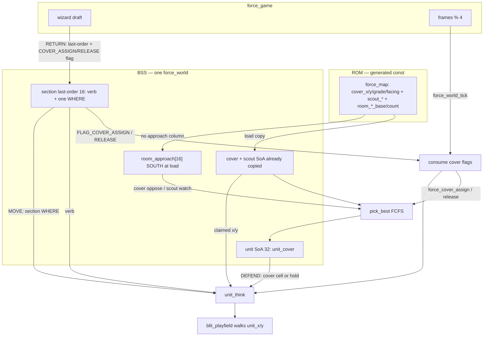
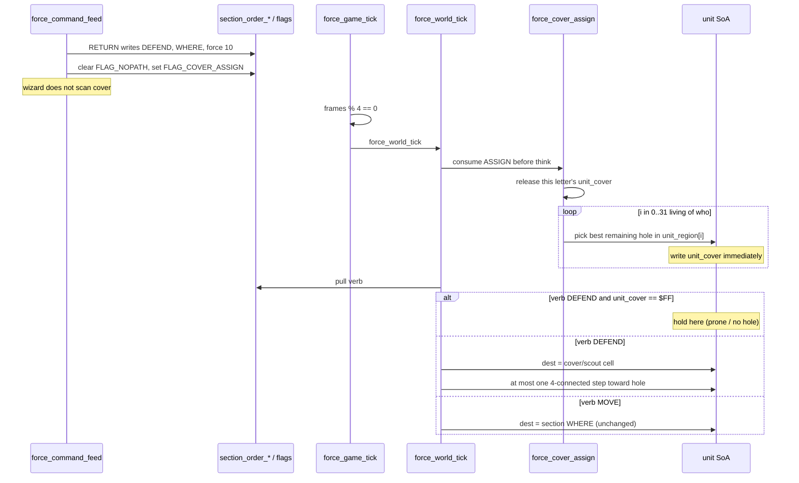

# Phase 5 — Cover and D

| Field | Value |
| --- | --- |
| Author | FORCE design session |
| Date | 2026-09-13 |
| Status | **landed** |
| Last worked on | 2026-09-13 |
| Repo path | [`design/phase-5-cover-and-d.md`](phase-5-cover-and-d.md) |
| Plan | [`development-plan.md`](development-plan.md) (Phase 5 frozen) |
| Source | `src/sdl/game/world.h`, `src/sdl/game/world.c`, `src/sdl/game/command.c`, `src/sdl/game/game.c`, `src/sdl/game/game.h`, `src/sdl/generated/force_data.h` |
| Intent | [`../doc/FORCE_07_Rooms_Cover_and_Farm.md`](../doc/FORCE_07_Rooms_Cover_and_Farm.md), [`../doc/FORCE_08_Units_Sections_and_Tick.md`](../doc/FORCE_08_Units_Sections_and_Tick.md) |
| Binary as it is | [`../agents/game.md`](../agents/game.md), [`../agents/known-gaps.md`](../agents/known-gaps.md) |

Cover / scout tables, approach bits, assignment on the triggers in
FORCE_07. First they-look-smart moment. Shooting not required.

Index status is **landed**. `D` claims cover and walks to the hole.

---

## Overview

Phase 4 left a live stepper. `M` and `D` both walk to section WHERE
then hold. Cover, scout, and per-room base/count already sit in BSS
`force_world`. `unit_cover` is `$FF` at spawn and never written.
Approach bits do not exist. `command.c` `commit` writes last-order
and does not call the world for a roster fill.

Phase 5 is the claim. On Defend RETURN the wizard writes last-order
and latches `FLAG_COVER_ASSIGN` on that letter. The next
`force_world_tick` consumes the flag **before** think:
`force_cover_assign(world, who)` walks the 32-slot pool in index
order and each living stack of that letter, **in the room it
currently occupies**, takes the best remaining free hole in that
room. Dest for the stepper is the claimed cell (`cover_x/y` or
`scout_x/y`), not a second copy of section WHERE. A room with zero
cover chips (mid and west on the current farm) is prone in place
(`unit_cover = $FF`, no step). Scout chips: if a room has none,
that step is a no-op. A scout is live when its facing **watches**
a live approach (`scout_south` when SOUTH is on), not when cover
would oppose that axis. Default approach bits are SOUTH on every
used room until Phase 7 has a wave script.

`--smoke` is still one frame, exit 0, verb NONE, stamps unmoved.
Interactive SHIFT+D RETURN is the gate: men leave the dirt and
lock to holes in the east room; a D issued in mid or west is
hit-the-dirt.

This is not combat, not `K`, not waves flipping bits, not A*, not
a C64 emitter.

---

## Background & Motivation

### Current runtime (Phase 4, landed)

`force_command_feed` commits on RETURN onto the section row
(`src/sdl/game/command.c` `commit`):

```c
w->section_order_verb[who]  = g->cmd_verb;
w->section_order_x[who]     = x;
w->section_order_y[who]     = y;
w->section_order_force[who] = force;
```

No call into cover. `D` stores `FORCE_VERB_DEFEND` and a WHERE
cell (cursor / typed). That is the issued cell, and it stays one
WHERE.

`unit_think` (`src/sdl/game/world.c`) treats Defend like Move:

```c
if (verb != FORCE_VERB_MOVE && verb != FORCE_VERB_DEFEND) {
    return;   /* NONE / HALT: hold here. */
}
if (!pull_desired(w, i, sec, &here, &dest_r, &p, &dx, &dy)) {
    return;
}
if (w->unit_x[i] == w->section_order_x[sec] &&
    w->unit_y[i] == w->section_order_y[sec] &&
    here == dest_r) {
    return;   /* arrived at WHERE */
}
```

`pull_desired` always reads `section_order_x/y`. Arrival is the
order cell. `unit_cover` is unread.

Cover / scout SoA is already on the world (Phase 1 copy, Phase 2
left `unit_cover = $FF`):

```c
uint8_t  room_cover_base[FORCE_ROOM_MAX];
uint8_t  room_cover_count[FORCE_ROOM_MAX];
uint8_t  room_scout_base[FORCE_ROOM_MAX];
uint8_t  room_scout_count[FORCE_ROOM_MAX];
uint8_t  cover_count;
uint8_t  cover_x/y/grade/facing[FORCE_COVER_MAX];
uint8_t  scout_count;
uint8_t  scout_x/y/facing[FORCE_SCOUT_MAX];
uint8_t  unit_cover[FORCE_UNIT_MAX];
```

Caps (`src/sdl/generated/force_data.h`):

| Symbol | Value |
| --- | ---: |
| `FORCE_COVER_MAX` | 128 |
| `FORCE_COVER_PER_ROOM` | 12 |
| `FORCE_SCOUT_MAX` | 32 |
| `FORCE_SCOUT_PER_ROOM` | 4 |
| `FORCE_FACE_NONE` | 0 |
| `FORCE_FACE_N` | 1 |
| `FORCE_FACE_E` | 2 |
| `FORCE_FACE_S` | 3 |
| `FORCE_FACE_W` | 4 |

Generated farm (`src/sdl/generated/force_data.c` — **work against
these tables**, do not hard-code them in C):

| Column | Farm |
| --- | --- |
| map | 40×20, window `0,0,40,20` |
| rooms | **3** rects |
| portals | 7 |
| cover | **11**, all grade 2, all in room 0 |
| scouts | **0** |
| units | 8 infantry, section 0, all in room 0 |

Rooms (colour-chip order; first containing rect wins):

| i | colour | x0,y0 | w×h | cells | name (intent) |
| ---: | ---: | --- | --- | --- | --- |
| 0 | 1 | 21,0 | 19×20 | x 21–39 | east / FARM |
| 1 | 2 | 6,0 | 15×20 | x 6–20 | middle / LANE |
| 2 | 4 | 0,0 | 6×20 | x 0–5 | west / FIELD |

Cover (row-major extract; `room_cover_base/count` = `{0,11,11}` /
`{11,0,0}`):

| i | x,y | grade | facing |
| ---: | --- | ---: | ---: |
| 0 | 26,3 | 2 | W (4) |
| 1–3 | 22,4 / 22,5 / 22,6 | 2 | W |
| 4 | 32,7 | 2 | W |
| 5–6 | 22,9 / 22,11 | 2 | W |
| 7 | 32,11 | 2 | **N (1)** |
| 8–10 | 22,12 / 22,14 / 22,17 | 2 | W |

Eleven chips: eight on x=22 facing W, three on roofs
`(26,3)`, `(32,7)`, `(32,11)`. Roofs are passable (Phase 4).
Zero scout rows. Assignment will run; “houses fill first / scout
in the gap” will not appear until the user restamps grade-3 and
scout chips. That is accepted.

Spawns (all section 0, region 0, `unit_cover = $FF`):

| slot | x | y | glyph |
| ---: | ---: | ---: | ---: |
| 0 (lead) | 26,7 | 6 |
| 1 | 26,8 | 6 |
| 2 | 24,9 | 2 |
| 3–7 | 26,9–13 | 6 |

Tick cadence is unchanged: every 4 display frames
`force_world_tick`; `move_wait` default 7; RETURN does not poke
wait. `command.c` is the wizard and does not step.

### Pain

- SHIFT+D RETURN walks eight men onto one WHERE cell. Packed
  occupancy makes seven wait in a blob. That is not “they look
  smart.” FORCE_07 already authored numbered holes; runtime never
  claims them.
- Pushing five (eight) WHEREs onto the section is impossible.
  Dest for D must be the per-stack hole index already allocated
  as `unit_cover`.
- Scanning the 40×20 for “best bush” is the 6502-filter failure.
  The access pattern is walk 32, then 12 cover / 4 scout in that
  room.
- FORCE_07’s “nearest stack to slot” pairing is a second
  language the user rejected. Who goes where is not important.
  First come, first served.
- Approach bits do not exist. Inventing a live pressure vector
  from enemy centroid is the thing FORCE_07 forbids. Until Phase
  7 has a wave script, SOUTH is the honest default.

### What Phase 4 already got right

Units pull last-order. Dest for `M` lives on the section.
Bresenham 4-connected, roofs pass, walls/barriers/occupancy
block, next-hop is a portal index. `D` is parsed and stored.
`command.c` writes last-order and does not step. Cover columns
already live on `world.c`. Phase 5 extends that world. It does
not invent a second BSS object, a farm-specific slot list in C,
or a new TU.

---

## Goals & Non-Goals

### In (Phase 5)

- Claim cover at runtime from the painted tables in the room
  the men are actually in. No per-soldier destinations authored
  in C. Repaint the chips, same code.
- On D commit only: wizard latches `FLAG_COVER_ASSIGN`;
  `force_world_tick` calls `force_cover_assign(world, who)`
  before think. Halt does not reassign. Do not reassign every
  tick. Do not reassign when an enemy steps. No combat → no
  contact-start, no death, no slot destroyed, no wave.
- FCFS: walk the 32-slot pool in index order. Each unassigned
  living stack of this section in this room takes the **best
  remaining free slot** in this room (highest grade, then facing
  that opposes a live approach or facing none, then Manhattan to
  the stack). That implements FORCE_07 fill order as slot
  *priority*, not nearest-stack-to-slot pairing.
- Dest for D is on the unit (`unit_cover` → table cell). Section
  last-order stays one WHERE (the issued cell / cursor — Phase 3
  already wrote it). Do not push five WHEREs onto the section.
- Change `unit_think`: verb DEFEND and `unit_cover != $FF` →
  stepper target is the claimed cell; `$FF` → hold here (no
  step). Stop treating D like M.
- `room_approach[FORCE_ROOM_MAX]` on the world, filled at load
  to `FORCE_APPROACH_S` (0x04), never `FORCE_FACE_S` (3), for
  every used room (0 for unused). Cover facing oppose: N↔S,
  E↔W. `FORCE_FACE_NONE` matches any live approach. Scout
  facing **watches** the same axis (`FORCE_FACE_S` →
  `FORCE_APPROACH_S`).
- Scout slots: after grade-3 in the “best remaining” ranking, at
  most one stack per live scout whose facing watches a live
  approach (`scout_south` is live when SOUTH is on). Table
  already in RAM. Zero scouts → that step is a no-op. Compiler
  rejects scout `facing=none`.
- Enemy uses the same assign if they ever get a D (scripts).
  Farm has no enemies. Do not special-case player.
- `--smoke`: verb NONE, no assign, stamps unmoved. Interactive:
  SHIFT+D RETURN, men leave the dirt and lock to holes in the
  east room; mid/west D is hit-the-dirt.
- One landing cut. Prefer not a new TU; `world.c` already owns
  cover columns. `command.c` stays the wizard: last-order +
  cover flags, no roster scan. **Timing lock:** `force_world_tick`
  consumes the flag before think so the same RETURN’s next
  logic tick already has `unit_cover` set.
- Work against the generated tables. Do not hard-code farm room
  count, cover cells, or spawn cells in C.
- `agents/game.md`, `agents/known-gaps.md`, `agents/testing.md`,
  `agents/architecture.md` if world columns / “where to change”
  grow, `design/README.md` active→landed when implemented.
  Product notes in FORCE_07 / FORCE_08 in the same landing PR
  (FCFS best-remaining; D dest is `unit_cover`; approach default
  SOUTH). `design/development-plan.md` only when behaviour is in
  `src/`.

### Out (later phases)

| Later | Why it is not Phase 5 |
| --- | --- |
| Combat, `A`, `K`, ROE, `fire_wait` (Phase 6) | No fire. Skip K-target slots: no K, so skip that line. |
| Waves flipping approach bits (Phase 7) | Default SOUTH, static. No pressure vector. |
| Contact-start / death / slot-destroyed reassign | No combat. Trigger is D commit only. |
| Intel, camera, `Z` / `C` / `E` (Phase 8) | Window is still the load copy. |
| `S` / `J`, engineers (Phase 9) | Peel/join are not this phase. A later join into a defending letter re-runs assign on the next D, not automatically. |
| Occupancy bitmap, A* | Rejected since Phase 4. Scan 32. |
| Glyph rotate to match cover facing | `known-gaps.md`: per-soldier facing is out of product scope. They walk to the cell; they do not turn. |
| Farm restamp to grade-3 houses / scout in the gap | Authoring. Same code. Do not bake a C slot list to fake the picture. |
| LZSS, colour-RAM, C64 emitter (Phase 10) | No `src/c64/`. |
| `malloc`, VLA, `tests/` tree, mouse | Forbidden now and later. |

---

## Key Decisions

Locked. Not reopened as Open Questions. Product conversation
2026-09-13 plus FORCE_07 / FORCE_08.

1. **Cover is claimed at runtime from painted tables in the
   room the men are actually in.** No per-soldier destinations.
   No farm-specific slot list in C. Repaint the chips, same
   code. `room_cover_base/count` and `room_scout_base/count`
   already slice the global lists per room. Scan those slices
   (≤ `FORCE_COVER_PER_ROOM` 12, ≤ `FORCE_SCOUT_PER_ROOM` 4).
   Never scan the map. Never walk `FORCE_COVER_MAX` 128 looking
   for a cell.

2. **If A is walking A→C, currently in B, and the player
   issues D:** last-order becomes defend. Each living stack of
   that section **in B** claims a free hole **in B**. Men
   already in C claim in C. A room with zero cover chips (mid
   and west on the current farm) → prone in place
   (`unit_cover = $FF`, stay). Scout chips: if a room has none,
   that step is a no-op. They do **not** walk to section WHERE
   and they do **not** continue the previous `M` into C.

3. **Who goes where is not important.** First come, first
   served. Walk the 32-slot pool in index order. Each
   unassigned living stack of this section in this room takes
   the **best remaining free slot** in this room: highest
   grade, then facing that opposes a live approach (or facing
   none), then Manhattan to the stack, then lower global index.
   That is greedy FCFS, not FORCE_07’s “nearest stack to slot”
   pairing. The user explicitly preferred FCFS over scripted
   who-goes-where.

4. **FORCE_07 fill order still describes slot *priority*,
   which FCFS “best remaining” implements:**

   | Tier | Slot |
   | ---: | --- |
   | 4 | grade 3 |
   | 3 | live scout (at most one stack per live scout slot) |
   | 2 | grade 2 whose facing opposes a live approach, or `FORCE_FACE_NONE` |
   | 1 | remaining grade 2 |
   | 0 | grade 1 |
   | — | rest prone (`$FF`) |

   Skip K-target slots: no K this phase, so skip that line.
   Grade 0 / other is not a candidate. Dead scouts (facing does
   not **watch** a live approach — same axis, not cover-oppose)
   are not candidates. Cover uses oppose (`facing_matches`);
   scouts use `scout_live`. Do not reuse the cover helper on
   `scout_facing`.

5. **Dest for D is on the unit, not a second copy of section
   WHERE.** Section last-order stays one WHERE (the issued cell
   / cursor — Phase 3 already wrote it). Cover walk: if verb is
   DEFEND and `unit_cover != $FF`, stepper target is the claimed
   cell; if `$FF`, hold here (no step). Do not push five WHEREs
   onto the section. Phase 4 `unit_think` currently treats D
   like M (walk to section WHERE). **Change that** this phase.
   `M` is unchanged (pull WHERE). Arrival compares against the
   dest cell (hole or WHERE), not always `section_order_x/y`.

6. **Default approach bits = SOUTH** until Phase 7 has a wave
   script. Store `room_approach[FORCE_ROOM_MAX]` on the world,
   filled at load to `FORCE_APPROACH_S` (**0x04**), never
   `FORCE_FACE_S` (**3**), for every used room (0 for unused).
   Do not invent a pressure vector. Cover facing oppose: N
   opposes S, E opposes W, S opposes N, W opposes E.
   `FORCE_FACE_NONE` counts as matching any live approach
   (`approach != 0`). Facing is the existing 0–4 enum;
   approach is a **bitmask**. Do not cast FACE to a mask:
   `FORCE_FACE_N == 1 == FORCE_APPROACH_N` and
   `FORCE_FACE_E == 2 == FORCE_APPROACH_E` alias;
   `FORCE_FACE_S == 3` is `N|E` bits, not SOUTH. Map FACE →
   bit only through `face_approach_bit`. `#error` if
   `FORCE_FACE_S == FORCE_APPROACH_S`. Unused rooms 0:
   nothing is live, including `FORCE_FACE_NONE`.

7. **Trigger this phase: D commit only.** Halt does not
   reassign (and does not release). No combat → no
   contact-start, no death, no slot destroyed, no wave. Do not
   reassign every tick. Do not reassign when an enemy steps.
   Re-issue D: release this letter’s claims, then FCFS from
   current cells. `M` commit **releases** this letter’s claims
   (holes free; they walk to WHERE). Halt leaves `unit_cover`
   as-is (they stop; they still own the hole).

8. **Current farm (tables, not C literals):** 3 rooms; 11
   cover all grade 2 (eight on x=22 facing W, three on roofs);
   0 scouts. Assignment will run; “houses fill first / scout in
   the gap” will not appear until the user restamps. That is
   accepted. Roofs are passable (Phase 4). With default SOUTH,
   only the N-facing roof chip opposes; the rest are remaining
   grade-2, picked by Manhattan.

9. **Scout slots:** after grade-3 fill (as priority in “best
   remaining”), at most one stack per **live** scout. Live =
   facing **watches** a live approach: `FORCE_FACE_S` →
   `FORCE_APPROACH_S`, same axis, not the cover oppose table.
   `assets/properties.txt` is `scout_south=scout facing=s`
   (and n/e/w). `gen_sdl.py` rejects scout `facing=none`.
   Default SOUTH therefore lights a south scout, not a north
   one. Farm has 0 scouts; do not author a C special-case.
   Scout table already in RAM (`scout_x/y/facing`,
   `room_scout_base/count`). Encode a scout claim in the same
   `unit_cover` byte: `FORCE_COVER_MAX + scout_index` (128 +
   0..31). Cover claims are `0 .. FORCE_COVER_MAX-1`. `$FF`
   remains none. `#error` if
   `FORCE_COVER_MAX + FORCE_SCOUT_MAX >= 0xFF`.

10. **Enemy uses the same assign** if they ever get a D
    (scripts). Farm has no enemies. Do not special-case player.
    `who` is `0..15`. The command path only ever passes `0..7`.

11. **`--smoke`:** one frame, exit 0, READY, eight load-cell
    stamps unmoved. Verb is NONE so think does not step.
    Interactive: SHIFT+D RETURN, men leave the dirt and lock to
    holes in the east room; mid/west D is hit-the-dirt. Smoke
    cannot type and cannot print SoA; `unit_cover` staying
    `$FF` is a debugger/review check, not a smoke signal.

12. **One landing cut. Wizard does not run the roster fill.**
    Prefer not a new TU; `world.c` already owns cover columns
    and `pick_best` stays file-static there. `command.c` stays
    the wizard: RETURN writes last-order and a **section flag**
    (`FLAG_COVER_ASSIGN` on D, `FLAG_COVER_RELEASE` on M). It
    does not call `force_cover_assign` / `force_cover_release`
    and does not scan 12 cover. **Timing lock stays:**
    `force_game_tick` already feeds then, if `frames % 4 == 0`,
    `force_world_tick`. Consume the flags at the **top** of
    `force_world_tick`, before the think loop, so the same
    RETURN’s next logic tick already has `unit_cover` set
    (else men walk to section WHERE for one think — the Phase
    4 path we are deleting). Do not assign from `unit_think`.
    Do not assign from `game.c`. Do not assign from
    `command.c`. Halt does not set or clear the cover flags
    (a pending D still fills, then think sees HALT). `game.c`
    still does not name `section_order_*`. Halt already
    **reads** `unit_x[lead]` for WHERE; the fence is no
    `unit_x` **writes** in `command.c`, not a ban on the
    name.

13. **Still no:** combat, K, waves flipping bits, S/J, A*,
    occupancy bitmap, mouse, malloc, C64, a second TMX,
    `tests/` tree, compiler-baked assignment, a farm slot list
    in C, glyph rotate, `cover.c`, pushing WHERE onto units,
    poking `move_wait` on RETURN.

---

## Proposed Design

### Runtime data flow



After init, `force_map.cover_*` is not read again. RAM tables
plus `unit_cover` are the live roster.

### Sequence: SHIFT+D RETURN, then one logic step



Same-frame RETURN + logic tick: `commit` is step 4 of
`force_game_tick`; `force_world_tick` is step 5 and consumes
the flag **before** think. `unit_cover` is set. They do not
take a WHERE step. A RETURN on a non-logic frame leaves the
flag until the next `world_tick`; think has not run yet, so
there is still no D-as-M lurch.

### Caps and constants (`world.h`)

Next to existing `#error` guards and Phase 4 `#define`s:

```c
#if (FORCE_COVER_MAX + FORCE_SCOUT_MAX) >= 0xFF
#error "unit_cover packs cover 0..COVER_MAX-1, scout COVER_MAX+i, $FF none"
#endif

/* Approach is a bitmask. FACE is 0-4, not a bit.
   FACE_N/E numerically alias APPROACH_N/E (1/2). FACE_S is 3
   (N|E bits), APPROACH_S is 0x04. Default SOUTH is
   FORCE_APPROACH_S, never FORCE_FACE_S. Map FACE → bit only
   through face_approach_bit; never `approach & FORCE_FACE_*`
   and never `room_approach[i] = FORCE_FACE_S`. */
#define FORCE_APPROACH_N  0x01u
#define FORCE_APPROACH_E  0x02u
#define FORCE_APPROACH_S  0x04u
#define FORCE_APPROACH_W  0x08u

#if FORCE_FACE_S == FORCE_APPROACH_S
#error "FORCE_FACE_S (enum 3) must not equal FORCE_APPROACH_S (bit 0x04)"
#endif

#define FORCE_SECTION_FLAG_COVER_ASSIGN   0x02u
#define FORCE_SECTION_FLAG_COVER_RELEASE  0x04u
```

`FORCE_SECTION_FLAG_NOPATH` is already `0x01`. Assign and
release are mutually exclusive; `commit` sets one and clears
the other. Both set (a bug) → assign wins (it releases first).

`FORCE_UNIT_NONE` (`$FF`) remains the generic sentinel: empty
lead, unassigned cover, no room, no path. Do not add
`FORCE_COVER_NONE`. Scout encoding uses `FORCE_COVER_MAX` as
the bias; do not add a second macro unless a reviewer wants a
name (`FORCE_COVER_SCOUT_BIAS` is optional sugar equal to
`FORCE_COVER_MAX`).

`tools/gen_sdl.py` is **unchanged**. Cover / scout extract and
`FORCE_COVER_PER_ROOM` 12 / `FORCE_SCOUT_PER_ROOM` 4 already
exist. No approach-bit emit. No assignment bake.

### `force_world` struct — new column

**Append** after `path_fail_who` (end of the struct). Do not
splice `room_approach` after `room_scout_count` (Phase 4
packing rule: new fields go at the end). Arrays stay **in the
struct**. Do not drop colour this phase. `unit_cover` already
exists; do not add `unit_scout`.

```c
    /* existing fields through path_fail_who, then Phase 5: */
    uint8_t  room_approach[FORCE_ROOM_MAX];  /* bitmask; unused rooms 0 */
```

Public:

```c
void force_cover_release(force_world *world, uint8_t who);
void force_cover_assign(force_world *world, uint8_t who);
```

`who` is `0 .. FORCE_SECTION_MAX-1`. Out of range is a no-op.
`force_cover_assign` always releases first, then fills.
`unit_region_at` stays file-static.

### BSS layout and byte budget

Phase 4 payload was 9985 SDL / 5985 without `color` (C may pad
9985 → 9986). All new fields are `uint8_t` after `row_off`, so
they pack.

| Field | Bytes | Notes |
| --- | ---: | --- |
| Phase 4 world | 9985 | |
| `room_approach[16]` | 16 | SOUTH at load; 0 unused |
| **SDL data** | **10001** | odd → C may pad to 10002 |
| **without `color`** | **6001** | 6502-relevant board |

FORCE_06’s “about 5–6K for the world” included cover lists
(already in Phase 1) and a cover-index byte per stack (already
in Phase 2). +16 for approach is noise. Compare:
`force_game.pixels` is 256000 bytes on the stack.

No taken-bit array on the world. Free-test walks 32. No scratch
BSS.

Farm occupancy of the new column:

| Column | Used / cap |
| --- | --- |
| rooms | 3 / 16 |
| `room_approach` | 3 × `FORCE_APPROACH_S`; 13 tails 0 |
| cover | 11 / 128, **read on D** |
| scouts | 0 / 32 |
| `unit_cover` | 8 live; `$FF` until first D |

### Load: fill approach

After room copy (count is known), before or after spawn
(assign does not run at load):

```c
for (i = 0u; i < FORCE_ROOM_MAX; ++i) {
    world->room_approach[i] =
        (i < world->room_count) ? (uint8_t)FORCE_APPROACH_S : 0u;
}
```

Do not read a ROM column (there is none, so this cannot hide
inside `copy_column`). Do not write `FORCE_FACE_S`. Tails stay
0. Restartable: a second load of a smaller `room_count` must
zero the unused approach bytes (the loop writes all 16).

Cover / scout `copy_column` is unchanged (Phase 1). Spawn still
sets `unit_cover = FORCE_UNIT_NONE`.

### `unit_cover` encoding

One byte, already on the unit:

| Value | Meaning | Stepper dest |
| --- | --- | --- |
| `0 .. FORCE_COVER_MAX-1` | cover slot index | `cover_x/y[c]` if `c < cover_count` |
| `FORCE_COVER_MAX + s` | scout slot `s` | `scout_x/y[s]` if `s < scout_count` |
| `$FF` | unassigned / prone | hold here |

Resolve (file-static). Bad index → 0, caller holds:

```c
static int cover_cell(const force_world *w, uint8_t c,
                      uint8_t *x, uint8_t *y)
{
    if (c == FORCE_UNIT_NONE) {
        return 0;
    }
    if (c < FORCE_COVER_MAX) {
        if (c >= w->cover_count) {
            return 0;
        }
        *x = w->cover_x[c];
        *y = w->cover_y[c];
        return 1;
    }
    c = (uint8_t)(c - FORCE_COVER_MAX);
    if (c >= w->scout_count) {
        return 0;
    }
    *x = w->scout_x[c];
    *y = w->scout_y[c];
    return 1;
}
```

Never subscript `$FF`. Never subscript `c >= cover_count` /
`s >= scout_count`.

### Facing vs approach

FACE is not a bit. Map it through this helper; never cast.

```c
static uint8_t face_approach_bit(uint8_t facing)
{
    if (facing == FORCE_FACE_N) {
        return FORCE_APPROACH_N;
    }
    if (facing == FORCE_FACE_E) {
        return FORCE_APPROACH_E;
    }
    if (facing == FORCE_FACE_S) {
        return FORCE_APPROACH_S;
    }
    if (facing == FORCE_FACE_W) {
        return FORCE_APPROACH_W;
    }
    return 0u;   /* NONE or junk: not a live bit */
}

/* Cover: facing opposes a live approach, or FACE_NONE vs any live. */
static int facing_matches(uint8_t facing, uint8_t approach)
{
    uint8_t bit;

    if (approach == 0u) {
        return 0;   /* unused room: nothing is live */
    }
    if (facing == FORCE_FACE_NONE) {
        return 1;
    }
    bit = face_approach_bit(facing);
    if (bit == 0u) {
        return 0;
    }
    if (bit == FORCE_APPROACH_N) {
        bit = FORCE_APPROACH_S;
    } else if (bit == FORCE_APPROACH_S) {
        bit = FORCE_APPROACH_N;
    } else if (bit == FORCE_APPROACH_E) {
        bit = FORCE_APPROACH_W;
    } else {
        bit = FORCE_APPROACH_E;
    }
    return (approach & bit) != 0u;
}

/* Scout: facing watches the same axis. scout_south is live
   when SOUTH is on. Compiler rejects scout facing=none. */
static int scout_live(uint8_t facing, uint8_t approach)
{
    uint8_t bit = face_approach_bit(facing);

    if (bit == 0u || approach == 0u) {
        return 0;
    }
    return (approach & bit) != 0u;
}
```

SOUTH default, **cover**: only `FORCE_FACE_N` and
`FORCE_FACE_NONE` match. Farm’s eight W-facing wall chips do
**not** oppose SOUTH. The single N-facing roof chip does.
That is the accepted flat grade-2 picture, not a bug to
special-case in C.

SOUTH default, **scout**: `scout_south` (`FORCE_FACE_S`) is
live; a north scout is dead. Farm has 0 scouts. Do not reuse
`facing_matches` on `scout_facing`.

### Manhattan

Coords are `uint8_t`. `|dx|+|dy|` on an 80×50 board fits
`uint8_t` (max 130). Subtract in `int`.

```c
static uint8_t manhattan(uint8_t x0, uint8_t y0, uint8_t x1, uint8_t y1)
{
    int dx = (int)x0 - (int)x1;
    int dy = (int)y0 - (int)y1;
    if (dx < 0) {
        dx = -dx;
    }
    if (dy < 0) {
        dy = -dy;
    }
    return (uint8_t)(dx + dy);
}
```

### Transaction: write `unit_cover` immediately

Two men pick the same hole if assign is not transactional.
**Lock:** no `taken[]` on the world. A hole is taken if any
**living** unit (`count != 0`) of **any** section has
`unit_cover == encoded`. Walk 32. When a stack takes a slot,
write `unit_cover[i]` **before** the next `i`. That is the
transaction.

```c
static int cover_taken(const force_world *w, uint8_t encoded)
{
    uint8_t i;

    for (i = 0u; i < FORCE_UNIT_MAX; ++i) {
        if (w->unit_count[i] == 0u) {
            continue;
        }
        if (w->unit_cover[i] == encoded) {
            return 1;
        }
    }
    return 0;
}
```

Cost is O(units × (12+4) × 32) per D, worst case ~16k
compares. Farm is 8 × 11 × 8. Do not “optimise” with a map or
a 128-byte taken column. Skip `count == 0` so a freed slot
cannot hold a hole.

Assign **releases this letter first**, so a re-issue D does
not see its own stale claims as taken. Other letters’ claims
remain (two sections defending one room share the furniture;
first D wins the good holes). Farm has one letter.

Cell occupancy (another body standing on the hole) is **not**
consulted at assign time. The stepper already waits
(`cell_free` scan 32). A man sitting on a hole he is not
assigned to does not steal it; the assignee walks up and
waits. Do not skip occupied cells at assign — farm has no
stacks, and mid-walk D would otherwise refuse a hole a passer
is crossing.

### Best remaining (`pick_best`)

Scan this room’s cover slice, then this room’s scout slice.
Keep the best encoded index. No `qsort`. No heap.

```c
static uint8_t pick_best(const force_world *w, uint8_t i, uint8_t room)
{
    uint8_t best = FORCE_UNIT_NONE;
    uint8_t best_tier = 0u;
    uint8_t best_manh = 0xFFu;
    uint8_t have = 0u;
    uint8_t approach = w->room_approach[room];
    uint8_t b, n, j;

    b = w->room_cover_base[room];
    n = w->room_cover_count[room];
    for (j = 0u; j < n; ++j) {
        uint8_t c = (uint8_t)(b + j);
        uint8_t g, f, tier, manh;
        if (c >= w->cover_count) {
            break;
        }
        if (cover_taken(w, c)) {
            continue;
        }
        g = w->cover_grade[c];
        f = w->cover_facing[c];
        if (g == 3u) {
            tier = 4u;
        } else if (g == 2u) {
            tier = facing_matches(f, approach) ? 2u : 1u;
        } else if (g == 1u) {
            tier = 0u;
        } else {
            continue;
        }
        manh = manhattan(w->unit_x[i], w->unit_y[i],
                         w->cover_x[c], w->cover_y[c]);
        if (!have || tier > best_tier ||
            (tier == best_tier && manh < best_manh) ||
            (tier == best_tier && manh == best_manh && c < best)) {
            have = 1u;
            best = c;
            best_tier = tier;
            best_manh = manh;
        }
    }

    b = w->room_scout_base[room];
    n = w->room_scout_count[room];
    for (j = 0u; j < n; ++j) {
        uint8_t s = (uint8_t)(b + j);
        uint8_t enc, manh;
        if (s >= w->scout_count) {
            break;
        }
        if (!scout_live(w->scout_facing[s], approach)) {
            continue;   /* dead scout: axis not in the room mask */
        }
        enc = (uint8_t)(FORCE_COVER_MAX + s);
        if (cover_taken(w, enc)) {
            continue;   /* at most one stack */
        }
        manh = manhattan(w->unit_x[i], w->unit_y[i],
                         w->scout_x[s], w->scout_y[s]);
        if (!have || 3u > best_tier ||
            (3u == best_tier && manh < best_manh) ||
            (3u == best_tier && manh == best_manh && enc < best)) {
            have = 1u;
            best = enc;
            best_tier = 3u;
            best_manh = manh;
        }
    }
    return have ? best : FORCE_UNIT_NONE;
}
```

Room with `cover_count` 0 and `scout_count` 0 → `$FF` (prone).
Do not walk the global cover list. Do not scan `tiles[]`.

### `force_cover_release` / `force_cover_assign`

```c
void force_cover_release(force_world *world, uint8_t who)
{
    uint8_t i;

    if (who >= FORCE_SECTION_MAX) {
        return;
    }
    for (i = 0u; i < FORCE_UNIT_MAX; ++i) {
        if (world->unit_section[i] == who) {
            world->unit_cover[i] = FORCE_UNIT_NONE;
        }
    }
}

void force_cover_assign(force_world *world, uint8_t who)
{
    uint8_t i;

    force_cover_release(world, who);
    if (who >= FORCE_SECTION_MAX) {
        return;
    }
    for (i = 0u; i < FORCE_UNIT_MAX; ++i) {
        uint8_t r;
        if (world->unit_count[i] == 0u) {
            continue;
        }
        if (world->unit_section[i] != who) {
            continue;
        }
        if (world->unit_kind[i] == FORCE_KIND_EMPLACEMENT) {
            continue;   /* they do not step; do not occupy a hole */
        }
        r = world->unit_region[i];
        if (r == FORCE_UNIT_NONE || r >= world->room_count) {
            continue;   /* cover stays $FF */
        }
        world->unit_cover[i] = pick_best(world, i, r);
        /* $FF if no hole: prone in place */
    }
}
```

FCFS is the outer `i` loop, index order 0..31. Do not sort
stacks by distance to a slot. Do not pair nearest-to-slot.
Emplacements skip (none on farm). Vehicles take a hole if they
ever exist (none on farm; do not special-case infantry). Region
is the Phase 4 lie (`unit_region`, not a fresh
`unit_region_at` of the cell) so a man standing on a portal
chip still claims in the flipped room.

### `pull_desired` takes the dest cell

Today it reads `section_order_x/y`. Both `M` and `D` need the
same next-hop / fail / in-room split; they disagree on **which
cell**. Pass `ox, oy`:

```c
static int pull_desired(force_world *w, uint8_t i, uint8_t sec,
                        uint8_t ox, uint8_t oy,
                        uint8_t *here_out, uint8_t *dest_out,
                        uint8_t *p_out, uint8_t *dx, uint8_t *dy)
{
    uint8_t dest_r = unit_region_at(w, ox, oy);
    uint8_t here = w->unit_region[i];
    uint8_t p = FORCE_UNIT_NONE;

    *here_out = here;
    *dest_out = dest_r;
    *p_out = FORCE_UNIT_NONE;
    if (here == FORCE_UNIT_NONE || here >= w->room_count ||
        dest_r == FORCE_UNIT_NONE || dest_r >= w->room_count) {
        fail_path(w, sec);
        return 0;
    }
    if (here == dest_r) {
        *dx = ox;
        *dy = oy;
        return 1;
    }
    p = w->next_hop[hop_index(here, dest_r)];
    if (p == FORCE_UNIT_NONE || p >= w->portal_count) {
        fail_path(w, sec);
        return 0;
    }
    *p_out = p;
    *dx = w->portal_x[p];
    *dy = w->portal_y[p];
    return 1;
}
```

In-room cover: `dest_r == here`, target is the hole, `p` is
`$FF`. A D whose WHERE is in another room must **not**
`NO PATH` — WHERE is not the dest. Authored cover sits inside
its room (compiler groups by containing rect); a chip outside
the rect is a content bug, and next-hop still applies.

### `unit_think` — stop treating D like M

```c
static void unit_think(force_world *w, uint8_t i)
{
    uint8_t sec = w->unit_section[i];
    uint8_t verb = w->section_order_verb[sec];
    uint8_t here, dest_r, p, dx, dy;
    uint8_t here0;
    uint8_t ox, oy;

    if (verb == FORCE_VERB_MOVE) {
        ox = w->section_order_x[sec];
        oy = w->section_order_y[sec];
    } else if (verb == FORCE_VERB_DEFEND) {
        if (!cover_cell(w, w->unit_cover[i], &ox, &oy)) {
            return;   /* $FF or bad index: prone / hold */
        }
    } else {
        return;   /* NONE / HALT: hold here. RETURN does not poke wait. */
    }
    if (!pull_desired(w, i, sec, ox, oy, &here, &dest_r, &p, &dx, &dy)) {
        return;
    }
    if (w->unit_x[i] == ox && w->unit_y[i] == oy && here == dest_r) {
        return;   /* arrived at hole (D) or WHERE (M); leave wait 0 */
    }
    if (dx != w->unit_tgt_x[i] || dy != w->unit_tgt_y[i]) {
        stepper_aim(w, i, dx, dy);
    }

    here0 = here;
    if (p != FORCE_UNIT_NONE &&
        w->unit_x[i] == w->portal_x[p] &&
        w->unit_y[i] == w->portal_y[p] &&
        here != dest_r) {
        portal_flip(w, i, p);
        if (!pull_desired(w, i, sec, ox, oy, &here, &dest_r, &p, &dx, &dy)) {
            return;
        }
        stepper_aim(w, i, dx, dy);
        return;
    }

    if (!stepper_step(w, i)) {
        return;
    }
    if (p != FORCE_UNIT_NONE &&
        w->unit_x[i] == w->portal_x[p] &&
        w->unit_y[i] == w->portal_y[p] &&
        here0 != dest_r) {
        portal_flip(w, i, p);
        if (pull_desired(w, i, sec, ox, oy, &here, &dest_r, &p, &dx, &dy)) {
            stepper_aim(w, i, dx, dy);
        }
    }
}
```

`stepper_aim` / `stepper_step` / `cell_free` / portal flip /
`move_wait` reload are **unchanged**. Roofs still pass; a hole
on a roof is a legal dest; draw restamps `tiles` so the
occupier disappears under the house — that is the lock-to-
houses picture. A hole on a wall is a content bug (wait
forever). Do not poke `unit_move_wait` on RETURN: a mid-walk D
waits out the current 7, then aims at the hole.

Do **not** fail the order because WHERE is disconnected when
verb is DEFEND. `pull_desired` sees the hole, not WHERE.

### `commit` — wizard latches a flag, does not fill

`src/sdl/game/command.c` `commit`, after the four last-order
stores and the NOPATH clear. Cover bits are mutually
exclusive:

```c
w->section_order_verb[who]  = g->cmd_verb;
w->section_order_x[who]     = x;
w->section_order_y[who]     = y;
w->section_order_force[who] = force;
{
    uint8_t f = w->section_flags[who];
    f = (uint8_t)(f & (uint8_t)~FORCE_SECTION_FLAG_NOPATH);
    if (g->cmd_verb == FORCE_VERB_DEFEND) {
        f = (uint8_t)(f & (uint8_t)~FORCE_SECTION_FLAG_COVER_RELEASE);
        f = (uint8_t)(f | FORCE_SECTION_FLAG_COVER_ASSIGN);
    } else if (g->cmd_verb == FORCE_VERB_MOVE) {
        f = (uint8_t)(f & (uint8_t)~FORCE_SECTION_FLAG_COVER_ASSIGN);
        f = (uint8_t)(f | FORCE_SECTION_FLAG_COVER_RELEASE);
    }
    /* HALT: do not touch COVER_ASSIGN / COVER_RELEASE */
    w->section_flags[who] = f;
}
g->cmd_nopath = 0;
```

WHERE resolution for Defend is **unchanged** (cursor / typed
cell, clamped). Chrome still paints `DEFEND A AT 10,20 FORCE
10`. That WHERE is the issued cell, not the hole. Halt still
writes lead-cell WHERE (it **reads** `unit_x[lead]`) and does
not latch a cover job.

`who` is 0–7 on this path. `force_cover_assign` accepts 0–15
for scripts; the wizard never calls it.

Last-order + flags is the wizard’s job. The roster fill is
world occupancy. `command.c` must not name `force_world_tick`,
`unit_move_wait`, `next_hop`, `unit_tgt_*`. It must not
**write** `unit_x` (Halt already reads the lead cell). It
must not name `force_cover_assign` / `pick_best`.

`force_game_tick` order is unchanged (feed, then maybe
`force_world_tick`, then `frames += 1`). Consume-before-think
is why that order works without a second think of D-as-M.
Two commits before the next logic tick: last flag wins (D
then M → release only; M then D → assign). D then Halt:
ASSIGN stays, tick fills, think sees HALT and holds; they
own the holes while stopped.

### `force_world_tick` — consume flags, then think

```c
static void consume_cover_jobs(force_world *world)
{
    uint8_t s;

    for (s = 0u; s < FORCE_SECTION_MAX; ++s) {
        uint8_t f = world->section_flags[s];
        if ((f & FORCE_SECTION_FLAG_COVER_ASSIGN) != 0u) {
            world->section_flags[s] = (uint8_t)(f &
                (uint8_t)~(FORCE_SECTION_FLAG_COVER_ASSIGN |
                           FORCE_SECTION_FLAG_COVER_RELEASE));
            force_cover_assign(world, s);
        } else if ((f & FORCE_SECTION_FLAG_COVER_RELEASE) != 0u) {
            world->section_flags[s] = (uint8_t)(f &
                (uint8_t)~FORCE_SECTION_FLAG_COVER_RELEASE);
            force_cover_release(world, s);
        }
    }
}

void force_world_tick(force_world *world)
{
    uint8_t i;

    world->path_fail_who = FORCE_UNIT_NONE;
    consume_cover_jobs(world);   /* before think: unit_cover is live */
    for (i = 0u; i < FORCE_UNIT_MAX; ++i) {
        if (world->unit_count[i] == 0u) {
            continue;
        }
        if (world->unit_kind[i] == FORCE_KIND_EMPLACEMENT) {
            continue;
        }
        if (world->unit_move_wait[i] > 0u) {
            world->unit_move_wait[i]--;
            if (world->unit_move_wait[i] > 0u) {
                continue;
            }
        }
        unit_think(world, i);
    }
}
```

Walk 16 section rows, not 32, for jobs. `pick_best` stays
file-static in `world.c`. Scripts may call `force_cover_assign`
directly (same function); farm has no enemies.

### Worked farm picture (tables, not C literals)

Illustrative. A Tiled restamp must keep working; do not paste
these coordinates into `world.c`.

Default `room_approach[0] = SOUTH`. All 11 chips grade 2. One
opposes: cover index 7 `(32,11)` facing N (tier 2). The other
ten are remaining grade-2 (tier 1). Zero scouts. Eight living
stacks, all `unit_region = 0`.

FCFS:

| unit i | cell | takes | why |
| ---: | --- | --- | --- |
| 0 | (26,7) | cover 7 `(32,11)` | only tier-2 chip |
| 1 | (26,8) | cover 0 `(26,3)` | remaining; Manhattan 5 ties cover 5; lower index wins |
| 2… | … | remaining x=22 / roof by Manhattan | greedy |

Eight claims, three leftover holes. Men leave the dirt column
(x=26) toward the wall (x=22) and the roofs. They do **not**
pile on the cursor cell.

Mid (room 1) and west (room 2): `room_cover_count = 0`,
`room_scout_count = 0` → every stack `$FF`, hold. Hit-the-dirt.

If A is mid-`M` into the west field, currently in the lane,
and the player issues D: last-order becomes DEFEND; stacks in
room 1 go prone in the lane; stacks that already crossed into
room 2 go prone in the west field; stacks still in room 0 lock
to east holes. Nobody finishes the walk to WHERE.

### Dual-rep / layer `rg` gates

Keep Phase 1–4 fences. Empty output is the pass:

```bash
rg 'mission->(map|x|y|w|h)\b|map->(tiles|color|spawn_)' src/sdl/game/game.c
rg 'spawn_(count|x|y|tile)\b' src/sdl/game/world.h src/sdl/game/game.c
rg 'world->spawn_' src/sdl
rg 'SDL_' src/sdl/game
rg 'section_order_' src/sdl/game/game.c
rg 'force_world_tick|unit_move_wait|next_hop|unit_tgt_' src/sdl/game/command.c
rg 'portal_from|portal_to|next_hop' tools/gen_sdl.py
rg 'astar|A\*|dijkstra|occupanc(y|y_map|y_bit)' src/sdl/game
rg 'fire_wait' src/sdl
rg 'force_world_tick' src/sdl/game/game.c   # NON-empty
```

Phase 5 fences:

```bash
# wizard latches flags, does not call assign (empty)
rg 'force_cover_assign|force_cover_release|pick_best' src/sdl/game/command.c

# wizard does latch the jobs (NON-empty)
rg 'FLAG_COVER_ASSIGN|FLAG_COVER_RELEASE' src/sdl/game/command.c

# game.c does not assign (empty)
rg 'force_cover_assign|force_cover_release|FLAG_COVER_' src/sdl/game/game.c

# wizard still does not step (empty; keep Phase 4)
rg 'force_world_tick|unit_move_wait|next_hop|unit_tgt_' src/sdl/game/command.c

# no farm cover literals (empty)
rg '\(26,3\)|\(32,11\)|cover_x\[7\]' src/sdl/game

# no pressure vector / centroid (empty)
rg 'centroid|pressure|flock' src/sdl/game

# compiler still does not bake assignment or approach (empty)
rg 'room_approach|cover_assign' tools/gen_sdl.py

# FACE_S must not be used as SOUTH (empty in game/)
rg 'room_approach\[.*\] = .*FORCE_FACE_S' src/sdl/game
```

`world.h` / `world.c` **name** `room_approach` and
`force_cover_assign`. Call sites of `force_cover_assign(`:

- `command.c` / `game.c`: empty (fences above).
- `world.c`: the definition plus `consume_cover_jobs` (called
  from `force_world_tick` **before** the think loop). Review
  `unit_think`: it must not contain `force_cover_assign`. Do
  not use an empty-output `rg` on the definition.

`command.c` **reads** `unit_x[lead]` on Halt (Phase 3/4). The
fence is no `unit_x` **writes**, not a ban on the identifier.

### Includes, CMake, ownership

No new TU. `src/sdl/CMakeLists.txt` already compiles `world.c`
and `command.c`.

```text
main.c            -> game + sdl/host          (unchanged)
game/game.c       -> core/screen + game/world.h + game/command.h
game/command.c    -> game/command.h + core/screen + stdio.h
                    (last-order + FLAG_COVER_*; no assign call;
                     command.h already pulls world.h via game.h)
game/world.c      -> game/world.h + string.h  (consume flags,
                     pick_best, assign, think dest)
sdl/host          -> sdl/input + core/types + SDL3
core/*            -> (no world, no generated map, no command)
generated         -> (none)
```

`world.c` does not include `game.h` or `command.h`. `command.c`
does not step. `core/` still has no map pointers. Dependency
direction unchanged. Do not add `cover.c`.

### Product-doc replacement (landing PR pastes these)

`doc/FORCE_07_Rooms_Cover_and_Farm.md` Assignment algorithm —
**replace** “nearest stack to slot, Manhattan” so the binary
and the intent cannot fork. Paste:

> Once per trigger (this phase: Defend commit; later:
> contact start / death / slot gone / approach bits changed):
> walk the 32-slot pool in index order. Each living stack of
> this section in this room takes the **best remaining free
> slot** in this room: grade 3, then live scout (at most one
> stack per live scout), then grade-2 opposing a live approach
> (or facing none), then remaining grade-2, then grade-1.
> Within a tier, nearer Manhattan, then lower slot index.
> Rest: prone in place (`cover index = $FF`). Skip a slot if
> it is the `K` target (no `K` until combat). Who goes where
> is not important; this is greedy FCFS, not a scripted pairing.
>
> Cover facing **opposes** a live approach (attack from south →
> north face of the wall, or facing none). Scout facing **names
> the approach it watches**: `scout_south` (`facing=s`) is live
> when the SOUTH bit is on, not when NORTH is on. Dead scout =
> that axis is not in the room mask. Compiler rejects scout
> `facing=none`.

Keep the three grades, approach bits, scout-after-hard-cover,
tank-as-four-slots (do **not** hard-code the tank in C; it is
four painted chips when the author stamps them). Keep “not
when an enemy stack steps one cell.”

`doc/FORCE_08_Units_Sections_and_Tick.md` dest-on-section —
**replace** the “Dest lives here, not on every unit” paragraph
in place (do not leave that sentence and add after it):

> **Dest for `M` lives here; dest for `D` is the claimed hole
> on the unit.** Five stacks of C moving to the same house
> (`M`) do not store five copies of WHERE. `D` dest is
> `unit_cover` (cover / scout cell, or `$FF` prone). The
> section still holds one issued-cell WHERE. A new `A` / `M` /
> `D` / `R` overwrites last order for everyone still in that
> letter. A scout peeled into E is untouched. Do not copy
> WHERE onto every unit. Do not push five WHEREs onto the
> section.

Event cadence already lists “cover roster.” **Add:** until
combat / waves, the only trigger is Defend commit.

Default approach: **add** to FORCE_07 approach-bits section
(or FORCE_08 event list):

> Until a wave script exists, every used room’s approach mask
> is SOUTH. Do not compute a moving pressure vector.

Do not leave FORCE_07’s nearest-stack sentence in place and
add FCFS after it. Do not leave FORCE_08’s “Dest lives here,
not on every unit” and add the D-dest sentence after it.

### `agents/` handoff (landing PR, not this design-only writeup)

| File | Change |
| --- | --- |
| `agents/game.md` | `D` claims cover in the room the men occupy and walks to the hole; `$FF` holds. `M` still walks to WHERE and releases claims. `H` holds, does not reassign. Wizard latches flags; `world_tick` fills before think. Drop the leftover “Men do not walk.” if it is still in Draw. Still no fire. |
| `agents/architecture.md` | `room_approach[16]`. “Where to change”: `world.*` owns `force_cover_assign` / `force_cover_release` / `pick_best`; `command.c` writes `FLAG_COVER_*` on D/M commit and still does not step or scan cover. Product blurb: cover fill exists. |
| `agents/known-gaps.md` | Cover assignment is **not** a gap. Remaining: combat, `A`/`K`/`S`/`J`/camera/waves. Closed-shape add: D dest is `unit_cover`; FCFS best-remaining; approach default SOUTH; assign on D-commit flag consumed at `world_tick`; scout live = watch axis. |
| `agents/testing.md` | Interactive SHIFT+D: east room leaves the dirt and locks to holes; mid/west D is hit-the-dirt; `M` still walks to WHERE; Halt does not reshuffle holes; smoke: exit 0, READY, eight load-cell stamps. `unit_cover` `$FF` is a debugger check, not a smoke signal. |
| `agents/assets.md` | Only if a sentence still says cover tables are unused. Compiler still emits chips; assign is runtime. |
| `agents/README.md` | Product blurb: D takes cover. If touched, design index is not empty. |
| `doc/FORCE_07`, `doc/FORCE_08` | Replacement sentences above. |
| `design/README.md` | This row **active** while Draft/in-tree; **landed** when D walks to holes. |
| `design/development-plan.md` | **Not** this design-only file. Landing PR, when `src/` assigns. |

This design-only output does not mark it landed.

---

## API / Interface Changes

| Surface | Change |
| --- | --- |
| `src/sdl/game/world.h` | `FORCE_APPROACH_*`; `#error` cover+scout `< 0xFF`; `#error` `FACE_S == APPROACH_S`; `FLAG_COVER_ASSIGN` / `RELEASE`; `room_approach[16]`; `force_cover_assign` / `force_cover_release`. |
| `src/sdl/game/world.c` | Load fills `FORCE_APPROACH_S`; `face_approach_bit` / `facing_matches` / `scout_live` / `pick_best` / assign / release; `consume_cover_jobs` at top of `force_world_tick`; `pull_desired(ox,oy)`; `unit_think` branches DEFEND vs MOVE. |
| `src/sdl/game/command.c` | RETURN D → `FLAG_COVER_ASSIGN`; RETURN M → `FLAG_COVER_RELEASE`; Halt neither. No assign call. |
| `src/sdl/game/command.h` | Unchanged signatures. |
| `src/sdl/game/game.c` / `game.h` | Unchanged (cadence already calls `force_world_tick`). |
| `src/sdl/CMakeLists.txt` | Unchanged (no new TU). |
| `src/sdl/main.c` | Unchanged. |
| `core/` / `sdl/input.*` / `sdl/host.*` | Unchanged. |
| `tools/gen_sdl.py` / generated headers | Unchanged. No approach emit. No assignment bake. No new TMX. |
| `agents/*.md` listed above | Landing PR. |
| `doc/FORCE_07`, `doc/FORCE_08` | Landing PR: FCFS; D dest is `unit_cover`; SOUTH default. |
| `design/README.md` | Index **active** while this design is in-tree; **landed** when men lock to holes. |

---

## Data Model Changes

No heap, no versioning, no save format. Regenerating
`force_data.c` is still how authoring reaches the binary.

**ROM:** unchanged. Cover chips remain `x, y, grade, facing`.
Scout chips remain `x, y, facing`. Rooms remain rects plus
base/count. No approach column.

**RAM world:** +16 `room_approach`. `unit_cover` becomes live
(was `$FF` only). `section_flags` reuses the existing byte:
`NOPATH` 0x01, `COVER_ASSIGN` 0x02, `COVER_RELEASE` 0x04.
Last-order columns already exist; after a D they still hold
the committed verb/WHERE/force. Arrival does **not** rewrite
verb to HALT (`D` stays `D` so a later joiner can be included
on the next assign). Halt does not clear `unit_cover`.

**UI (`force_game`):** unchanged. Talky line still names the
issued WHERE, not the hole.

**Authoring:** five named TMX layers, unchanged. Farm 40×20, 3
rooms, 7 portals, 11 cover (all grade 2), 0 scouts, 8 soldiers.
A restamp that adds grade-3 interiors and a south scout chip
lights “houses first / eyes on the road” without a C change.

Phase 6 adds `fire_wait` / shoot half / `K` skip. Phase 7
flips `room_approach` from the wave script. Phase 10 drops the
colour plane; cover lists and `unit_cover` stay.

---

## Alternatives Considered

### Nearest-stack-to-slot (FORCE_07 as written)

Rejected. Pairing the closest man to each house first is a
scripted who-goes-where. The user locked FCFS: walk 32 in
index order, each takes the best remaining. FORCE_07 fill
order remains the **priority** of slots (grade 3, scout,
opposing grade-2, …). The landing PR rewrites the nearest-
stack sentence so the two languages cannot fork.

### Assign every tick vs on D commit

On D commit, **locked**. Every-tick assign fights the stepper
(a man one cell from a hole loses it to a better score) and
is the “not when an enemy steps” failure. Contact / death /
slot gone / approach change are later triggers; they will call
the same `force_cover_assign`. Detecting a **verb rising edge**
inside `force_world_tick` needs a previous-verb column and
misses re-issue D (claims already set). That is not this
design: commit writes an explicit assign/release flag;
`world_tick` consumes it before think. Same RETURN’s logic
tick sees `unit_cover`.

### Assign from `command.c` commit vs flag consumed in `world_tick`

Flag consumed at the top of `force_world_tick`, **locked**.
`command.c` is the wizard (last-order + flags). `world.c` owns
occupancy and `pick_best`. `game.c` already must not name
`section_order_*`. A post-feed call in `game.c` splits the
wizard’s commit across TUs. A direct `force_cover_assign` from
`commit` would meet the timing lock but fights the wizard/world
split (`agents/architecture.md`, Phase 3). Halt already reads
`unit_x[lead]`; that is not a licence for the wizard to scan
12 cover.

### Assign from `game.c` after feed

Rejected. Same as Phase 4: cadence in `game.c`, work in
`world.c`.

### Section WHERE = cover cell

Impossible for eight men. Rejected since FORCE_08 / Phase 2
KD 4. One WHERE is the issued cell. Per-stack dest is
`unit_cover`.

### Approach 0 vs SOUTH

SOUTH, **locked**. Approach 0 means nothing is live: no scout
is live, no grade-2 “opposes,” FACE_NONE does not match.
Every farm chip would rank as remaining grade-2 by Manhattan
only — even flatter, and it would not exercise the oppose
path. SOUTH makes the one N-facing roof chip preferred. Phase
7 overwrites the mask.

### Compiler-baked assignment

Rejected. Who is in which room at D time is runtime. Baking
“unit 0 → cover 7” into ROM is a farm-specific slot list in
another language. Repaint the chips, same code.

### New `cover.c` vs keep `world.c`

Keep `world.c`. Phase 2 rejected `units.c`; Phase 4 rejected
`stepper.c`. Cover columns, `unit_cover`, and `room_approach`
are world columns. `command.c` is the opposite split (UI, not
occupancy). A follow-on file split of **static** helpers with
no new public API is allowed if a reviewer chokes; it is not
this phase’s plan.

### `taken[FORCE_COVER_MAX]` on BSS

Rejected. Walk 32. A 128-byte taken column is a second
occupancy picture. Stack-local 16-bit per-room masks are a
legal speed lie inside `pick_best` if a reviewer wants them;
they are not required. Do not put them on `force_world`.

### Separate `unit_scout` column

Rejected. One byte is the FORCE_08 field. Bias scout indices
by `FORCE_COVER_MAX`. `#error` if the pack collides with `$FF`.

### Glyph rotate to cover facing

Rejected. `known-gaps.md` already names per-soldier facing
out of product scope. They walk to the cell.

### Reassign on Halt

Rejected (KD 7). Halt means stop stepping. Releasing holes
would look like “they gave up the wall.” Re-issuing D is how
you reshuffle. `M` releases because they are leaving the
roster for a march.

### Keep D-as-M for one think, assign after the think loop

Rejected. Same-frame RETURN + `frames % 4 == 0` would walk
toward WHERE once (Phase 4 path). Eight men take a step the
player did not ask for. Consume-before-think is the timing
lock. Assign-from-`commit` is not required for that lock.

---

## Security & Privacy Considerations

Not a networked service. No accounts, no auth, no PII, no
telemetry, no sandbox beyond “this is a local game binary.”

The actual threat is **bad authoring** and **index overflow**,
not web auth:

- `unit_cover` is `$FF`, a cover index `< FORCE_COVER_MAX`, or
  `FORCE_COVER_MAX + scout_index`. Never use `$FF` as a
  subscript into `cover_x[128]` or `scout_x[32]`. Never use a
  cover index as a scout index without subtracting the bias.
- `#error` if `FORCE_COVER_MAX + FORCE_SCOUT_MAX >= 0xFF`.
- `#error` if `FORCE_FACE_S == FORCE_APPROACH_S`. Never write
  `FORCE_FACE_S` into `room_approach`. Never
  `approach & FORCE_FACE_N` (aliases `APPROACH_N`, would look
  like it works for NORTH and lie for SOUTH).
- `room` / `who` / `here` are `$FF` or in range before they
  index `room_cover_base[16]` / `room_approach[16]` /
  `section_*`. A `$FF` region skips assign (prone), it does
  not wrap to room 255.
- `pick_best` walks `room_cover_count` / `room_scout_count`
  and still bounds `base+j` against `cover_count` /
  `scout_count`.
- `section_order_x/y` on a D is the issued cell, not a licence
  to `NO PATH` when that cell is disconnected. Dest is the
  hole.
- Occupancy and passability still walk 32 and
  `force_tile_class[tid]` with `tid` from the map byte
  (0–127). No TMX parse at tick. Assign does not scan
  `tiles[]`.
- RAM world is BSS, not heap. Assign does not spawn, does not
  grow arrays, does not open files.
- `game/` still has no SDL.

A flash / `NO PATH` remains a **player-verb** channel for
disconnected **MOVE** dests. Do not flash because a room has
zero cover (prone is the feature). Do not beep on a packed
hole. Wait is the feature.

Do not flash on load. Load fills SOUTH quietly.

---

## Observability

No metrics stack, no log daemon, no tracing, no feature-flag
service.

| Signal | Where |
| --- | --- |
| Compile failure | `FORCE_COVER_MAX + FORCE_SCOUT_MAX >= 0xFF` `#error`. `FORCE_FACE_S == FORCE_APPROACH_S` `#error`. Missing `force_cover_assign` if `consume_cover_jobs` calls it and `world.c` forgot the body. |
| Runtime bring-up | `./build/src/sdl/force --smoke` — one frame, exit 0. Still needs a display. READY, eight load-cell stamps. Did not crash / did not move. Does **not** prove FCFS, and does **not** prove assign-did-not-run. |
| Visual | Smoke: eight farm stamps still on the load cells (tables: `(26,7)…(26,13)` and `(24,9)` — not C literals). A one-cell drift is a fail. Roofs covering, roster A white / B–H grey. |
| Interactive (required) | SHIFT+D path below. Smoke cannot type. |
| Layer / assign regression | Empty `rg` gates as specified; `rg 'force_cover_assign\|force_cover_release\|pick_best' src/sdl/game/command.c` **empty**; `FLAG_COVER_ASSIGN` in `command.c` **non-empty**; `game.c` empty for assign/flags. |

Interactive gate (`./build/src/sdl/force`, no args):

1. SHIFT+D, RETURN (defaults WHO=A, WHERE=cursor, FORCE=10)
   with the eight men still in the east room. They **leave the
   dirt** and walk toward distinct holes (wall x=22 and roofs),
   4-connected, ~2 cells/s. They do **not** pile on the cursor
   cell. One man prefers the N-facing roof `(32,11)` (only
   oppose-SOUTH chip among all-grade-2). `unit_cover != $FF`
   for each of the eight; three holes leftover.
2. SHIFT+M into the lane (x 6–20) or west field (x 0–5), then
   SHIFT+D RETURN: **hit-the-dirt**. They stop in the room they
   occupy. Mid and west have zero cover chips and zero scouts.
   `unit_cover = $FF`. They do not finish the walk to WHERE.
3. SHIFT+M RETURN still walks to WHERE (Phase 4). `M` releases
   claims so a later D can re-fill.
4. SHIFT+H RETURN mid-walk-to-hole: walking stops in the cell
   they are on. Holes are **not** reshuffled. `unit_cover`
   unchanged.
5. Re-issue SHIFT+D in the east room: release + FCFS from
   current cells. Pairing may change. Accepted.
6. Cursor on a **roof** hole, D: a man may occupy it (passable
   roofs; draw hides him). Walls still block.
7. Two men do not claim the same index (transaction). Packed
   hole: assignee waits (`cell_free`); do not swap-resolve.
8. SHIFT+A in VERB still flashes (Phase 3). Esc/Q still quit.
9. `--smoke` still exit 0; READY; eight stamps unmoved on the
   load cells. Do not claim smoke exercised FCFS or proved
   `unit_cover` stayed `$FF` (no overlay, no stdout of SoA).
   Verb NONE is why think does not step; a debugger may confirm
   `unit_cover` `$FF` after load. Interactive SHIFT+D is the
   only proof of assign.

There is no ctest. Do not add a `tests/` tree in Phase 5. Do
not add a debug overlay of cover indices. Walking farm is the
proof. “Houses fill first / scout in the gap” is a restamp,
not a fail of this binary. Checklist: `pick_best` never walks
`tiles[]`; `unit_think` DEFEND does not read WHERE as dest.

---

## Rollout Plan

No feature flags. No staged dual-read. No percentage rollout.

**One landing PR.** Do not split “assign writes `unit_cover`
but `D` still walks to WHERE” from “D walks to the hole.”
There is no mergeable columns-only PR (`room_approach` SOUTH
that nobody reads is a footgun; `unit_cover` filled while
think still aims at WHERE is a one-think lurch). An internal
first *commit* of `room_approach` + prototypes is allowed only
as commit 1 of that landing PR, and it must **not** update
`agents/` as if cover fill exists.

**Landing PR:** `room_approach` + flags + assign/release +
`unit_think` D dest + `consume_cover_jobs` before think +
`agents/` + FORCE_07 / FORCE_08 + `design/README.md`
**active → landed**. SHIFT+D locks to holes. Do not land
“table claimed but think is still D-as-M.”

Rollback is `git revert` of that PR. There is no runtime switch.

Verification, from repo root (same as `agents/testing.md`):

```bash
cmake -B build -S . -DCMAKE_BUILD_TYPE=Debug
cmake --build build -j
./build/src/sdl/force --smoke
```

Then the interactive list in Observability. A missed CMake line
is not the failure mode (no new TU). `game/` SDL include fails
review + `rg`. Smoke cannot type SHIFT+D; do not claim cover
fill works from exit 0 alone.

---

## Risks

| Risk | Sev | Mitigation |
| --- | --- | --- |
| All grade-2 farm looks flat; 0 scouts | **Low** | Accepted (KD 8). SOUTH still prefers the one N-facing roof. Restamp later. Do not fake houses in C. |
| Two men pick the same hole | **High** | Write `unit_cover` before the next `i`; `cover_taken` walks 32. Review: no “score all then write.” |
| D mid-walk leftover `move_wait` | **Med** | RETURN does not poke wait (Phase 4 KD 7). After the current 7 they aim at the hole, not WHERE. Interactive item 1 from a standing start (spawn wait is 0). |
| Cover cell occupied | **Med** | Stepper waits (`cell_free`). Assign ignores cell occupancy. Same-cell packed is wait, not steal. |
| Slot on roof | **Low** | Roofs pass (Phase 4). Draw hides the occupier. Product. |
| Re-issue D reshuffles | **Low** | Accepted. Release + FCFS from current cells. |
| Halt vs D | **Med** | Halt does not set or clear cover flags. Interactive item 4. `M` latches RELEASE. |
| Wizard runs the roster fill | **High** | Flags only in `command.c`. `pick_best` file-static in `world.c`. `rg` empty for assign names in `command.c` / `game.c`. |
| One think of D-as-M if assign is late | **High** | Consume flags at the **top** of `force_world_tick`, before think. Same-frame RETURN + logic tick sees `unit_cover`. KD 12. |
| `unit_think` still arrives on WHERE | **High** | Arrival compares `ox,oy` (hole or WHERE). Snippet. `rg` / review: DEFEND path does not name `section_order_x` as dest. |
| Scout / cover index collision | **High** | Bias `FORCE_COVER_MAX`. `#error` pack vs `$FF`. `cover_cell` branches. |
| `$FF` subscript into cover_x | **High** | `cover_cell` returns 0; think holds. Never `cover_x[unit_cover]` raw. |
| `here == $FF` indexes `room_approach[255]` | **High** | Assign skips `$FF` / `>= room_count` before `pick_best`. `pull_desired` still fails `$FF` before `hop_index`. |
| Approach bitmask vs FACE enum mix-up | **High** | FACE is 0–4; APPROACH is `0x01/02/04/08`. N/E alias. `FORCE_FACE_S` is 3, not SOUTH. `face_approach_bit` is the only FACE→bit path. `#error` if `FACE_S == APPROACH_S`. Load writes `FORCE_APPROACH_S`. |
| Scout live uses cover-oppose | **High** | `scout_live` watches the same axis. `pick_best` must not call `facing_matches` on `scout_facing`. Default SOUTH lights `scout_south`. |
| Farm hard-coded (11, (32,11), x=22, …) | **Med** | KD 1 / 8. Tables. A C literal of those coords fails review + `rg`. |
| `qsort` / heap for “best remaining” | **High** | Linear scan 12+4. Review rejects `stdlib.h` sort. |
| Assign every tick sneaks in “so they look alive” | **High** | KD 7. Consume runs once per logic tick from flags, not per living unit. Review: `unit_think` does not call assign. |
| `agents/` / FORCE_07 lag after D fills | **Med** | Handoff in the same landing PR. Nearest-stack sentence must die. |
| Glyph rotate “so they face south” | **Low** | Out of scope. Review rejects `unit_glyph` writes in assign. |
| WHERE-disconnected D flashes `NO PATH` | **High** | `pull_desired` sees the hole. WHERE is chrome. |

Review checklist next to the snippets:

1. `consume_cover_jobs` runs at the **top** of
   `force_world_tick`, before the think loop.
2. `unit_think` DEFEND dest is `cover_cell`, not
   `section_order_x/y`. Arrival uses `ox,oy`.
3. `$FF` / out-of-range cover and scout indices are never
   subscripts.
4. `pick_best` scans `room_*_count` (≤12 / ≤4), not the map,
   not `FORCE_COVER_MAX`.
5. Write `unit_cover` before the next stack. `cover_taken`
   walks 32, skip `count == 0`.
6. Halt does not set or clear cover flags. `M` latches
   RELEASE. D latches ASSIGN (assign releases first).
7. `room_approach` is `FORCE_APPROACH_S` for `i < room_count`,
   else 0. Never `FORCE_FACE_S`. Append at end of struct.
8. No farm coordinates in C.
9. `rg 'force_cover_assign\|force_cover_release\|pick_best'
   src/sdl/game/command.c` empty; `FLAG_COVER_ASSIGN` in
   `command.c` non-empty; `game.c` empty for assign/flags.
10. `command.c` has no `unit_x` **writes** and no stepper
    names. Halt may **read** `unit_x[lead]`.
11. RETURN does not poke `unit_move_wait`.
12. FACE vs APPROACH: only `face_approach_bit` maps FACE to a
    bit. Cover uses `facing_matches` (oppose). Scout uses
    `scout_live` (same axis).
13. No `force_cover_assign(` call from `unit_think`. The
    world_tick call is `consume_cover_jobs` only.
14. `#error` if cover+scout pack collides with `$FF`. `#error`
    if `FORCE_FACE_S == FORCE_APPROACH_S`.

---

## Open Questions

None. Defaults that could have been questions are Key
Decisions 1–2 (claim in the room they occupy; mid-walk D
claims here, zero chips = prone), 3–4 (FCFS best-remaining,
FORCE_07 order is slot priority, skip K), 5 (dest on
`unit_cover`, one WHERE on the section, stop D-as-M), 6
(SOUTH = `FORCE_APPROACH_S` 0x04, bitmask, FACE_NONE matches
live, FACE is not a bit), 7 (D commit only; Halt does not
reassign; `M` releases), 8–9 (flat farm accepted; scout
encoding; scout live = watch axis), 10–13 (same assign for
enemy; smoke vs interactive; wizard latches flags,
`world_tick` fills before think; one landing PR; still no
combat / K / waves / A* / malloc / C64).

Do not silently pick a third language (nearest-stack **and**
FCFS, or WHERE **and** five dests).

---

## References

- [`development-plan.md`](development-plan.md) — Phase 5 frozen name and bounds, 6502 filter
- [`phase-4-rooms-portals-stepper.md`](phase-4-rooms-portals-stepper.md) — stepper pull, D-as-M, roofs pass, assign-not-this-phase
- [`phase-3-command-line.md`](phase-3-command-line.md) — verb enum, last-order write, `command.c` is the wizard
- [`phase-2-units-exist.md`](phase-2-units-exist.md) — unit SoA, dest on the section, `unit_cover = $FF`
- [`phase-1-ram-world.md`](phase-1-ram-world.md) — BSS world, cover columns copied, `game/` has no SDL
- [`../doc/FORCE_07_Rooms_Cover_and_Farm.md`](../doc/FORCE_07_Rooms_Cover_and_Farm.md) — three grades, approach bits, scouts, tank ring as four chips, assignment triggers
- [`../doc/FORCE_08_Units_Sections_and_Tick.md`](../doc/FORCE_08_Units_Sections_and_Tick.md) — dest on section, `unit_cover`, 15 Hz, pull not push, event cadence
- [`../agents/game.md`](../agents/game.md) — D walks to WHERE; no cover fill
- [`../agents/architecture.md`](../agents/architecture.md) — tree, BSS ownership, `world.*` owns tick
- [`../agents/known-gaps.md`](../agents/known-gaps.md) — cover assignment is a gap today
- [`../agents/testing.md`](../agents/testing.md) — smoke + interactive stepper
- `src/sdl/game/world.h` — `force_world`, `enum force_verb`, `unit_cover`, cover/scout SoA
- `src/sdl/game/world.c` — `unit_think` D-as-M, `pull_desired`, load copy of cover
- `src/sdl/game/command.c` — RETURN `commit`
- `src/sdl/game/game.c` — cadence; no `section_order_*`
- `src/sdl/generated/force_data.h` — `FORCE_COVER_PER_ROOM` 12, `FORCE_SCOUT_PER_ROOM` 4, `FORCE_FACE_*`
- `src/sdl/generated/force_data.c` — farm 3 rooms, 11 cover all grade 2, 0 scouts, 8 spawns
- `tools/gen_sdl.py` — cover extract `x,y,grade,facing`; scout `facing` n/e/s/w only (rejects none); per-room cap 12
- `assets/properties.txt` — `scout_south=scout facing=s` (and n/e/w)

---

## PR Plan

Independently reviewable. **One landing PR.** No PR writes
`unit_cover` as a user-visible feature without D walking to
the hole, and no PR retargets D without a transactional
assign. There is no mergeable columns-only PR. An internal
first commit of zeros / SOUTH is allowed only as commit 1 of
this PR, and it must not touch `agents/`. Do not invent a C64
tree. Do not add `cover.c`. Do not bind `A`. Do not shoot. Do
not flip approach bits from a fake wave. Do not ship assign
without D walking to the hole.

When `design/phase-5-cover-and-d.md` is added to the repo,
`design/README.md` gains a row **active**. That is not
implementation. The landing PR below flips it to **landed**.

### PR 1 — Claim cover on D, walk to the hole

| | |
| --- | --- |
| **Title** | Claim cover on Defend commit and walk each stack to its hole |
| **Depends on** | nothing (Phase 4 already landed) |
| **Files** | `src/sdl/game/world.h` (`FORCE_APPROACH_*`, `#error` pack, `#error` FACE_S vs APPROACH_S, `FLAG_COVER_ASSIGN` / `RELEASE`, `room_approach[16]`, `force_cover_assign` / `force_cover_release`), `src/sdl/game/world.c` (load `FORCE_APPROACH_S`; `face_approach_bit` / `facing_matches` / `scout_live` / `manhattan` / `cover_taken` / `pick_best`; assign releases then FCFS write-immediately; `consume_cover_jobs` at top of `force_world_tick`; `pull_desired(ox,oy)`; `unit_think` DEFEND dest = hole or hold), `src/sdl/game/command.c` (RETURN D → `FLAG_COVER_ASSIGN`; RETURN M → `FLAG_COVER_RELEASE`; Halt neither; no assign call), `agents/game.md`, `agents/known-gaps.md` (cover assignment is no longer a gap), `agents/testing.md` (SHIFT+D east locks to holes; mid/west hit-the-dirt; smoke = exit 0 / READY / load-cell stamps), `agents/architecture.md`, `agents/assets.md` if cover was “unused”, `agents/README.md` if the blurb still says no cover fill, `doc/FORCE_07_Rooms_Cover_and_Farm.md` (**replace** nearest-stack with FCFS; scout live = watch axis), `doc/FORCE_08_Units_Sections_and_Tick.md` (**replace** “Dest lives here” in place: `M` WHERE / `D` `unit_cover`; trigger this phase is D commit; approach default SOUTH), `design/README.md` (Phase 5 **active** → **landed**), `design/development-plan.md` (phase done when `src/` assigns) |
| **Does not** | emit approach from `gen_sdl.py`; bake assignment; A*; occupancy bitmap; `cover.c`; `taken[]` on BSS; `unit_scout` column; push WHERE onto units; bind `A`/`K`/`S`/`J`; allocate `fire_wait`; flip bits from a wave; hard-code farm (11, 32,11, x=22, …); rotate glyphs; steal Esc; put SDL in `game/`; walk D to WHERE; convert arrived `D` to HALT; poke `move_wait` on RETURN; reassign every tick; reassign on Halt; nearest-stack pairing; call `force_cover_assign` from `command.c`; reuse cover-oppose for scouts; write `FORCE_FACE_S` into `room_approach`; add a TMX; malloc; C64 emitter; `tests/`; merge a columns-only PR |
| **Description** | Load fills `room_approach` with `FORCE_APPROACH_S`. Defend RETURN latches `FLAG_COVER_ASSIGN`. `force_world_tick` consumes the flag before think and calls `force_cover_assign`: release this letter, walk 32 in index order, each living stack in its current room takes the best remaining free hole (grade 3, live scout watching the approach, opposing grade-2 / none, remaining grade-2, grade-1; Manhattan; lower index). `unit_cover` packs cover vs scout (`FORCE_COVER_MAX` bias). `unit_think` DEFEND aims at the claimed cell or holds on `$FF`. `M` still walks to WHERE and latches release. Halt does not reassign. Handoff: cover assignment is no longer a gap; combat and waves still are. Product docs match the binary (FCFS, not nearest-stack; scout live = same axis). |
| **Gate** | Empty `rg` fences as specified; `rg 'force_cover_assign\|force_cover_release\|pick_best' src/sdl/game/command.c` **empty**; `FLAG_COVER_ASSIGN` in `command.c` **non-empty**; `game.c` empty for assign/flags. Review checklist under Risks. `./build/src/sdl/force --smoke` still paints the farm, READY, eight soldiers on the **load cells** (tables), exit 0. Interactive: SHIFT+D in east leaves the dirt and locks to distinct holes (one man to the N-facing roof); D in mid/west is hit-the-dirt; `M` still walks to WHERE; Halt does not reshuffle. |

Do not split this PR into “assign writes indices + still D-as-M”
then “wire dest.” The user-visible API after merge is:
SHIFT+D RETURN, men lock to holes.

`agents/` and FORCE_07 / FORCE_08 updates belong in this PR, not
a follow-up, so the handoff matches `src/` on the same merge.
