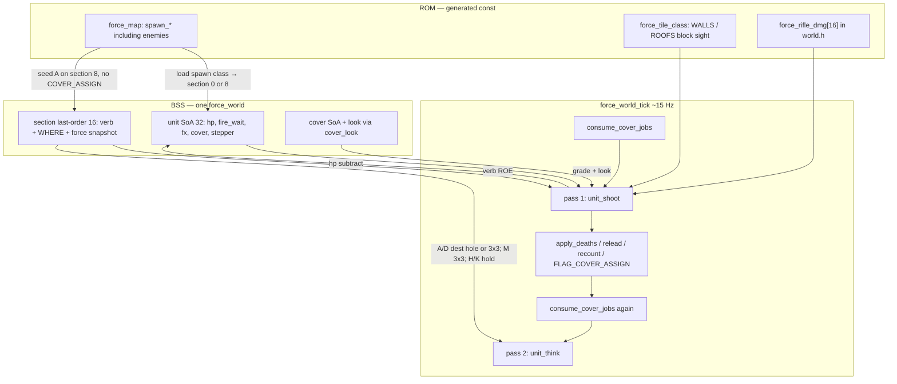

# Phase 6 — Combat

| Field | Value |
| --- | --- |
| Author | FORCE design session |
| Date | 2026-09-15 |
| Status | **Draft** |
| Last worked on | 2026-09-15 |
| Repo path | [`design/phase-6-combat.md`](phase-6-combat.md) |
| Plan | [`development-plan.md`](development-plan.md) (Phase 6 frozen) |
| Source | `src/sdl/game/world.h`, `src/sdl/game/world.c`, `src/sdl/game/command.c`, `src/sdl/game/game.c`, `src/sdl/game/game.h`, `src/sdl/generated/force_data.h` |
| Intent | [`../doc/FORCE_01_Vision_and_Principles.md`](../doc/FORCE_01_Vision_and_Principles.md), [`../doc/FORCE_02_Command_Language_and_UI.md`](../doc/FORCE_02_Command_Language_and_UI.md), [`../doc/FORCE_06_Tiles_Memory_and_Sprites.md`](../doc/FORCE_06_Tiles_Memory_and_Sprites.md), [`../doc/FORCE_07_Rooms_Cover_and_Farm.md`](../doc/FORCE_07_Rooms_Cover_and_Farm.md), [`../doc/FORCE_08_Units_Sections_and_Tick.md`](../doc/FORCE_08_Units_Sections_and_Tick.md) |
| Binary as it is | [`../agents/game.md`](../agents/game.md), [`../agents/known-gaps.md`](../agents/known-gaps.md) |
| Depends on | [`cover-advancing.md`](cover-advancing.md) (directional live sets; shot dir vs hole facing) |

Shoot half of the tick. Instant hits, rifles only, closest smear,
cover as `LSR` on a 16-byte table. `A` parses. Enemies stamp and
walk in. `K` and the force nibble are PR2 of the **same** phase;
the phase is not done after PR1. Directional cover already landed
as the first cut.

Index status is **active**. Do not mark landed until PR2 is in
`src/` and the interactive gates below hold.

---

## Overview

Phase 5 and cover-advancing left a live stepper and a directional
cover fill. `M` walks a 3×3 around WHERE. `D` claims the live
advancing list in the room of WHERE and walks to the hole. `H`
holds. `A` flashes in VERB. Farm has eight player infantry, zero
enemy stamps, no `unit_hp`, no `fire_wait`. `force_world_tick` is
one walk of 32 that decrements `unit_move_wait` and calls
`unit_think`. FORCE_08's "do I shoot, do I move" is still only
the second question.

Phase 6 is where the game lives or dies. A shot that fires this
logic tick subtracts this logic tick. No projectile records, no
travel time, no tracers. Every infantry unit has a rifle.
Unlimited ammo; cooldown is a wait byte. Damage is
`force_rifle_dmg[chebyshev] >> shifts`; after shifts, **0 is a
miss**. Closest enemy in range with LOS. Default ROE is smear.
Two-pass tick so slot 0 does not win every dual.

`--smoke` is still one frame, exit 0. Player stamps (verb NONE)
stay put. Seeded enemy `A` **may** take a first step on frame 0;
that is OK. Interactive PR1: you `D`, they walk in, men drop,
houses last longer than dirt. Interactive PR2: `K` concentrates;
force 3 breaks after first serious losses.

This is not waves, not `S`/`J`, not cannons, not a C64 emitter.

---

## Background & Motivation

### Current runtime (cover-advancing, landed)

`force_game_tick` (`src/sdl/game/game.c`): feed, then if
`(frames % FORCE_LOGIC_PERIOD) == 0` **before** increment,
`force_world_tick`. `FORCE_LOGIC_PERIOD` is 4 (~15 Hz). Frame 0
is a logic tick.

`force_world_tick` (`src/sdl/game/world.c`):

```c
world->path_fail_who = FORCE_UNIT_NONE;
consume_cover_jobs(world);
for (i = 0u; i < FORCE_UNIT_MAX; ++i) {
    if (world->unit_count[i] == 0u) continue;
    if (world->unit_kind[i] == FORCE_KIND_EMPLACEMENT) continue;
    if (world->unit_move_wait[i] > 0u) {
        world->unit_move_wait[i]--;
        if (world->unit_move_wait[i] > 0u) continue;
    }
    unit_think(world, i);
}
```

`unit_think` branches MOVE (3×3 via `move_dest`) and DEFEND
(claimed hole via `cover_cell`, else `move_dest` 3×3 and prone
on arrival). `FORCE_VERB_HALT` / `NONE` / `ATTACK` fall into
`return` — no step. ATTACK is on the enum (`world.h` line
`FORCE_VERB_ATTACK = 4, /* A — not parsed yet */`) and is not
reached from the wizard.

`command.c` `verb_from_letter`: `M=12`, `D=3`, `H=7`. Letter 0
(`A`) returns `FORCE_VERB_NONE` and `accept_verb` flashes.
`commit` writes `section_order_verb/x/y/force` and latches
`FLAG_COVER_ASSIGN` on `D`, `FLAG_COVER_RELEASE` on `M`. Halt
touches neither. Force nibble is stored, never evaluated.

Spawn (`force_world_load`): `force_tile_class[tile]` →
`FORCE_CLASS_GOODGUYS` section 0, `FORCE_CLASS_ENEMIES` section
8 (`FORCE_LETTER_MAX`). Kind infantry, **count 1**, glyph =
stamp tile. `unit_cover = $FF`. `unit_move_wait = 0` so a
standing-start order can step the same logic tick. There is no
`unit_hp` and no `unit_fire_wait`.

`force_section_recount` sums live `unit_count` into
`section_strength`. Lead is set at spawn if empty
(`force_unit_spawn`) and **never succeeded**. There is no death
path.

`cell_free` already refuses a second body on a cell (scan 32)
and refuses `FORCE_CLASS_WALLS` / `BARRIERS`. Roofs pass.
Combat must not assume two units share a cell.

Cover: `force_cover_assign` releases the letter, dest room =
region of WHERE, live slice from `section_front` (order snapped
to `room_axis`). `pick_best` walks ≤ 12. `cover_facing` is pole
1–4, soft 5–8, or hard 9–12. Look is `cover_look` (opposite of
an exclusive pole; soft / `$FF` tag uses section front; hard
uses the painted cardinal). Wrong-face of an advancing pole is
not leftover grade-2.

### Farm tables (work against these, do not hard-code)

`src/sdl/generated/force_data.c`:

| Column | Farm |
| --- | --- |
| map | 40×20, window `0,0,40,20` |
| rooms | **4** rects, **all `FORCE_AXIS_EW`** |
| portals | 7 (gaps at x=5 and x=21) |
| cover | **46**; room 0 is 11 neutrals (ten grade 3 `hard=w`, one grade 2 `soft=w`) |
| scouts | **0** |
| units | 8 infantry, section 0, all in room 0. **Zero enemy stamps.** |

Rooms (colour-chip order; first containing rect wins):

| i | colour | x0,y0 | w×h | cells | name (intent) |
| ---: | ---: | --- | --- | --- | --- |
| 0 | 1 | 21,0 | 19×20 | x 21–39 | east / FARM |
| 1 | 2 | 13,0 | 8×20 | x 13–20 | inner lane |
| 2 | 3 | 6,0 | 7×20 | x 6–12 | outer lane |
| 3 | 4 | 0,0 | 6×20 | x 0–5 | west / FIELD |

Product language "FIELD_S" is the Hold-the-Farm incoming wave
(FORCE_07: SOUTH). This board's rooms are vertical EW strips;
the approach is **west**, not a south-field room. Stamp enemies
in room 3. Do not invent a fifth rect in C.

Yard wall is `FORCE_CLASS_WALLS` on x=21 except a 2-wide open
front at `(21,7)` / `(21,8)` (tile 112 + painted portal chips).
Barrier line at x=5 (`FORCE_CLASS_BARRIERS`, tile 33). Houses
are `FORCE_CLASS_ROOFS` (tiles 48–52). `tile_open` / `cell_free`
block walls and barriers; roofs pass.

Player spawns (section 0, `unit_cover = $FF`):

| slot | x,y | glyph |
| ---: | --- | ---: |
| 0 (lead) | 26,7 | 6 |
| 1 | 26,8 | 6 |
| 2 | 24,9 | 2 |
| 3–7 | 26,9–13 | 6 |

Tick cadence unchanged: every 4 display frames; `move_wait`
default 7; RETURN does not poke wait.

Host (`agents/architecture.md`): one thread, **no audio
callback**, no mixer, no `SDL_Audio`. `core/` and `game/` have
no SDL.

### Pain

- Men walk and take holes. Nothing dies. Hold the Farm is a
  screensaver until someone shoots.
- `A` is the assault verb on the command card and it flashes.
- FORCE_08 says infantry HP is headcount. These unstacked
  privates are count=1; a 16-damage rifle would delete a
  "stack" of one in one hit and leave no hurt picture. HP
  model B overrides that for this phase.
- One-pass think: slot 0 fires and the target is already dead
  before slot 1 aims. Duals are spawn-order, which is accidental
  `K`.
- Cover as boolean `/2` undoes advancing poles (wrong-face is
  open; grade 3 is `/8`). The live directional set is the
  membership; the shoot half consumes **facing** for the shift
  count.
- Same-room-only LOS would make the west field a ghost: the
  2-wide front at x=21 is the shot lane into the yard. House-C
  roofs must still block a shot *through* the building.

### What is already right

Unit SoA, two banks of letters (0–7 player, 8–15 enemy),
`force_unit_spawn` / `force_section_recount`, greedy stepper,
`cell_free` no-stack, directional `pick_best`,
`section_order_force` snapshot on commit, `cover_look` /
`section_front` / `opposite_face` / `snap_axis`. Phase 6
extends that world. It does not invent a projectile pool, a
second BSS object, or a new TU.

---

## Goals & Non-Goals

### In (Phase 6, both PRs)

- Instant rifle hits. Shot this logic tick, HP this logic tick.
  No projectile records, no tracers, no muzzle sprites.
- `unit_hp` byte, spawn **16**. `unit_count` stays occupancy
  and stays **1**. Death: `hp == 0` → `count = 0`, free the
  slot, lead succession, recount, cover reassign (player bank
  with verb `A`/`D`/`H`/`K` only; never enemy bank this phase;
  never `M`/`NONE`).
- `unit_fire_wait` column. Reload `FORCE_FIRE_WAIT_RIFLE` (8)
  after a shot. Fastest legal wait is 1, like move. Independent
  of `unit_move_wait`. Reload **pauses** while the verb is not
  weapons-free (`M` / `NONE` do not decrement).
- One 16-byte rifle table, Chebyshev `max(|dx|,|dy|)`. Dist
  ≥ 16 is a miss (no shot). Peak 16 at dist 0. Named
  `FORCE_HP_INFANTRY`, `force_rifle_dmg[16]`.
- Cover shifts: `LSR` on the table value. Extra moving shift
  stacks. After shifts, 0 is a miss. Do not clamp to 1.
  `unit_cover != $FF` then `/2` is forbidden.
- LOS: cheap ray, max 16 steps, skip endpoints, any
  `blocks sight` tile in between → this target does not exist
  for this shot. Derived from `force_tile_class` (walls +
  roofs). No 4K sight plane. Not same-room-only.
- Targeting: closest enemy in range with LOS. Scan 32.
  Chebyshev. Skip `count == 0` **and** `hp == 0` (a corpse this
  tick is not a smear target). Friendly fire off (bank 0–7 vs
  8–15). No scoring function. No splash in PR1.
- Two-pass tick: all due shooters fire → apply deaths / recount
  / lead / cover reassign → then step. Two walks of 32.
- ROE by verb (no in-contact bit for shooting):

  | Verb | Shoot? | Walk? |
  | --- | --- | --- |
  | `A` / `D` / `K` | Weapons free (hunt closest in range with LOS; `K` overrides in PR2) | `A`/`D` yes; `K` no |
  | `H` | Weapons free, no walk | No |
  | `M` | Silent. No hunt, no shoot. Transit. | Yes |
  | NONE | No | No |

- Parse `A` in PR1. Dest = claimed hole if `unit_cover`
  resolves, else 3×3 around WHERE (same helper as `D` today).
  Player-issued `A` latches `FLAG_COVER_ASSIGN` like `D`.
- Stamp enemy infantry on the farm (west field, room 3). Bank 8
  gets a standing `A` at load toward the farm so the interactive
  gate is a firefight. Enemy uses the same mover + default ROE.
  Never `K`. Seeded `A` does **not** latch `FLAG_COVER_ASSIGN`
  (they must not steal farm houses at load).
- Hits visible on the **target** (hurt tint / 1-tick glyph
  flash). Muzzle tint is skipped in PR1. Do not poke
  `world->color`. No mixer: stub `shot_this_tick`.
- PR2: `K` (three-of-four due shooters on the named cell) and
  force-break from `section_order_force` vs live
  `section_strength`. Coarse morale **is** that nibble check.
  No morale byte.
- `--smoke` still one frame, exit 0, must not crash with
  enemies present. Interactive gates below.
- `agents/game.md`, `known-gaps.md`, `testing.md`,
  `architecture.md` on landing. FORCE_08 HP-as-headcount
  sentence overridden for these unstacked privates in the same
  landing PR as PR1. `design/README.md` stays **active** until
  PR2 lands.

### Out (later phases / never)

| Later / never | Why |
| --- | --- |
| Grenades, bazookas, `section_baz` columns | Fork 3. Follow-on shape in Alternatives. Phase 2 taught not to pack unused columns. |
| Cannons, mortars, MG nests as shooters | Future `kind`. Soldiers only. |
| `S` / `J`, splitting bazookas | Phase 9. Split rule for later: parent with more than one tube → dest takes one; parent with one → it stays. Join adds counts. |
| Waves / clock / win-lose | Phase 7. Contact-start reassign can then latch enemy `FLAG_COVER_ASSIGN` when they enter the dest room. |
| Overview, fog, `C` / `E` | Phase 8 |
| Occupancy bitmap, A* | Rejected since Phase 4. Scan 32. |
| Mouse, per-private click | Out of product. |
| Sound hardware | Host has no mixer. Stub the counter. |
| C64 emitter | Phase 10. |
| Projectiles, tracers, muzzle sprites | Instant hits. |
| Same-room-only LOS, 16×16 damage page, HP = headcount vs damage 16 | Rejected below. |
| `malloc`, VLA, `tests/` tree | Forbidden now and later. |
| In-contact bit gating whether a rifle may fire | Range 16 already is the engagement. |
| `A` on a cell that happens to hold an enemy is implicit `K` | FORCE_02's "A issued on an enemy weapon cell" is not this phase. `A` is still assault (assign + hole or 3×3). `K` is PR2 only. |

---

## Key Decisions

Locked in the Phase 6 conversation 2026-09-15. The kernel and
the five product forks are **not** reopened. Do not invent a
different combat system.

1. **Instant hits. Soldiers only.** A shot that fires this
   logic tick subtracts this logic tick. No projectile
   records, no travel time, no tracers, no muzzle sprites.
   Cannons / mortars / MG nests are future `kind`, not this
   phase's shooters. `unit_shoot` skips `kind != INFANTRY`.
   Emplacements do not fire this phase (none are authored).

2. **Unlimited ammo; cooldown is a wait byte.** `/2` and `/4`
   are `LSR`. Do not divide by 3. `fire_wait` reloads from a
   rifle constant, independent of `move_wait`. Fastest legal
   `fire_wait` is 1. Reload **pauses off-ROE**: `M` / `NONE`
   return from `unit_shoot` without decrementing. A man who
   shoots (`wait=8`), then `M`s, then `H`s still owes the
   remaining ticks. Named freeze, not "always decrement but
   don't hunt."

3. **HP model B.** `unit_hp` byte, spawn **16**. `unit_count`
   stays occupancy and stays **1**. Death: `hp == 0` →
   `count = 0`, free the slot, lead succession, recount,
   then `FLAG_COVER_ASSIGN` only per KD 17 (player `A`/`D`/
   `H`/`K`; never enemy; never `M`/`NONE`). One record, one
   shot per `fire_wait`.
   Do not multiply damage by count. FORCE_08 "infantry HP is
   headcount" is overridden for these unstacked privates.
   When stacks become real later, either hp is the current man
   and a kill does `count--` then reload hp, or N men = N×16 —
   not this phase.

4. **Range table: one 16-byte array per weapon, indexed by
   Chebyshev `max(|dx|,|dy|)`.** Dist ≥ 16 is a miss (no shot,
   do not spend `fire_wait` on a guaranteed miss — the scan
   already skipped them). Not a 16×16 page. Rifle table
   **peaks at 16** at dist 0. Shape is frozen; the sixteen
   numbers are tunables in one array (`FORCE_HP_INFANTRY`,
   `force_rifle_dmg[16]`). First play will be wrong; changing
   the table is not a design revisit.

5. **Cover shifts (all `LSR` on the table value; extra moving
   shift stacks).** After shifts, **0 is a miss**. Do not
   clamp to 1.

   | Defender state | Extra LSR |
   | --- | ---: |
   | Moving (dest remains — not "stepped this frame") | +1 |
   | Scrap / prone (`unit_cover == $FF` or grade 1) | +1 |
   | Grade 2, shot from the hole's front | +2 |
   | Grade 3 (roof / hard) | +3 |
   | Grade 2, shot from the wrong side | +0 (open) |

   Shot direction from shooter→target, snapped to cardinal,
   compared to look (`cover_look` / scout facing). Incoming
   face = snap of `(shooter - target)`. Incoming == look →
   from the front. Wrong-face of an advancing pole is open.
   `unit_cover != $FF` then `/2` is forbidden — it undoes
   advancing poles. Grade 3 is three LSRs (`/8`) regardless of
   facing. If play says bunker, drop the constant to 2 — do
   not change the shift model. Scout holes have no
   `cover_grade`: treat as scrap (`+1`) even when occupying
   the scout cell (the gap is not a house).

   **Grade applies only on the hole cell.** If `cover_cell`
   resolves **and** `unit_x/y` equals that cell → apply grade
   + facing as in the table. Else treat as no hole (`$FF` /
   scrap path), plus moving if dest remains. A same-tick `D`
   that claims a house while still standing in the yard is
   scrap + moving, not `/8`. Arrival facing already waits
   until the cell; the shoot half matches.

   There is no "open standing, 0 LSR" dirt state. Leftovers
   are prone (`$FF`, FORCE_07). Dist 0 prone = 8 damage (two
   shots). Dist 0 occupying grade-2 wrong-face, not moving =
   16 (one shot) — that is the open row. Dist 0 occupying
   grade 3 = 2 (eight shots).

   Moving = dest remains (`M`/`A`/`D` still walking to hole or
   3×3), not a this-tick pulse. Shoot happens **before** step,
   so "stepped this frame" would be last tick's move and would
   miss men who are about to step. `H` / arrived / `NONE` are
   not moving. Occupying a hole and dest-remaining cannot
   both be true for `D`/`A` (arrived ⇒ dest is here).

6. **LOS is a cheap ray, not a room test.** Chebyshev /
   Bresenham toward the target, max 16 steps, skip endpoints
   (man ON a wall or roof can fight), any `blocks sight` tile
   in between → this target does not exist for this shot,
   continue the closest scan. `blocks sight` =
   `FORCE_CLASS_WALLS` or `FORCE_CLASS_ROOFS` from
   `force_tile_class[tiles[row_off[y]+x]]`. Barriers (hedges)
   do **not** block sight — they already block walking.
   Same-room-only is rejected: the 2-wide front at x=21 is the
   shot lane from the lane into the yard; house-C roofs still
   block a shot *through* the building. Do not invent a 4K
   sight plane.

7. **Closest enemy in range with LOS. Scan 32. Chebyshev.**
   Not first-in-list (that is accidental `K` by spawn order).
   Default ROE is smear. No scoring function. Friendly fire
   off: `unit_section[i] >= FORCE_LETTER_MAX` is the other
   bank (already used in spawn and `force_command_implied_who`).
   Skip `count == 0` **and** `hp == 0` so later due shooters
   in the same walk do not dump into a corpse this tick
   (overkill on one body is not smear). Do **not** skip the
   shooter when `unit_hp[i] == 0` — dead men still fire this
   tick. No friendly splash (and no splash in PR1).

8. **Two-pass tick.** All due shooters fire (damage into HP) →
   apply deaths / recount / lead / cover reassign → then step.
   Two walks of 32. One-pass think makes slot 0 win every dual.
   `H` still does not step but **does** participate in the
   shoot pass (`unit_think` stays the mover; shoot is not
   inside it).

9. **ROE by verb, not an in-contact bit.** Table in Goals.
   Range 16 already is the engagement. In-contact is for
   force/morale later, not for whether a rifle may fire.
   `M` is silent transit (FORCE_02: no seek-and-destroy).
   `H` is hold here and fight.

10. **Parse `A` in PR1. `A` assigns cover the way `D` does.**
    FORCE_07 / cover-advancing: `A` / `D` / `R` use the same
    assign when those verbs land. Wizard latches
    `FLAG_COVER_ASSIGN` on player-issued `A` (same as `D`).
    Dest: if `cover_cell` resolves, the hole; else `move_dest`
    3×3 around WHERE (this is already how `D` leftovers walk
    in `unit_think`). Weapons free. Assault is not "walk the
    3×3 and never take a hole." Leftovers of a full live list
    fight in the open on the 3×3; that is the smear picture.
    `A` on a cell that happens to hold an enemy is still
    assault, not implicit `K`.

11. **Enemies: stamp + standing `A`, no `K`, no load-time
    house steal.** Farm currently has zero enemy stamps. PR1
    paints enemy infantry on the actors plane in room 3 (west
    field, x 0–4 — x=5 is the barrier). `force_unit_spawn`
    already maps `FORCE_CLASS_ENEMIES` → section 8. After
    spawn, if section 8 has men, write `FORCE_VERB_ATTACK`,
    WHERE = section 0 lead cell (no farm coordinate literals),
    force 10. Do **not** set `FLAG_COVER_ASSIGN` on that seed:
    assign is WHERE-room, and a load-time `A` at the farm
    would claim the houses before the player `D`s. They walk
    the 3×3 around the farm WHERE in the open, weapons free.
    Phase 7 contact-start may latch assign when they enter.
    Enemy never `K`.

12. **Slice — two PRs, same phase, phase is not done after the
    first.** PR1 is the kernel (this file's shoot half minus
    `K` / force-break). PR2 is `K` and force-break. Coarse
    morale **is** the force nibble check in PR2. No separate
    morale byte. Grenades, bazookas, morale-as-its-own-byte:
    not in either PR.

13. **`K` (PR2):** section fire budget on the named cell until
    it is quiet, then default smear. Leftovers return fire at
    whoever is dropping them (the 4th smears closest — do not
    track "who shot me"). Skip that cell as a cover hole in
    `pick_best` (after bounds-check, if this letter's verb is
    `KILL` and the candidate cell equals WHERE, `continue`;
    same for scout cells). That skip is not in today's
    `pick_best`; implement it in PR2. Enemy never `K`. At
    least three quarters of the section fire on that cell
    (FORCE_02). 6502-cheap: first 3 of every 4 due shooters in
    the letter take the K cell if a living other-bank body
    sits there **with LOS**; the 4th smears. `(due & 3) != 0`
    — no divide by 3. Quiet vs blocked LOS: (1) body on cell,
    LOS clear → K shot; (2) body on cell, LOS blocked → this
    shooter smears, cell is not quiet, other due rifles still
    try; (3) no body → quiet, all smear. `K` does not step and
    does not release cover (concentrate in place). `R` is not
    parsed.

14. **Force-break (PR2):** `section_order_force` snapshot
    already stored on commit. On death/recount, if live
    `section_strength` is at or below the threshold implied by
    the nibble vs snapshot, break. Snapshot is the strength
    when the order was issued, not a running percent of TOE.
    Break behaviour: rewrite verb to `HALT` (weapons free, stop
    walking, keep holes) and set `FLAG_BREAKING`. A new player
    order (`A`/`D`/`M`/`H`/`K`) **clears** that bit in `commit`
    (`f &= ~FORCE_SECTION_FLAG_BREAKING` on every successful
    RETURN). Rewriting the verb is not clearing a flag.
    `R` is not parsed yet; Phase 7/9 upgrades break to fall
    back one room. Threshold:

    | Force nibble | Break when (after a loss, `now < snap`) |
    | ---: | --- |
    | 0 | Always (run). Same as 1–3 until a contact bit exists. |
    | 1–3 | Always (probe: first death is serious fire). |
    | 4–6 | `now <= (snap >> 1)` (half, `LSR`) |
    | 7–9 | `now <= 1` (almost last man) |
    | 10 | Never |

    F=0 vs 1–3 are identical on a death-only check. Do not
    invent a contact bit this phase to split them.

15. **Presentation.** No projectiles. `shot_this_tick` counts
    fires this logic tick for a later sample; the host has no
    mixer (`agents/architecture.md`: no audio callback) — stub
    the counter, do not call `SDL_Audio`. Hits must be visible
    on the **target**: 1-logic-tick hurt flash. PR1: lerp
    **opaque** glyph pixels 50% toward `0xFFCC3333` when
    `(unit_fx & 0x0F) != 0`. Do not name `FORCE_RED` (that is
    a VIC-II index; playfield is sheet RGB). Knockout (alpha 0)
    sheet pixels are untouched. Muzzle (high nibble) is
    **skipped in PR1**. Packed in `unit_fx` (low nibble hurt;
    high nibble reserved). Do **not** poke `world->color`
    under the cell (roofs restamp; Phase 10 drops the colour
    plane). Men under roofs stay hidden by the restamp; that
    is the lock-to-houses picture, not a fail of the flash.

16. **Lead succession is specified in FORCE_08 and missing in
    `src/`.** On death, if `section_lead[who]` is the dead
    slot (or is already empty / wrong letter): prefer another
    living unit of that letter in the last-order room, else
    any living of that letter, else `$FF` and keep
    `section_last_x/y`. Implement it. `force_section_recount`
    does not do this today.

17. **Death must not leave a dangling `unit_cover` claim.**
    Always set `unit_cover = $FF` on the dead slot **before**
    any assign. `cover_taken` already skips `count == 0`, but
    a reused spawn must not inherit a hole. Then latch
    `FLAG_COVER_ASSIGN` **only** when:

    - player bank (`who < FORCE_LETTER_MAX`) **and**
    - verb is `ATTACK` / `DEFEND` / `HALT` / `KILL`.

    `MOVE` / `NONE` → do not assign (keep remaining men `$FF`).
    Enemy bank → do **not** assign in PR1/PR2 (Phase 7
    contact-start). A death on bank 8 must not claim the farm
    houses the player just `D`'d (the seed's WHERE is the
    farm lead; `force_cover_assign` dest-room is WHERE).

18. **`--smoke` with enemies.** Frame 0 is a logic tick.
    Player verb is NONE → no shoot, no step. Enemies with a
    seeded `A` **will** think on frame 0. Spawn `move_wait`
    stays 0 (standing-start D still steps the same RETURN).
    Pick: **this is OK.** Chebyshev from room 3 to the farm
    lead is ≥ 16, so no shot on frame 0; they may take one
    step east. `--smoke` must not crash. Do not assert enemy
    cells unmoved. Player eight stay on the load cells.

19. **No `unit_weapon` column, no `section_baz`.** Every
    infantry unit has a rifle. Reload from
    `FORCE_FIRE_WAIT_RIFLE`. Do not put loadouts on Tiled
    actor-instance properties (actors are a tile plane;
    per-cell attribs do not exist).

20. **Still no:** projectiles, grenades, bazookas, morale
    byte, waves, `S`/`J`, `R`, A*, occupancy bitmap, mouse,
    malloc, C64, a second TMX layer, `tests/` tree, poking
    `world->color`, a mixer, same-room LOS, 16×16 damage
    page, one-pass think, first-in-list targeting.

---

## Proposed Design

### Runtime data flow



### Sequence: two-pass logic tick

```mermaid
sequenceDiagram
  participant tick as force_game_tick
  participant world as force_world_tick
  participant sh as unit_shoot
  participant d as apply_deaths
  participant th as unit_think

  tick->>world: frames % 4 == 0
  world->>world: consume_cover_jobs
  loop i in 0..31 living
    world->>sh: fire_wait-- ; if 0 and ROE, hunt + hit
    Note over sh: damage into HP this tick
  end
  world->>d: hp==0 → count=0, cover=$FF
  d->>d: relead, recount, FLAG_COVER_ASSIGN
  world->>world: consume_cover_jobs
  loop i in 0..31 living, not emplacement
    world->>th: move_wait-- ; if 0, step
    Note over th: H / K return without a step
  end
```

Same-frame RETURN + logic tick: `commit` is still step 4 of
`force_game_tick`; `force_world_tick` is still step 5. Cover
flags consume **before** shoot so a same-tick `D` already
has `unit_cover` for dest (moving vs arrived). Grade still
applies only on the hole cell (KD 5): they are scrap + moving
until they occupy it. Deaths consume **before** step so a
corpse is not walked and the hole is free for the letter's
remaining men.

### Caps and constants (`world.h`)

Next to `FORCE_MOVE_WAIT_DEFAULT`:

```c
#define FORCE_HP_INFANTRY        16u
#define FORCE_FIRE_WAIT_RIFLE     8u   /* logic ticks; tunable, not sacred */
#define FORCE_RANGE_MAX          16u   /* dist >= 16 is a miss */
#define FORCE_FX_HURT             1u   /* low nibble: 1 logic tick */
#define FORCE_FX_MUZZLE          16u   /* high nibble reserved; skip in PR1 */
```

`FORCE_SECTION_FLAG_BREAKING` (`0x08`) is **PR2 only** — do
not declare it in PR1.

`FORCE_FIRE_WAIT_RIFLE = 8` is ~0.53 s at 15 Hz. Prone dirt
at dist 0 is `16 >> 1 = 8` → two shots. Occupying grade-3 at
dist 0 is `16 >> 3 = 2` → eight shots ≈ 4 s. Occupying
grade-2 wrong-face, not moving, is 16 → one shot. That is the
working lie so houses matter. Retune the constant or the
table; do not retune the shift model.

Rifle table (tunables; peak 16 at 0 is frozen):

```c
/* Chebyshev dist 0..15. Dist >= 16 never indexes this. */
static const uint8_t force_rifle_dmg[FORCE_RANGE_MAX] = {
    /*  0   1   2   3   4   5   6   7 */
       16, 14, 12, 10,  8,  7,  6,  5,
    /*  8   9  10  11  12  13  14  15 */
        4,  3,  3,  2,  2,  1,  1,  1
};
```

Keep it in `world.c` (file-static) or as `extern const` next
to the `#define`s in `world.h`. Do not emit it from
`gen_sdl.py` — it is not map data.

Worked shifts at dist 0 (table 16). Grade rows assume the
defender **occupies** the hole (KD 5). Walking to a house is
prone + moving, not grade 3.

| Defender | LSR | Damage |
| --- | ---: | ---: |
| Prone / scrap (`$FF` or grade 1), not moving | 1 | 8 (two shots) |
| Prone + moving | 2 | 4 |
| Grade 2 front, occupying, not moving | 2 | 4 |
| Grade 2 wrong-face, occupying, not moving | 0 | 16 (open) |
| Grade 3 occupying, not moving | 3 | 2 (eight shots) |
| Grade 3 occupying at dist 8 (table 4) | 3 | 0 **miss** |

There is no "open standing / 0 LSR" dirt row. That 16 is
wrong-face grade-2, occupying, not moving. At dist 8 into an
occupied house, the rifle does not tell. Close in, or `K` in
PR2.

### `force_world` struct — new columns

**Append** at the end (Phase 4 packing rule). Arrays stay in
the struct. Do not drop colour.

```c
    /* existing through room_cover_hi, then Phase 6 (append-at-end): */
    uint8_t  unit_hp[FORCE_UNIT_MAX];
    uint8_t  unit_fire_wait[FORCE_UNIT_MAX];
    uint8_t  unit_fx[FORCE_UNIT_MAX];   /* lo: hurt; hi reserved (PR1) */
    uint8_t  shot_this_tick;
    uint8_t  section_order_str[FORCE_SECTION_MAX];  /* strength at issue */
```

No `unit_weapon`. No `section_baz`. No projectile SoA.

Public (PR1):

```c
/* existing spawn / recount / tick / cover, plus: */
void force_section_relead(force_world *world, uint8_t who);
```

`force_section_relead` may stay file-static if only
`apply_deaths` calls it; making it public matches
`force_section_recount` and is the cheaper review. Out of
range `who` is a no-op.

### BSS layout and byte budget

Cover-advancing payload is the Phase 5 world plus 64 bytes of
`room_axis/lo/none/hi`. New:

| Field | Bytes | Notes |
| --- | ---: | --- |
| `unit_hp[32]` | 32 | spawn 16 |
| `unit_fire_wait[32]` | 32 | spawn 0 (first `A`/`D`/`H` may fire the same tick) |
| `unit_fx[32]` | 32 | display nibbles; 0 at spawn |
| `shot_this_tick` | 1 | stub mixer |
| `section_order_str[16]` | 16 | strength at issue; written PR1, evaluated PR2 |
| **add** | **113** | C may pad |
| **without `color`** | still ~6K | 6502-relevant board |

FORCE_06's "about 5–6K" still holds. Compare:
`force_game.pixels` is 256000 bytes on the stack.

Farm occupancy after PR1:

| Column | Used / cap |
| --- | --- |
| units | 8 player + ~6 enemy / 32 |
| `unit_hp` | 16 each until hit |
| `unit_count` | 1 each; 0 on death |
| section 0 | last-order from wizard |
| section 8 | seeded `A`, force 10, no cover flag |

### Load / spawn

`force_unit_spawn` grows:

```c
    world->unit_hp[slot]        = FORCE_HP_INFANTRY;
    world->unit_fire_wait[slot] = 0u;
    world->unit_fx[slot]        = 0u;
    world->unit_move_wait[slot] = 0u;   /* unchanged */
    world->unit_count[slot]     = count; /* still 1 from load */
```

Load `zero_u8` the new columns with the other unit arrays,
including `section_order_str`. `shot_this_tick = 0`.

After the spawn loop and `force_section_recount`, seed bank 8
if it has men. **No farm literals:**

```c
if (world->section_strength[FORCE_LETTER_MAX] > 0u) {
    uint8_t lead0 = world->section_lead[0];
    uint8_t who   = FORCE_LETTER_MAX;
    world->section_order_verb[who]  = FORCE_VERB_ATTACK;
    world->section_order_force[who] = 10u;
    world->section_order_str[who]   = world->section_strength[who];
    if (lead0 < FORCE_UNIT_MAX && world->unit_count[lead0] != 0u) {
        world->section_order_x[who] = world->unit_x[lead0];
        world->section_order_y[who] = world->unit_y[lead0];
    } else {
        world->section_order_x[who] = 0u;
        world->section_order_y[who] = 0u;
    }
    /* no FLAG_COVER_ASSIGN — they march the 3×3 in the open */
}
```

A later mission with no enemies is a no-op. Phase 7 overwrites
the order from the wave script.

### Enemy stamps (authoring, PR1)

`tools/gen_sdl.py` `extract_spawns` already accepts class
`enemies` and load already maps them to section 8. **Do not
special-case in C.** Paint 6–8 enemy infantry on `farm.tmx`
actors plane, tiles 8–15 (facing E = tile 10 is the natural
wave face), cells in room 3 (x 0–4, y around 8–14), one man
per cell, inside a room rect (compiler already rejects
outside). Barrier x=5 is not a spawn cell. Dist to (26,7) is
≥ 16 so smoke does not fire.

Do not invent Tiled per-instance "standing order" properties.

### `blocks sight`

```c
static int blocks_sight(const force_world *w, int x, int y)
{
    uint8_t tid, cls;

    if (x < 0 || y < 0 ||
        x >= (int)w->width || y >= (int)w->height) {
        return 1;   /* off-map is opaque */
    }
    tid = w->tiles[(int)w->row_off[y] + x];
    cls = force_tile_class[tid];
    return (cls == FORCE_CLASS_WALLS || cls == FORCE_CLASS_ROOFS);
}
```

No new flag table. Barriers / empty / roofs-as-walkable are
already encoded in `force_tile_class`. Occupying bodies do
**not** block sight (you shoot past a man; you do not shoot
through a house).

### Chebyshev + LOS ray

```c
static uint8_t chebyshev(uint8_t x0, uint8_t y0, uint8_t x1, uint8_t y1)
{
    int dx = (int)x0 - (int)x1;
    int dy = (int)y0 - (int)y1;
    if (dx < 0) dx = -dx;
    if (dy < 0) dy = -dy;
    return (uint8_t)((dx > dy) ? dx : dy);
}

/* Skip endpoints. Returns 1 if the shot is clear. */
static int los_clear(const force_world *w,
                     uint8_t x0, uint8_t y0, uint8_t x1, uint8_t y1)
{
    int dx = (int)x1 - (int)x0;
    int dy = (int)y1 - (int)y0;
    int adx = (dx < 0) ? -dx : dx;
    int ady = (dy < 0) ? -dy : dy;
    int sx = (dx > 0) - (dx < 0);
    int sy = (dy > 0) - (dy < 0);
    int x = (int)x0;
    int y = (int)y0;
    int n = (adx > ady) ? adx : ady;
    int i, err;

    if (n <= 1) {
        return 1;   /* adjacent: no intermediate cell */
    }
    if (n >= (int)FORCE_RANGE_MAX) {
        return 0;
    }
    if (adx >= ady) {
        err = adx / 2;
        for (i = 1; i < n; ++i) {
            x += sx;
            err += ady;
            if (err >= adx) {
                err -= adx;
                y += sy;
            }
            if (blocks_sight(w, x, y)) {
                return 0;
            }
        }
    } else {
        err = ady / 2;
        for (i = 1; i < n; ++i) {
            y += sy;
            err += adx;
            if (err >= ady) {
                err -= ady;
                x += sx;
            }
            if (blocks_sight(w, x, y)) {
                return 0;
            }
        }
    }
    return 1;
}
```

`adx / 2` is `LSR` on a value ≤ 15. Max 16 cells per **due
shot**, not every pair every tick. Adjacent / same-cell: same
cell cannot happen (`cell_free`); adjacent has no
intermediate, LOS is free.

Farm picture: a man in the inner lane (x=13–20) shooting a man
in the yard (x=22+) is clear only if the Bresenham visits the
open front at y=7 or y=8 rather than a wall on x=21. A man
behind house-C (roofs at ~31–33, 11–14) is not hittable
through the roof tiles. A man **on** a roof is hittable
because his cell is an endpoint.

### Cover-front test + damage

```c
static uint8_t snap_cardinal(int dx, int dy)
{
    int adx = (dx < 0) ? -dx : dx;
    int ady = (dy < 0) ? -dy : dy;

    if (adx > ady) {
        return (dx > 0) ? (uint8_t)FORCE_FACE_E : (uint8_t)FORCE_FACE_W;
    }
    if (ady > 0) {
        return (dy > 0) ? (uint8_t)FORCE_FACE_S : (uint8_t)FORCE_FACE_N;
    }
    if (adx > 0) {
        return (dx > 0) ? (uint8_t)FORCE_FACE_E : (uint8_t)FORCE_FACE_W;
    }
    return FORCE_FACE_NONE;
}

static int dest_remains(const force_world *w, uint8_t i)
{
    uint8_t sec = w->unit_section[i];
    uint8_t verb = w->section_order_verb[sec];
    uint8_t ox, oy;

    if (verb == FORCE_VERB_MOVE) {
        (void)move_dest(w, i, sec, &ox, &oy);
    } else if (verb == FORCE_VERB_ATTACK || verb == FORCE_VERB_DEFEND) {
        if (!cover_cell(w, w->unit_cover[i], &ox, &oy)) {
            (void)move_dest(w, i, sec, &ox, &oy);
        }
    } else {
        return 0;   /* H / K / NONE / R-until-parsed: not walking */
    }
    return (w->unit_x[i] != ox || w->unit_y[i] != oy);
}

static uint8_t cover_shifts(const force_world *w, uint8_t tgt,
                            uint8_t sh_x, uint8_t sh_y)
{
    uint8_t shifts = 0u;
    uint8_t c = w->unit_cover[tgt];
    uint8_t hx, hy;
    uint8_t incoming;
    uint8_t look;
    int on_hole;

    if (dest_remains(w, tgt)) {
        shifts = (uint8_t)(shifts + 1u);
    }
    on_hole = cover_cell(w, c, &hx, &hy) &&
              w->unit_x[tgt] == hx && w->unit_y[tgt] == hy;
    if (!on_hole) {
        return (uint8_t)(shifts + 1u);   /* prone / scrap / walking to hole */
    }
    if (c >= FORCE_COVER_MAX) {
        return (uint8_t)(shifts + 1u);   /* scout cell = scrap */
    }
    if (w->cover_grade[c] == 3u) {
        return (uint8_t)(shifts + 3u);
    }
    if (w->cover_grade[c] == 1u) {
        return (uint8_t)(shifts + 1u);
    }
    /* occupying grade 2: front +2, wrong-face +0 */
    incoming = snap_cardinal((int)sh_x - (int)w->unit_x[tgt],
                             (int)sh_y - (int)w->unit_y[tgt]);
    look = cover_look(w, w->unit_section[tgt], w->cover_facing[c]);
    if (incoming == look && incoming != FORCE_FACE_NONE) {
        shifts = (uint8_t)(shifts + 2u);
    }
    return shifts;
}

static uint8_t rifle_damage(uint8_t dist, uint8_t shifts)
{
    uint8_t dmg;

    if (dist >= FORCE_RANGE_MAX) {
        return 0u;
    }
    dmg = force_rifle_dmg[dist];
    while (shifts > 0u) {
        dmg = (uint8_t)(dmg >> 1);   /* LSR */
        shifts--;
    }
    return dmg;   /* 0 is a miss */
}
```

Reuse `cover_look` / `cover_cell` / `move_dest` — do not
re-derive look from `cover_facing` with a second table.
`dest_remains` may call `move_dest`; that is a 3×3 walk of
passable cells, not a map scan. Do not call `stepper_step`
from the shoot pass.

### Closest smear

```c
static uint8_t other_bank(uint8_t sec)
{
    return (sec >= FORCE_LETTER_MAX) ? 0u : FORCE_LETTER_MAX;
}

static uint8_t find_closest(const force_world *w, uint8_t i)
{
    uint8_t best = FORCE_UNIT_NONE;
    uint8_t best_d = 0xFFu;
    uint8_t j;
    uint8_t bank = other_bank(w->unit_section[i]);
    uint8_t bank_hi = (uint8_t)(bank + FORCE_LETTER_MAX);

    for (j = 0u; j < FORCE_UNIT_MAX; ++j) {
        uint8_t d;
        uint8_t s;
        if (j == i || w->unit_count[j] == 0u || w->unit_hp[j] == 0u) {
            continue;   /* corpse this tick is not a smear target */
        }
        s = w->unit_section[j];
        if (s < bank || s >= bank_hi) {
            continue;   /* friendly / empty letter */
        }
        d = chebyshev(w->unit_x[i], w->unit_y[i],
                      w->unit_x[j], w->unit_y[j]);
        if (d >= FORCE_RANGE_MAX) {
            continue;
        }
        if (best != FORCE_UNIT_NONE && d >= best_d) {
            continue;   /* keep closer; tie → lower index already stored */
        }
        if (!los_clear(w, w->unit_x[i], w->unit_y[i],
                       w->unit_x[j], w->unit_y[j])) {
            continue;
        }
        best = j;
        best_d = d;
    }
    return best;
}
```

Tie at equal Chebyshev: **lower slot index**. That is not
spawn-order `K` — equal distance is a coin flip the 6502 can
afford, and it is not "first living enemy in the list
regardless of range." First-in-list without the distance
predicate is the rejected alternative.

`other_bank(sec)`: player 0–7 hunts 8–15; enemy 8–15 hunts
0–7. A peeled player E (section 4) still hunts 8–15. Do not
compare `section` equality only (that would let A shoot B).
Skip `hp == 0` as well as `count == 0`. Do not skip the
shooter on `hp == 0`.

### Apply a hit

```c
static void apply_hit(force_world *w, uint8_t tgt, uint8_t dmg)
{
    if (dmg == 0u) {
        return;   /* miss: still a shot, still reload, no hurt flash */
    }
    if (dmg >= w->unit_hp[tgt]) {
        w->unit_hp[tgt] = 0u;
    } else {
        w->unit_hp[tgt] = (uint8_t)(w->unit_hp[tgt] - dmg);
    }
    w->unit_fx[tgt] = (uint8_t)((w->unit_fx[tgt] & 0xF0u) | FORCE_FX_HURT);
}
```

Do not multiply by `unit_count`. Do not `count--`. HP 0 is
not yet a free slot — that is `apply_deaths` after every
shooter has fired. Later `find_closest` calls in the **same**
walk skip `hp == 0`, so remaining due rifles smear onto the
next living body, not the corpse.

### `unit_shoot` (pass 1)

```c
static int weapons_free(uint8_t verb)
{
    return verb == FORCE_VERB_ATTACK ||
           verb == FORCE_VERB_DEFEND ||
           verb == FORCE_VERB_HALT   ||
           verb == FORCE_VERB_KILL;   /* PR2; enum already has no K — add it */
}

static void unit_shoot(force_world *w, uint8_t i)
{
    uint8_t sec = w->unit_section[i];
    uint8_t verb = w->section_order_verb[sec];
    uint8_t tgt;
    uint8_t dist;
    uint8_t dmg;

    if (w->unit_kind[i] != FORCE_KIND_INFANTRY) {
        return;   /* soldiers only this phase */
    }
    if (!weapons_free(verb)) {
        return;   /* M / NONE: pause fire_wait (do not decrement) */
    }
    if (w->unit_fire_wait[i] > 0u) {
        w->unit_fire_wait[i]--;
        if (w->unit_fire_wait[i] > 0u) {
            return;
        }
    }
    tgt = find_closest(w, i);          /* PR1. PR2 may override with K. */
    if (tgt == FORCE_UNIT_NONE) {
        return;   /* wait stays 0: hunt every logic tick */
    }
    dist = chebyshev(w->unit_x[i], w->unit_y[i],
                     w->unit_x[tgt], w->unit_y[tgt]);
    dmg = rifle_damage(dist, cover_shifts(w, tgt, w->unit_x[i], w->unit_y[i]));
    apply_hit(w, tgt, dmg);
    w->unit_fire_wait[i] = FORCE_FIRE_WAIT_RIFLE;
    /* PR1: do not set muzzle nibble. Hurt is on the target. */
    if (w->shot_this_tick < 0xFFu) {
        w->shot_this_tick++;
    }
}
```

No target → leave `fire_wait` at 0 so they retry next tick
(cheap: 32×32 Chebyshev, rays only for candidates in range).
A shot (including a 0-damage miss after shifts) reloads.
Skip `kind != INFANTRY` (KD 1). The step pass still skips
emplacements too. None on the farm this phase. Dead shooters
(`hp == 0`, `count` still 1) still run this function.

`FORCE_VERB_KILL` is new on the enum for PR2 (`K = 6` after
`RETREAT = 5`, or slot 6). PR1 `weapons_free` may omit it
until the enum exists; add the enumerant in PR1 so PR2 is not
a world.h fight, and do not parse `K` yet.

### Deaths, lead, cover reassign

```c
void force_section_relead(force_world *world, uint8_t who)
{
    uint8_t lead;
    uint8_t dest_r;
    uint8_t i;
    uint8_t fallback = FORCE_UNIT_NONE;

    if (who >= FORCE_SECTION_MAX) {
        return;
    }
    lead = world->section_lead[who];
    if (lead < FORCE_UNIT_MAX &&
        world->unit_count[lead] != 0u &&
        world->unit_section[lead] == who) {
        world->section_last_x[who] = world->unit_x[lead];
        world->section_last_y[who] = world->unit_y[lead];
        return;
    }
    dest_r = unit_region_at(world,
                            world->section_order_x[who],
                            world->section_order_y[who]);
    for (i = 0u; i < FORCE_UNIT_MAX; ++i) {
        if (world->unit_count[i] == 0u ||
            world->unit_section[i] != who) {
            continue;
        }
        if (dest_r != FORCE_UNIT_NONE &&
            world->unit_region[i] == dest_r) {
            world->section_lead[who] = i;
            world->section_last_x[who] = world->unit_x[i];
            world->section_last_y[who] = world->unit_y[i];
            return;
        }
        if (fallback == FORCE_UNIT_NONE) {
            fallback = i;
        }
    }
    if (fallback != FORCE_UNIT_NONE) {
        world->section_lead[who] = fallback;
        world->section_last_x[who] = world->unit_x[fallback];
        world->section_last_y[who] = world->unit_y[fallback];
        return;
    }
    world->section_lead[who] = FORCE_UNIT_NONE;
    /* last_x/y stand */
}

static int death_reassign(const force_world *w, uint8_t who)
{
    uint8_t verb;

    if (who >= FORCE_LETTER_MAX) {
        return 0;   /* enemy bank: Phase 7 contact-start */
    }
    verb = w->section_order_verb[who];
    return verb == FORCE_VERB_ATTACK ||
           verb == FORCE_VERB_DEFEND ||
           verb == FORCE_VERB_HALT   ||
           verb == FORCE_VERB_KILL;
}

static void apply_deaths(force_world *w)
{
    uint8_t i;
    uint16_t letters = 0u;

    for (i = 0u; i < FORCE_UNIT_MAX; ++i) {
        uint8_t s;
        if (w->unit_count[i] == 0u) {
            continue;
        }
        if (w->unit_hp[i] != 0u) {
            continue;
        }
        s = w->unit_section[i];
        w->unit_count[i] = 0u;
        w->unit_cover[i] = FORCE_UNIT_NONE;   /* always, before any assign */
        w->unit_fx[i]    = 0u;
        if (s < FORCE_SECTION_MAX) {
            letters = (uint16_t)(letters | (uint16_t)(1u << s));
        }
    }
    for (i = 0u; i < FORCE_SECTION_MAX; ++i) {
        if ((letters & (uint16_t)(1u << i)) == 0u) {
            continue;
        }
        force_section_relead(w, i);
        if (death_reassign(w, i)) {
            w->section_flags[i] = (uint8_t)(
                (w->section_flags[i]
                    & (uint8_t)~FORCE_SECTION_FLAG_COVER_RELEASE)
                | FORCE_SECTION_FLAG_COVER_ASSIGN);
        }
    }
    force_section_recount(w);
    /* PR2 force-break needs post-recount strength; see PR2 section. */
}
```

Order lock: kill (count=0, cover=$FF) → relead (walks living)
→ flag assign **only** if `death_reassign` → recount →
`consume_cover_jobs` in `force_world_tick`. Enemy bank and
player `M`/`NONE` never get `FLAG_COVER_ASSIGN` from death.
PR2's nibble check is after recount (needs live
`section_strength`). If break rewrites verb to `HALT`, it
does not clear `FLAG_COVER_ASSIGN` — remaining player men
still refill, then hold and shoot.

Do not spawn from death. Slot reuse is the next
`force_unit_spawn` (Phase 7 truck).

### `force_world_tick`

```c
void force_world_tick(force_world *world)
{
    uint8_t i;

    world->path_fail_who = FORCE_UNIT_NONE;
    world->shot_this_tick = 0u;
    for (i = 0u; i < FORCE_UNIT_MAX; ++i) {
        uint8_t fx = world->unit_fx[i];
        uint8_t hurt = (uint8_t)(fx & 0x0Fu);
        uint8_t muz  = (uint8_t)(fx >> 4);
        if (hurt > 0u) hurt--;
        if (muz  > 0u) muz--;
        world->unit_fx[i] = (uint8_t)(hurt | (uint8_t)(muz << 4));
    }
    consume_cover_jobs(world);
    for (i = 0u; i < FORCE_UNIT_MAX; ++i) {
        if (world->unit_count[i] == 0u) {
            continue;
        }
        unit_shoot(world, i);   /* skips non-infantry */
    }
    apply_deaths(world);
    consume_cover_jobs(world);
    for (i = 0u; i < FORCE_UNIT_MAX; ++i) {
        if (world->unit_count[i] == 0u) {
            continue;
        }
        if (world->unit_kind[i] == FORCE_KIND_EMPLACEMENT) {
            continue;
        }
        if (world->unit_move_wait[i] > 0u) {
            world->unit_move_wait[i]--;
            if (world->unit_move_wait[i] > 0u) {
                continue;
            }
        }
        unit_think(world, i);
    }
}
```

Two walks of 32, plus a cheap fx nibble walk. Do not fold
shoot into `unit_think`. Pass 1 skips `kind != INFANTRY`
inside `unit_shoot`. Pass 2 still skips emplacements.

### `unit_think` — `A` walks like `D`; `H` still holds

```c
    if (verb == FORCE_VERB_MOVE) {
        (void)move_dest(w, i, sec, &ox, &oy);
    } else if (verb == FORCE_VERB_DEFEND || verb == FORCE_VERB_ATTACK) {
        if (!cover_cell(w, w->unit_cover[i], &ox, &oy)) {
            (void)move_dest(w, i, sec, &ox, &oy);
        }
    } else {
        return;   /* NONE / HALT / K: hold here. Shoot already ran. */
    }
```

Cover arrival facing (`face_slot` / `cover_look`) already
runs on DEFEND arrival; run it for ATTACK arrival too (same
block). `K` (PR2) takes the `return` path: no step.

### Parse `A` (`command.c`)

`verb_from_letter`: letter 0 → `FORCE_VERB_ATTACK`.
`verb_name`: `"ATTACK"`. `commit` cover flags:

```c
        f = (uint8_t)(f & (uint8_t)~FORCE_SECTION_FLAG_NOPATH);
        /* PR2: also f &= ~FORCE_SECTION_FLAG_BREAKING on every RETURN */
        if (g->cmd_verb == FORCE_VERB_DEFEND ||
            g->cmd_verb == FORCE_VERB_ATTACK) {
            f = (uint8_t)(f & (uint8_t)~FORCE_SECTION_FLAG_COVER_RELEASE);
            f = (uint8_t)(f | FORCE_SECTION_FLAG_COVER_ASSIGN);
        } else if (g->cmd_verb == FORCE_VERB_MOVE) {
            f = (uint8_t)(f & (uint8_t)~FORCE_SECTION_FLAG_COVER_ASSIGN);
            f = (uint8_t)(f | FORCE_SECTION_FLAG_COVER_RELEASE);
        }
        /* HALT / K: do not touch COVER_ASSIGN / COVER_RELEASE */
        w->section_flags[who] = f;
        w->section_order_str[who] = w->section_strength[who];
```

`commit` writes `section_order_str` for every verb including
`H`/`K`. WHERE / force defaults unchanged (cursor, force 10).
Talky line `ATTACK A AT 10,20 FORCE 10`. Wizard still does
not call `force_cover_assign`. `K` in PR2: letter 10,
`FORCE_VERB_KILL`, no cover flag (keep holes), no step, and
the BREAKING mask on every successful RETURN.

### Hurt draw (`game.c` `blit_playfield`)

One helper next to `stamp_tile`. After stamping
`unit_glyph[i]`, if `(unit_fx[i] & 0x0F) != 0` lerp each
**opaque** glyph pixel 50% toward `0xFFCC3333`: for each of
R, G, B, `ch = (uint8_t)((ch + tint_ch) >> 1)` (`LSR` average).
Do not name `FORCE_RED`. Do not touch knockout (alpha 0)
sheet pixels. Then restamp `tiles` so roofs still cover. Do
not write `world->color[idx]`. Muzzle is skipped in PR1 (do
not read the high nibble).

`shot_this_tick` is not drawn. No mixer.

### Dual-rep / layer `rg` gates

Keep Phase 1–5 fences. Add:

```bash
# no projectile pool (empty)
rg 'projectile|tracer|muzzle_sprite' src/sdl/game

# no color poke from combat (empty)
rg 'world->color\[' src/sdl/game/world.c

# no mixer (empty)
rg 'SDL_Audio|Mix_' src/sdl

# no 16×16 page (empty)
rg 'rifle_dmg\[16\]\[16\]|force_rifle_dmg\[256\]' src/sdl

# no unit_weapon / section_baz in PR1 (empty until a later PR spends them)
rg 'unit_weapon|section_baz' src/sdl/game

# A parses (NON-empty)
rg 'FORCE_VERB_ATTACK' src/sdl/game/command.c

# two-pass: unit_shoot named, and unit_think is not the only walk
rg 'unit_shoot' src/sdl/game/world.c   # NON-empty

# wizard still does not step or assign (empty; keep Phase 5)
rg 'force_world_tick|unit_move_wait|next_hop|unit_tgt_|force_cover_assign' src/sdl/game/command.c

# no farm enemy coordinates in C (empty)
rg '\(1,10\)|\(2,11\)|FIELD_S' src/sdl/game
```

Enemy cells live in TMX → generated spawn tables, not in
`world.c`.

### Includes, CMake, ownership

No new TU. `src/sdl/CMakeLists.txt` already compiles
`world.c`, `command.c`, `game.c`.

```text
main.c            -> game + sdl/host          (unchanged)
game/game.c       -> core/screen + game/world.h + game/command.h
                    (blit reads unit_fx; does not write SoA)
game/command.c    -> last-order + FLAG_COVER_* on D and A
game/world.c      -> two-pass tick, shoot, deaths, seed A
sdl/host          -> still no audio
core/*            -> unchanged
generated         -> farm spawn list grows (compiler)
```

`world.c` does not include `game.h` or `command.h`. `command.c`
does not step. Do not add `combat.c`.

### Product-doc replacement (landing PR pastes these)

`doc/FORCE_08_Units_Sections_and_Tick.md` — **replace**
"Infantry HP is headcount" for the unstacked-private era:

> Infantry units in Phase 6 are unstacked privates: `count = 1`,
> `unit_hp` is a byte, spawn 16. A kill is `hp == 0` →
> `count = 0`, free the slot, lead succession, recount, cover
> reassign. Do not multiply damage by count. When stacks become
> real, either hp is the current man (`count--` then reload hp)
> or N men = N×16 — not this phase.

Add to the tick section:

> Logic tick is two passes of 32: all due shooters fire
> (instant hits), then deaths / relead / recount / cover
> reassign, then step. `fire_wait` reloads from weapon class
> (`FORCE_FIRE_WAIT_RIFLE`). `H` does not step and does shoot.
> `M` does not shoot.

`doc/FORCE_02` micro / ROE is already smear + `K` three
quarters. Binary matches after PR2. Do not add a scoring
function sentence.

FORCE_07 death reassign is this phase's `FLAG_COVER_ASSIGN` on
the dead letter **when** `death_reassign` is true (player
`A`/`D`/`H`/`K` only). Skip K-target holes: implement in PR2
`pick_best` (not present in today's loop).

---

## PR2 mechanics (design now, implement in PR2)

### `FORCE_VERB_KILL`

Add to `enum force_verb` (prefer in PR1 so the enumerant
exists): `FORCE_VERB_KILL = 6`. Parse letter 10 in PR2.
`verb_name` `"KILL"`. Commit: last-order WHERE is the named
cell, force snapshot as usual, **no** cover assign/release
(holes stay). `unit_think` holds (same `return` as `H`).
Enemy wizard never runs; scripts must not write `KILL` on
8–15.

### Three-of-four due shooters

Stack-local `uint8_t due[FORCE_SECTION_MAX]` zeroed at the
start of the shoot pass. In `unit_shoot`, after the unit is
due (wait hit 0) and verb is `KILL`:

```c
due[sec]++;
if ((due[sec] & 3u) != 0u) {
    uint8_t k = find_on_cell(w, i, w->section_order_x[sec],
                             w->section_order_y[sec]);
    if (k != FORCE_UNIT_NONE) {
        tgt = k;                    /* body + LOS: K shot */
    } else {
        tgt = find_closest(w, i);   /* no body, or body behind a roof */
    }
} else {
    tgt = find_closest(w, i);       /* 4th smears */
}
```

`find_on_cell`: scan 32, other bank, `count != 0`, **`hp != 0`**,
matching x/y. Return that slot only if `los_clear`. Three-way:

1. Body on cell, LOS clear → K shot.
2. Body on cell, LOS blocked → this shooter smears (cell is
   **not** quiet; other due rifles still try `find_on_cell`).
3. No living body on the cell → quiet, all smear.

A `K` through a roof is not a cheat. Leftovers "return fire
at whoever is dropping them" **is** closest smear. Do not
store a last-attacker column. `due[]` still increments in
case 2.

`& 3` is "three quarters" without a divide. Four due shooters
→ three on K, one smear. Two due → both on K. One due → on K.
That matches FORCE_02's "at least three quarters" for a full
section and is greedy-honest for a remnant.

### Skip K-target holes

In `pick_best`, after bounds-check, if this letter's verb is
`KILL` and the candidate cell equals `section_order_x/y`,
`continue`. Same for a scout cell. Today's `pick_best` has no
skip hook; cover-advancing listed it as out-of-scope. Implement
the loop rule in PR2.

### Force-break

After `force_section_recount` in `apply_deaths`, for each
letter that lost a man (and, cheaply, every letter with
`strength > 0` is also fine — 16 rows):

```c
static int force_broken(uint8_t force, uint8_t snap, uint8_t now)
{
    if (force >= 10u) {
        return 0;
    }
    if (now >= snap) {
        return 0;   /* no loss vs snapshot */
    }
    if (force <= 3u) {
        return 1;   /* 0 run / 1–3 probe */
    }
    if (force <= 6u) {
        return now <= (uint8_t)(snap >> 1);
    }
    return now <= 1u;   /* 7–9 almost last man */
}
```

On break: `section_order_verb[who] = FORCE_VERB_HALT`; set
`FLAG_BREAKING` (PR2 chrome). Do not release cover. Do not
parse `R`. They stop walking and keep shooting. A new player
order overwrites last-order; `commit` **clears**
`FLAG_BREAKING` on every successful RETURN (`f &= ~0x08`),
including `H`/`K`. Rewriting the verb is not clearing a flag.

`section_order_force` **is** the nibble 0–10, not the strength
snapshot. PR1 already appends `section_order_str[16]` (see
struct dump) and writes it on `commit` and on the enemy seed.
PR2 evaluates it; PR1 does not. Do not overload the nibble
byte (it cannot hold a strength of 8).

Break uses `section_order_str` as `snap`, live
`section_strength` as `now`, nibble as `force`.

---

## 6502 filter

Every decision in this file:

- Fixed arrays, integer ids, no allocator, no generic pools.
- SoA columns on `force_world` (`,x` / `,y`).
- Scan 32 units, not the map. Ray at most 16 cells **per due
  shot**, not every pair every tick.
- Logic ~15 Hz (`FORCE_LOGIC_PERIOD` 4). Same counts on SDL
  and later C64.
- `/2` `/4` `/8` are `LSR`. No divide by 3 (`due & 3`,
  `snap >> 1`).
- No C64 emitter (Phase 10).
- No 4K sight plane, no 16×16 damage page, no projectile
  records, no `malloc`.

Worst-case shoot pass: 32 due × 32 Chebyshev + a handful of
16-cell rays. Farm PR1 is ~14 living, fire_wait 8, so ~2 due
per tick. Off-screen rooms still tick (FORCE_08).

---

## API / Interface Changes

| Surface | Change |
| --- | --- |
| `src/sdl/game/world.h` | PR1: `FORCE_HP_INFANTRY`, `FORCE_FIRE_WAIT_RIFLE`, `FORCE_RANGE_MAX`, `FORCE_FX_HURT`, `FORCE_FX_MUZZLE` (unused), `FORCE_VERB_KILL` (unparsed); `unit_hp` / `unit_fire_wait` / `unit_fx` / `shot_this_tick` / `section_order_str[16]`; `force_section_relead`. PR2: `FLAG_BREAKING`. |
| `src/sdl/game/world.c` | Two-pass tick; `unit_shoot` / LOS / closest (skip `hp==0`) / occupancy-gated shifts / deaths + `death_reassign` / relead; spawn hp 16; seed section-8 `A` + `section_order_str`; PR2 `K` quota + force-break. |
| `src/sdl/game/command.c` | PR1: parse `A`, `FLAG_COVER_ASSIGN` on `A`, talky `ATTACK`, write `section_order_str` on every commit. PR2: parse `K`; `f &= ~FLAG_BREAKING` on every RETURN. |
| `src/sdl/game/command.h` | Unchanged signatures. |
| `src/sdl/game/game.c` | `blit_playfield` lerps opaque glyph pixels 50% toward `0xFFCC3333` from `unit_fx` low nibble. No muzzle. Cadence unchanged. |
| `src/sdl/game/game.h` | Unchanged. |
| `src/sdl/CMakeLists.txt` | Unchanged (no new TU). |
| `src/sdl/main.c` | Unchanged `--smoke`. |
| `core/` / `sdl/input.*` / `sdl/host.*` | Unchanged. No mixer. |
| `tools/gen_sdl.py` | Unchanged (already extracts enemies). |
| `assets/maps/farm.tmx` | PR1: enemy actor stamps in room 3. |
| `agents/*.md` listed below | Landing of each PR. |
| `doc/FORCE_08` | HP model B sentence on PR1 landing. |
| `design/README.md` | **active** this writeup; **landed** when PR2 is in `src/`. |

---

## Data Model Changes

No heap, no versioning, no save format. Regenerating
`force_data.c` is still how authoring reaches the binary.

**ROM:** farm spawn list grows (enemy tiles 8–15). No weapon
column on stamps. No new TMX layer.

**RAM world:** +113 bytes as in the BSS table (`unit_hp` /
`fire_wait` / `fx` / `shot_this_tick` / `section_order_str`).
`section_flags` gains `BREAKING` 0x08 in PR2. Last-order
columns already exist; after an `A` they hold ATTACK + WHERE
+ force nibble + strength snapshot. Arrival does **not**
rewrite verb to HALT.

**UI (`force_game`):** unchanged except `A` no longer flashes
and talky names ATTACK. `K` in PR2.

**Authoring:** five named TMX layers, unchanged. Paint enemies
on `actors`. Standing order is C at load, not a property.

Phase 7 flips `room_approach` from the wave script and may
latch enemy cover assign on contact. Phase 10 drops the
colour plane; `unit_fx` tint stays a draw-time mix.

---

## Alternatives Considered

### First-in-list targeting

Rejected. Walking 32 and shooting the first other-bank body
in range is accidental `K` by spawn order. Closest Chebyshev
with LOS is smear. Tie → lower index is a 6502 coin flip, not
the rejected rule. Dumping remaining due shots into a
`hp == 0` corpse is the same bug keyed by distance; skip
`hp == 0` in `find_closest` / `find_on_cell`.

### `A` issued on an occupied enemy cell is `K`

Rejected this phase. FORCE_02 names it; the binary does not.
Player `A` is assault (assign + hole or 3×3). `K` is PR2
only. Do not special-case A-on-weapon into `KILL`.

### Per-tile Tiled loadouts / actor objects

Rejected. Actors are a tile plane. Per-cell attribs do not
exist. Every infantry unit has a rifle. Do not allocate
`section_baz` until a later PR spends them.

### 16×16 damage page

Rejected. One 16-byte array indexed by Chebyshev. A page is
256 bytes for no extra decision. Dist ≥ 16 is already a miss.

### 2×2 splash origin (use Chebyshev R=1 later)

Rejected for PR1 (no splash). Follow-on grenades: Chebyshev
radius-1, not a 2×2 rectangle. A 2×2 origin is anisotropic and
punishes the south-east cell.

### Same-room-only LOS

Rejected. FARM is huge; the west field / lane must shoot into
the yard across the 2-wide front at x=21, not through house-C.
Room tests are cheap and wrong.

### Cover as boolean `/2`

Rejected. It undoes advancing poles: wrong-face of a grade-2
chip is open (`+0`), not half. Grade 3 is `/8`. The live list
is membership; the shift count is facing + grade + moving.

### HP = headcount against damage 16

Rejected for these unstacked privates. Count is 1; a 16-peak
rifle would delete the man with no hurt picture. Model B:
`unit_hp` 16. FORCE_08 overridden this phase.

### Always-shoot (collapses `M` / `A`)

Rejected. FORCE_02: `M` is no seek-and-destroy. Always-shoot
makes Move an assault. `H` is the hold-and-fight verb.

### One-pass think

Rejected. Slot 0 would win every dual. Two walks of 32.

### Suppression-first as the start (Close Combat-ish)

Rejected as v1. A later bump to `fire_wait` can model pin.
Do not add a suppression byte this phase.

### Projectiles

Rejected. Instant hits. Travel time on a 15 Hz 40-wide board
is a pool, a miss-by-the-time-they-step, and tracers the
6502 will not draw.

### Room-level CRT / abstracted firefight

Rejected. Men are visible; a room dice roll would look fake.
The player has to see the house last longer than the dirt.

### Follow-on: grenades and bazookas (not packed)

Documented so PR1 does not "just add a column."

- **Grenade:** per-unit long `fire_wait` + Chebyshev radius-1
  splash. Friendly splash off. A bazooka with no hard target
  is a fat grenade. Not PR1/PR2.
- **Bazooka:** section count + section wait, spent by
  whichever man has `kind=emplacement|vehicle` in rocket
  range. Do not allocate `section_baz` until that PR.
- **`S`/`J` tubes (Phase 9):** if parent has more than one
  tube, dest takes one; if parent has one, it stays. Join
  adds counts.

---

## Security & Privacy Considerations

Not a networked service. No accounts, no auth, no PII, no
telemetry.

The actual threat is **index overflow** and **friendly fire**,
not web auth:

- `force_rifle_dmg[dist]` only if `dist < 16`. Dist ≥ 16 is a
  miss before the subscript.
- `unit_cover` encoding unchanged. Never `$FF` as a subscript
  into `cover_x`. Scout bias unchanged.
- `who` / `here` / `sec` in range before indexing section or
  room rows. `1u << s` for death letters: `s < 16`.
- `blocks_sight` uses `force_tile_class[tid]` with `tid` from
  the map byte (0–127). Off-map is opaque, not a wrap.
- Friendly fire: bank test, not "section != self" (that would
  let A shoot B).
- HP subtract saturates at 0; do not wrap `uint8_t`.
- RAM world is BSS, not heap. Shoot does not spawn, does not
  grow arrays, does not open files, does not call SDL.
- `game/` still has no SDL. No mixer.

A flash remains a **player-verb** channel (illegal key, `NO
PATH`). Do not flash because a shot missed (0 after LSR is
the feature). Do not beep on death. The man disappearing is
the signal.

Do not flash on load. Seeded `A` is quiet.

---

## Observability

No metrics stack, no log daemon, no tracing, no feature-flag
service.

| Signal | Where |
| --- | --- |
| Compile failure | Existing `#error` guards. Missing `unit_hp` write in spawn is a review fail, not a `#error`. |
| Runtime bring-up | `./build/src/sdl/force --smoke` — one frame, exit 0. Still needs a display. Must **not crash** with enemies present. Player eight unmoved. Enemy may take one step. |
| Visual | Smoke: eight blue load-cell stamps; red enemy stamps in the west field. Roster A white. Roofs covering. |
| Interactive PR1 | Gate below. Smoke cannot type. |
| Interactive PR2 | `K` + force 3. |
| Layer regression | `rg` gates above. |

`FORCE_TRACE=1` may grow a shoot line (`u%u dmg %u -> u%u hp
%u`) next to the existing think line. Optional. Do not print
every miss every tick.

Interactive gate **PR1** (`./build/src/sdl/force`, no args):

1. SHIFT+D, RETURN with the eight men in the east room. They
   lock to farm holes (grade 3 houses fill first).
2. Enemies with seeded `A` walk east from room 3 through the
   lane, through the x=21 front, into the yard. They shoot
   (weapons free). They do **not** sit in the houses at load.
3. Shots resolve: HP drops, hurt tint on the **target**, men
   disappear when `hp` hits 0. Death frees the slot (roster
   stays A white until A is empty). Remaining **player** A
   refill holes (`D`/`A`/`H`). Enemy deaths do **not** claim
   farm houses. Two open enemies in range: first shot drops
   one, remaining due rifles go to the other, not the corpse.
4. Men **occupying** houses last longer than men in the dirt.
   A prone man in dirt at dist 0 dies in two shots; a man on
   a grade-3 hole takes eight; wrong-face grade-2 (occupying,
   not moving) dies like open (one shot at dist 0). Walking
   toward a house is dirt, not `/8`.
5. SHIFT+M: they go silent and walk. They stop shooting until
   a weapons-free verb.
6. SHIFT+H: they stop walking and keep shooting.
7. SHIFT+A: parses, talky ATTACK, latches cover assign, walks
   hole or 3×3, weapons free. No VERB flash.
8. `--smoke` still exit 0. Player stamps unmoved. Enemies may
   have stepped one cell. No crash.

Interactive gate **PR2**:

1. `K` on one enemy (cursor on him): at least three of four
   due friendlies shoot that cell; he drops faster than smear.
   When he is gone, fire smears again.
2. Re-issue `A` / `D` at force **3**, take losses: after the
   first death the letter **HALT**s (stops walking, still
   shoots). Force 10 does not.
3. Enemy never concentrates even if you stand on their lead.

There is no ctest. Do not add a `tests/` tree. Do not add a
debug overlay of HP. Walking farm is the proof.

---

## Rollout Plan

No feature flags. No staged dual-read. No percentage rollout.

**Two PRs, same phase** (fork 1). Do not land PR1 as "Phase 6
done." Do not split PR1 into "columns without shoot" — unused
`unit_hp` is a footgun, and a one-pass think that already
subtracts is the dual-winner bug.

Rollback is `git revert` of that PR. There is no runtime
switch.

Verification, from repo root (same as `agents/testing.md`):

```bash
cmake -B build -S . -DCMAKE_BUILD_TYPE=Debug
cmake --build build -j
./build/src/sdl/force --smoke
```

Then the interactive list. A missed CMake line is not the
failure mode (no new TU). Smoke cannot type `D`; do not claim
combat works from exit 0 alone.

### `agents/` handoff (each landing PR, not this design-only writeup)

| File | PR1 | PR2 |
| --- | --- | --- |
| `agents/game.md` | Instant rifles, two-pass tick, `A` parses, enemies walk in, HP 16, smear. Still no `K` / force-break. | `K` three-of-four; force nibble breaks to `H`. |
| `agents/architecture.md` | `unit_hp` / `fire_wait` / `fx` / `section_order_str`; `world.*` owns shoot. No mixer. | `FLAG_BREAKING`. |
| `agents/known-gaps.md` | Combat smear is **not** a gap. Remaining: `K`, force-break, `S`/`J`/camera/waves. Closed-shape: HP model B, two-pass, `M` silent. | `K` / force-break not gaps. Remaining: waves, `S`/`J`, camera. |
| `agents/testing.md` | Smoke + enemy step OK; interactive D-vs-A firefight; houses last. | `K` + force 3. |
| `agents/assets.md` | Farm has enemy stamps. Load still class → section 8. | Unchanged. |
| `doc/FORCE_08` | HP model B + two-pass sentence. | Force snapshot byte. |
| `design/README.md` | Stays **active**. | **landed** when PR2 is in `src/`. |
| `design/development-plan.md` | Cites this file (this writeup). Do not mark the phase implemented until PR2. | Mark implemented in the landing PR, not before. |

---

## Risks

| Risk | Sev | Mitigation |
| --- | --- | --- |
| Seeded `A` steals farm houses at load | **High** | No `FLAG_COVER_ASSIGN` on the seed (KD 11). Player `D` claims. Review: load seed must not set the flag. |
| Enemy death claims farm houses | **High** | `death_reassign` is player `A`/`D`/`H`/`K` only (KD 17). Seed and death path both leave enemy `FLAG_COVER_ASSIGN` clear. |
| Slot 0 wins every dual | **High** | Two-pass (KD 8). Damage into HP; deaths after the shoot walk. Review: no `count=0` inside `unit_shoot`. |
| Smear piles onto a corpse | **High** | `find_closest` / `find_on_cell` skip `hp == 0`. Dead shooters still fire. |
| `H` never shoots | **High** | Shoot is not in `unit_think`. `weapons_free` includes HALT. |
| `M` hunts | **High** | `weapons_free` excludes MOVE / NONE. Interactive item 5. |
| `unit_cover != $FF` then `/2` sneaks in | **High** | Shift table is grade + facing + moving. Review `cover_shifts`. |
| Same-room LOS "optimisation" | **High** | Rejected. Ray uses `force_tile_class`. |
| Friendly fire A→B | **High** | Bank test, not `section != self`. |
| Death leaves a claimed hole | **Med** | Always `unit_cover = $FF` on the dead slot. Assign only if `death_reassign`. |
| Player `M` death assigns holes | **Med** | `death_reassign` excludes `MOVE` / `NONE`. |
| Grade from a claim in the yard | **High** | Occupancy gate in `cover_shifts` (KD 5). Review: walking to a house is scrap + moving. |
| Lead dangles at a corpse | **Med** | `force_section_relead` (missing today; KD 16). Halt WHERE uses lead cell. |
| Smoke crashes / moves player | **Med** | Player NONE. Enemy may step. No shot at dist ≥ 16. |
| Houses don't matter | **Med** | Grade 3 occupying is `/8`. Table 16 → 2 at dist 0 (eight shots). Prone dirt is two shots. Interactive item 4. If play says bunker, drop the **constant** to 2, not the model. |
| 0 after LSR clamped to 1 | **Med** | 0 is a miss (KD 5). Distant house shots miss; that is the close-or-K picture. |
| Wizard runs targeting | **High** | `find_closest` file-static in `world.c`. `rg` empty in `command.c`. |
| Mixer / `SDL_Audio` "just a beep" | **Low** | Host has no callback. Stub `shot_this_tick`. |
| Farm enemy coords in C | **Med** | TMX stamps. WHERE = section-0 lead. `rg` empty. |
| One-pass "columns then think" PR | **High** | Fork 1: two PRs, kernel is not columns-only. |
| F=0 vs 1–3 identical | **Low** | Accepted until a contact bit (KD 14). Do not invent one. |

Review checklist next to the snippets:

1. `force_world_tick` is consume → shoot all → deaths / relead
   / recount → consume → step. Two walks of 32.
2. `unit_think` does not shoot. `H` returns without a step
   and still fired in pass 1.
3. Damage is `table[dist] >> shifts`. 0 is a miss. No clamp
   to 1. No `unit_cover != $FF` `/2`.
4. LOS skips endpoints; walls + roofs block; barriers do not.
   Not same-room-only.
5. Closest Chebyshev, scan 32, other bank, LOS. Skip
   `count == 0` and `hp == 0`. Tie = lower index. Dead
   shooters still fire.
6. Death: `hp==0` → `count=0`, `cover=$FF` always, relead,
   recount. `FLAG_COVER_ASSIGN` only if `death_reassign`
   (player `A`/`D`/`H`/`K`). Seed and death path both leave
   enemy `FLAG_COVER_ASSIGN` clear.
7. `A` parses; `FLAG_COVER_ASSIGN` like `D`; dest hole or 3×3.
   A-on-enemy-cell is not `K`.
8. Enemy stamps from TMX; seed `A` without cover flag; WHERE
   = player lead; seed writes `section_order_str`.
9. Spawn `unit_hp = 16`, `count = 1`. No `unit_weapon`.
   `unit_shoot` skips non-infantry.
10. No `world->color` writes. No `SDL_Audio`. Hurt lerp is
    opaque pixels 50% toward `0xFFCC3333`. No muzzle in PR1.
11. `--smoke` exit 0 with enemies; player unmoved.
12. PR2 not claimed done by PR1.
13. `cover_shifts`: grade only when occupying the hole cell.
14. `commit` writes `section_order_str`. PR2 also clears
    `FLAG_BREAKING` on every RETURN.

---

## Open Questions

None. The five product forks are closed (two PRs; `M` silent /
`H` weapons free; rifles only, no bazooka bytes; grade 3 is
three LSRs; 16/16 working curve). The kernel above is not
reopened.

F=0 vs 1–3 collapsing on a death-only check is a documented
limitation (KD 14), not a question. Rifle table numbers are
tunables in one array, not a revisit. Enemy stamp count (6–8)
is authoring.

Do not silently pick a third language (projectiles **and**
instant hits, or HP-as-headcount **and** a 16-byte HP).

---

## References

- [`development-plan.md`](development-plan.md) — Phase 6 frozen name (shoot half, default ROE smear, `K`, force nibble, coarse morale; enemy same cover fill, no `K`)
- [`cover-advancing.md`](cover-advancing.md) — directional live sets; `A`/`D` assign; look from advancing; Phase 6 remainder was this file
- [`phase-5-cover-and-d.md`](phase-5-cover-and-d.md) — `FLAG_COVER_ASSIGN`, `pick_best`, consume-before-think
- [`phase-4-rooms-portals-stepper.md`](phase-4-rooms-portals-stepper.md) — stepper, `cell_free` no-stack, roofs pass
- [`phase-3-command-line.md`](phase-3-command-line.md) — wizard, last-order on RETURN, `A` flashed
- [`phase-2-units-exist.md`](phase-2-units-exist.md) — spawn class → section 0/8, count 1, do not pack unused columns
- [`../doc/FORCE_01_Vision_and_Principles.md`](../doc/FORCE_01_Vision_and_Principles.md) — smear is default; `K` is the human edge
- [`../doc/FORCE_02_Command_Language_and_UI.md`](../doc/FORCE_02_Command_Language_and_UI.md) — ROE, force nibble, `M` no seek-and-destroy, `K` three quarters
- [`../doc/FORCE_06_Tiles_Memory_and_Sprites.md`](../doc/FORCE_06_Tiles_Memory_and_Sprites.md) — `blocks sight`, unit fields `weapon` / `fire_wait` (weapon column deferred)
- [`../doc/FORCE_07_Rooms_Cover_and_Farm.md`](../doc/FORCE_07_Rooms_Cover_and_Farm.md) — grades, death reassign, `A`/`D` assign, skip K-target holes
- [`../doc/FORCE_08_Units_Sections_and_Tick.md`](../doc/FORCE_08_Units_Sections_and_Tick.md) — shoot and/or move, `fire_wait` from weapon class, 15 Hz, 32-slot pool, lead succession
- [`../agents/game.md`](../agents/game.md) — no fire today; `A` flashes
- [`../agents/architecture.md`](../agents/architecture.md) — no audio callback; `world.*` owns tick
- [`../agents/known-gaps.md`](../agents/known-gaps.md) — combat / ROE / concentrate is a gap today
- [`../agents/testing.md`](../agents/testing.md) — smoke + interactive
- `src/sdl/game/world.h` — `force_world`, verbs, no `unit_hp` today
- `src/sdl/game/world.c` — `force_world_tick`, `unit_think`, spawn, recount, cover assign
- `src/sdl/game/command.c` — `commit`, `verb_from_letter`
- `src/sdl/generated/force_data.c` — farm 4 rooms all EW, 46 cover, 8 player spawns, 0 enemies
- `assets/tiles.txt` — walls 16–29, roofs 48–52, barriers 32–38, enemies 8–15

---

## PR Plan

Independently reviewable. **Two PRs, same phase.** Phase 6 is
not done after the first. Do not invent a C64 tree. Do not
add `combat.c`. Do not bind `S`/`J`/`R`/`Z`. Do not add a
mixer. Do not pack `section_baz`.

### PR1 — Combat kernel: rifles, smear, `A`, enemy firefight

- **Title:** Phase 6 PR1 — instant rifles, two-pass tick, parse `A`, enemy stamps
- **Files / components:**
  - `src/sdl/game/world.h` — `FORCE_HP_INFANTRY`, `FORCE_FIRE_WAIT_RIFLE`, `FORCE_RANGE_MAX`, `FORCE_FX_HURT`, `FORCE_FX_MUZZLE` (defined, unused), `FORCE_VERB_KILL` enumerant (unparsed); `unit_hp` / `unit_fire_wait` / `unit_fx` / `shot_this_tick` / `section_order_str[16]`; `force_section_relead`. No `FLAG_BREAKING`.
  - `src/sdl/game/world.c` — spawn hp 16; two-pass tick; `unit_shoot` (infantry only, pause `fire_wait` off-ROE); LOS; closest (skip `hp==0`); occupancy-gated cover shifts; deaths + relead + recount + `death_reassign`; seed section-8 `A` without `FLAG_COVER_ASSIGN` and with `section_order_str`; `unit_think` ATTACK dest
  - `src/sdl/game/command.c` — parse `A`; talky ATTACK; `FLAG_COVER_ASSIGN` on `A`; write `section_order_str` on every commit
  - `src/sdl/game/game.c` — hurt lerp (opaque glyph pixels 50% toward `0xFFCC3333`); no muzzle; no `world->color` poke
  - `assets/maps/farm.tmx` — 6–8 enemy actor stamps in room 3 (west field)
  - `src/sdl/generated/force_data.c` — regenerated (do not hand-edit)
  - `agents/game.md`, `architecture.md`, `known-gaps.md`, `testing.md`, `assets.md` — smear is live; `K` / force-break still gaps
  - `doc/FORCE_08_Units_Sections_and_Tick.md` — HP model B + two-pass
- **Depends on:** landed cover-advancing (directional look; `A` assign path).
- **Description:** Kernel only. Instant hits, 16-byte rifle table, LOS ray from `force_tile_class` walls+roofs, cover `LSR` shifts (grade only on the hole cell; prone dirt dist 0 is two shots; grade 3 occupying is eight), closest smear (skip corpses), two-pass tick, death frees slots and reassigns cover for player `A`/`D`/`H` only, lead succession, parse `A` (cover assign + hole or 3×3; not implicit `K`), enemy stamps with standing `A` (no load-time or death-time house steal). Gate: you `D`, they walk in, men drop, occupying houses last longer than dirt. `--smoke` exit 0, player unmoved, enemies may first-step. No `K` evaluation, no force-break, no grenades, no projectiles, no muzzle tint.

### PR2 — `K` and force-break

- **Title:** Phase 6 PR2 — concentrate `K` and force nibble break
- **Files / components:**
  - `src/sdl/game/command.c` — parse `K` (letter 10); talky KILL; no cover flag; `f &= ~FLAG_BREAKING` on every successful RETURN
  - `src/sdl/game/world.c` — `unit_shoot` three-of-four due on the named cell; `find_on_cell` (skip `hp==0`; body+LOS / body+blocked / empty); `pick_best` skips the K cell; `force_broken` after recount; verb → `HALT` on break; set `FLAG_BREAKING`
  - `src/sdl/game/world.h` — `FORCE_SECTION_FLAG_BREAKING 0x08`
  - `agents/game.md`, `known-gaps.md`, `testing.md` — `K` / force-break live
  - `design/README.md` — this row **active → landed**
  - `design/development-plan.md` — Phase 6 implemented (landing only)
- **Depends on:** PR1 (rifles and death must exist; `K` is untestable until they do; force-break is untestable until men die). `section_order_str` already written in PR1.
- **Description:** Required before Phase 6 is landed. `K` puts first 3 of every 4 due shooters on the named cell if a living other-bank body is there with LOS; blocked LOS smears that shooter but is not quiet; no body → quiet, all smear; the 4th smears. Enemy never `K`. Skip that cell as a cover hole. On death/recount, nibble vs `section_order_str` vs live strength; break rewrites verb to `HALT` (weapons free, keep holes) and sets `FLAG_BREAKING`; the next RETURN clears it. Force 3 breaks after first serious losses; force 10 does not. No morale byte. No `R`. No grenades.

When `design/phase-6-combat.md` is added to the repo,
`design/README.md` gains a row **active**. That is this
writeup, not a landing.
