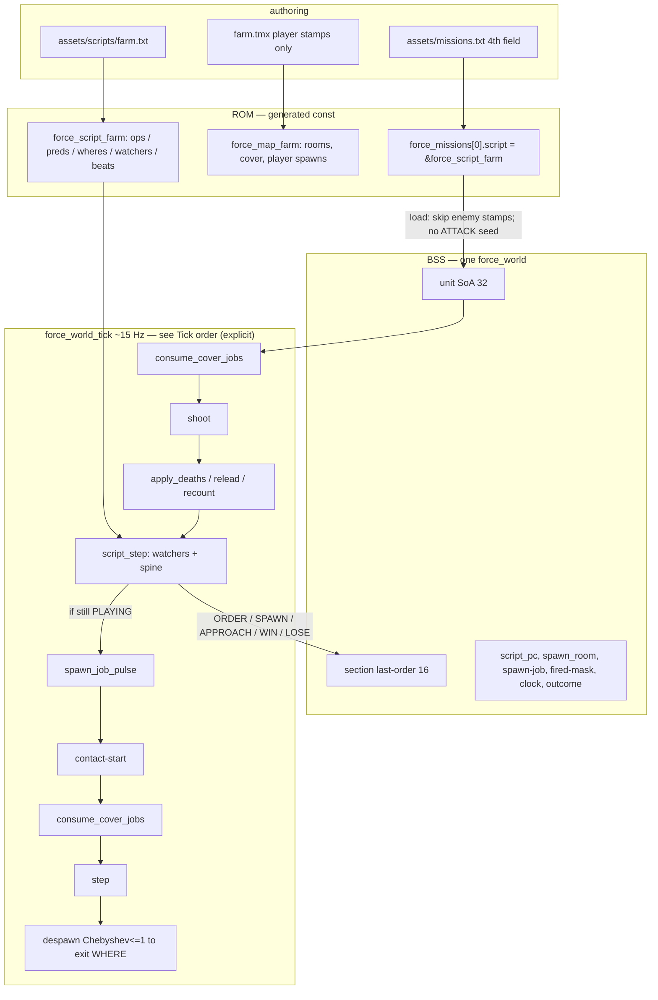

# Phase 7 — Mission script

| Field | Value |
| --- | --- |
| Author | FORCE design session |
| Date | 2026-09-15 |
| Status | **Draft** |
| Last worked on | 2026-09-15 |
| Repo path | [`design/phase-7-mission-script.md`](phase-7-mission-script.md) |
| Plan | [`development-plan.md`](development-plan.md) (Phase 7 frozen) |
| Source | `src/sdl/game/world.h`, `src/sdl/game/world.c`, `src/sdl/game/command.c`, `src/sdl/game/game.c`, `src/sdl/game/game.h`, `src/sdl/generated/force_data.h`, `tools/gen_sdl.py`, `assets/missions.txt`, `assets/maps/farm.tmx` |
| Intent | [`../doc/FORCE_01_Vision_and_Principles.md`](../doc/FORCE_01_Vision_and_Principles.md), [`../doc/FORCE_02_Command_Language_and_UI.md`](../doc/FORCE_02_Command_Language_and_UI.md), [`../doc/FORCE_04_Campaign_Twenty_Scenarios.md`](../doc/FORCE_04_Campaign_Twenty_Scenarios.md), [`../doc/FORCE_07_Rooms_Cover_and_Farm.md`](../doc/FORCE_07_Rooms_Cover_and_Farm.md), [`../doc/FORCE_08_Units_Sections_and_Tick.md`](../doc/FORCE_08_Units_Sections_and_Tick.md) |
| Binary as it is | [`../agents/game.md`](../agents/game.md), [`../agents/known-gaps.md`](../agents/known-gaps.md) |
| Depends on | [`phase-6-combat.md`](phase-6-combat.md) (rifles, smear, `K`, force-break; load seed this phase overwrites) |

The director, not a brain. A cue sheet compiled to bytecode
spawns letters, issues the same 4-byte order the player types,
watches the 32-slot pool and the 16-row section table, and
trips win/lose. Hold the Farm is a game at the end of this
phase. That is the first playable, not “engine complete.”

Index status is **active**. This writeup is not a landing.

---

## Overview

Phase 6 left a live firefight with a one-beat director hardcoded
at load (`force_world_load` in `src/sdl/game/world.c` lines
1967–1980): stamp every actor, and if enemy bank 8 has men,
write `FORCE_VERB_ATTACK` at the player lead, force 10, no
`FLAG_COVER_ASSIGN`. Soldiers already walk, take cover, smear,
and halt on the force nibble. `force_unit_spawn` already
exists. `room_approach` already exists. Letters 8–15 already
exist as script handles (FORCE_08). The missing piece is a
short program that can re-issue those things as the fight
changes.

Phase 7 replaces that seed with a **director**. Units do not
run a script (FORCE_08). Enemy AI remains: same mover + default
ROE + mission script. No per-unit behaviour tree. The director
is a company commander: spawn a group, give them the same
4-byte order the player types, watch the board, issue the next
order when a condition trips.

The farm product changes versus FORCE_04 / FORCE_07. Mission 1
is no longer “one room, three waves on one axis, win when the
clock ends.” Farm is a 3-act play on four EW rooms. Wave 1
walks in and dies. Wave 2 knows the player holds the houses,
hunkers, falls back, runs west off the map. Wave 3 dies in
place in room 3; the player must leave the houses and clear
it. Win is last wave dead **and** a living player body in
room 3. Lose is player bank strength 0 at any time.

`--smoke` is still one frame, exit 0. Player stamps (verb
NONE) stay put. The script may spawn and seed an order on
frame 0; enemies **may** take a first step; that is OK.
Outcome must stay playing after that frame. Interactive: a
readable 3-act fight and a chrome line that says the farm is
held or lost.

This is not the truck, not radio lines, not `S`/`J`, not a
C64 emitter.

---

## Background & Motivation

### Current runtime (Phase 6, landed)

`force_game_tick` (`src/sdl/game/game.c`): feed, then if
`(frames % FORCE_LOGIC_PERIOD) == 0` **before** increment,
`force_world_tick`. `FORCE_LOGIC_PERIOD` is 4 (~15 Hz). Frame 0
is a logic tick.

`force_world_tick` (`world.c` 2002–2046): decrement `unit_fx`
→ `consume_cover_jobs` → shoot all → `apply_deaths` (relead,
recount, `FLAG_COVER_ASSIGN` via `death_reassign`, force-break
to `HALT`) → `consume_cover_jobs` → step.

`death_reassign` (`world.c` 1648–1660) is player bank and
verb `A`/`D`/`H`/`K` only. Enemy bank never latches
`FLAG_COVER_ASSIGN` on death. Phase 6 KD 11 / KD 17 deferred
enemy assign to Phase 7 contact-start.

Load stamps `FORCE_CLASS_GOODGUYS` → section 0,
`FORCE_CLASS_ENEMIES` → section 8 (`FORCE_LETTER_MAX`). Then
the seed:

```c
if (world->section_strength[FORCE_LETTER_MAX] > 0u) {
    /* ATTACK, force 10, WHERE = section-0 lead, no COVER_ASSIGN */
}
```

`commit` (`command.c` 250–342) writes
`section_order_verb/x/y/force/str`, clears `NOPATH` and
`BREAKING`, latches `FLAG_COVER_ASSIGN` on player `D`/`A` and
`FLAG_COVER_RELEASE` on `M`. That 4-byte object is what the
director must issue.

Row 21 paints `READY` when idle (`command.c` 455–456), talky
otherwise, `NO PATH` while flash. There is no outcome byte
and no clock.

### Farm tables (work against these, do not hard-code)

`src/sdl/generated/force_data.c`:

| Column | Farm |
| --- | --- |
| map | 40×20, window `0,0,40,20` (the window **is** the map) |
| rooms | **4** rects, **all `FORCE_AXIS_EW`** |
| portals | 7 (gaps at x=5 and x=21) |
| cover | **46**; room 0 is 11 neutrals (ten grade 3 `hard=w`, one grade 2 `soft=w`) |
| scouts | **0** |
| units | 8 infantry section 0 in room 0; **7** enemy stamps section 8 in room 3 (west field) |

Rooms (colour-chip order from `extract_rooms`; colour =
tile − 112; Tiled `firstgid=1` so GID 114–117 are tiles
113–116, colours 1–4). First containing rect wins
(`unit_region_at`):

| i | colour | x0,y0 | w×h | cells | product name |
| ---: | ---: | --- | --- | --- | --- |
| 0 | 1 | 21,0 | 19×20 | x 21–39 | room **1** east / houses |
| 1 | 2 | 13,0 | 8×20 | x 13–20 | room **2** inner lane |
| 2 | 3 | 6,0 | 7×20 | x 6–12 | room **3** outer lane |
| 3 | 4 | 0,0 | 6×20 | x 0–5 | room **4** west / field |

Product language is west→east **4-3-2-1**. Scripts name
rooms via aliases bound to `room_colour`. C never contains
farm room indices.

Cover per room (`room_cover_count` / `lo` / `none` / `hi`):

| i | product | chips | lo | none | hi | notes |
| ---: | --- | ---: | ---: | ---: | ---: | --- |
| 0 | 1 houses | 11 | 0 | 11 | 0 | all neutrals; grade 3 houses |
| 1 | 2 inner | 15 | 7 | 0 | 8 | poles only; plenty for a D |
| 2 | 3 outer | 16 | 9 | 0 | 7 | poles only; plenty for a D |
| 3 | 4 west | 4 | 0 | 0 | 4 | all advancing=w |

Rooms 2 and 3 are **not** short of holes. The west field is
thin (4 chips); wave 1 does not `D` there.

Yard wall is `FORCE_CLASS_WALLS` on x=21 except a 2-wide open
front at `(21,7)` / `(21,8)`. Barrier line at x=5
(`FORCE_CLASS_BARRIERS`, tile 33). Roofs pass. `cell_free`
refuses walls, barriers, and a second body (scan 32).

Player spawns (section 0) unchanged. Enemy stamps today
(`spawn_tile` 10 = enemies facing E) sit at
`(2,8) (1,9) (3,9) (2,10) (3,12) (1,13) (2,14)` — all in
room 3, x 0–4. Phase 7 **strips** those stamps; the director
owns enemy entry.

Load default `room_approach` (`world.c` 1860–1875): EW →
`FORCE_APPROACH_W`, NS → `FORCE_APPROACH_S`. Farm is all EW,
so every room already has WEST on. The script still writes
the bit when a wave starts (FORCE_07: the wave script *is*
the vector).

Tick cadence unchanged: every 4 display frames; `move_wait`
default 7; RETURN does not poke wait. Spawn `move_wait` stays
0 so a standing-start order can step the same logic tick.

Host (`agents/architecture.md`): one thread, **no audio
callback**, no mixer. `core/` and `game/` have no SDL.

### Pain

- Hold the Farm is a firefight, not a game. There is no
  second beat, no fallback, no win, no lose, no clock.
- The one-beat seed double-issues the moment a script also
  `ORDER`s bank 8.
- Enemy stamps in the west field are the wave. A director
  that also `SPAWN`s piles 7 leftover bodies onto the first
  cue.
- `death_reassign` will not fill enemy holes after a loss, so
  a script `D` that takes casualties never reshuffles.
- FORCE_04’s “clock ends, farm still yours” does not describe
  the 3-act board this conversation locked. The original
  clock-end skin is a later mission on the same map.

### What is already right

Unit SoA, two banks of letters (0–7 player, 8–15 enemy),
`force_unit_spawn` / `force_section_recount` /
`force_section_relead`, greedy stepper, `cell_free` no-stack,
directional `pick_best`, `section_order_force` /
`section_order_str` snapshot on commit, `room_approach`,
`room_colour`, cover consume-before-shoot. Phase 7 extends
that world. It does not invent a VM with `wave = 2`, a
per-unit tree, a second BSS object, or a new TU.

---

## Goals & Non-Goals

### In (Phase 7, all PRs)

- A **director**: spawn, order, watch, win/lose. Same 4-byte
  last-order the wizard writes. Units do not run a script.
- Authoring is a cue sheet under `assets/scripts/`.
  `tools/gen_sdl.py` compiles it to bytecode. No parser in
  the game. Missions bind a script from `missions.txt`.
- Named **beats** (the PC) plus **armed watchers**. Letters
  *are* the tags: script `A` is enemy bank letter A (section
  8). Fresh letter when two groups must be alive at once;
  reuse `A` when the previous group is gone.
- Orders are **events**, not levels. Watchers that fire
  actions are once / edge-triggered. Re-issuing `D` every
  tick would reset `section_order_str` and they would never
  break.
- Force-break stays `HALT` (`FLAG_BREAKING`). Broken sections
  keep holes, keep shooting, stop walking. The director then
  issues the next `D` or `M`. Wave 3 uses force 10 (die in
  place). Do not make force-break mean retreat.
- No `if_sometimes`. Scan on the logic tick (~15 Hz).
  Debounce is a count threshold (`player.in 4 >= 5`), not a
  slower poll. Latch on the rising edge (once-bit).
- Farm 3-act script. Win: last wave dead **and**
  `player.in 3 >= 1`. Lose: player bank strength == 0 at any
  time, even if a later beat is scheduled. Clock exists as a
  **predicate**; farm win is event-driven.
- Approach bits from the script. Script-issued `D` latches
  `FLAG_COVER_ASSIGN` like the wizard. Script-issued `A`
  does **not** steal houses at spawn; contact-start latches
  assign when the letter enters the dest room.
- Off-map despawn for an enemy `M` to an exit cell.
- `--smoke` still one frame, exit 0, player unmoved if verb
  NONE. Script may spawn and seed; enemies may first-step.
  Farm outcome stays playing after 1 frame.
- Interactive: readable 3-act fight; row 21 names the
  outcome. No campaign screen.
- `agents/game.md`, `known-gaps.md`, `testing.md`,
  `assets.md`, `architecture.md` on landing.
  `design/README.md` stays **active** until the last PR of
  this phase lands.

### Out (later phases / never)

| Later / never | Why |
| --- | --- |
| Truck drive / flip / tow / dismount / absorb-into-nest | Pageant. Win does not need the sprite. `force_unit_spawn` is already the hook. |
| Radio lines / radio chrome | Pageant. Opcode reserved; compiler rejects `radio` this phase. |
| Clock-as-win | Clock predicate exists. Farm win is event-driven. FORCE_04’s “clock ends, farm still yours” is a later skin of the same board. |
| True parallel spines (two independent wave programs) | Watchers + one spine is enough. |
| `S` / `J`, overview, fog, `C` / `E` lists | Phase 8 / 9. |
| Nest facing, grenades, distract-the-gun, lower command language | Player agency stays the high-level line. Private addressable after `S` (Phase 9). `M` to a cover cell does **not** claim the hole; `D` claims. |
| Per-unit behaviour trees | FORCE_08. Rejected. |
| General-purpose script with mutable `wave` | PC pretending to be content. Rejected. |
| Hardcoded C farm state machine | Not reusable for 20 missions, not data. Rejected. |
| Enemy `K` | Enemy uses default ROE. Script `A` is assault. `K` stays the human edge. |
| C64 emitter | Phase 10. |
| `malloc`, VLA, `tests/` tree, a mixer, `script.c` | Forbidden / no new TU. |

Director vs pageant (this phase is the left column only):

| | Director | Pageant |
|---|---|---|
| Job | Plausible fight | Choreography |
| Speaks | spawn, order, watch, win/lose | paths, flips, kind changes, absorb |
| Farm | patrol → contact → last stand | radio + truck |
| 6502 | a table of cues | extra kinds + sprite budget |

Director verbs must still be able to express “spawn, `M` to a
cell, wait until arrived” so a later pageant can call them.
Vehicles and nest transform must not shape the language.

---

## Key Decisions

Locked in the Phase 7 conversation 2026-09-15. Do not reopen
the director/cue-sheet shape, the 3-act farm, or the win
clause.

1. **The script is a director, not a brain.** Soldiers already
   walk, take cover, smear, and halt on the force nibble.
   Phase 7 spawns a group, issues the same 4-byte order the
   player types, watches the board, issues the next order
   when a condition trips. Units do **not** run a script
   (FORCE_08). Enemy AI remains: same mover + default ROE +
   mission script. No per-unit behaviour tree. Script state
   never sits on a unit.

2. **Cue sheet compiled by `gen_sdl.py`. No parser in the
   game.** Authoring is `assets/scripts/*.txt`. Runtime is a
   tiny stepper over ROM tables. Unknown rooms, over-cap,
   player-bank spawn letters, `radio`, `if_sometimes` fail
   the **compile**.

3. **Watchers are an always-scanned table; the spine is one
   beat at a time.** Wipe and overrun stay armed for the
   whole mission. Contact fallbacks are more spine, not a
   second program. Watchers-as-ARM-ops in the bytecode
   stream are rejected (see Alternatives). Cap 8 watchers,
   scan 8 every logic tick.

4. **Letters are the tags.** Script `A`–`H` are enemy bank
   8–15 (`'A' - 'A' + FORCE_LETTER_MAX`). `A.strength == 0`
   is “this letter is dead.” `player` in a predicate is the
   whole player bank (sum `section_strength[0..7]`, or count
   of slots whose section `< FORCE_LETTER_MAX`). There is no
   mutable `wave` byte.

5. **Orders are events, not levels.** A watcher or wait that
   fires an action is edge-triggered / once. Re-issuing `D`
   every tick while `B.strength <= 4` would rewrite
   `section_order_str` to the live strength and they would
   never break. `FORCE_SCRIPT_WATCH_ONCE` is the default for
   every watcher action other than `WIN`/`LOSE` (those latch
   `script_outcome` and freeze). Spine `WAIT` fires once then
   `GOTO`s; the PC leaves.

6. **Force-break stays `HALT`.** `apply_deaths` already
   rewrites verb to `HALT` and sets `FLAG_BREAKING` (`world.c`
   1717–1723). Broken sections keep holes, keep shooting,
   stop walking. Force 5 on wave 2 is “stop pushing and hug
   dirt” **once the group exists**. Script `ORDER` snapshots
   **issued n** when a spawn-job for that letter is live
   (KD 15), so force 5 is half of 8, not half of 0. Skip
   `force_broken` for a letter while
   `spawn_job_rem > 0 && spawn_job_letter == who` — a death
   among the first two of a batch-2 stagger must not HALT
   the letter against snap 8 (`now = 1 <= 4`). Later pulses
   would otherwise land on `HALT` and sit in room 4, and
   `contact_fight` would skip the room-2 hunker. After the
   job goes idle, the Phase 6 nibble vs issued n applies
   unchanged. The *director* then issues `D B room 3 force
   4`, later `M B exit-west force 10`. Do not make
   force-break mean retreat. Wave 3 uses force 10 (never
   breaks). A script `ORDER` clears `FLAG_BREAKING` the way
   `commit` does (`command.c` 321–322). Sheet-only
   workaround (force 10 on spawn, re-`ORDER` force 5 at
   `contact_fight`) is rejected: every staggered + force-n
   mission would have to remember it.

7. **No `if_sometimes`.** Scan on the logic tick
   (`FORCE_LOGIC_PERIOD` 4, ~15 Hz). Debounce is a count
   threshold in the predicate (`player.in 4 >= 5`), not a
   slower poll. Latch on the rising edge via the once-bit.

8. **Farm is a 3-act play. Win is clear-room-3, not
   hold-room-1.** Wave 1 patrol: spawn in room 4, `A` room 1
   force 10, walk in, likely wiped. Wave 2 contact: spawn in
   `spawn_room` (staggered), `D` room 2 force 5, **wait
   `job idle`** (the eight are out), **then** wait
   `B.strength <= 4` before falling back — not a single
   `<= 4` on the spawn tick. Then `D` room 3 force 4, then
   `M` exit-west force 10. Wave 3 last stand: `D` room 3
   force 10.
   Win: that letter’s strength == 0 **and**
   `player.in 3 >= 1`, via `wait … -> held` then
   `beat held: win` (WAIT targets a beat, never `win` /
   `lose`). Losing the farm houses is not an automatic
   fail. The truck pickup (road through room 3) is the
   *narrative* reason to leave room 1; it does not drive.
   Player never leaving room 1 is a failed mission, not a
   missing failsafe.

9. **Global lose is player bank strength == 0.** Armed for
   the whole session (`watch wipe`). Session lost even if a
   `J` is scheduled later. Reinforcements require a living
   letter. There is no `J` this phase.

10. **Clock is a predicate, not the farm win.** `script_clock`
    is a `uint16_t` of logic ticks from load, incremented
    while `script_outcome == PLAYING`. `PRED_CLOCK_GE` exists
    for later “hold until…” skins. The farm script does not
    wait on it.

11. **WHERE is resolved at issue time, not chased every
    step.** Four kinds: `ROOM`, `CELL`, `PLAYER`, `EXIT`.
    Packed into the existing `section_order_x/y` cells. If
    the player moves, a watcher re-issues; the dest is not a
    homing missile and not flocking.

12. **Wave 1 is `A` (ATTACK), not `K`.** The conversation’s
    “`K` room 1 force 10” was made-up syntax matching the
    Phase 6 seed, which writes `FORCE_VERB_ATTACK`. `K` is
    concentrate on a cell; `A` is assault. Enemy never `K`.
    Script `order A A room 1 force 10`. Compiler rejects
    script `K`.

13. **Script `D` assigns at issue; script `A` assigns on
    contact-start.** Player wizard `A` still latches
    `FLAG_COVER_ASSIGN` in `commit` (landed). Director `A`
    must **not** — that is the Phase 6 house-steal bug with
    a different author. When an enemy letter with verb `A`
    first has a living man in the dest room, set
    `FLAG_CONTACT` (new, `0x10`) and `FLAG_COVER_ASSIGN`.
    Taken holes stay with the player (FCFS). Leftovers prone.
    Script `D` latches `FLAG_COVER_ASSIGN` immediately
    (hunker in the WHERE room, walk there). Script `M`
    latches `FLAG_COVER_RELEASE` like the wizard.

14. **TMX stamps remain the player start. Director owns
    enemy entry.** Strip the 7 enemy actors from `farm.tmx`.
    If `mission->script != NULL`, `force_world_load` skips
    `FORCE_CLASS_ENEMIES` stamps. Delete the Phase 6 seed
    block (`world.c` 1967–1980) so a script cannot
    double-issue. Unscripted missions still stamp enemies
    and give them **no** standing order (sandbox, not a
    hidden director).

15. **Spawn-job is background, period matches `move_wait`.**
    `SPAWN n letter [in room|spawn_room] [batch] [period]`
    does not wait the spine. Stagger 2 every 7 **logic
    ticks**, not display frames. Pulse uses the
    `unit_move_wait` pattern (`world.c` 2038–2044):
    `if (wait > 0) { wait--; if (wait > 0) return; }` then
    place, then `wait = period`. First pulse this tick
    (`wait = 0`); next pulses at t=7, 14, 21. One spawn-job
    slot is enough for farm. Pool full → skip this pulse,
    keep `remaining`, retry after `period`. Do not stall
    the PC. Same-beat `ORDER` of a letter with a live job
    snapshots **issued n** (`section_strength +
    spawn_job_rem`), not the empty live count. A pulse that
    lands ≥ 1 man re-latches `FLAG_COVER_ASSIGN` if that
    letter’s verb is `D`, or `A` with `FLAG_CONTACT`, so
    the same-tick consume fills late bodies. `apply_deaths`
    skips `force_broken` for that letter while the job is
    live (KD 6) so issued n does not HALT a partial group.

16. **Off-map despawn is arrival near an exit WHERE, not a
    window test on every unit.** `try_land` (`world.c`
    377–382) and `try_step` (398–401) both refuse `nx < 0`
    / `>= width`. After step, enemy bank + verb `MOVE` +
    WHERE on a window edge: if Chebyshev(unit, WHERE)
    `<= 1`, free the slot (cover `$FF`, count 0), then
    relead / recount for that letter. Player bank never
    auto-despawns. Smoke must not despawn: frame-0 orders
    are `A`/`D`, not `M` to an edge. `pick_spawn_cell`
    skips any cell with Chebyshev `<= 1` of this letter’s
    current `MOVE` WHERE so a same-beat `SPAWN` then
    `ORDER M exit-west force 10` does not land on the dest
    and vanish this tick.

17. **Predicates are a small enum + args. `and` is two
    slots.** No expression language. Every wait/watch carries
    pred0 and pred1; pred1 kind `PRED_NONE` means unused
    (true). Both must hold. Farm win is
    `C.strength == 0 and player.in 3 >= 1`. Also:
    `PRED_STR_GE` (`<letter>.strength >= n`) and
    `PRED_JOB_IDLE` (`job idle`: `spawn_job_rem == 0`,
    including “no job”). **Spine only** — the compiler
    rejects `job idle` on a watcher (it is true at load and
    between waves). WAIT is **level-triggered**; debounce
    “the eight are out” with `job idle`, not a falling
    edge. No `or`, no nested `and`. Need `or` → two
    watchers.

18. **Tick order is the list under “Tick order (explicit)”,
    nowhere else.** Predicates see this tick’s strength.
    An `ORDER` issued this tick consumes cover before step,
    so a same-tick `D` already has holes as dest. Pulse
    runs **after** `script_step` so a same-tick wipe does
    not keep spawning. Same-frame as player RETURN (commit
    is step 4 of `force_game_tick`, `force_world_tick` is
    step 5). Frozen outcome skips shoot / script / step
    after the fx decrement.

19. **Win/lose freeze the board and paint row 21.**
    `script_outcome`: 0 playing, 1 win, 2 lose. On set: PC
    stops, spawn-job stops, `force_world_tick` decrements
    `unit_fx` and returns (last hurt flash can finish).
    Cursor and wizard still feed; they cannot unfreeze.
    Row 21: `HELD THE FARM` (yellow) / `FARM LOST`
    (light-red), overriding `READY` / talky. Esc / Q still
    quit. No campaign screen. Strings are farm literals in
    `command.c` this phase; a follow-on puts two
    `const char *` on `force_script` so chrome stays
    map-agnostic. Do not block PR3 on that. `--smoke` must
    leave outcome playing for farm.

20. **No new TU.** Stepper is file-static in `world.c`. RAM
    appends on `force_world`. Compiler stays in `gen_sdl.py`.
    Do not add `script.c`, `combat.c`, a mixer, or a C64
    tree.

21. **Caps fail the compile.** Ops 64, watchers 8, beats 12,
    preds 32, wheres 16, spawn templates 8, spawn-jobs 1
    (RAM), beat/watch name 15 chars. One spine. Farm fits
    with margin (7 beats including `contact_fight` and
    `held`, 2 watchers, 16 ops).

22. **`--smoke` is unchanged as a gate.** One frame, exit 0,
    player eight unmoved if verb NONE. Script may spawn 8
    in room 4 and `ORDER A A room 1`; Chebyshev to the farm
    lead is ≥ 16 so no shot; they may take one step east.
    Do not assert enemy cells unmoved. Outcome stays
    playing (wipe needs 8 dead player men; win needs act 3).

23. **Pageant is parked, language is not hostile to it.**
    `CELL` WHERE and `PRED_AT_CELL` exist so a later truck
    path can `SPAWN`, `ORDER M cell x,y`,
    `WAIT <letter> at <x>,<y>`. `PRED_REACHED` is the room
    form (`<letter> in <room>`). `OP_RADIO` is a reserved
    enumerant; compiler rejects the keyword this phase.
    Same-beat `SPAWN` then `ORDER M` is safe because
    `pick_spawn_cell` skips the MOVE WHERE cluster (KD 16).

24. **Enemy death reassigns when they are hunkering or in
    contact.** Extend `death_reassign`: player bank unchanged
    (`A`/`D`/`H`/`K`); enemy bank if verb is `D`, or verb is
    `A`/`H` **and** `FLAG_CONTACT`. A death on bank 8 with
    standing `A` and no contact still must not claim the
    farm houses (Phase 6 KD 17, still true until they enter).

25. **`APPROACH` writes the mask; it does not slap the
    player roster.** Latch `FLAG_COVER_ASSIGN` only on
    **enemy** letters whose dest room is that room and
    (verb `D`, or verb `A` with `FLAG_CONTACT`). Player
    `D` already has a WHERE vector; reshuffling houses
    when wave 1 starts is rude. FORCE_07 “recompute when
    approach bits change” is the director’s enemy fill.

---

## Proposed Design

### Runtime data flow



### Sequence: one logic tick

```mermaid
sequenceDiagram
  participant tick as force_game_tick
  participant world as force_world_tick
  participant sh as unit_shoot
  participant d as apply_deaths
  participant dir as script_step
  participant th as unit_think

  tick->>world: frames % 4 == 0
  alt outcome != PLAYING
    world->>world: unit_fx-- only
  else playing
    world->>world: script_clock++
    world->>world: consume_cover_jobs
    loop i in 0..31 living
      world->>sh: hunt + hit
    end
    world->>d: hp==0 → count=0, relead, recount, break
    world->>dir: watchers + spine until WAIT
    Note over dir: ORDER this tick writes last-order + issued n
    world->>world: spawn_job_pulse (after spine; skip if not PLAYING)
    world->>world: contact-start (enemy A entered dest)
    world->>world: consume_cover_jobs
    loop i in 0..31 living, not emplacement
      world->>th: step
    end
    world->>world: enemy M near exit WHERE → free slot
  end
```

Authoritative step list: **Tick order (explicit)** below.
KD 18 and every PR bullet cite that list, not this
diagram. Same-frame RETURN + logic tick is unchanged:
`commit` is still step 4 of `force_game_tick`;
`force_world_tick` is still step 5. Script `ORDER` in the
deaths-to-step gap is the director equivalent of that
RETURN.

### Authoring file

New directory `assets/scripts/`. One file per script, stem
is the identifier. Comments and ident rules match
`tiles.txt` / `missions.txt`: `#` to end of line,
`IDENT_RE` = `^[A-Za-z_][A-Za-z0-9_]*$`.

`assets/missions.txt` gains an optional 4th field:

```text
# name  map  x,y,w,h  [script]
farm_mission farm 0,0,40,20 farm
```

`load_missions` today (`gen_sdl.py` 263–296) requires
exactly 3 tokens. Relax to 3 or 4. Fourth token is a script
stem; file is `assets/scripts/<stem>.txt`. Missing file,
unknown stem, or a script that names a room colour the map
does not have → `gen_sdl: ...` and the **build** fails.

CMake (`src/sdl/CMakeLists.txt`): add

```cmake
file(GLOB FORCE_SCRIPTS CONFIGURE_DEPENDS
     "${FORCE_ROOT}/assets/scripts/*.txt")
```

to `FORCE_GEN_INPUTS` next to `missions.txt` and the TMX
glob.

No `script` column on the TMX. No runtime file load.

### Compiler grammar

Line-oriented, like `properties.txt`. Keywords are
case-sensitive lowercase. Room names, beat names, watch
names are idents or decimal integers (farm uses `1`–`4`).

```text
room <name> = colour <1-15>
spawn_room <name>

watch <name>: <pred> [and <pred>] -> <action> [once]

beat <name>:
  <action>
  wait <pred> [and <pred>] -> <beat>   # beat name only, never win/lose
```

Actions:

```text
spawn <n> <letter> [in <room>|in spawn_room] [batch <b>] [period <p>]
order <letter> <verb> <where> force <0-10>   # force is required; no default
set spawn_room <room>
approach <room> <bits>
goto <beat>
win
lose
```

`<letter>` is `A`–`H` (enemy 8–15). `<verb>` is `A` `D` `M`
`H` only (`A`=`ATTACK`, `D`=`DEFEND`, `M`=`MOVE`,
`H`=`HALT`). `<bits>` is `N`/`E`/`S`/`W` or those OR’d
(`W|E`). `<where>`:

```text
room <name>
cell <x>,<y>
player
exit-west | exit-east | exit-north | exit-south
```

Predicates:

```text
<letter>.strength == <n>
<letter>.strength <= <n>
<letter>.strength >= <n>
player.strength == <n>
player.in <room> >= <n>
<letter>.in <room> >= <n>
<letter> in <room>                 # PRED_REACHED; n implicit 1
<letter> at <x>,<y>                # PRED_AT_CELL; living man on the cell
player.in <room> >= enemy.in <room>
clock >= <n>                       # n is logic ticks, u16
job idle                           # PRED_JOB_IDLE; spine wait only, not watchers
```

`wait` always names a **beat**. `win` / `lose` are actions
on a beat (or a watcher), not WAIT targets. There is no
compiler sugar that synthesizes a beat from `-> win`.

`and` joins exactly two preds on one wait/watch. A third
`and` fails the compile. WAIT is level-triggered: it fires
the first tick the pair is true **after** the decode tick
(the decode tick parks; it does not evaluate). Do not add
a falling-edge WAIT this phase.

Top-level `spawn_room` sets the load default
(`script_spawn_room` at `force_world_load`). Beats run in
source order; the first `beat` is the start PC. A file with
zero beats fails.

### Compile-time checks (fail `gen_sdl`)

| Condition | Error |
| --- | --- |
| Unknown room name / colour not on this map | `farm.txt: room 5: colour 5 not on farm` |
| `order` / `spawn` letter not `A`–`H` | player-bank letters are not script handles |
| `order` verb `K` / `R` / unknown | `K` is the human edge; `R` is unbound |
| `radio` / `if_sometimes` / `wave =` | parked / rejected |
| Duplicate beat or watch name | |
| `wait` / `goto` unknown beat | `wait … -> win` is this error: `win` is an action, not a beat |
| Force missing, or force > 10, n = 0, batch = 0, period = 0 | `order` requires `force <0-10>`; no default (wizard RETURN defaults to 10, the cue sheet does not) |
| `job idle` on a `watch` line | true at load / between waves; spine `wait` only |
| `cell x,y` outside the map | |
| Name longer than 15 | |
| Ops > 64, watchers > 8, beats > 12, preds > 32, wheres > 16, spawn tmpls > 8 | cap |
| Watcher action `order` | watchers may `win` / `lose` / `set spawn_room` / `approach` / `goto`; an order is a beat. `approach` packs `watch_arg` as `(bits << 4) or room` (room 0–15, bits 0–15). Watcher `goto` clears `script_waiting`. |
| Mission names a script the map cannot bind | rooms checked against **that** mission’s map |

Room aliases bind to **colour**, then to the map’s room
**index** via `room_colour[]`. Bytecode stores the index.
C never writes `/* farm houses = 0 */`. If someone restamps
colours, they recompile; they do not patch `world.c`.

Integer room tokens without an alias are colours, not
indices: `room 1 = colour 1` is required documentation on
farm even though they coincide. A script that says `in 4`
looks up alias `4`, else colour 4.

### Farm cue sheet (`assets/scripts/farm.txt`)

Product verbs: wave 1 is **ATTACK**, approach is **WEST**
(farm rooms are EW strips; FORCE_07’s SOUTH was an NS-yard
sketch). Counts are tunables in this file, not C.

```text
# Hold the Farm — director. Rooms 1-4 are colour chips 1-4
# (tiles 113-116 / Tiled GID 114-117). West → east 4-3-2-1.

room 1 = colour 1
room 2 = colour 2
room 3 = colour 3
room 4 = colour 4

spawn_room 4

watch wipe:    player.strength == 0            -> lose
watch overrun: player.in 4 >= 5                -> set spawn_room 2   once

beat patrol:
  spawn 8 A in spawn_room
  order A A room 1 force 10
  approach 1 W
  wait A.strength == 0 -> contact

beat contact:
  spawn 8 B in spawn_room batch 2 period 7
  order B D room 2 force 5
  wait job idle -> contact_fight

beat contact_fight:
  wait B.strength <= 4 -> contact_back

beat contact_back:
  order B D room 3 force 4
  wait B.strength <= 2 -> contact_run

beat contact_run:
  order B M exit-west force 10
  wait B.strength == 0 -> last

beat last:
  spawn 8 C in spawn_room
  order C D room 3 force 10
  wait C.strength == 0 and player.in 3 >= 1 -> held

beat held:
  win
```

Several branches active: wipe and overrun stay armed; spine
is one beat at a time; `contact_fight` / `contact_back` /
`contact_run` are more spine.

Wave 2 `batch 2 period 7` is four pulses at t=0, 7, 14, 21
(move_wait pattern; ~1.4 s). `wait job idle` is required:
`SPAWN` does not wait the spine, the first pulse is this
tick, and a level-triggered `wait B.strength <= 4` would
fire on tick 1 with two men and skip the hunker. Casualty
wait is the **next** beat. WAIT does not evaluate on the
decode tick, so `contact_fight` parks one tick even if
they already took losses during the stagger.

The spine does not wait on the job for the **order**:
`order B D` applies to whoever is alive, including men who
appear on later pulses (new spawn copies no order; the
**section** already holds last-order, and `unit_think`
reads the section). Late pulses re-latch `FLAG_COVER_ASSIGN`
(KD 15) so they claim room-2 poles. `section_order_str` is
issued n (8). `apply_deaths` skips `force_broken` while
that letter’s spawn-job is live (KD 6), so a death among
the first two does not HALT against snap 8. After `job
idle`, force 5 HALTs at half of 8 (`now <= 4`) as intended.
`M exit-west` is `force 10` (required token; never breaks;
they despawn or die).

### Bytecode / IR

Caps, emitted in `force_data.h` from `gen_sdl.py` next to
`FORCE_ROOM_MAX`:

```c
#define FORCE_SCRIPT_OPS_MAX      64u
#define FORCE_SCRIPT_WATCH_MAX     8u
#define FORCE_SCRIPT_BEAT_MAX     12u
#define FORCE_SCRIPT_PRED_MAX     32u
#define FORCE_SCRIPT_WHERE_MAX    16u
#define FORCE_SCRIPT_SPAWN_MAX     8u   /* templates, not the unit pool */
#define FORCE_SCRIPT_NAME_MAX     16u   /* 15 + NUL, compiler-only */
```

SoA, not one blob, matching every other generated table.

```c
enum force_script_op {
    FORCE_OP_NOP        = 0,
    FORCE_OP_SPAWN      = 1,  /* a = spawn-template index */
    FORCE_OP_ORDER      = 2,  /* a = letter 8-15, b = verb|(force<<4), c = where index */
    FORCE_OP_SET_SPAWN  = 3,  /* a = room index */
    FORCE_OP_APPROACH   = 4,  /* a = room index, b = FORCE_APPROACH_* bits */
    FORCE_OP_GOTO       = 5,  /* a = beat index */
    FORCE_OP_WAIT       = 6,  /* a = pred0, b = pred1 or 0xFF, c = beat index */
    FORCE_OP_WIN        = 7,
    FORCE_OP_LOSE       = 8,
    FORCE_OP_RADIO      = 9   /* reserved; compiler rejects */
};

enum force_pred_kind {
    FORCE_PRED_NONE      = 0,
    FORCE_PRED_STR_EQ    = 1,  /* who.strength == n */
    FORCE_PRED_STR_LE    = 2,  /* who.strength <= n */
    FORCE_PRED_IN_GE     = 3,  /* who in room >= n */
    FORCE_PRED_REACHED   = 4,  /* who has a living man in room (n unused) */
    FORCE_PRED_AT_CELL   = 5,  /* who has a living man at (a,b) */
    FORCE_PRED_CLOCK_GE  = 6,  /* clock >= u16(a | b<<8), little-endian */
    FORCE_PRED_REL_GE    = 7,  /* player count in room a >= enemy count in room a */
    FORCE_PRED_STR_GE    = 8,  /* who.strength >= n */
    FORCE_PRED_JOB_IDLE  = 9   /* spawn_job_rem == 0; who unused */
};

enum force_where_kind {
    FORCE_WHERE_ROOM     = 0,  /* a = room index */
    FORCE_WHERE_CELL     = 1,  /* a = x, b = y */
    FORCE_WHERE_PLAYER   = 2,  /* sticky dest, resolved at issue */
    FORCE_WHERE_EXIT     = 3   /* a = FORCE_FACE_N/E/S/W */
};

#define FORCE_SCRIPT_WHO_PLAYER  0xFFu
#define FORCE_SCRIPT_WATCH_ONCE  0x01u
#define FORCE_SCRIPT_PLAYING     0u
#define FORCE_SCRIPT_WIN         1u
#define FORCE_SCRIPT_LOSE        2u
```

`who` in a pred is a section id 8–15, or
`FORCE_SCRIPT_WHO_PLAYER`. Player strength is the sum of
`section_strength[0..7]` (walk 8, not 32). Player-in-room
walks 32 and counts `unit_count != 0 && unit_section < 8 &&
unit_region == room`.

Generated script object (pointer on `force_mission`; NULL if
the 4th field was omitted):

```c
typedef struct force_script {
    const char *name;
    uint8_t op_count;
    const uint8_t *op_code;
    const uint8_t *op_a;
    const uint8_t *op_b;
    const uint8_t *op_c;
    uint8_t beat_count;
    const uint8_t *beat_pc;          /* op index of each beat */
    uint8_t watch_count;
    const uint8_t *watch_pred0;
    const uint8_t *watch_pred1;      /* 0xFF = none */
    const uint8_t *watch_op;         /* WIN/LOSE/SET_SPAWN/APPROACH/GOTO */
    const uint8_t *watch_arg;        /* SET_SPAWN: room; GOTO: beat;
                                      * APPROACH: (bits << 4) | room;
                                      * WIN/LOSE: unused */
    const uint8_t *watch_flags;
    uint8_t pred_count;
    const uint8_t *pred_kind;
    const uint8_t *pred_who;
    const uint8_t *pred_a;
    const uint8_t *pred_b;
    uint8_t where_count;
    const uint8_t *where_kind;
    const uint8_t *where_a;
    const uint8_t *where_b;
    uint8_t spawn_tmpl_count;
    const uint8_t *spawn_n;
    const uint8_t *spawn_letter;
    const uint8_t *spawn_room;       /* 0xFF = live spawn_room */
    const uint8_t *spawn_batch;
    const uint8_t *spawn_period;
    uint8_t start_spawn_room;        /* index, from top-level spawn_room */
    uint8_t start_beat;              /* 0 */
} force_script;
```

`force_mission` grows one field:

```c
typedef struct force_mission {
    const char *name;
    const force_map *map;
    uint16_t x, y, w, h;
    const force_script *script;      /* NULL if unscripted */
} force_mission;
```

Endian: all multi-byte script values little-endian. Ops are
4 bytes (`code,a,b,c`). 64 ops = 256 bytes ROM plus the
aux tables. Farm is 16 ops + 2 watchers + ~9 preds + 5
wheres + 3 spawn tmpls + 7 beats ≪ caps.

Watcher `APPROACH` packing: `watch_arg = (uint8_t)((bits << 4) | room)`.
Room index 0–15, approach bits 0–15 (`FORCE_APPROACH_*` fit;
`W|E` is `0x0A`). Spine `OP_APPROACH` still uses two op
bytes (`a` = room, `b` = bits). Watcher `GOTO`:
`apply_watch_action` sets `script_waiting = 0` then
`script_pc = beat_pc[arg]`, otherwise a parked WAIT keeps
the PC and the new beat never runs. Farm does not GOTO from
watchers; the packing and the clear are still required
because the compiler accepts those actions.

After load, game code still does not index `force_map` board
columns. The script pointer is ROM, like `mission->name`.
Store `world->script = mission->script` at load (a const
pointer into generated data). Do not copy the op stream into
BSS.

### Predicate evaluation

```c
static uint8_t bank_strength(const force_world *w, uint8_t who)
{
    uint8_t i, s = 0u;
    if (who == FORCE_SCRIPT_WHO_PLAYER) {
        for (i = 0u; i < FORCE_LETTER_MAX; ++i) {
            s = (uint8_t)(s + w->section_strength[i]);
        }
        return s;
    }
    if (who < FORCE_SECTION_MAX) {
        return w->section_strength[who];
    }
    return 0u;
}

static uint8_t count_in_room(const force_world *w, uint8_t who, uint8_t room)
{
    uint8_t i, n = 0u;
    for (i = 0u; i < FORCE_UNIT_MAX; ++i) {
        uint8_t s;
        if (w->unit_count[i] == 0u) {
            continue;
        }
        if (w->unit_region[i] != room) {
            continue;
        }
        s = w->unit_section[i];
        if (who == FORCE_SCRIPT_WHO_PLAYER) {
            if (s < FORCE_LETTER_MAX) {
                n++;
            }
        } else if (s == who) {
            n++;
        }
    }
    return n;
}
```

`PRED_REL_GE`: `count_in_room(player, room) >=
count_in_room-of-enemy-bank`. Enemy bank = walk 32,
`section >= FORCE_LETTER_MAX`. Farm does not use it; it is
the “push vs fall back” pred the conversation listed.

`PRED_STR_GE`: `bank_strength(who) >= n`. Available; farm
wave 2 uses `job idle` instead of `B.strength >= 8` so a
partial group that already took losses can still leave the
spawn beat.

`PRED_JOB_IDLE`: `w->spawn_job_rem == 0u`. True when no job
is live (load, after the last pulse, after a wipe skipped
the pulse). Who/args unused. **Spine `wait` only.** A
`watch` line with `job idle` fails the compile — it would
fire on tick 0. Farm watchers do not use it.

A wait/watch is true iff pred0 is true **and** (pred1 is
`PRED_NONE` or pred1 is true). Empty pred0 is a compile
error.

### WHERE packing into last-order x,y

`ORDER` writes cells. Resolution is **at issue**, one time.

| Kind | Cell written |
| --- | --- |
| `ROOM` | Canonical cell of that room (below). `D` only needs the dest **room** (`force_cover_assign` uses `unit_region_at(WHERE)`). `A` uses the cell as the 3×3 centre (`move_dest`). |
| `CELL` | Authored `x,y`. Pageant: `ORDER M cell x,y` then `WAIT <letter> at x,y` (`PRED_AT_CELL`). |
| `PLAYER` | Strongest player-occupied room’s canonical cell; if none, section-0 lead cell (same as today’s seed). Sticky. Re-issue from a watcher if they move; do not chase every step. |
| `EXIT` | Open window-edge cell of that face (below). |

**Room canonical cell.** Do not scan 4K. Walk the room
table (already ≤ 16). Cell = first cover chip in that room
(`cover_x/y[room_cover_base[r]]`) if `room_cover_count[r] >
0`; else `(room_x0[r] + room_w[r]/2, room_y0[r] +
room_h[r]/2)` if `tile_open`; else walk the room **edge**
facing the incoming approach (westmost column of an EW
room, ≤ `room_h` probes, cap 20). Farm rooms 1–4 all have
cover, so the cover-chip path hits.

**PLAYER strongest room.** Walk 32, tally counts per room
into a 16-byte scratch (rooms ≤ 16), pick max, tie → lower
index. Canonical cell of that room. If every tally is 0,
fall back to `section_lead[0]`’s `unit_x/y` (Phase 6 seed
path, `world.c` 1973–1978).

**EXIT-west (and the other three).** Walk the room table
for a room whose rect includes the window face:

- west: `room_x0[r] == world->win_x`
- east: `room_x0[r] + room_w[r] == win_x + win_w`
- north / south analogously on y

Farm west: room index 3, x0 = 0. Candidate =
`(win_x, room_y0 + room_h/2)` → `(0, 10)`. If `!tile_open`,
walk `y ± i` up to `room_h` (≤ 20). Do not walk the whole
map. Store that cell as WHERE.

`exit-west` does not take a room token. It is the window
edge, which on farm **is** the map edge. Later boards with
a camera window (Phase 8) reuse the same rule against
`win_*`.

### Off-map despawn

After the step pass:

```c
static int where_on_edge(const force_world *w, uint8_t x, uint8_t y)
{
    uint8_t x1 = (uint8_t)(w->win_x + w->win_w - 1u);
    uint8_t y1 = (uint8_t)(w->win_y + w->win_h - 1u);
    return (x == w->win_x || x == x1 || y == w->win_y || y == y1);
}

/* Chebyshev <= 1 covers the MOVE 3×3 around an edge WHERE. */
```

For each living unit: `unit_section >= FORCE_LETTER_MAX`
and letter verb is `MOVE` and `where_on_edge(order_x,
order_y)` and Chebyshev(unit, WHERE) `<= 1` →
`unit_count = 0`, `unit_cover = $FF`, `unit_fx = 0` (same
death hygiene minus HP). Then for each letter that lost a
man: `force_section_relead`, `force_section_recount`. Do
**not** force-break on a despawn (they left, they were not
shot). Do not run `death_reassign` for a successful retreat.

Smoke: patrol issues `A`, WHERE is a room-1 cover cell
around x=26, not an edge. No despawn. A later pageant
`spawn; order M exit-west` is saved by `pick_spawn_cell`
(below), not by delaying despawn.

### Spawn job vs pool cap 32

One RAM job (farm never overlaps two `SPAWN`s; wave 1 is
dead before wave 2, wave 2 is gone before wave 3):

```c
/* remaining == 0 → idle */
uint8_t spawn_job_rem, spawn_job_letter, spawn_job_room;
uint8_t spawn_job_batch, spawn_job_period, spawn_job_wait;
```

`SPAWN` op: if a job is already live, **replace** it
(farm never overlaps; a second `SPAWN` without waiting the
first is an authoring mistake, not a queue). Set
`remaining = n`, letter, room (0xFF = live `spawn_room`
each pulse), batch (default n), period (default 1),
`wait = 0` so the first pulse is **this** tick.

Pulse (every playing logic tick **after** `script_step`,
only if still `PLAYING` — a same-tick wipe must not keep
spawning):

```c
if (w->spawn_job_rem == 0u) {
    return;
}
if (w->spawn_job_wait > 0u) {
    w->spawn_job_wait--;
    if (w->spawn_job_wait > 0u) {
        return;   /* same as unit_move_wait, world.c 2038–2044 */
    }
}
/* place batch; recount; maybe re-latch ASSIGN; then: */
w->spawn_job_wait = w->spawn_job_period;
```

1. Place up to `batch` men (or `remaining`, whichever is
   smaller). Each successful `force_unit_spawn` decrements
   `remaining`.
2. `force_section_recount` if any landed.
3. If at least one man landed **and** that letter’s verb is
   `DEFEND`, or `ATTACK` with `FLAG_CONTACT`, latch
   `FLAG_COVER_ASSIGN`. The second `consume_cover_jobs`
   this tick fills them. First pulse of a same-beat
   `SPAWN`+`ORDER D`: ORDER already latched ASSIGN; this
   re-latch is idempotent. Later pulses (batch 2) would
   otherwise sit `$FF` and prone on the 3×3.
4. `wait = period`. If `remaining == 0`, job goes idle
   (`PRED_JOB_IDLE` true next tick).

`period 7` at 15 Hz is ~0.47 s between pulses. Four pulses
land at logic ticks 0, 7, 14, 21 (~1.4 s), not 0, 8, 16,
24. Do not write `wait--` then return without the
inner `if (wait > 0)`.

**Pool full** (`force_unit_spawn` returns `$FF`): stop this
pulse, **do not** decrement the failed men, set `wait =
period` and retry. Do not stall the PC. Do not log.

Peak farm occupancy: 8 player + 8 of one enemy letter = 16
/ 32. Wave 2 leftovers retreating are the same letter B.
Overrun (`set spawn_room 2`) does not add a second group.
If a later mission keeps two letters alive, 8+8+8 = 24;
the last 8 fail until slots free — that is the cap, not a
bug.

**Spawn cell.** Must sit in a room. `cell_free` already
refuses stacking, walls, barriers. Do not scan 4K.

`pick_spawn_cell(world, room)`:

1. Resolve room: if the job’s room is `$FF`, use live
   `spawn_room`.
2. Walk **westmost column first** on an EW room (x from
   `x0` to `x0+w-1`; y from `y0` to `y0+h-1`), northmost
   row first on an NS room. That is the incoming edge.
3. Cap probes at 32. Skip `FORCE_CLASS_ROOFS` (do not
   appear under a house). Skip `!cell_free`. If this
   letter’s verb is `MOVE` and Chebyshev(candidate,
   `section_order_x/y`) `<= 1`, skip — the spine already
   issued `ORDER` this tick (pulse is after `script_step`),
   so a same-beat `SPAWN` then `ORDER M exit-west` must not
   land on `(0,10)` and despawn this tick. Farm patrol is
   `A`; this skip is idle there.
4. Glyph = tile **10** (enemies facing E, `tiles.txt`
   `8-15 enemies`; Phase 6 used 10). Named
   `FORCE_GLYPH_ENEMY_E 10u` in `world.h`. Do not invent a
   tileset property.
5. Kind infantry, count 1, hp 16, `move_wait` 0, cover
   `$FF` — `force_unit_spawn` already does this.
6. No cell → this man fails, try the next of the batch
   (usually another y). If the whole batch fails, wait
   the period.

Farm room 4 is 6×20 with open dirt at x=0–4, barrier at
x=5. Eight men fit. They will not land on player stamps
(player is in room 1).

### Script-issued orders

Pull the last-order write out of `commit` so wizard and
director share it. Public in `world.h`:

```c
void force_section_issue(force_world *world, uint8_t who,
                         uint8_t verb, uint8_t x, uint8_t y,
                         uint8_t force);
```

```c
void force_section_issue(force_world *w, uint8_t who,
                         uint8_t verb, uint8_t x, uint8_t y,
                         uint8_t force)
{
    uint8_t f;
    if (who >= FORCE_SECTION_MAX) {
        return;
    }
    w->section_order_verb[who]  = verb;
    w->section_order_x[who]     = x;
    w->section_order_y[who]     = y;
    w->section_order_force[who] = force;
    w->section_order_str[who]   = w->section_strength[who];
    /* wizard path: live strength. Script ORDER may overwrite
       with issued n when a spawn-job for `who` is live. */
    f = w->section_flags[who];
    f = (uint8_t)(f & (uint8_t)~(FORCE_SECTION_FLAG_NOPATH |
                                 FORCE_SECTION_FLAG_BREAKING |
                                 FORCE_SECTION_FLAG_CONTACT));
    if (verb == FORCE_VERB_DEFEND || verb == FORCE_VERB_ATTACK) {
        f = (uint8_t)(f & (uint8_t)~FORCE_SECTION_FLAG_COVER_RELEASE);
        f = (uint8_t)(f | FORCE_SECTION_FLAG_COVER_ASSIGN);
    } else if (verb == FORCE_VERB_MOVE) {
        f = (uint8_t)(f & (uint8_t)~FORCE_SECTION_FLAG_COVER_ASSIGN);
        f = (uint8_t)(f | FORCE_SECTION_FLAG_COVER_RELEASE);
    }
    w->section_flags[who] = f;
}
```

`commit` resolves WHO / WHERE / force, then calls
`force_section_issue`. Player `A` still assigns (landed).

Director `ORDER`:

1. Resolve WHERE to `x,y` (previous subsection).
2. `force_section_issue(world, letter, verb, x, y, force)`.
3. If verb is `ATTACK`, **clear** `FLAG_COVER_ASSIGN`
   (assault in the open until contact-start). `FLAG_CONTACT`
   is already clear from `issue`.
4. If a spawn-job is live for this letter
   (`spawn_job_rem > 0 && spawn_job_letter == who`),
   overwrite `section_order_str[who] =
   section_strength[who] + spawn_job_rem` (issued n, not
   whoever exists this tick). Pulse has not run yet this
   tick, so on `spawn 8 B; order B D force 5` this is
   `0 + 8 = 8`. `force_broken` for nibble 4–6 is then
   `now <= (8 >> 1)` — half of the wave, not half of an
   empty snapshot — **once the job is idle**. While
   `spawn_job_rem > 0 && spawn_job_letter == who`,
   `apply_deaths` does not call `force_broken` for that
   letter (KD 6). Wizard `commit` does not take the
   issued-n branch (no job, or job is an enemy letter).

Player `A` vs director `A` is still only step 3. Do not
add a cover-policy argument. Issued-n is script-only
because the wizard issues against men who already exist.

Force-break vs a live spawn-job (`apply_deaths`, after
recount, `world.c` 1713–1724 today):

```c
for (i = 0u; i < FORCE_SECTION_MAX; ++i) {
    if ((letters & (uint16_t)(1u << i)) == 0u) {
        continue;
    }
    if (w->spawn_job_rem > 0u && w->spawn_job_letter == i) {
        continue;   /* partial group; issued n is TOE, not now */
    }
    if (force_broken(w->section_order_force[i],
                     w->section_order_str[i],
                     w->section_strength[i])) {
        w->section_order_verb[i] = FORCE_VERB_HALT;
        w->section_flags[i] = (uint8_t)(
            w->section_flags[i] | FORCE_SECTION_FLAG_BREAKING);
    }
}
```

Player letters never match `spawn_job_letter` (scripts
spawn 8–15). Despawn still does not force-break.

Contact-start, after the spine / spawn pulse, before the
second `consume_cover_jobs`:

```c
static void contact_start(force_world *w)
{
    uint8_t who;
    for (who = FORCE_LETTER_MAX; who < FORCE_SECTION_MAX; ++who) {
        uint8_t dest_r, i, f;
        if (w->section_order_verb[who] != FORCE_VERB_ATTACK) {
            continue;
        }
        f = w->section_flags[who];
        if ((f & FORCE_SECTION_FLAG_CONTACT) != 0u) {
            continue;
        }
        dest_r = unit_region_at(w, w->section_order_x[who],
                                w->section_order_y[who]);
        if (dest_r == FORCE_UNIT_NONE) {
            continue;
        }
        for (i = 0u; i < FORCE_UNIT_MAX; ++i) {
            if (w->unit_count[i] == 0u || w->unit_section[i] != who) {
                continue;
            }
            if (w->unit_region[i] == dest_r) {
                w->section_flags[who] = (uint8_t)(
                    f | FORCE_SECTION_FLAG_CONTACT
                      | FORCE_SECTION_FLAG_COVER_ASSIGN);
                break;
            }
        }
    }
}
```

Rising edge is `FLAG_CONTACT` empty. New `ORDER` clears it.
They spend at most one logic tick in the dest room without
holes (they entered last tick’s step; this tick assigns
before this tick’s step).

`APPROACH`: `world->room_approach[room] = bits`. Then for
each **enemy** letter whose dest room is `room` and (verb
`D`, or verb `A` with `FLAG_CONTACT`): latch
`FLAG_COVER_ASSIGN`. Do not touch player letters.

### Spine stepper

RAM (append at end of `force_world`, Phase 4 packing rule):

```c
    const force_script *script;     /* NULL if unscripted */
    uint8_t  script_pc;
    uint8_t  script_waiting;        /* 1 = parked on WAIT */
    uint8_t  script_wait_pred0;
    uint8_t  script_wait_pred1;
    uint8_t  script_wait_beat;
    uint8_t  spawn_room;
    uint8_t  spawn_job_rem;
    uint8_t  spawn_job_letter;
    uint8_t  spawn_job_room;        /* 0xFF = live spawn_room */
    uint8_t  spawn_job_batch;
    uint8_t  spawn_job_period;
    uint8_t  spawn_job_wait;
    uint8_t  script_fired;          /* watcher once-mask, 8 bits */
    uint16_t script_clock;
    uint8_t  script_outcome;        /* PLAYING / WIN / LOSE */
```

Load (after recount, **instead of** the ATTACK seed):

```c
world->script = mission->script;
world->script_pc = 0u;
world->script_waiting = 0u;
world->script_fired = 0u;
world->script_clock = 0u;
world->script_outcome = FORCE_SCRIPT_PLAYING;
world->spawn_job_rem = 0u;
if (world->script != NULL) {
    world->spawn_room = world->script->start_spawn_room;
    world->script_pc = world->script->beat_pc[world->script->start_beat];
} else {
    world->spawn_room = 0u;
}
```

Skip `FORCE_CLASS_ENEMIES` stamps when `mission->script !=
NULL`. Delete lines 1967–1980 of `world.c` (the seed).

Stepper, file-static in `world.c`. Bound the inner decode
loop to `FORCE_SCRIPT_OPS_MAX` so a `GOTO` cycle cannot
spin the tick:

```c
static void script_step(force_world *w)
{
    const force_script *sc = w->script;
    uint8_t n, steps;
    if (sc == NULL || w->script_outcome != FORCE_SCRIPT_PLAYING) {
        return;
    }
    for (n = 0u; n < sc->watch_count; ++n) {
        uint8_t flags = sc->watch_flags[n];
        if ((flags & FORCE_SCRIPT_WATCH_ONCE) != 0u &&
            (w->script_fired & (uint8_t)(1u << n)) != 0u) {
            continue;
        }
        if (!pred_pair(w, sc, sc->watch_pred0[n], sc->watch_pred1[n])) {
            continue;
        }
        w->script_fired = (uint8_t)(w->script_fired | (uint8_t)(1u << n));
        apply_watch_action(w, sc, sc->watch_op[n], sc->watch_arg[n]);
        if (w->script_outcome != FORCE_SCRIPT_PLAYING) {
            return;
        }
    }
    if (w->script_waiting) {
        if (pred_pair(w, sc, w->script_wait_pred0, w->script_wait_pred1)) {
            w->script_waiting = 0u;
            w->script_pc = sc->beat_pc[w->script_wait_beat];
        } else {
            return;
        }
    }
    steps = 0u;
    while (w->script_pc < sc->op_count &&
           w->script_waiting == 0u &&
           w->script_outcome == FORCE_SCRIPT_PLAYING &&
           steps < FORCE_SCRIPT_OPS_MAX) {
        uint8_t pc = w->script_pc;
        uint8_t op = sc->op_code[pc];
        uint8_t a  = sc->op_a[pc];
        uint8_t b  = sc->op_b[pc];
        uint8_t c  = sc->op_c[pc];
        w->script_pc = (uint8_t)(pc + 1u);
        steps++;
        switch (op) {
        case FORCE_OP_SPAWN:   start_spawn_job(w, a); break;
        case FORCE_OP_ORDER:   issue_script_order(w, a, b, c); break;
        case FORCE_OP_SET_SPAWN: w->spawn_room = a; break;
        case FORCE_OP_APPROACH: script_approach(w, a, b); break;
        case FORCE_OP_GOTO:
            w->script_pc = sc->beat_pc[a];
            break;
        case FORCE_OP_WAIT:
            w->script_waiting = 1u;
            w->script_wait_pred0 = a;
            w->script_wait_pred1 = b;
            w->script_wait_beat  = c;
            break;
        case FORCE_OP_WIN:
            w->script_outcome = FORCE_SCRIPT_WIN;
            break;
        case FORCE_OP_LOSE:
            w->script_outcome = FORCE_SCRIPT_LOSE;
            break;
        default:
            break; /* NOP / RADIO reserved */
        }
    }
}
```

`apply_watch_action`:

```c
static void apply_watch_action(force_world *w, const force_script *sc,
                               uint8_t op, uint8_t arg)
{
    if (op == FORCE_OP_WIN) {
        w->script_outcome = FORCE_SCRIPT_WIN;
    } else if (op == FORCE_OP_LOSE) {
        w->script_outcome = FORCE_SCRIPT_LOSE;
    } else if (op == FORCE_OP_SET_SPAWN) {
        w->spawn_room = arg;
    } else if (op == FORCE_OP_APPROACH) {
        script_approach(w, (uint8_t)(arg & 0x0Fu),
                        (uint8_t)(arg >> 4));
    } else if (op == FORCE_OP_GOTO) {
        w->script_waiting = 0u;   /* parked WAIT must not keep the PC */
        w->script_pc = sc->beat_pc[arg];
    }
}
```

Watchers run **before** the spine so a wipe on the same
tick as a wait-for-win loses (global lose wins the race).
`once` is recorded even for `WIN`/`LOSE`; the freeze makes
that academic.

`WAIT` at the end of `patrol` parks until `A.strength == 0`,
then sets PC to `contact`. The wait op is consumed
(`script_pc` already advanced); we do not re-decode it.
`wait … -> held` then `beat held: win` is how the spine
wins; there is no `WAIT` whose `c` is an opcode.

### Tick order (explicit)

This is the **only** authoritative list (KD 18, mermaid,
PR bullets all point here). Replace `force_world_tick`
with:

```
if outcome != PLAYING:
    decrement unit_fx
    return
script_clock++           /* wrapping u16 is fine; farm does not wait on it */
path_fail_who = $FF
shot_this_tick = 0
decrement unit_fx
consume_cover_jobs
shoot all
apply_deaths
script_step              /* watchers + spine; may WIN/LOSE/ORDER/SPAWN */
if outcome != PLAYING: return
spawn_job_pulse
contact_start
consume_cover_jobs
step
despawn_exits            /* may relead/recount; no force-break */
```

Orders issued this tick **do** step this tick if
`move_wait` is already 0. That is OK: it matches player
RETURN on a logic frame. Newly spawned men have
`move_wait = 0` and think in the same step pass — Phase 6
already allows a seeded `A` to first-step on frame 0.

If `script_step` sets `LOSE` after deaths, skip spawn /
contact / step so the board freezes on the last corpse.

### Clock

`uint16_t script_clock`, ++ once per **playing** logic
tick, starting at 0 on load. Frame 0 of `--smoke` is a
logic tick, so after that tick clock is 1. `PRED_CLOCK_GE`
compares `script_clock >= (uint16_t)pred_a |
((uint16_t)pred_b << 8)`. Farm script does not mention
`clock`. 65535 ticks ≈ 73 minutes at 15 Hz; wrapping is
not a farm problem.

### Win/lose UX

`script_outcome` is the only session flag. No campaign
index, no next-mission pointer.

Chrome (`force_command_paint` / `force_game_draw`): if
`world->script_outcome != PLAYING`, row 21 paints
`HELD THE FARM` in `FORCE_YELLOW` on win,
`FARM LOST` in `FORCE_LIGHT_RED` on lose, and **returns**
before the `READY` / talky branch. `NO PATH` flash still
loses to outcome (outcome is the session). Row 20 wizard
holes may keep painting; they cannot unfreeze the tick.
Row 24 (`SDL  farm_mission  JOY …`) is unchanged — the
portable strip (20–23) carries the result so Atari / Apple
II still see it.

Those two strings are farm literals in `command.c`. That is
accepted for Phase 7 (one mission, no campaign screen). It
will not survive mission 2. Follow-on, not a PR3 gate: two
`const char *` on `force_script` (win line, lose line, cap
15 chars like beat names) so `command.c` stays
map-agnostic. `world.c` still never contains a farm **room**
literal.

`--smoke`: one `force_game_tick` + one draw + exit 0. Farm
after 1 logic tick is still `PLAYING`. Do not special-case
smoke in the stepper; the script is just too slow to
finish. An empty script (`script == NULL`) never wins or
loses.

Interactive: the player reads the line and hits Esc / Q.
No key to restart this phase.

### Approach bits

`OP_APPROACH` writes `room_approach[room] = bits`. Farm
patrol writes room 1 (houses, index 0) `FORCE_APPROACH_W`.
Load already set WEST on every EW room, so the first write
is a no-op on this board and the right vector on an NS
board.

Cover reassignment on approach change: enemy letters only,
and only if they would already be filling that room (KD
25). Player roster is not slapped.

Contact-start is the other latch (KD 13). Both consume in
the existing second `consume_cover_jobs`.

### Room numbering in scripts

Author names bind to colour chips, compiler binds colour →
index via `force_map.room_colour`. Farm aliases 1–4 =
colours 1–4 = indices 0–3. Product copy in this document
says “room 3”; bytecode says `2`. `world.c` never contains
a farm room literal.

### Caps (runtime + compile)

| Thing | Cap | Farm used |
| --- | ---: | ---: |
| ops | 64 | 16 |
| watchers | 8 | 2 |
| beats | 12 | 7 (`patrol` … `held`) |
| preds | 32 | ~9 |
| wheres | 16 | ~5 |
| spawn templates | 8 | 3 |
| spawn jobs (RAM) | 1 | 1 |
| name length | 15 | `contact_fight` = 13 |
| units | 32 | 8 + 8 peak |
| script RAM | ~22 bytes + a pointer | |

Exceeding a cap fails `gen_sdl`, not a runtime clamp.

### BSS layout and byte budget

Append-at-end on `force_world`:

| Field | Bytes | Notes |
| --- | ---: | --- |
| `script` pointer | 4–8 host / 2 on 6502 | ROM, not a copy |
| `script_pc` + waiting + 3 wait bytes | 5 | |
| `spawn_room` | 1 | index |
| spawn-job (6 bytes) | 6 | one job |
| `script_fired` | 1 | 8 watchers |
| `script_clock` | 2 | u16 logic ticks |
| `script_outcome` | 1 | |
| **add** | **~24** | C may pad the pointer |
| `FLAG_CONTACT` | 0 | bit `0x10` on existing `section_flags` |

FORCE_06’s “about 5–6K” still holds. Compare:
`force_game.pixels` is 256000 bytes on the stack.

`#define FORCE_SECTION_FLAG_CONTACT 0x10u` in `world.h`
next to `BREAKING 0x08`.

### `--smoke`

Unchanged as a gate (`agents/testing.md`): window opens,
paints, exits 0. Frame 0 is a logic tick. Player verb NONE
→ no shoot, no step. Farm script runs `patrol` through
`WAIT`: 8 enemies in room 4, `ATTACK` room 1 force 10,
approach WEST, parked on `A.strength == 0`. Dist to (26,7)
≥ 16, no shot. They may step east. Outcome playing. Do not
assert enemy cells unmoved. Do not skip `script_step` under
smoke.

### Handoff (each landing PR, not this design-only writeup)

Durable invariants fold into `agents/` when behaviour is
in `src/`, same as Phase 6. This writeup only adds an
**active** row in `design/README.md`.

| File | PR1 | PR2 | PR3 |
| --- | --- | --- | --- |
| `agents/game.md` | Script ROM + RAM; tick hook; no seed. PR1 `farm.txt` is wipe + `beat idle: wait clock >= 65535 -> idle`. Smoke green, no waves. | Spawn-job + ORDER + approach; patrol then idle. | Full 3-act `farm.txt`; EXIT/despawn/overrun/AND/chrome. Hold the Farm playable. |
| `agents/known-gaps.md` | Campaign/clock/waves still a gap (director skeleton only). | Waves started, not a game. | Campaign/clock/waves **not** a gap for mission 1. Remaining: other 19 boards, clock-as-win skin, pageant. |
| `agents/assets.md` | `scripts/*.txt`, missions 4th field, skip enemy stamps when scripted. | Unchanged. | Farm script is the 3-act cue sheet. |
| `agents/testing.md` | Smoke: player unmoved, outcome playing, no crash with a script pointer. | Interactive: wave 1 walks in. | Interactive 3-act + chrome. |
| `agents/architecture.md` | `script_*` on `force_world`; no `script.c`. | `force_section_issue`. | `FLAG_CONTACT`, outcome freeze. |
| `design/README.md` | Stays **active**. | Stays **active**. | **landed** when PR3 is in `src/`. |
| `design/development-plan.md` | Cites this file (this writeup). Do not mark the phase implemented until PR3. | | Mark implemented in the landing PR. |

`doc/FORCE_04` mission 1 blurb is product intent, not the
binary. Do not rewrite it in a landing PR unless the
session explicitly updates campaign copy; the binary-as-it-
is lives in `agents/`. `doc/FORCE_08` already says scripts
name 8–15 and units do not run a script — no change
required. `doc/FORCE_07` approach-bits sentence is already
the director.

---

## API / Interface Changes

### `world.h`

```c
#define FORCE_SECTION_FLAG_CONTACT  0x10u
#define FORCE_GLYPH_ENEMY_E         10u
#define FORCE_SCRIPT_WHO_PLAYER     0xFFu
#define FORCE_SCRIPT_PLAYING        0u
#define FORCE_SCRIPT_WIN            1u
#define FORCE_SCRIPT_LOSE           2u

void force_section_issue(force_world *world, uint8_t who,
                         uint8_t verb, uint8_t x, uint8_t y,
                         uint8_t force);
```

New `force_world` columns: the script RAM block in Proposed
Design. Enums for ops / preds / where kinds live in
**generated** `force_data.h` next to the script struct
(they are compiler output, like `FORCE_AXIS_EW`).

### `command.c`

`commit` calls `force_section_issue` then returns to the
draft-SHOW bookkeeping. Cover-flag behaviour for the
**player** is unchanged.

`force_command_paint`: if `g->world->script_outcome ==
FORCE_SCRIPT_WIN`, paint `HELD THE FARM` yellow and return;
if `LOSE`, paint `FARM LOST` light-red and return. Else
existing `READY` / talky / `NO PATH`. Follow-on: those
strings move onto `force_script` (see Win/lose UX).

### `force_world_load`

- Skip `FORCE_CLASS_ENEMIES` when `mission->script != NULL`.
- Delete the section-8 ATTACK seed.
- Init script RAM (above).

### `force_world_tick`

As in **Tick order (explicit)**. Early-out when not
`PLAYING` after the fx decrement (and after deaths if
`script_step` just lost, before the pulse).

### `force_mission` / generated

Fourth constructor argument / field: `const force_script
*script`. `farm_mission` points at `force_script_farm`.

### `gen_sdl.py`

New: `load_script`, `compile_script(script_text, map)`,
emit script SoA, bind from `load_missions`. Caps as
`#define`s. CMake glob `assets/scripts/*.txt`. **PR1
compiler is complete**: every opcode, pred kind (including
`STR_GE` / `JOB_IDLE`), WHERE kind (`ROOM`/`CELL`/`PLAYER`/
`EXIT`), watcher action packing, and cap check. PR2/PR3
do not grow the language; they grow the runtime and
`farm.txt`.

---

## Data Model Changes

No TMX layer added. Actors plane on farm loses the 7 enemy
stamps (player 8 remain). Properties / rooms / cover
unchanged.

Migration: one-way authoring edit of `farm.tmx` + new
`assets/scripts/farm.txt` + `missions.txt` 4th field. No
save format. Old binaries that still seed ATTACK from
stamps are replaced wholesale; there is no runtime version
byte.

ROM growth: one `force_script` plus ~400 bytes of tables
for farm. RAM growth: ~24 bytes on `force_world`.

---

## Alternatives Considered

### 1. General-purpose script with mutable `wave`

The first sketch: `wave = 2`, `if wave == 2`, arithmetic,
maybe a stack. Rejected. The PC pretending to be content
turns every mission into a program and invites
`if_sometimes`. Letters *are* the tags; `A.strength == 0`
is “wave 1 is dead.” Fresh letter when two groups overlap.
This is data, not a language.

### 2. Hardcoded C farm state machine

A `farm_phase` enum in `world.c`, `switch` on strength.
Rejected. Twenty missions would grow twenty switches. The
6502 form is a table of cues the compiler emits. Farm is
the first row, not a special case.

### 3. Per-unit behaviour trees

Rejected since FORCE_08. The unit asks “do I shoot, do I
move.” Strategy feeds those questions through section
orders. A tree per private is the opposite of a 32-slot
scan.

### 4. Clock-only waves (original Phase 7 one-liner)

“Clock, waves, approach bits flipping, win/lose.” A clock
that spawns wave 2 at t=N cannot express “when B is down
to 4, fall back,” nor “if the player overruns room 4, spawn
in 2.” Insufficient for fallback / failsafe. Clock remains
a **predicate** for later skins.

### 5. Watchers as ARM ops in the bytecode stream

Encode `ARM wipe` as an op that copies a watcher into a
live list. Rejected for this phase. Wipe and overrun stay
armed from load; a table of 8 that is always scanned is
the 6502 form (scan 8, not a live list plus a free list).
ARM ops would still need the table. Spine `WAIT` is the
one “armed then fire then leave” object, and it is a
parked PC, not a watcher slot.

Trade-off: you cannot arm a watcher mid-mission that was
not in the ROM table. Farm does not need that. A later
pageant that wants a one-shot “when the truck arrives”
adds a watcher row, or a spine wait.

### 6. (Mentioned, not chosen.) Watcher-issued ORDER

A watcher that `order`s would need the same once-bit as
everything else, and would compete with the spine for the
letter’s last-order. Disallowed: watchers `goto` a beat
that `order`s. One writer of last-order per letter per
tick (the spine, plus the player wizard on RETURN).

### 7. Falling-edge WAIT (`was > 4, now <= 4`)

Rejected. A 6502 WAIT is a parked pred, level-triggered
after the decode tick. Wave 2’s “don’t fall back on the
first two men” is `PRED_JOB_IDLE` then a casualty wait,
not an edge detector on strength. Occupancy
(`B.in 2 >= 6`) is available as `PRED_IN_GE` if play says
the hunker should wait for arrival; farm uses job idle.

---

## Security & Privacy Considerations

There is no auth, no network, no user accounts, no
telemetry. The binary is a local SDL prototype.

The cue sheet is **compile-time ROM**, trusted like
`farm.tmx` and `tiles.txt`. The game does not parse script
text, does not `eval`, does not `malloc` a bytecode buffer
from disk. A hostile `assets/scripts/*.txt` can fail the
build or emit a mean mission; it cannot run host code.
`gen_sdl.py` stays stdlib-only (no `os.system` of script
contents).

Caps are the abuse surface that matters on a 6502: a
`GOTO` cycle is bounded by `steps < FORCE_SCRIPT_OPS_MAX`
per tick. A spawn-job cannot grow the pool past 32.
Outcome freeze stops the director.

No PII. No mixer, so no audio device policy change.

---

## Observability

Same gate as prior phases: `--smoke` is the automated
path. Interactive chrome is the human path.

| Signal | Where |
| --- | --- |
| `--smoke` exit 0 | `main.c`; one tick + draw. Outcome must stay playing for farm. |
| Row 21 `HELD THE FARM` / `FARM LOST` | `force_command_paint`, overrides `READY`. |
| Row 21 `READY` / talky | Unchanged while playing. |
| `FORCE_TRACE=1` | Existing stepper trace (`world.c` `trace_on`). Extend one line on `ORDER` / `SPAWN` / outcome: letter, verb, WHERE, pc, remaining. Do not print every watcher miss. |
| `shot_this_tick` | Stub mixer, unchanged. No `SDL_Audio`. |
| `gen_sdl: ... n ops n watchers` | Compiler stdout, next to the existing `farm 4 rooms 8 spawns 46 cover` line. |

No metrics daemon, no log file, no HUD clock unless a later
skin paints one. Alerting is “the interactive gate failed.”

---

## Rollout Plan

Three PRs, same phase, independently reviewable. Phase 7 is
not done after PR1. Feature flags: none (the script pointer
is the flag; unscripted missions are a NULL). Rollback: git
revert the PR; `farm.tmx` enemy stamps only come back if
PR1 is reverted (PR1 strips them).

Staged play: PR1 must not change the smoke exit code. PR2
is the first interactive wave. PR3 is the product.

Handoff to `agents/` in the same landing change set as each
PR, table above. `design/README.md` stays **active** until
PR3. When `design/phase-7-mission-script.md` is added to
the repo, that index gains a row **active** — this writeup,
not a landing.

---

## Risks

| Risk | Sev | Mitigation |
| --- | --- | --- |
| Pool of 32 vs 8 player + staggered spawn + leftovers retreating | **Med** | Farm peak is 16 (one enemy letter at a time). Job retries on full. Review: wait `A.strength == 0` before contact, `job idle` then `B.strength <= 4`, `B.strength == 0` before last. |
| Wave 2 `wait B.strength <= 4` fires with batch 2 | **High** | `wait job idle -> contact_fight` then `wait B.strength <= 4`. WAIT is level-triggered; job idle is the debounce. Review the published `farm.txt`. |
| Same-beat `ORDER` snapshots str=0; late pulses get no holes | **High** | Script ORDER writes issued n (`live + rem`). Pulse that lands a man re-latches ASSIGN for `D` / `A+CONTACT`. Review `issue_script_order` and pulse step 3. |
| Issued-n + force 5 HALTs wave 2 on first stagger death | **High** | `apply_deaths` skips `force_broken` while `spawn_job_rem > 0 && spawn_job_letter == who` (KD 6). After `job idle`, nibble vs snap 8. Do not sheet-workaround with force 10 then re-ORDER 5. Review the skip next to `world.c` 1713–1724. |
| Script `D` without cover in rooms 2/3 | **Low** | Verified: inner 15 chips, outer 16. Leftovers would prone; they will not. West field has only 4 — wave 1 does not `D` there. |
| Player never leaves room 1 → last stand never wins | **Med** | That is the mission (KD 8). No clock failsafe this phase. Chrome stays `READY` until they go or they die. |
| Off-map despawn vs window vs full map | **Med** | Farm window **is** the map (`0,0,40,20`). Despawn is Chebyshev ≤ 1 to an edge WHERE, enemy `M` only. Smoke issues `A`. `try_step` still cannot walk off the buffer. |
| Compile-time room names vs colour vs index drift | **Med** | Aliases bind colour; bytecode stores index from `room_colour[]`. C has no farm literals. Restamp → recompile. |
| Re-issue `ORDER` resetting `section_order_str` | **High** | Once-bits on watchers; spine `WAIT` fires once then GOTOs. Review: no `ORDER` in a watcher; no level-triggered `D`. |
| Director `A` steals farm houses at spawn | **High** | Clear `FLAG_COVER_ASSIGN` after `force_section_issue` for script `A` (KD 13). Contact-start only when a man is in the dest room. Review: load has no seed and no enemy stamps. |
| Enemy death claims farm houses before contact | **High** | `death_reassign` enemy path requires verb `D` or `FLAG_CONTACT` (KD 24). |
| `APPROACH 1 W` reshuffles the player’s `D` | **Med** | Enemy letters only (KD 25). |
| Spawn on frame 0 wins or loses | **High** | Farm wait is strength/occupancy, not clock-0. Wipe needs 8 dead. `--smoke` review: `script_outcome == PLAYING`. |
| Spawn-job period counted in display frames | **Med** | Period is logic ticks. Pulse uses `move_wait` (inner `if wait > 0 return`). Pulses at 0, 7, 14, 21. |
| Two bodies on a spawn cell | **Low** | `cell_free` scan 32. Probe the next cell. |
| `GOTO` cycle spins the tick | **Low** | `steps < FORCE_SCRIPT_OPS_MAX`. |
| Double-issue with leftover seed | **High** | Delete `world.c` 1967–1980. Strip enemy actors. Skip enemy stamps when scripted. `rg` the seed. |
| Smoke instantly despawns west-edge spawns | **Med** | Despawn requires verb `MOVE` and edge WHERE. Patrol is `A`. Spawn cells may be x=0; that is not enough. Pageant `SPAWN`+`M exit-west`: skip Chebyshev ≤ 1 of MOVE WHERE. |
| Watcher `GOTO` while spine is parked on WAIT | **Low** | `apply_watch_action` clears `script_waiting`. Farm does not GOTO from watchers. |

Review checklist next to the snippets:

1. `force_world_tick` matches **Tick order (explicit)**:
   consume → shoot → deaths → script → (if PLAYING) pulse
   → contact-start → consume → step → despawn. Frozen
   outcome skips from after fx (or after a same-tick LOSE,
   before the pulse).
2. No parser in `src/sdl/`. `rg` empty for `fopen` of a
   `.txt` at runtime.
3. Script `A`–`H` are 8–15. `rg` empty for a C farm room
   index literal.
4. Seed ATTACK gone. Enemy stamps gone from `farm.tmx`.
   Scripted load skips `FORCE_CLASS_ENEMIES`.
5. Script `D` sets `FLAG_COVER_ASSIGN`; script `A` clears
   it; contact-start sets `FLAG_CONTACT | ASSIGN` on
   rising edge. Pulse re-latches ASSIGN for `D` /
   `A+CONTACT` when a man lands.
6. `commit` still assigns player `A`. `force_section_issue`
   is the one writer of last-order + str + BREAKING clear.
   Script ORDER then overwrites str with issued n if a job
   for that letter is live. `apply_deaths` skips
   `force_broken` while that job is live.
7. Watchers once; spine WAIT once. `section_order_str` is
   not rewritten every tick. Wave 2 waits `job idle` before
   `B.strength <= 4`.
8. Despawn is enemy `M` + edge WHERE + Chebyshev ≤ 1.
   Player never. Smoke does not. Spawn skips Chebyshev ≤ 1
   of this letter’s MOVE WHERE.
9. Spawn period is logic ticks, `move_wait` pattern.
   Pulses at 0, 7, 14, 21. Pool full retries. Probe cap 32,
   westmost column first, skip roofs.
10. Row 21 outcome overrides `READY`. `--smoke` outcome
    playing, player unmoved, exit 0.
11. No `script.c`, no mixer, no `K` in the compiler
    grammar, no `radio` accepted, no `S`/`J`/`R`/`Z`.
    `wait … -> win` is a compile error. Spine wins via
    `beat held: win`.
12. PR3 not claimed done by PR1. PR1 compiler is complete
    (all ops, preds, WHERE kinds, watcher packing).
13. Watcher `APPROACH` packs `(bits << 4) | room`. Watcher
    `GOTO` clears `script_waiting`.
14. `order` always has `force <0-10>`. Farm `M exit-west`
    is `force 10`. `job idle` is illegal on a watcher.

---

## Open Questions

None that block implementation. The compiler/runtime
contracts the first pass left open are closed here:

- WAIT targets a **beat** only (`beat held: win`; PR1
  `beat idle`). No `-> win` sugar.
- Wave 2 waits `job idle` then casualties. `PRED_STR_GE`
  exists; farm does not need it for that beat.
- Pulse uses the `move_wait` pattern. Script ORDER
  snapshots issued n; late pulses re-latch ASSIGN.
  `apply_deaths` skips `force_broken` while that letter’s
  spawn-job is live.
- `order` requires `force <0-10>` (`M exit-west force 10`).
  `job idle` is a spine wait, compile-error on a watcher.
- Watcher `APPROACH` packs one arg byte; watcher GOTO
  clears `script_waiting`.

Farm win is clear-room-3 plus `player.in 3 >= 1` (KD 8);
hold-room-1 is not a second clause. Spawn counts 8/8/8
and `period 7` are tunables in `farm.txt`, like the rifle
table — first play will be wrong; changing the numbers is
not a design revisit.

Follow-on, not a gate: outcome chrome strings on
`force_script` (Win/lose UX). Watcher-issued `ORDER` is
disallowed on purpose (Alternatives 6). Clock-as-win is a
later skin of `PRED_CLOCK_GE`. Radio / truck are parked.
Falling-edge WAIT is rejected (Alternatives 7).

Do not silently pick a third language (a C state machine
**and** a cue sheet, or per-unit trees **and** a director).

---

## References

- [`development-plan.md`](development-plan.md) — Phase 7 frozen name (clock, waves, approach bits flipping, win/lose; Hold the Farm is playable)
- [`phase-6-combat.md`](phase-6-combat.md) — rifles, smear, `K`, force-break; load seed this phase deletes; contact-start assign deferred here
- [`cover-advancing.md`](cover-advancing.md) — directional live sets; `A`/`D` assign
- [`phase-5-cover-and-d.md`](phase-5-cover-and-d.md) — `FLAG_COVER_ASSIGN`, `room_approach` load default
- [`phase-4-rooms-portals-stepper.md`](phase-4-rooms-portals-stepper.md) — stepper, `cell_free` no-stack, `try_step` refuses off-map
- [`phase-2-units-exist.md`](phase-2-units-exist.md) — spawn class → section 0/8, `force_unit_spawn`
- [`../doc/FORCE_04_Campaign_Twenty_Scenarios.md`](../doc/FORCE_04_Campaign_Twenty_Scenarios.md) — mission 1 original (clock-end, one axis); **product change** is this file’s 3-act farm
- [`../doc/FORCE_07_Rooms_Cover_and_Farm.md`](../doc/FORCE_07_Rooms_Cover_and_Farm.md) — approach bits, contact-start, “wave script *is* the vector”
- [`../doc/FORCE_08_Units_Sections_and_Tick.md`](../doc/FORCE_08_Units_Sections_and_Tick.md) — units do not run a script; scripts name 8–15; same mover + default ROE + mission script
- [`../agents/game.md`](../agents/game.md) — seeded `A`, no clock, no outcome
- [`../agents/known-gaps.md`](../agents/known-gaps.md) — campaign / clock / waves is a gap today
- [`../agents/assets.md`](../agents/assets.md) — `missions.txt` is `name map rect`; compiler inputs
- [`../agents/testing.md`](../agents/testing.md) — smoke + interactive
- `src/sdl/game/world.c` — `force_world_load` 1799–1980 (seed), `force_world_tick` 2002–2046, `force_unit_spawn` 1727–1776, `death_reassign` 1648–1660
- `src/sdl/game/command.c` — `commit` 250–342, row 21 `READY` 455–456
- `src/sdl/generated/force_data.c` — farm 4 rooms colours 1–4, cover 11/15/16/4, 8 player + 7 enemy spawns
- `tools/gen_sdl.py` — `load_missions` 263–296, `extract_rooms` 668–714, caps 19–37
- `assets/maps/farm.tmx` — `firstgid=1`, rooms layer, actors layer
- `assets/tiles.txt` — enemies 8–15, colours 113–127

---

## PR Plan

Independently reviewable. **Three PRs, same phase.** Phase 7
is not done after the first. Do not invent a C64 tree. Do
not add `script.c` or `combat.c`. Do not bind `S`/`J`/`R`/`Z`.
Do not add a mixer. Do not start the pageant (truck, radio,
kind changes).

**PR1 compiler is complete.** Every opcode, pred kind
(`STR_EQ`/`LE`/`GE`, `IN_GE`, `REACHED`, `AT_CELL`,
`CLOCK_GE`, `REL_GE`, `JOB_IDLE`), WHERE kind
(`ROOM`/`CELL`/`PLAYER`/`EXIT`), watcher action (including
`APPROACH` packing and `GOTO` clearing wait), two-slot
`and`, required `force` on `order`, `job idle` illegal on
watchers, and every cap check land in PR1. PR2/PR3 do not
touch `gen_sdl.py` except if a bug in that complete
compiler is found. PR2/PR3 are runtime + `farm.txt`.

Tick order in every PR is **Tick order (explicit)**:
consume → shoot → deaths → script → (if PLAYING) pulse →
contact-start → consume → step → despawn. Do not copy an
abbreviation that drops shoot or the first consume.

Quiet-farm PR1 is an intentional regression so PR2 cannot
double-issue with leftover stamps/seed.

### PR1 — Compiler, ROM tables, RAM skeleton, strip the seed

- **Title:** Phase 7 PR1 — mission script compiler, ROM/RAM skeleton, drop load-time enemy seed
- **Files / components:**
  - `tools/gen_sdl.py` — **complete** language (all ops, preds, WHERE kinds, watcher packing, caps); `load_missions` 3-or-4 tokens; `load_script` / `compile_script`; emit `force_script` SoA + enums; bind `force_missions[].script`
  - `src/sdl/CMakeLists.txt` — `GLOB` `assets/scripts/*.txt` into `FORCE_GEN_INPUTS`
  - `assets/missions.txt` — `farm_mission farm 0,0,40,20 farm`
  - `assets/scripts/farm.txt` — this exact program (legal no-op director; cannot fire on smoke):
    ```text
    room 1 = colour 1
    room 2 = colour 2
    room 3 = colour 3
    room 4 = colour 4
    spawn_room 4
    watch wipe: player.strength == 0 -> lose
    beat idle:
      wait clock >= 65535 -> idle
    ```
  - `assets/maps/farm.tmx` — strip the 7 enemy actor stamps (player 8 remain)
  - `src/sdl/generated/force_data.{h,c}` — regenerated (do not hand-edit)
  - `src/sdl/game/world.h` — script RAM columns, `FORCE_SECTION_FLAG_CONTACT` (declared, unused until PR2), `FORCE_SCRIPT_PLAYING/WIN/LOSE`, `force_section_issue`
  - `src/sdl/game/world.c` — load inits script RAM; skip enemy stamps when `script != NULL`; **delete** the section-8 ATTACK seed; `force_world_tick` as **Tick order (explicit)** with `script_step` (wipe + idle wait) and a no-op pulse (`remaining` stays 0); `pred_pair` implements the **full** pred enum (cheap; stub only exercises `STR_EQ` + `CLOCK_GE`); `apply_watch_action` as specified (GOTO clears wait); `force_section_issue` extracted; `commit` **does** switch to it in PR1 so there is one writer
  - `src/sdl/game/command.c` — `commit` calls `force_section_issue`; paint outcome lines (dead code on smoke)
  - `agents/game.md`, `assets.md`, `architecture.md`, `known-gaps.md`, `testing.md` — script pointer exists; waves still a gap; farm has no enemy stamps so smoke is a quiet farm (player eight, verb NONE)
- **Depends on:** landed Phase 6 (rifles, `K`, force-break).
- **Description:** Skeleton only. Complete compiler + ROM + RAM + tick hook. Wipe watcher can `LOSE` if the player bank is already 0 (it is not). Spine parks on `clock >= 65535`. Strip load-time enemy seed and enemy TMX stamps so PR2 cannot double-issue. `--smoke` exit 0, player unmoved, **no** enemies, outcome playing. Interactive PR1 is a silent farm you can still `D` around — worse than Phase 6 as a firefight, on purpose, for one PR. Do not spawn a wave in PR1.

### PR2 — Spawn-job, ORDER, approach, patrol wave fights

- **Title:** Phase 7 PR2 — spawn-job, script ORDER, approach bits, farm patrol wave
- **Files / components:**
  - `src/sdl/game/world.c` — `start_spawn_job` / pulse (`move_wait` pattern, issued-n snapshot, late-pulse ASSIGN); `pick_spawn_cell` (skip MOVE WHERE cluster); `issue_script_order` (WHERE resolve ROOM/CELL/PLAYER; script `A` clears `COVER_ASSIGN`); `apply_deaths` skips `force_broken` while `spawn_job_rem > 0 && spawn_job_letter == who`; `script_approach`; `contact_start`; `death_reassign` enemy `D` / `FLAG_CONTACT`. Tick order is **Tick order (explicit)** in full (consume → shoot → deaths → script → pulse → contact-start → consume → step → despawn).
  - `src/sdl/game/world.h` — `FORCE_GLYPH_ENEMY_E`
  - `assets/scripts/farm.txt` — this exact program:
    ```text
    room 1 = colour 1
    room 2 = colour 2
    room 3 = colour 3
    room 4 = colour 4
    spawn_room 4
    watch wipe: player.strength == 0 -> lose
    beat patrol:
      spawn 8 A in spawn_room
      order A A room 1 force 10
      approach 1 W
      wait A.strength == 0 -> idle
    beat idle:
      wait clock >= 65535 -> idle
    ```
  - `agents/game.md`, `testing.md`, `known-gaps.md` — wave 1 walks in; still no win chrome, no fallback
- **Depends on:** PR1 (complete compiler, no seed, `force_section_issue`).
- **Description:** The farm is a firefight again, now from the director. Eight enemies spawn in room 4 on logic tick 0, `ATTACK` room 1 force 10, no house steal at spawn, contact-start may assign leftover holes when they enter room 1. After they die the spine parks on `idle`. `--smoke` may first-step those eight; player unmoved; outcome playing. Interactive: you `D` the houses, they walk in, men drop. No despawn, no win, no wave 2.

### PR3 — EXIT, despawn, 3-act farm, win/lose chrome

- **Title:** Phase 7 PR3 — farm 3-act director, exit despawn, Hold the Farm playable
- **Files / components:**
  - `assets/scripts/farm.txt` — full cue sheet in Proposed Design (wipe, overrun, patrol, contact, contact_fight, contact_back, contact_run, last, held). No `gen_sdl.py` language work unless PR1’s complete compiler has a bug.
  - `src/sdl/game/world.c` — `WHERE_EXIT` resolve; `despawn_exits` after step; overrun `SET_SPAWN`; outcome freeze after a same-tick WIN/LOSE. `PRED_JOB_IDLE` / `IN_GE` / two-slot `and` already evaluate in PR1’s `pred_pair`; PR3 is the first sheet that uses them. Tick order remains **Tick order (explicit)**.
  - `src/sdl/game/command.c` — row 21 `HELD THE FARM` / `FARM LOST` live
  - `src/sdl/game/game.c` — no tick change required (world early-outs); optional: skip `path_fail` flash after outcome
  - `agents/game.md`, `known-gaps.md`, `testing.md`, `assets.md`, `architecture.md` — Hold the Farm is playable; campaign/clock/waves not a gap for mission 1; remaining 19 boards / pageant / clock-as-win are gaps
  - `design/README.md` — this row **active → landed**
  - `design/development-plan.md` — Phase 7 implemented (landing only)
- **Depends on:** PR2 (spawn + ORDER + contact-start must exist; wave 2 is untestable until they do; win is untestable until wave 3 can die).
- **Description:** Required before Phase 7 is landed. Full 3-act farm. Wave 2 hunkers in room 2 **after `job idle`**, falls back to 3, runs west, despawns or dies. Wave 3 hunkers in room 3 force 10. Win when they are gone and a player body is in room 3 (`wait … -> held` / `beat held: win`). Lose when the player bank hits 0 at any time. Overrun watcher moves `spawn_room` to 2 if five player men enter room 4. Interactive chrome names the outcome. `--smoke` still playing after one frame. No truck, no radio, no `S`/`J`, no mixer, no C64.

When `design/phase-7-mission-script.md` is added to the
repo, `design/README.md` gains a row **active**. That is
this writeup, not a landing.
