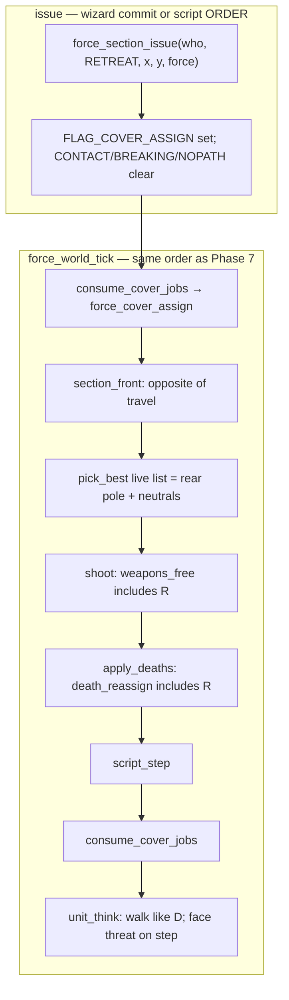
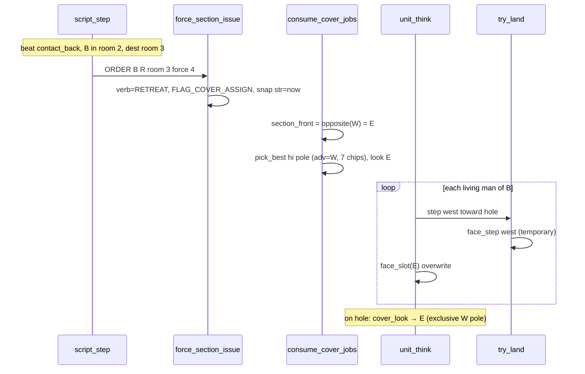

# Phase 7 follow-on — Retreat verb (`R`)

| Field | Value |
| --- | --- |
| Author | FORCE design session |
| Date | 2026-09-16 |
| Status | **Accepted** (index: **landed**) |
| Last worked on | 2026-09-16 |
| Repo path | [`design/phase-7-retreat.md`](phase-7-retreat.md) |
| Plan | [`development-plan.md`](development-plan.md) (Phase **numbers frozen**; this is not Phase 9 and not a new “Phase 7.5”) |
| Source | `src/sdl/game/world.h`, `src/sdl/game/world.c`, `src/sdl/game/command.c`, `src/sdl/generated/force_data.h`, `tools/gen_sdl.py`, `assets/scripts/farm.txt` |
| Intent | [`../doc/FORCE_02_Command_Language_and_UI.md`](../doc/FORCE_02_Command_Language_and_UI.md) (card R auto-WHERE is **out**), [`../doc/FORCE_07_Rooms_Cover_and_Farm.md`](../doc/FORCE_07_Rooms_Cover_and_Farm.md) |
| Binary as it is | [`../agents/game.md`](../agents/game.md), [`../agents/known-gaps.md`](../agents/known-gaps.md), [`../agents/assets.md`](../agents/assets.md) |
| Depends on | [`phase-7-mission-script.md`](phase-7-mission-script.md) (landed director), [`cover-advancing.md`](cover-advancing.md) (KD 2 R rule, never wired) |

Hold the Farm’s 3-act middle currently issues `order B D room 3 force 4`.
`D` derives cover front from travel toward WHERE, so the enemy **turns
around**, takes the **wrong pole**, and looks **west** — as if the player
were in the field. The fight is still to the east. That reads as “they
spun and ran” and breaks the farm vertical slice.

`R` already exists on the verb enum. Bind it now, with WHERE explicit,
same slots as `D`. Phase 9 (`S`/`J`, engineers, Town/Loop) is the wrong
bucket. Do not invent a renamed phase.

Index status is **landed**.

---

## Overview

`R` is almost like `D`: walk into a dest room and take cover there.
The difference is **directionality**:

- Walk **backwards** into the room.
- **Preserve facing** for where the enemy is (the threat they are
  falling back from).
- Enter the cover that still faces that threat — not the cover that
  faces the room they walked into.
- It must read as retreat, not “oh, they turned and ran.”

Farm line becomes `order B R room 3 force 4` instead of another `D`.

The enum, a `section_front` special-case, and the compiler’s “R is
unbound” reject are already in tree. None of them do the right thing
on farm. This follow-on binds the wizard and the cue sheet, walks `R`
like `D`/`A`, and replaces the stub front with **opposite of travel**.

No new TU. No malloc. No A*. Compiler caps unchanged. `--smoke` still
frame-0 patrol `A`. Force-break stays `HALT`.

---

## Background & Motivation

### Current runtime (Phase 7, landed)

`FORCE_VERB_RETREAT = 5` exists (`world.h` 60) with the comment
`R — not parsed yet`. Every execute path still treats it as “not a
cover-walk verb”:

| Site | `world.c` | What happens on `R` today |
| --- | ---: | --- |
| `section_front` | 678–680 | **Stub:** `return approach_front(axis, room_approach[dest])`. Not opposite-of-travel. |
| `unit_think` | 1282–1288 | `D`/`A` walk to a hole (else 3×3). `R` falls into `else` and **holds**. |
| Arrival `face_slot` | 1294–1304 | `D`/`A` only. |
| `dest_remains` | 1436–1443 | `M`/`A`/`D` only. Walking `R` would not pick up the mover cover-shift. |
| `weapons_free` | 1581–1587 | `A`/`D`/`H`/`K`. `R` is silent. |
| `death_reassign` | 1684–1706 | Player `A`/`D`/`H`/`K`; enemy `D` or `A`/`H`+`FLAG_CONTACT`. `R` missing both banks. |
| `force_section_issue` | 1866–1872 | `D`/`A` latch `FLAG_COVER_ASSIGN`; `M` releases. `R` latches **neither**. |
| `issue_script_order` | 2555–2559 | Clears assign for script `A` only. Dead until the compiler emits `R`. |
| `script_approach` | 2591–2596 | Re-latch on enemy `D` or `A`+CONTACT. |
| `spawn_job_pulse` | 2732–2737 | Same pair as approach. |
| `contact_start` | 2749 | Enemy `A` only. Correct to leave `R` out (assign at issue, like `D`). |

Wizard (`command.c` 36–53): `verb_from_letter` maps `A=0`, `M=12`,
`D=3`, `H=7`, `K=10`. Letter **17** (`R`) returns `FORCE_VERB_NONE` and
`accept_verb` flashes. `verb_name` has no `RETREAT` string.

Compiler (`tools/gen_sdl.py`): `SCRIPT_VERBS` is `A`/`D`/`M`/`H`
(83–88). `_parse_verb` (812–819) rejects `K` as the human edge and
`R` as unbound. `FORCE_VERB_RETREAT` is not even a Python constant.

Farm cue sheet (`assets/scripts/farm.txt` 28–30):

```text
beat contact_back:
  order B D room 3 force 4
  wait B.strength <= 2 -> contact_run
```

That is the line that turns them around.

### Farm numbers (work against these)

Rooms are **all `FORCE_AXIS_EW`**. Product language is west → east
**4-3-2-1**. Colour chips 1–4. C stores extract order (east first):

| i | colour | cells | product | lo (adv=E) | none | hi (adv=W) |
| ---: | ---: | --- | --- | ---: | ---: | ---: |
| 0 | 1 | x 21–39 | room **1** houses | 0 | 11 | 0 |
| 1 | 2 | x 13–20 | room **2** inner | 7 | 0 | 8 |
| 2 | 3 | x 6–12 | room **3** outer | 9 | 0 | 7 |
| 3 | 4 | x 0–5 | room **4** west | 0 | 0 | 4 |

Load `room_approach` (`world.c` 1937–1952): EW → `FORCE_APPROACH_W`.
The script writes `approach 1 W` only (houses). Rooms 2, 3, 4 keep
load WEST for the whole mission.

Wave 2 at `contact_back`: letter B (section 9) is in **room 2**
(index 1, x 13–20) after the room-2 `D`, strength ≤ 4, issued n was
8 then a new ORDER snapshots the live count. Dest is **room 3**
(index 2, x 6–12). They walk **west**, away from the player in the
houses (east).

### Why `D` is the wrong verb here

`section_front` for `D`/`A` (`world.c` 681–700): if the lead’s room
≠ dest, center-to-center of those rooms; else lead → WHERE; snap to
the dest axis; if no on-axis vector, `approach_front`.

Farm `D room 3` from room 2:

```
dest centre x = 6 + 7/2 = 9
here centre x = 13 + 8/2 = 17
dx = 9 − 17 = −8  → snap_axis(EW) = FACE_W
front = W
live advancing = opposite(W) = E  → lo pole, 9 chips
cover_look(exclusive E) = opposite(E) = W
```

They sit **east of the furniture looking west** — into the empty
field — as if the player were in room 4. The player is in the
houses. Wrong pole, wrong look.

`try_land` (`world.c` 397–410) always `face_step`s the land cell, so
even a later arrival `face_slot` cannot save the walk: every west
step paints a west-facing glyph. That is the “spun and ran” read.

### The stub would not save farm

```c
if (verb == FORCE_VERB_RETREAT) {
    return approach_front(axis, w->room_approach[dest_r]);
}
```

Dest room 3 is EW, `room_approach[2]` is still `FORCE_APPROACH_W`.
`approach_front(EW, WEST)` → `FORCE_FACE_W`. Same front `D` just
computed from travel. **The stub faces west on `R room 3`.** It is
the wrong rule. Do not ship it. `cover-advancing.md` KD 2 already
said the right thing and then “until `R` exists, do not call this.”

### What is already right

Directional `pick_best` (live pole + neutrals, ≤ 12). `cover_look`
derives exclusive-pole look as `opposite(advancing)` and soft-neutral
look as `section_front`. Script `D` assigns at issue; script `A`
assigns on contact-start. Force-break rewrites the verb to `HALT`
(`world.c` 1766–1771) and does **not** mean retreat. `force_section_issue`
is the one writer of last-order + str + BREAKING/CONTACT clear.
Wizard `commit` already routes through that function. No new command
object. No new BSS column.

### Pain

- Wave 2 fallback looks like a rout the wrong way. The 3-act farm
  is playable as a clock of spawns, not as a readable fight.
- `R` on the enum is a trap: a future caller that hits the stub
  gets west-facing cover on farm.
- FORCE_02 card R (“fall back one room toward last rally”, WHO
  only) is not what the farm line needs, and auto-WHERE is Phase 9.

---

## Goals & Non-Goals

### In (this follow-on, all PRs)

- Bind player wizard `R` (SHIFT+R) like `D`: WHO, WHERE, FORCE.
  Cover assign, walk to dest-room holes (else 3×3 around WHERE),
  weapons free.
- Bind script `order <letter> R <where> force <n>`. Farm
  `contact_back` becomes `order B R room 3 force 4`.
- `unit_think`: `R` walks like `D`/`A`.
- Cover live list: front is **not** travel-toward-WHERE. Front is
  **opposite of travel** (backing up). Live advancing = travel
  direction (the rear). Exact farm numbers below.
- Visual: while stepping on `R`, glyphs must **not** face the step.
  They keep looking at the threat (`section_front`). On arrival,
  same as `D`: `cover_look` / scout facing.
- `R` latches `FLAG_COVER_ASSIGN` at issue (wizard and script),
  like `D`, not like script `A`.
- Death reassign, weapons-free, `dest_remains`, spawn-pulse
  re-latch, and `script_approach` re-latch all include `R` the
  way they include `D`.
- Force-break stays `HALT`. Farm `R` at force 4 still HALTs at
  half of the new snapshot.
- `--smoke` unchanged: frame 0 is still patrol `A`, not `R`.
  Outcome PLAYING. Player eight unmoved.
- Compiler caps unchanged. No new TU. No malloc. No A*.
- Fold into `agents/game.md`, `known-gaps.md`, `testing.md`,
  `assets.md` on landing (closed-shape sentences listed in PR3,
  not only the unbound-verb line). `design/README.md` already has
  this row **active**; PR3 flips it to **landed**. Cite from
  `development-plan.md` Phase 7 as a follow-on; do not add a
  phase number.

### Out

| Later / never | Why |
| --- | --- |
| Auto “one room toward last rally” WHERE (FORCE_02 card, WHO only) | Player / script still supplies WHERE (cursor, typed cell, `room` / `cell` / `player` / `exit-*`). Phase 9 / later. |
| `S` / `J`, fog, camera, engineers, Town / Loop | Phase 8 / 9. |
| Changing `D`’s travel-derived front | `D` remains “face where you are going.” Farm hunker in room 2 stays `D`. |
| Storing a front byte on the section | `cover-advancing.md` already: recompute on assign. |
| Force-break meaning retreat | Phase 7 KD 6. The director issues `R`, then `M`. |
| Making `R` silent (`M`) or hold (`H`) | Weapons free, walk, cover. |
| Contact-start assign for script `R` | They are already in the fight. Assign at issue like `D`. |
| C64 emitter, `script.c`, mixer, `malloc`, A* | Unchanged / forbidden. |
| Bump compiler caps | Farm swaps one verb letter. Same op count. |

---

## Key Decisions

Locked in this conversation 2026-09-16. Do not reopen the product
call (implement now, WHERE-explicit, inverted front).

1. **This is a Phase 7 follow-on, not Phase 9 and not “Phase 7.5”.**
   Phase numbers and names are frozen (`development-plan.md`).
   Phase 9 is “More verbs and the other boards.” Farm-slice
   completeness is this file. Title stays “Phase 7 follow-on —
   Retreat verb.”

2. **`R` is `D` with inverted front.** Walk into the dest-room
   holes, weapons free, cover assign at issue. Front = opposite
   of the same travel vector `D`/`A` already compute. Live
   advancing = travel (the rear). That is `cover-advancing.md`
   KD 2: “Retreat toward the east → still E (front is still
   west).” Farm is the mirror: retreat toward the **west** →
   still **W** advancing (front is still **east**).

3. **WHERE is explicit this slice.** FORCE_02 card R (“fall back
   one room toward last rally”, WHO only) is **out**. Wizard
   slots are VERB WHO WHERE FORCE, same as `D`. Script WHERE
   kinds already exist (`ROOM` / `CELL` / `PLAYER` / `EXIT`).
   Farm uses `room 3`.

4. **The `section_front` stub is the wrong rule. Replace it.**
   `approach_front(axis, room_approach[dest])` on farm `R room 3`
   returns `FACE_W`. Correct front is `FACE_E`. Do not keep a
   verb special-case that returns the D-fallback.

5. **No-vector fallback is `opposite(approach_front)`, not
   `approach_front`.** `D`/`A` fall back to the wave bit (farm
   WEST = look west, player holding against an incoming west
   wave). `R` is backing up **from** the fight, so the same bit
   is the rear. Opposite of WEST is EAST. Matches farm when
   already in dest with `dx == 0` (lead on the same EW column
   as WHERE). Do not store a previous-front byte.

6. **`D` is unchanged.** Travel-derived front stays “face where
   you are going.” Wave 2 hunker remains `order B D room 2 force 5`.
   Only `contact_back` swaps to `R`.

7. **Glyphs face the threat while stepping, the hole on arrival.**
   `try_land` keeps calling `face_step` (verb-agnostic). `unit_think`
   overwrites with `face_slot(section_front)` after a portal cross
   **and** after a stepper step when the verb is `R`. Farm
   `contact_back` (room 2 → room 3) is an abutting front, not a
   painted portal (portals are `x=5` and `x=21`); that walk is
   the stepper path. The portal overwrite is for player/door `R`
   (houses gap at x=21). Wiring only the portal `return` passes a
   door test and fails the farm gate. Draw is after the whole
   tick, so there is no west-then-east flicker. Arrival uses
   `cover_look` / scout facing, same as `D`. Do not add a verb
   test inside `try_land`.

8. **Script `R` assigns at issue, like `D`.**
   `force_section_issue` latches `FLAG_COVER_ASSIGN`.
   `issue_script_order` must **not** clear it (that clear is
   script-`A` only, Phase 7 KD 13). `contact_start` stays `A`
   only. Pulse / `script_approach` re-latch `R` the way they
   re-latch `D`. Farm `contact_back` is after `job idle`, so
   pulse re-latch is belt-and-suspenders.

9. **Force-break stays `HALT`.** New ORDER at `contact_back`
   snapshots live strength (≤ 4) and force 4 (the 4–6 band).
   They HALT at half of that snapshot (`now <= snap >> 1`),
   which is the existing `wait B.strength <= 2 -> contact_run`
   beat. Do not make the nibble issue `R`.

10. **`--smoke` does not grow a retreat assertion.** Frame 0 is
    still patrol `A` in room 4, player verb NONE, outcome
    PLAYING. Interactive farm is the gate: wave 2 fallback
    looks east.

11. **No new TU, no new BSS, no cap bump.** A file-static
    `verb_takes_cover` (`D||A||R`) is allowed **only** at
    issue, think walk/arrival, and `dest_remains`. Pulse,
    `script_approach`, and `death_reassign` keep their own
    arms (copy-paste C in Proposed Design). Do **not** reuse
    `verb_takes_cover` there: that would re-latch script `A`
    without `FLAG_CONTACT` and drop player `H`/`K` reshuffle.
    `FORCE_SCRIPT_OPS_MAX` 64 stays. Farm op count does not
    change.

12. **Letter 17 is `R`.** `A=0` … `R=17`. Same SHIFT+letter
    path as `D`. No `input.c` change. Talky `RETREAT A AT
    10,20 FORCE 10` fits `FORCE_COLS` 40.

---

## Proposed Design

### Runtime data flow (unchanged tick; `R` rides existing flags)



Tick order is **not** reopened. `R` is another verb on the
existing consume / shoot / deaths / script / pulse / contact /
consume / step / despawn list.

### Sequence: farm `contact_back`



### `section_front` — correct `R` rule

Keep the `D`/`A` travel vector. Invert only the last step.

Travel (already landed, `world.c` 681–696):

- Dest room = region of `section_order_x/y`.
- Axis = `room_axis[dest]`.
- If living lead’s room ≠ dest: `dx,dy` = dest-room centre −
  lead-room centre.
- Else: `dx,dy` = WHERE − lead cell.
- `travel = snap_axis(axis, dx, dy)`.

Then:

| Verb | Front |
| --- | --- |
| `A` / `D` | `travel`, else `approach_front(axis, room_approach[dest])` |
| `R` | `opposite_face(travel)`, else `opposite_face(approach_front(...))` |
| other | unused (no assign) |

Replace the current early-return at 678–680. Do **not** return
`approach_front` for `R`. Suggested shape:

```c
    /* after computing travel into `front` the way A/D already do */
    if (front == FORCE_FACE_NONE) {
        front = approach_front(axis, w->room_approach[dest_r]);
    }
    if (verb == FORCE_VERB_RETREAT) {
        front = opposite_face(front);
    }
    return front;
```

That invert-after-fallback is equivalent to KD 5: no-vector `R`
is opposite of the `D` fallback. One `opposite_face` call. Axis
none / mask 0 still yields `FACE_NONE` (`opposite(NONE) = NONE`);
`pick_best` then walks the none block, same as today.

#### Farm worked example — `R room 3` from room 2

Rooms west → east 4-3-2-1, colour 1 houses.

```
west                         east
 room 4    room 3    room 2    room 1
 x 0-5     x 6-12    x 13-20   x 21-39
 colour 4  colour 3  colour 2  colour 1
           dest B    here B    player
           9 lo E    7 lo E    11 none
           7 hi W    8 hi W    (houses)
```

| | `D room 3` (today, wrong) | `R room 3` (this file) |
| --- | --- | --- |
| Travel | W (centre 9 − centre 17) | W (same vector) |
| Front | W | **E** (`opposite(W)`) |
| Live advancing | E (lo, 9 chips, x mostly 6) | **W** (hi, 7 chips, x 7 and 11) |
| `cover_look` | W | **E** |
| Glyph on the walk | west (`face_step`) | **east** (overwrite) |
| Reads as | spun, ran, looking at the field | backing up, still looking at the houses |

Room 3 hi pole (`force_data.c` cover rows 35–41): cells
`(11,1) (7,5) (11,5) (11,10) (7,14) (11,14) (11,18)` —
west-of-furniture, advancing W, look E. Four men, seven holes.
No prone leftovers from a short live list. The 2→3 hop is an
open front (no portal chip between x=12 and x=13); overwrite
runs after `stepper_step`, not `try_portal_cross`.

Already-in-dest (lead in room 3): WHERE is
`room_canonical_cell` = first cover chip `(6,1)` (lo pole).
If `lead_x > 6`, `dx < 0` → travel W → front E. If `lead_x == 6`,
`dx == 0` → fallback `opposite(approach_front(EW, WEST))` = E.
Both still east.

`D` from the west field into room 2 is unchanged: travel E,
front E, hi pole, look E. That hunker already faces the houses.
`R` **preserves** that axis instead of flipping it.

### Cover assign and issue flags

`force_section_issue` (`world.c` 1866–1872) today:

```c
    if (verb == FORCE_VERB_DEFEND || verb == FORCE_VERB_ATTACK) {
        f = (uint8_t)(f & (uint8_t)~FORCE_SECTION_FLAG_COVER_RELEASE);
        f = (uint8_t)(f | FORCE_SECTION_FLAG_COVER_ASSIGN);
    } else if (verb == FORCE_VERB_MOVE) {
        ...
    }
```

Add `FORCE_VERB_RETREAT` to the first arm. Wizard `commit` already
calls this function (`command.c` 315); no second latch in
`command.c`.

`verb_takes_cover` is **only** for issue, think walk/arrival, and
`dest_remains`. Those three sites are `D||A` today and become
`D||A||R`. Pulse, approach, and death_reassign are different
predicates today; adding `R` means copy-paste the existing arm
plus `RETREAT`, not this helper.

```c
static int verb_takes_cover(uint8_t verb)
{
    return verb == FORCE_VERB_DEFEND ||
           verb == FORCE_VERB_ATTACK ||
           verb == FORCE_VERB_RETREAT;
}
```

Pulse (`spawn_job_pulse` 2732–2737) and `script_approach`
(2591–2596) stay contact-gated on `A`. Treat `R` like `D`
(always re-latch; no CONTACT gate):

```c
        if (verb == FORCE_VERB_DEFEND ||
            verb == FORCE_VERB_RETREAT ||
            (verb == FORCE_VERB_ATTACK &&
             (f & FORCE_SECTION_FLAG_CONTACT) != 0u)) {
            w->section_flags[who] = (uint8_t)(
                f | FORCE_SECTION_FLAG_COVER_ASSIGN);
        }
```

`death_reassign` keeps player `H`/`K` and enemy `H+CONTACT`.
Add `R` next to `D` on both banks; do **not** un-gate enemy `A`:

```c
    if (who < FORCE_LETTER_MAX) {
        return verb == FORCE_VERB_ATTACK ||
               verb == FORCE_VERB_DEFEND ||
               verb == FORCE_VERB_RETREAT ||
               verb == FORCE_VERB_HALT   ||
               verb == FORCE_VERB_KILL;
    }
    if (verb == FORCE_VERB_DEFEND || verb == FORCE_VERB_RETREAT) {
        return 1;
    }
    if ((verb == FORCE_VERB_ATTACK || verb == FORCE_VERB_HALT) &&
        (w->section_flags[who] & FORCE_SECTION_FLAG_CONTACT) != 0u) {
        return 1;
    }
    return 0;
```

Do **not** put `R` in `contact_start` (still `ATTACK` only).
Do **not** have `issue_script_order` clear assign for `R`
(the `if (verb == FORCE_VERB_ATTACK)` clear stays `A`-only).

`force_section_issue` already clears `FLAG_CONTACT` on every
new order. A `contact_back` `R` therefore drops CONTACT. That
is fine: assign is immediate. Using `verb_takes_cover` in
pulse/approach would re-latch patrol `A` without CONTACT
(Phase 7 KD 13 house-steal). Using it in player death would
drop `H`/`K` reshuffle.

### `unit_think` / `dest_remains`

Walk branch: `verb_takes_cover` in the `D`/`A` arm (hole else
3×3). Arrival `face_slot` (`cover_look` / scout) in the same
arm. After `try_portal_cross` success **and** after
`stepper_step`, if verb is `RETREAT`:

```c
        face_slot(w, i, section_front(w, sec));
```

Farm `contact_back` never hits the portal arm: room 2 (x 13–20)
→ room 3 (x 6–12) is an open seam (inferred front). Painted
portals are `x=5` (room 4|3 barrier) and `x=21` (houses door).
The stepper overwrite is the farm gate; the portal overwrite
is player `SHIFT+R` through a door. Keep both. Overwrite even
if the step failed: a blocked man still faces the threat, not
a leftover `D` west-step from a previous think. `try_land` /
`face_step` stay verb-agnostic.

`dest_remains` uses the same walk dest so a moving `R` still
takes the +1 cover-shift (`cover_shifts` 1458–1459). On the
hole, `cover_look` is E, so incoming-from-east fire keeps the
grade-2 facing bonus.

### Weapons free / force-break

`weapons_free`: add `FORCE_VERB_RETREAT`. They shoot on the
way back. `M` stays silent.

`force_broken` is verb-agnostic (nibble vs snap vs now). On
trip it writes `HALT` + `FLAG_BREAKING`. Farm force 4 in the
4–6 band HALTs at half. No change to the nibble table.

### Wizard

`command.c` `verb_from_letter`: `letter == 17u` →
`FORCE_VERB_RETREAT`. `verb_name`: `"RETREAT"`. Slots follow
`D` (WHERE after WHO). `HALT` remains the only verb that skips
WHERE (`accept_who` 134–137, `commit` 274–284). Talky SHOW line
already prints `verb_name` + WHERE + FORCE; no new slot.

No `input.c` change. SHIFT+R is already a letter edge.

### Compiler

`tools/gen_sdl.py`:

```python
FORCE_VERB_RETREAT = 5

SCRIPT_VERBS = {
    "A": FORCE_VERB_ATTACK,
    "D": FORCE_VERB_DEFEND,
    "M": FORCE_VERB_MOVE,
    "H": FORCE_VERB_HALT,
    "R": FORCE_VERB_RETREAT,
}
```

`_parse_verb`: **delete** the `tok == "R"` unbound raise. Keep
the `tok == "K"` human-edge raise. Unknown letters still fail.

`order` packing is `verb | (force << 4)`. Verb 5 fits the low
nibble. No bytecode layout change. Caps unchanged.

### Farm cue sheet

`assets/scripts/farm.txt`, one token:

```text
beat contact_back:
  order B R room 3 force 4
  wait B.strength <= 2 -> contact_run
```

Patrol stays `order A A room 1 force 10`. Contact hunker stays
`order B D room 2 force 5`. Last stand stays `order C D room 3
force 10` (`D`, they arrived from the west field / spawn_room
and **are** facing where they are going). `--smoke` still decodes
patrol first; it never reaches `contact_back`.

### Memory

Zero new BSS bytes. Zero new ROM columns. Cover SoA still ≤ 128.
Next-hop still 256. Script op stream still 4 bytes × ≤ 64.

### 6502 filter

- No allocator, no extra section column, no stored front.
- Recompute `section_front` on assign (already) and on the `R`
  step overwrite (one `opposite_face` + `face_slot`).
- `pick_best` still scans ≤ 12 live chips, never 24.
- Scan 32 units, 16 sections. Same as every other verb.

---

## API / Interface Changes

### Wizard (player bank 0–7)

| | Before | After |
| --- | --- | --- |
| SHIFT+R | flash VERB (`FORCE_VERB_NONE`) | `RETREAT`, slot WHO |
| RETURN defaults | — | WHO = cursor / last; WHERE = cursor; FORCE = 10 |
| Last-order verb | — | `FORCE_VERB_RETREAT` |
| Cover | — | assign at issue, dest = room of WHERE |

### Script

```text
order <letter> R <where> force <0-10>
```

Same WHERE kinds as `D`. Compiler no longer errors
`R is unbound`. `K` still errors `K is the human edge`.

### Verb matrix (execute)

| Verb | Walk | Cover at issue | Weapons | Death reassign (player / enemy) | Step glyph |
| --- | --- | --- | --- | --- | --- |
| `M` | 3×3 | release | no | no / no | face step |
| `D` | hole else 3×3 | assign | yes | yes / yes | face step; hole look on arrival |
| `A` | hole else 3×3 | assign (script: on contact) | yes | yes / if CONTACT | face step; hole look on arrival |
| `H` | no | keep | yes | yes / if CONTACT | unchanged |
| `K` | no | keep (skip WHERE cell) | yes | yes / no | unchanged |
| **`R`** | **hole else 3×3** | **assign (script too)** | **yes** | **yes / yes** | **face `section_front`; hole look on arrival** |

---

## Data Model Changes

None. `enum force_verb` already has slot 5. Section last-order is
still four bytes + `section_order_str`. `cover_facing[]` still
stores advancing. No migration. Farm TMX is not restamped; room 3
already paints both poles.

`world.h` comment on the enumerant: drop “not parsed yet.”

---

## Alternatives Considered

### 1. Keep `D` and invert front when WHERE is behind the lead

Rejected. `D` means “face where you are going” (`cover-advancing.md`
selector, Phase 5 hold). Farm needs **both**: hunker into room 2
facing the houses (`D`, travel east) **and** fall back into room 3
still facing the houses (`R`, travel west). One verb cannot be
both without a hidden heuristic. Severity if we shipped it: every
later `D` onto a rearward cell would silently take the retreat
pole.

### 2. Ship the current `section_front` stub (`approach_front`)

Rejected. Verified against farm: dest room 3 is EW, approach WEST,
stub front = W, live lo pole, look west. Same bug as `D`. The stub
exists so `A` could land without rewriting `section_front`; it is
not a product rule. `cover-advancing.md` already specified
opposite-of-travel and said not to call the stub.

### 3. Auto-WHERE: one room toward last rally (FORCE_02 card)

Rejected **this slice**. That is WHO-only and needs a stored rally
room (FORCE_03 / FORCE_08). Farm already knows the dest (`room 3`).
Player still supplies WHERE. Phase 9 / later may add the card’s
auto-room; the execute path this file binds is the same 4-byte
object, so that sugar is a parser default, not a second mover.

### 4. `M` then `D` as two director beats

Rejected. `M` is silent, releases cover, and `face_step`s the walk.
The read is still “they turned and ran,” then a second order snaps
them onto a pole. Extra beat, extra `section_order_str` snapshot,
and force 4 would apply to the `M` not the hunker. One verb.

### 5. Store a front byte on the section at the previous `D`/`A`

Rejected. `cover-advancing.md` KD: recompute from the order; do not
store a front. A stale byte desyncs on relead / WHERE change /
approach rewrite. Opposite-of-travel is one `snap_axis` plus
`opposite_face`, already in the file.

---

## Threats / what not to do

This is an SDL prototype with no network and no secrets. Skip
security theatre.

- Do **not** invert `D`. Farm room-2 hunker is travel-east and
  already looks at the houses.
- Do **not** leave the `approach_front` early-return for `R`.
- Do **not** `face_step` the retreat walk without an overwrite.
  Correct pole + west-facing glyphs still reads as a rout.
- Do **not** dump this in Phase 9 or invent Phase 7.5.
- Do **not** bind FORCE_02 auto-rally WHERE.
- Do **not** make force-break issue `R`.
- Do **not** assign script `R` on contact-start (they would walk
  uncovered until a body entered room 3).
- Do **not** add `script.c`, a mixer, a C64 tree, `malloc`, or A*.
- Do **not** put `R` on frame 0 of farm; `--smoke` stays patrol `A`.
- Do **not** scan 24 cover chips or store a second live list.

---

## Observability

- `FORCE_TRACE=1` already logs `v%u` and `aim(dx,dy)` **before**
  portal/step (`world.c` 1307–1315). After this lands, wave 2
  fallback is `v5` with **west aim** (desired hop, travel). There
  is no `face_slot` / glyph line; do not grep TRACE for the
  overwrite. Facing is an interactive/glyph check (east while
  walking west). No new trace flag. Do not add a `face` field
  to the think log this slice.
- Row 21 talky: `RETREAT A AT x,y FORCE n` while drafting /
  SHOW. Outcome chrome (`HELD THE FARM` / `FARM LOST`) unchanged.
- `--smoke`: still one frame, exit 0, player on load cells,
  `script_outcome == PLAYING`. Do not assert enemy cells; they
  may first-step on patrol `A`.
- Interactive gate (required; smoke cannot type and cannot reach
  act 2):

  1. Hold the houses (`SHIFT+D`). Wave 1 walks in from room 4
     looking east, dies.
  2. Wave 2 hunkers in room 2, looking **east**.
  3. On `contact_back`, they walk **west** into room 3 **still
     looking east**, onto the hi pole (west-of-furniture). They
     do not take the x=6 lo-pole chips. They do not flash west
     glyphs mid-walk.
  4. Force 4 HALTs at half; then `M exit-west` (those glyphs
     **may** face west — that is a run, verb `M`).
  5. SHIFT+R on the player: parses, no VERB flash, talky
     `RETREAT`, walks to dest-room holes facing **opposite** of
     travel. SHIFT+D still faces travel.
  6. Esc/Q still quit. F3 still restarts at patrol.

---

## Rollout Plan

No feature flags. Land by PR (below), `cmake --build`,
`./build/src/sdl/force --smoke`, then interactive farm.

Rollback: revert the PR. Farm `contact_back` returning to `D`
restores the current (wrong) fallback; the rest of the 3-act
script does not depend on `R`. Wizard `R` returning to flash is
the Phase 7 binary.

`development-plan.md` Phase 7 paragraph gains a cite of this
file as a follow-on. Do not add a phase row. `design/README.md`
already lists this row **active** (same change set as this
draft). PR3 flips it to **landed**.

---

## Risks

| Risk | Sev | Mitigation |
| --- | --- | --- |
| Stub `approach_front` left in place | **High** | KD 4. Review: `rg 'FORCE_VERB_RETREAT' src/sdl/game/world.c` shows invert-after-fallback, not an early `return approach_front`. Interactive: room-3 fallback looks east. |
| `face_step` on the west walk without overwrite | **High** | KD 7. Overwrite after portal cross **and** after `stepper_step`. Review: no `verb == RETREAT` inside `try_land`. Interactive: no west glyphs while backing up. |
| `unit_think` still holds (`else` branch) | **High** | `verb_takes_cover` in the walk arm. Review: `R` is not in the `NONE / HALT / K` comment. |
| `FLAG_COVER_ASSIGN` not latched | **High** | Issue arm includes `R`. Script `A` clear stays `A`-only. Review: `rg` the issue `if` and `issue_script_order`. |
| Death / pulse / approach miss `R` | **Med** | Copy-paste arms in Proposed Design, not `verb_takes_cover`. Enemy `R` reassigns without CONTACT (CONTACT was just cleared). Pulse/approach stay `D\|\|R\|\|(A && CONTACT)`. Player death keeps `H`/`K`. |
| `weapons_free` miss → silent fallback | **Med** | Add `R`. Interactive: they still shoot walking west. |
| `dest_remains` miss → walking men get full cover bonus | **Low** | Same walk dest as think. |
| Compiler still rejects `R`; farm.txt fails the build | **High** | PR2 before farm.txt, or same PR as the grammar. Review: `_parse_verb` has no `R is unbound`. |
| `--smoke` reaches `R` or changes frame 0 | **Med** | Patrol is still `A`. Smoke never waits to `contact_back`. |
| Player SHIFT+R from the houses into the lane (WHERE west) looks **east** | **Low** | Travel W → front E is the rule, not a farm special-case. That order is “back into the lane still facing the houses,” which is a weird WHERE if the threat is the west-incoming wave. Usual player retreat on farm is WHERE **east** of them (cover-advancing KD 2: retreat east, front still west). If they meant “go west and face the wave,” that is `D`. Do not add a player-bank exception. |
| Last stand accidentally becomes `R` | **Low** | `order C D room 3 force 10` stays. They spawn in spawn_room (west) and hunker facing travel (east). |
| Talky `RETREAT A AT 10,20 FORCE 10` overflows row 21 | **Low** | 27 chars; `FORCE_COLS` 40. |

Review checklist:

1. `section_front`: `R` is `opposite_face` of the `A`/`D` result
   (including the `approach_front` fallback). No early
   `return approach_front` for `RETREAT`.
2. `unit_think` / `dest_remains` walk `R` like `D`/`A`.
3. After portal cross **and** after `stepper_step`, `R` calls
   `face_slot(section_front)`. Farm 2→3 is the stepper path
   (abutting front). Arrival uses `cover_look`.
4. `force_section_issue` latches assign on `R`. Script `A`
   still clears it. `contact_start` still `A` only.
5. `weapons_free` adds `R` (still `A`/`D`/`H`/`K` plus `R`).
   Pulse / `script_approach`: `DEFEND || RETREAT || (ATTACK &&
   CONTACT)` — not `verb_takes_cover`. Player death: existing
   `A`/`D`/`H`/`K` plus `RETREAT`. Enemy death: `DEFEND ||
   RETREAT || ((ATTACK || HALT) && CONTACT)`.
6. `verb_from_letter(17) == FORCE_VERB_RETREAT`. `verb_name`
   is `RETREAT`. WHERE slots like `D`, not like `H`.
7. `SCRIPT_VERBS` has `R`. `_parse_verb` rejects `K`, not `R`.
8. `farm.txt` `contact_back` is `order B R room 3 force 4`.
   Patrol is still `A`. Last stand is still `D`.
9. `--smoke` exit 0, PLAYING, player unmoved. No new TU.
10. `agents/` handoff on the last PR. Closed-shape sentences in
    PR3 (glyphs except `R`, wizard parses `R`, assign on
    `D`/`A`/`R`, enemy death `D`/`R` or CONTACT), not only the
    unbound list.

---

## Open Questions

None that block implementation. Product call is made: bind `R`
now, WHERE-explicit, opposite-of-travel front.

Follow-on, not a gate:

- FORCE_02 auto-WHERE (“one room toward last rally”) when a
  rally room exists. Parser sugar on top of this 4-byte object.
- Outcome chrome strings on `force_script` (already parked in
  Phase 7).
- Optional `verb_takes_cover` name; any file-static equivalent
  is fine at issue / think / `dest_remains` only. Pulse,
  approach, and death_reassign stay separate arms.

Do not silently pick a third rule (approach bit as front **and**
opposite-of-travel, or a stored front byte **and** a recompute).

---

## References

- [`development-plan.md`](development-plan.md) — Phase numbers frozen; Phase 7 Hold the Farm; Phase 9 is the other verbs / boards
- [`phase-7-mission-script.md`](phase-7-mission-script.md) — director, farm 3-act, `R` listed as unbound (this file supersedes that reject)
- [`cover-advancing.md`](cover-advancing.md) — KD 2 R rule; `section_front` helper; live `[lo\|none\|hi]`
- [`phase-5-cover-and-d.md`](phase-5-cover-and-d.md) — `FLAG_COVER_ASSIGN`, dest = room of WHERE
- [`phase-6-combat.md`](phase-6-combat.md) — `weapons_free`, force-break to `HALT`, `FORCE_VERB_RETREAT = 5` slot
- [`../doc/FORCE_02_Command_Language_and_UI.md`](../doc/FORCE_02_Command_Language_and_UI.md) — card R auto-rally WHERE is out of this slice
- [`../doc/FORCE_07_Rooms_Cover_and_Farm.md`](../doc/FORCE_07_Rooms_Cover_and_Farm.md) — approach bits, farm rooms
- [`../agents/game.md`](../agents/game.md) — `A`/`D` walk; `R` not mentioned as bound
- [`../agents/known-gaps.md`](../agents/known-gaps.md) — `R` unbound
- [`../agents/assets.md`](../agents/assets.md) — cue-sheet verbs
- `src/sdl/game/world.h` — `FORCE_VERB_RETREAT = 5`
- `src/sdl/game/world.c` — `section_front` 657–701 (stub 678–680), `unit_think` 1271–1334, `try_land`/`face_step` 365–410, `force_section_issue` 1848–1874, `weapons_free` 1581–1587, `death_reassign` 1684–1706
- `src/sdl/game/command.c` — `verb_from_letter` 36–53
- `tools/gen_sdl.py` — `SCRIPT_VERBS` 83–88, `_parse_verb` 812–819
- `assets/scripts/farm.txt` — `contact_back` 28–30
- `src/sdl/generated/force_data.c` — farm rooms / cover lo-none-hi 1338–1357, cover cells 1363–1369

---

## PR Plan

Independently reviewable. **Three PRs, same follow-on.** Do not
invent a C64 tree. Do not add `script.c`. Do not bind `S`/`J`/`Z`.
Do not change `D`’s front. Do not put `R` on farm until PR2 (PR1
is wizard-testable without touching the 3-act sheet).

### PR1 — Retreat runtime and wizard

- **Title:** Bind `R`: opposite-of-travel front, walk like `D`, SHIFT+R
- **Files:** `src/sdl/game/world.h` (comment on the enumerant),
  `src/sdl/game/world.c` (`section_front`, `verb_takes_cover`,
  `unit_think`, `dest_remains`, `weapons_free`, `death_reassign`,
  `force_section_issue`, `script_approach`, `spawn_job_pulse`,
  step-glyph overwrite), `src/sdl/game/command.c`
  (`verb_from_letter` letter 17, `verb_name` `"RETREAT"`)
- **Depends on:** none (Phase 7 already landed)
- **Does not:** touch `farm.txt`, `gen_sdl.py`, `agents/`.
  Script `R` still fails the compile; farm still issues `D` on
  `contact_back` (still the wrong fallback until PR2).
- **Description:** Wizard SHIFT+R is a real order: WHO WHERE FORCE,
  cover assign, walk to dest-room holes, weapons free, death
  reshuffle. `section_front` inverts travel (and inverts the
  `approach_front` fallback). Glyphs face `section_front` while
  stepping (overwrite after portal **and** after `stepper_step`;
  farm 2→3 is the stepper path), `cover_look` on arrival.
  `try_land` stays verb-agnostic. `verb_takes_cover` is issue /
  think / `dest_remains` only; pulse, approach, and death_reassign
  use the copy-paste arms in Proposed Design. `--smoke` unchanged
  (nobody issues `R`).
- **Gate:** `--smoke` exit 0, PLAYING, player unmoved. Interactive:
  SHIFT+R no VERB flash; they walk; they look opposite of travel;
  SHIFT+D still looks along travel. `rg` fences in Risks 1–6.

### PR2 — Compiler bind and farm `contact_back`

- **Title:** Script `R` and Hold the Farm fallback
- **Files:** `tools/gen_sdl.py` (`FORCE_VERB_RETREAT`, `SCRIPT_VERBS`,
  `_parse_verb`), `assets/scripts/farm.txt` (`order B R room 3 force 4`)
- **Depends on:** PR1 (runtime must walk and invert before the
  director issues `R`, or wave 2 holds in room 2 looking the
  right way but never leaves)
- **Does not:** bind `K` for scripts; does not change patrol / last
  stand; does not bump caps.
- **Description:** Cue sheet may `order … R …`. Farm act-2 fallback
  uses it. Rebuild regenerates bytecode (same op count, verb nibble
  5 instead of 2 on that ORDER). `_parse_verb("R")` no longer
  raises `R is unbound`. `K` still the human edge.
- **Gate:** `cmake --build` succeeds with the new `farm.txt`.
  `--smoke` still patrol `A`, PLAYING. Interactive 3-act: wave 2
  backs into room 3 looking **east**, hi pole, then `M exit-west`.
  Last stand still `D` looking east.

### PR3 — Handoff

- **Title:** Agents and plan: `R` is in, farm fallback is retreat
- **Files:** `agents/game.md`, `agents/known-gaps.md`,
  `agents/testing.md`, `agents/assets.md`, `assets/README.md`
  (script verb table), `README.md` (command table: `R` **In**,
  WHERE-explicit one-liner), `design/README.md` (this row
  active → landed), `design/development-plan.md` (Phase 7
  paragraph cites this follow-on; **no new phase number**)
- **Depends on:** PR2
- **Does not:** rewrite FORCE_02 (card auto-WHERE stays later);
  does not claim Phase 9 verbs.
- **Description:** Binary-as-it-is matches source. Replace these
  closed-shape sentences (an unbound-list-only edit leaves
  `agents/` lying):

  - `known-gaps.md` 12: unbound `J S R F Z B C E` → `J S F Z B C E`.
  - `known-gaps.md` 67: “Glyphs face last step (8-way) / cover
    (cardinal).” → last step **except `R` overwrites to
    `section_front` before draw**; arrival still cover (cardinal).
  - `known-gaps.md` 73–75: “Assign on D/A-commit flag… `R` exists
    on the enum; wizard does not parse it.” → assign on
    `D`/`A`/`R`-commit; wizard parses `R`.
  - `known-gaps.md` 82: “Enemy death reassigns on `D` or
    `FLAG_CONTACT`.” → on `D`/`R` or `FLAG_CONTACT`.
  - `game.md` 13–26 / 97–103: parse `M`/`D`/`H`/`A`/`K`/`R`;
    `R` walks like `D` (hole else 3×3), weapons free; glyphs
    face last step except `R` (threat / `section_front`).
  - `game.md` 33–34: Wave 2 “fall back to room 3” → `R room 3`
    force 4, west walk, **east** glyphs, hi pole (not x=6).
  - `testing.md` 59: stepper “Glyphs turn with the step” stays
    true for `M`/`D`/`A`; add `R` overwrites to front.
  - `testing.md` 60 Combat: wave 2 fallback looks **east**, hi
    pole, not x=6 lo chips; SHIFT+R parses (no VERB flash).
  - `testing.md` 61 Cover: “EW room, retreat east → face E” is
    a **soft-neutral walk / `D` travel** example. Verb `R`
    faces **opposite** of travel (retreat east → front still
    west). Do not leave that sentence as a description of `R`.
  - `agents/assets.md` / `assets/README.md` 590: `order` verbs
    `A` `D` `M` `H` **`R`**. `K` still rejected.
  - `README.md` command table: `R` **In**, WHERE-explicit.
  - `design/README.md`: this row **active → landed**.
  - `design/development-plan.md`: Phase 7 paragraph cites this
    follow-on; still ten phases.

- **Gate:** Same smoke + interactive as PR2. `rg 'R is unbound'`
  empty under `tools/` and `agents/`. `rg 'wizard does not parse'`
  empty. `design/README.md` this row **landed**.
