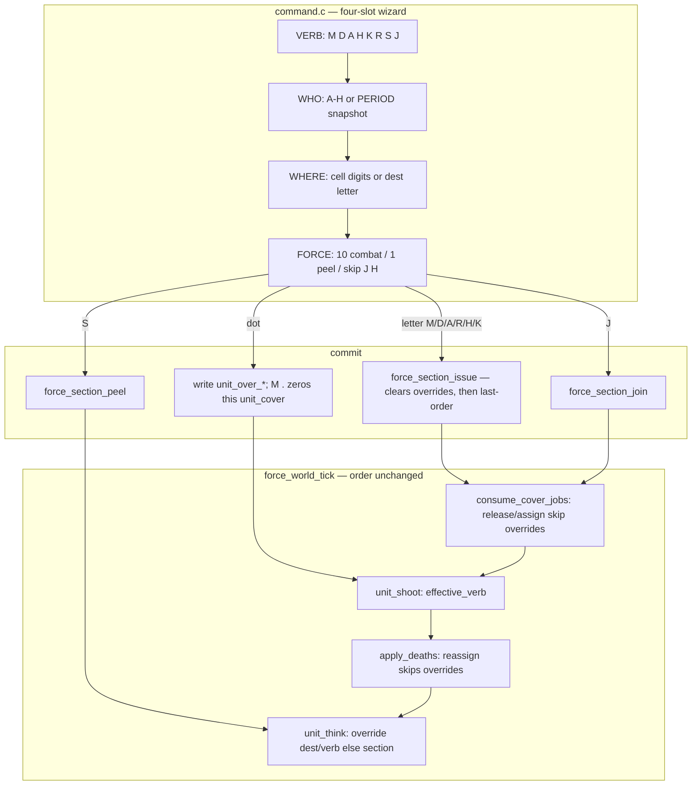

# Phase 9 slice — `S` / `J` and remaining combat-admin verbs (`M` rewrite, `.` nudge)

| Field | Value |
| --- | --- |
| Author | FORCE design session |
| Date | 2026-09-17 |
| Status | **Accepted** (index: **landed**) |
| Last worked on | 2026-09-17 |
| Repo path | [`design/phase-9-s-j-nudge.md`](phase-9-s-j-nudge.md) (intended once copied into the tree) |
| Plan | [`development-plan.md`](development-plan.md) (Phase **numbers and names frozen**) |
| Source | `src/sdl/game/command.c`, `src/sdl/game/command.h`, `src/sdl/game/game.h`, `src/sdl/game/world.h`, `src/sdl/game/world.c`, `src/sdl/sdl/input.c`, `src/sdl/core/types.h` |
| Intent | [`../doc/FORCE_02_Command_Language_and_UI.md`](../doc/FORCE_02_Command_Language_and_UI.md), [`../doc/FORCE_08_Units_Sections_and_Tick.md`](../doc/FORCE_08_Units_Sections_and_Tick.md), [`../doc/FORCE_05_Command_Card.md`](../doc/FORCE_05_Command_Card.md) |
| Binary as it is | [`../agents/game.md`](../agents/game.md), [`../agents/known-gaps.md`](../agents/known-gaps.md), [`../agents/testing.md`](../agents/testing.md), [`../agents/input.md`](../agents/input.md) |
| Depends on | [`phase-7-mission-script.md`](phase-7-mission-script.md) (landed), [`phase-7-retreat.md`](phase-7-retreat.md) (landed `R`) |

Hold the Farm is playable (Phase 7 landed) but the player cannot **place men**. `D`/`A`/`R` FCFS cover hides a man in a rear hole. `S`/`J` are unbound. `M` at equal speed is silent cannon fodder: strictly dominated by `A` in any LOS (shooting does not slow you). Fog/camera (Phase 8) would hide the placement problem.

This file is a **slice of Phase 9** (S/J and remaining combat-admin verbs) executed **before Phase 8** (Intel and camera). Do **not** rename Phase 8 or 9. Do **not** invent “Phase 7.5”.

**Execution order:** Phase 7 (landed, including `R`) → **this slice** → Phase 8 → rest of Phase 9 (engineers, Town/Loop, type-join `J I`, remaining card).


Index status is **landed**. Behaviour is in `src/`.

---

## Overview

The player needs three placement tools that the current binary does not have, plus a `M` that is worth typing:

1. **Split (`S`)** — peel THE cursor man (or N men of a named letter) into a dest **letter**. He is his own letter; A’s next `D` does not move him.
2. **Join (`J`)** — letter join only (`J B A`). B’s living units take A’s last order, walk to A’s job, B goes empty. No `J I A,C` type-join / reinforcements this cut.
3. **This stack (`.`)** — WHO is period: snapshot the unit under the cursor, stay in letter, write a **per-unit dest override**. Legal on `M` `D` `A` `H` `K` `R`. Not on `S`/`J`. Next standing letter-wide commit to that letter clears overrides.
4. **`M` rewrite** — sprint (`move_wait` 4 vs 7), silent **only while walking**, occupy-if-chip on arrival, last order stays `MOVE`. Arrived movers smear. A follow-up `D` after `M` onto a wall chip is superfluous.

Slot order never changes: **VERB WHO WHERE FORCE**. Keyboard: SHIFT+letter talks. Unshifted WASD/arrows move the cursor. Unshifted `.` is a WHO token (not a cursor step).

6502 filter holds: fixed arrays, integer ids, no malloc, scan 32 units / 16 sections, no map scan. `--smoke` still exits 0 after one frame. Interactive Hold the Farm is the placement test.

---

## Background & Motivation

### Current runtime (Phase 7 + `R`, landed)

Hold the Farm plays. Eight blue soldiers at the gate are letter A. The player’s only combat verbs are letter-wide. `known-gaps.md` still lists `S`/`J` unbound and “no peel/join.”

| Site | File | What happens today |
| --- | --- | --- |
| Wizard verbs | `command.c` 36–56 | `verb_from_letter`: A=0, M=12, D=3, H=7, K=10, R=17. **S=18 and J=9 return `FORCE_VERB_NONE`** and `accept_verb` flashes. |
| WHO | `command.c` 132–144, 256–330 | Letter 0–7 only. RETURN with empty WHO falls back to `force_command_implied_who` then `cmd_last_who`. **No period. Cursor man is never a WHO.** |
| `enum force_verb` | `world.h` 54–62 | `NONE=0, MOVE=1, DEFEND=2, HALT=3, ATTACK=4, RETREAT=5, KILL=6`. No SPLIT/JOIN. |
| `enum force_cmd_kind` | `types.h` 57–65 | NONE, LETTER, DIGIT, COMMA, SPACE, RETURN, DEL. **No PERIOD.** |
| Input | `input.c` 167–230 | Misc bits: RETURN, DEL, COMMA, SPACE, then digits, then A–Z if `stick_latched \|\| shift`. Period scancode is ignored. Unshifted WASD is cursor (`input.c` 82–95). |
| `M` walk dest | `world.c` `move_dest` 1248–1294 | 3×3 rank around `section_order_x/y`. Fill C, N, S, W, E, NW, SE, NE, SW. |
| `M` issue | `world.c` `force_section_issue` 1988–2014 | `FLAG_COVER_RELEASE` (not assign). |
| `M` think | `world.c` `unit_think` 1410–1418 | MOVE → `move_dest`. At dest, return without claiming a chip. |
| `M` shoot | `world.c` `weapons_free` 1719–1726 | `A`/`D`/`R`/`H`/`K` only. **MOVE is silent for the whole order**, walking and arrived. |
| `move_wait` | `world.h` 21, `world.c` `stepper_step` 538 / 561 / 576 / 617 | Every successful step reloads `FORCE_MOVE_WAIT_DEFAULT` **7**. Terrain ignored. Same cadence as `A`/`D`/`R`. |
| Cover FCFS | `world.c` `force_cover_assign` 989–1028 | Releases the letter, then `pick_best` for every living non-emplacement unit of that letter. **No per-unit skip.** |
| Death reassign | `world.c` `death_reassign` 1823–1846, `apply_deaths` 1865–1914 | Player `A`/`D`/`R`/`H`/`K` latch `FLAG_COVER_ASSIGN`. Same full-letter `pick_best`. |
| Draft object | `game.h` 16–36 | `cmd_verb`, `cmd_who` (0–7 or `FORCE_UNIT_NONE`), `cmd_x/y`, `cmd_force`. No unit snapshot. |
| Unit SoA | `world.h` 117–157 | No override columns. `unit_fx` high nibble is reserved for muzzle (`FORCE_FX_MUZZLE`). |

`force_command_implied_who` (`command.c` 82–102) already walks 32 and returns the **section** of the first player-bank body on the cursor cell. The cursor names a stack; the wizard throws that information away except as WHO-default for a letter-wide commit.

### Pain

- **`D` dumps a man in a house.** Live advancing list + FCFS (`pick_best` 873–973) fills rear-pole and neutrals first. A wall/window chip the player can see is not a named dest. There is no “this man, that cell.”
- **`S`/`J` unbound.** The scout flourish in FORCE_02 / FORCE_08 is a poster. Empty letters B–H stay grey. You cannot detach the hidden man into B and order him.
- **`M` is strictly worse than `A` in LOS.** Same `move_wait` 7, same +1 LSR while walking (`cover_shifts` 1594–1597), no return fire, no dest holes, never claims a chip on arrival. User test fails: `M` to a wall chip arrives in the open, silent, needing a superfluous `D`.
- **Phase 8 first would hide this.** Fog and a camera window make “which hole did FCFS pick?” unreadable. Placement must work on the one-screen farm **before** intel.

### Farm placement test (work against this)

1. `D` the houses. FCFS hides at least one man in a rear hole.
2. Point at him. Either `S B` (he becomes B) then `M B` / `D B` onto a wall chip, **or** `M .` / `D .` onto that chip without leaving A.
3. He must arrive **in cover and fighting**. A follow-up letter `D` is not required for the wall chip.
4. Later `D A` (letter-wide) recalls a nudged man into FCFS. That is the standing line.

`--smoke` never types. Frame 0 stays patrol `A`, player unmoved, outcome PLAYING, exit 0.

---

## Goals & Non-Goals

### In (this slice, all PRs)

- Player can peel THE pointed man (`S`), join letters (`J B A` only), nudge a pointed man (`.` WHO), and sprint-move that fights at dest and takes a named chip.
- Hold the Farm placement test above.
- `M` sprint: `FORCE_MOVE_WAIT_SPRINT 4u`. Silent only while `dest_remains`. Occupy-if-chip on arrival. Last order stays `MOVE`. Enemy `M` (exit despawn) uses the same reload — they leave faster. Fine.
- `.` WHO for `M` `D` `A` `H` `K` `R`. Snapshot unit index when `.` is accepted. RETURN WHERE uses the cursor cell **at commit** (cursor may move after the tag). `H .` skips WHERE.
- Per-unit override SoA. Letter-wide `M`/`D`/`A`/`R`/`H`/`K` issue **clears overrides first**, then normal issue. Cover **release**, assign, and death reassign **skip** live-override units (`unit_cover` stays claimed). `M .` commit zeros **that** unit’s `unit_cover` only.
- `--smoke` still 0. No new TU required (wizard / world / input / types only). No malloc. No A*. Compiler caps unchanged. Script does **not** gain `S`/`J` this cut; farm cue sheet unchanged.
- Fold into `agents/` and the command-language `doc/` files listed under Handoff when each PR lands.

### Out

| Later / never | Why |
| --- | --- |
| Fog, overview `Z`, `C`/`E`, camera `F`/`B` | Phase 8. This slice is why 8 waits. |
| Type-join `J I A,C` / reinforcements | Rest of Phase 9. This cut is **letter join only**. |
| Stick mapping for `.` | Keyboard `.` this cut. Pad has no period glyph; do not block the design on a face button. |
| Slowing `A`/`D` instead of speeding `M` | Retimes every farm wave. Sprint rebate is the `M` identity. |
| Per-private click as the **normal** WHO | FORCE_01. `.` is the exception; default WHO stays the letter. |
| Stacks as N>1 beyond peeling N **count=1** units | Infantry is still occupancy 1. Peel count 3 means three pool records, not a stacked cell. |
| Engineers, mines, Town / Loop, doctrine `D *` | Rest of Phase 9. |
| Making `M` weapons-free **always** | Then it is `A` without holes; sprint-past dies. |
| Executing Phase 8 first | Fog hides placement. |
| WHO = digit `1` as unit id | Digits are WHERE/FORCE. `.` is “this.” |
| C64 emitter, `script.c`, mixer, `malloc`, A* | Unchanged / forbidden. |

---

## Key Decisions

Locked in this conversation 2026-09-17. Do not reopen the product call (execute this Phase 9 slice before Phase 8; bind `S`/`J`/`.`/`M` rewrite as specified).

1. **This is a Phase 9 slice, executed before Phase 8. Not “Phase 7.5.”**
   Phase numbers and names are frozen (`development-plan.md`). Phase 8 stays “Intel and camera.” Phase 9 stays “More verbs and the other boards.” Title stays “Phase 9 slice — S/J and remaining combat-admin verbs.” Plan text notes execution order 7 → this slice → 8 → rest of 9.

2. **Slot order never changes: VERB WHO WHERE FORCE.**
   `S`/`J` WHERE is a **letter**, not a cell (reuse `cmd_x` as dest-letter, `0xFF` unset). `S` FORCE is peel count, default **1** not 10. `J` skips FORCE. `H` and `H .` skip WHERE. Combat `.` still has WHERE (cursor at commit) except halt.

3. **`S B` RETURN peels THE cursor man into B. Not last-who.**
   Cursor on a man → that unit becomes B (B empty → section of one). Cursor not on a man → **beep**, do not fall back to `cmd_last_who`. `S A B` names source A: cursor on an A man peels him; cursor on a C man beeps; cursor not on a man peels A’s **lead**, then pool scan. Peel count 3: cursor A-man first, then more of A until 3. Dest illegal / same-letter / source last-order is `K` → beep.

4. **Peel rewrites `unit_section`. Do not copy source last-order onto dest.**
   Lead succession on source (`force_section_relead`). Cover release for the peeled unit only (`unit_cover = $FF`). Drop his override. If dest was empty, he is lead. A letter that has never existed this mission (`FORCE_VERB_NONE`) is a peel **target**, not a join dest. Empty letters keep last order + last lead cell. A’s next `D` does not move him.

5. **`J` this cut is letter join only (`J B A`). No `J I A,C`.**
   B’s living units take A’s last order, walk to A’s job (FORCE_08: last-order room else lead room else last lead cell), then run last order. `D` includes them in the cover roster (latch `FLAG_COVER_ASSIGN` on dest if `verb_takes_cover`). Join clears B’s overrides. B goes empty (roster grey). A’s lead stays A’s unless A was empty, then B’s lead becomes A’s. Join dest must have men **or** a last order; never-used letter beeps. Do **not** path-to-NCO. Do **not** copy WHERE onto every unit.

6. **`.` is WHO for combat verbs, not a new verb. It does not write `section_order_*`.**
   Add `FORCE_CMD_PERIOD`. Snapshot the **unit index** when `.` is accepted in WHO (man must be under the cursor **at that keystroke**; do not latch last-sat-on as a fallback). You may then move the cursor; RETURN WHERE uses the new cell. Player bank 0–7 only; enemy body → beep. Dead at commit → beep. Chrome: WHO paints `.`; roster still yellows his letter. Not legal on `S`/`J`.

7. **Per-verb `.` dest is a per-unit override.**
   - `M .` WHERE cell: override MOVE to that **cell**. Sprint. Silent while `dest_remains`. **At commit:** `unit_cover[i] = FORCE_UNIT_NONE` for that unit only (per-unit analog of letter `M` release — leave the FCFS rear hole). Do **not** letter-release. On arrival: weapons free; if cell is a **free** cover/scout chip, claim it (`occupy_if_chip`); else prone `$FF`. Do not `pick_best`. Do not seek a better hole.
   - `D .` / `A .` / `R .`: if WHERE **is** a cover/scout chip, named chip is legal **even if wrong-pole** (player pointed). Claim it, dest = that cell. If WHERE is **not** a chip: `pick_best` for **this unit only** in the **room of WHERE** (dirt is a room hint, not a waypoint). Weapons free the whole time. `R .` front still opposite of travel.
   - `H .`: no WHERE. That unit stops (`dest_remains` false / override dest = current cell, verb HALT). Rest of letter unchanged.
   - `K .` WHERE cell: that **one rifle** uses K rules on WHERE (body+LOS → that cell; else smear). He does not step. He keeps his current hole. Section K 3-of-4 is **unchanged** for the rest of the letter; this man is not “the section concentrating.”

8. **Letter-wide issue clears overrides first, then normal issue.**
   `force_section_issue` for `M`/`D`/`A`/`R`/`H`/`K` walks 32, zeroes `unit_over_verb` for that letter, then writes last-order / flags as today. So `D A` after a wall nudge **does** recall him into FCFS. Individual `.` does **not** clear the others’ overrides. Peel drops the peeled unit’s override. Join: B’s units lose override, take A’s last order.

9. **Cover release, assign, and death reassign skip live-override units.**
   Today `force_cover_assign` (`world.c` 989–1028) always `force_cover_release(who)` then `pick_best` every living non-emplacement unit. Skipping only the pick walk still zeros the nudged man’s `unit_cover` in the pre-pass, so death/join FCFS strips the wall claim and `cover_taken` hands the chip to someone else. **`force_cover_release` must skip `unit_over_verb[i] != NONE`**, same as the pick walk. After skip-release, `cover_taken` keeps the wall chip out of other men’s `pick_best`. Letter `M` still full-releases because KD 8 clears overrides **before** flags. Death reassign and join dest ASSIGN do **not** clear overrides, so the skip-release is what keeps the claim. `section_front` ignores override units (including a nudged lead): front from section WHERE, not the nudged man. Join dest stays last-order room, not chase the nudged lead. Lead nudge is still allowed.

10. **`M` is a sprint that fights at dest and occupies a chip underfoot.**
    (a) When effective verb is MOVE, `move_wait` reloads **4** (`FORCE_MOVE_WAIT_SPRINT`). Terrain still ignored. (b) `weapons_free` for MOVE is true iff `!dest_remains(unit)`. Arrived movers smear. Last order **stays MOVE** (do not rewrite to HALT). (c) On MOVE arrival (section rank cell or `.` cell), if that cell equals a free cover or scout chip, claim it. Do not run `pick_best`. Rank fillers only get cover if **their** rank cell is a chip. Lead takes WHERE; if WHERE is a chip, lead claims it. (d) Letter `M` still **release cover at issue** (`FLAG_COVER_RELEASE`). `M .` does not `force_section_issue`; it zeros **that** unit’s `unit_cover` at commit so `occupy_if_chip` is not a no-op on a leftover rear hole. Still dest = 3×3 rank for letter `M`. Still no hunt while walking.

11. **Named chip on `D .`/`A .`/`R .` is legal even if wrong-pole.**
    Player pointed. Live-list rules apply only to the dirt-room `pick_best` fallback. If the named chip is taken by another living unit’s `unit_cover`, beep (D/A/R `.`). `M .` still dests that cell; occupy-if-chip on arrival no-ops if taken.

12. **K-budget peel is simple: do not peel a unit whose section last-order is `K`.**
    Fine for this cut. Do not parse 3-of-4 membership.

13. **Stick `.` is keyboard-only this cut.**
    Spec keyboard `.`. If the pad has no period, the player uses letters (or the keyboard period, which still emits in stick play). Do not map a face button. Do not block the design on stick.

14. **`--smoke` does not grow a peel/nudge assertion.**
    Frame 0 is still patrol `A` in room 4, player verb NONE, outcome PLAYING. Interactive farm is the placement gate. Enemy `M` sprint only shows up at `contact_run` exit-west (later than smoke).

15. **Smallest honest BSS add is three SoA columns × 32.**
    `unit_over_verb[32]` (0 = none), `unit_over_x[32]`, `unit_over_y[32]`. `FORCE_MAP_W_MAX` 80 × `FORCE_MAP_H_MAX` 50 cannot pack dest into one byte. `unit_fx` high nibble is muzzle — do not steal. Do not malloc. Do not a generic pool. In-progress wizard may grow `cmd_dot` + `cmd_unit` on `force_game` (UI), not on section last-order (still four bytes + `section_order_str`).

---

## Proposed Design

### Runtime data flow



Tick order is **not** reopened: consume → shoot → deaths → script → pulse → contact-start → consume → step → despawn. Override is another dest/verb source on the same 32-scan.

### Sequence: farm wall placement via `.`

```mermaid
sequenceDiagram
  participant p as player
  participant wiz as command_feed
  participant iss as force_section_issue
  participant ov as unit_over_*
  participant th as unit_think
  participant sh as unit_shoot

  p->>iss: D A houses
  iss->>iss: FLAG_COVER_ASSIGN, pick_best FCFS
  Note over th: one man hidden in a rear hole
  p->>wiz: M . (cursor on that man)
  wiz->>ov: snapshot unit index; WHO paints "."
  p->>wiz: move cursor to wall chip, RETURN
  wiz->>ov: over_verb=MOVE, over_x/y=chip
  wiz->>ov: this unit only: unit_cover = $FF (leave rear hole)
  loop dest_remains
    th->>th: sprint reload 4, silent
  end
  th->>th: occupy_if_chip: claim wall
  sh->>sh: weapons_free because !dest_remains
  Note over p: in cover, fighting; no follow-up D
  p->>iss: D A again
  iss->>iss: clear overrides, then FCFS including him
```

### `M` rewrite (letter and `.`)

Today `weapons_free` (`world.c` 1719–1726) is verb-only and excludes MOVE. `stepper_step` reloads 7 at four sites. `unit_think` MOVE at dest returns without a claim.

**Sprint.** Add to `world.h` next to `FORCE_MOVE_WAIT_DEFAULT`:

```c
#define FORCE_MOVE_WAIT_SPRINT     4u
```

File-static reload:

```c
static uint8_t move_reload(const force_world *w, uint8_t i)
{
    if (effective_verb(w, i) == FORCE_VERB_MOVE) {
        return FORCE_MOVE_WAIT_SPRINT;
    }
    return FORCE_MOVE_WAIT_DEFAULT;
}
```

Replace the four `w->unit_move_wait[i] = FORCE_MOVE_WAIT_DEFAULT` assignments in `stepper_step` (538, 561, 576, 617). Terrain still ignored. Enemy exit `M` uses 4 — they leave faster; `despawn_exits` (`world.c` 2960–3000) is unchanged (still section verb MOVE, Chebyshev ≤ 1 to WHERE).

**Silent only while walking.** `weapons_free` must see the unit, not only the verb:

```c
static int weapons_free(const force_world *w, uint8_t i)
{
    uint8_t verb = effective_verb(w, i);

    if (verb == FORCE_VERB_MOVE) {
        return !dest_remains(w, i);
    }
    return verb == FORCE_VERB_ATTACK ||
           verb == FORCE_VERB_DEFEND ||
           verb == FORCE_VERB_RETREAT ||
           verb == FORCE_VERB_HALT   ||
           verb == FORCE_VERB_KILL;
}
```

`unit_shoot` (`world.c` 1728–1775) uses `effective_verb` for the K vs smear branch and this `weapons_free`. While MOVE and `dest_remains`, return before touching `fire_wait` (today’s pause, `known-gaps.md` “M silent (pause fire_wait)”). On arrival, `fire_wait` is whatever it was (spawn 0 → immediate smear). **Do not rewrite last-order to HALT.** In the open they die easier; they fight back.

**Occupy-if-chip.** List scan, not a map scan. `chip_at(w, x, y)` walks `cover_count` then `scout_count` (caps 128 + 32; farm is far smaller). Return encoded index (`c` or `FORCE_COVER_MAX+s`) or `FORCE_UNIT_NONE`. Reuse `cover_taken` (`world.c` 858–871).

```c
static void occupy_if_chip(force_world *w, uint8_t i, uint8_t x, uint8_t y)
{
    uint8_t enc;

    if (w->unit_cover[i] != FORCE_UNIT_NONE) {
        return;
    }
    enc = chip_at(w, x, y);
    if (enc == FORCE_UNIT_NONE || cover_taken(w, enc)) {
        return;
    }
    w->unit_cover[i] = enc;
}
```

Call from `unit_think` on the MOVE at-dest path (the early return at 1423–1435) **and** after a MOVE step that lands on dest, so the arrival frame claims. Rank cell only: `ox,oy` from `move_dest` / override dest, not a hunt. Lead’s rank-0 cell **is** WHERE (`move_dest` fill order C first). If WHERE is a chip, lead claims it. Fillers claim only if their rank cell is a chip. Do **not** `pick_best`.

`occupy_if_chip` no-ops if `unit_cover[i] != FORCE_UNIT_NONE`. Letter `M` is fine: `FLAG_COVER_RELEASE` already cleared the letter before think. **`M .` does not issue**, so commit must write `unit_cover[i] = FORCE_UNIT_NONE` for that unit only (farm path: `D` houses → FCFS rear hole still claimed → `M .` wall). Without that write the helper never claims the wall, `cover_taken` still holds the rear hole, `cover_shifts` sees not-on-hole → 1 LSR. He fights in the open on the wall cell. Do **not** letter-release.

`cover_shifts` already: walking → 1 LSR; arrived not on claimed hole → 1 LSR (prone open); on grade-3 hole → 3. Claiming on M arrival is what makes the wall/window work.

Still release cover at letter `M` issue (`FLAG_COVER_RELEASE`, `force_cover_release` 975–987, now skip-override — see below). Still no hunt while walking.

### Effective dest / verb (32-scan)

```c
static uint8_t effective_verb(const force_world *w, uint8_t i)
{
    if (w->unit_over_verb[i] != FORCE_VERB_NONE) {
        return w->unit_over_verb[i];
    }
    return w->section_order_verb[w->unit_section[i]];
}
```

`unit_think` / `dest_remains`: if override is live, dest is `unit_over_x/y` (after D/A/R `.` commit has already stored the hole cell, or the named chip cell, or WHERE). Else today’s section dest (`move_dest` / `cover_cell` / hold). `verb_takes_cover` on the **effective** verb for the walk/arrival arm.

`section_order_*` on the letter is unchanged by `.`. Join dest and `section_front` keep reading last-order WHERE.

### Cover / override interactions

| Event | Override units | Others in the letter |
| --- | --- | --- |
| Letter `M`/`D`/`A`/`R`/`H`/`K` `force_section_issue` | **Cleared first**, then they take the new last-order | Last-order as today |
| `M .` commit | `unit_over_*` written; **this unit** `unit_cover = $FF` | Untouched (their holes stay) |
| `D .`/`A .`/`R .` commit | `unit_over_*` written; this unit claims named / `pick_best` hole | Untouched (do not letter-release) |
| `H .`/`K .` commit | `unit_over_*` written; keep hole | Untouched |
| `force_cover_assign` | **Skip pick** (`unit_over_verb != NONE`) | `pick_best` as today; `cover_taken` still sees override chips |
| `force_cover_release` | **Skip** (`unit_over_verb != NONE`) — claim stays | Release |
| Letter `M` release via `consume_cover_jobs` | Overrides already cleared (KD 8), so they release too | Release |
| Death reassign | Skip release **and** pick; chips stay claimed | Latch ASSIGN; `pick_best` cannot take his wall (`cover_taken`) |
| Peel | Peeled unit’s override dropped; his `unit_cover = $FF` | Source others keep override |
| Join | B’s units drop override, section becomes A | Dest ASSIGN skip-releases **existing** override men on A (chips stay); joiners (override already none) enter FCFS |
| Unit death / spawn | `unit_over_verb[i] = NONE` on free/new slot | — |

`section_front` (`world.c` 758–814): skip units with live override in `front_from_occupied`. If the lead has an override, do not use the lead’s current cell as the travel from-point; use a non-override living body of that letter if any, else `section_last_x/y`, else `approach_front`. Front stays “section WHERE,” not the nudged man.

`force_cover_release` (`world.c` 975–987) today zeros `unit_cover` for every unit of `who`. Add the same skip as pick:

```c
        if (world->unit_section[i] != who) {
            continue;
        }
        if (world->unit_over_verb[i] != FORCE_VERB_NONE) {
            continue;
        }
        world->unit_cover[i] = FORCE_UNIT_NONE;
```

`force_cover_assign` still calls `force_cover_release` first (1006), then the 32-walk (1016–1027). After the emplacement continue: `if (unit_over_verb[i] != NONE) continue;`. Skip-release plus skip-pick is the whole rule. Do **not** only patch the pick walk — that is the bug that zeros the wall claim on death/join ASSIGN.

### Peel (`S`)

New enumerants (wizard-only; **not** written to `section_order_verb`):

```c
enum force_verb {
    FORCE_VERB_NONE    = 0,
    FORCE_VERB_MOVE    = 1,
    FORCE_VERB_DEFEND  = 2,
    FORCE_VERB_HALT    = 3,
    FORCE_VERB_ATTACK  = 4,
    FORCE_VERB_RETREAT = 5,
    FORCE_VERB_KILL    = 6,
    FORCE_VERB_SPLIT   = 7,  /* S — wizard only */
    FORCE_VERB_JOIN    = 8   /* J — wizard only */
};
```

`verb_from_letter`: letter 18 → SPLIT, letter 9 → JOIN. `verb_name`: `"SPLIT"`, `"JOIN"`.

World op (no malloc, scan 32):

```c
void force_section_peel(force_world *w,
                        uint8_t src, uint8_t dst,
                        uint8_t first, uint8_t n);
```

`first` is a unit index or `FORCE_UNIT_NONE` (then lead first). `n` is peel count ≥ 1.

Algorithm:

1. Beep (wizard, before the call) if `src`/`dst` ≥ 8, `src == dst`, dest letter illegal, `section_order_verb[src] == KILL`, or `n == 0`.
2. Build a work list of up to `n` living infantry of `src`: `first` if it is living, player-bank, and `unit_section[first] == src`; then pool scan `i = 0..31` same letter, skip already picked, skip `count == 0`. Stop at `n` or exhaustion. Exhaustion with at least one man is legal (peel 3 from 1-man A peels the one). Zero men → beep.
3. For each picked unit: `unit_section = dst`, `unit_cover = FORCE_UNIT_NONE`, `unit_over_verb = NONE`.
4. `force_section_relead(src)` (and last-lead cell). `force_section_recount`.
5. If dest had `section_lead == NONE`, dest lead = first peeled unit; `section_last_x/y` = his cell.
6. **Do not** copy `section_order_*` from src to dst. Dest `FORCE_VERB_NONE` stays NONE (he sits until ordered — the scout). Dest with an existing last-order keeps it; the new man obeys dest from the next think.
7. Do not latch cover on dest this cut unless dest already had `FLAG_COVER_ASSIGN` pending. Source holes of remaining men stay; the vacated chip is free for a later death reassign / letter `D`.

Wizard resolution table (commit, not think):

| Line | Cursor | Result |
| --- | --- | --- |
| `S B` RETURN | on a man | **That** man becomes B (B empty → section of one) |
| `S B` RETURN | not on a man | **Beep.** Do not fall back to last-who |
| `S A B` RETURN | on an **A** man | **That** man, not any man |
| `S A B` RETURN | on a **C** man | **Beep.** Named A, pointed at someone else |
| `S A B` RETURN | not on a man | Peel A’s **lead** into B |
| `S A B 3` | on an A man | That man first, then more from A (pool scan, same letter) until 3 |
| `S A B 3` | not on a man | Three from A, lead first, then pool scan |
| Out of letters / dest illegal / peel a unit in the `K` budget | | Beep |

`cmd_last_who` after success = **dest** letter (the flourish: peel, then order that peel).

### Join (`J B A`)

```c
void force_section_join(force_world *w, uint8_t src, uint8_t dst);
```

1. Beep if `src`/`dst` ≥ 8, `src == dst`, `section_strength[src] == 0`, or dest is never-used (`section_order_verb[dst] == NONE` **and** `section_strength[dst] == 0`). Empty dest **with** a last order is legal (everyone died, meat incoming — FORCE_08).
2. Remember `src_lead = section_lead[src]`.
3. For each living unit of src: `unit_section = dst`, `unit_over_verb = NONE`. Leave `unit_cover` until dest assign; they will walk to dest’s job. Do not copy WHERE onto the unit.
4. If dest lead is NONE, dest lead = `src_lead` (if that slot still maps to dst).
5. Src: `section_lead = NONE`, strength 0 after recount. **Keep** src `section_order_*` and `section_last_x/y` (empty letters persist).
6. If `verb_takes_cover(section_order_verb[dst])`, latch `FLAG_COVER_ASSIGN` on dest so the next `consume_cover_jobs` includes joiners in FCFS. Skip-release (KD 9) keeps chips already claimed by **existing** override men on dest; joiners have `unit_over_verb == NONE` so they release and `pick_best`. Join dest is last-order room (region of `section_order_x/y`), else lead room, else last lead cell — they already walk that because they now obey dest last-order. Do **not** path-to-NCO. Do **not** retarget last-order at the (possibly nudged) lead.

`cmd_last_who` after success = dest A.

No FORCE slot. No type-join. Script compiler unchanged.

### `.` WHO + parser

**Input.** `types.h` `enum force_cmd_kind`: add `FORCE_CMD_PERIOD` after `FORCE_CMD_DEL`. `input.c`: fifth misc bit (`16u`) on `SDL_SCANCODE_PERIOD`, edge-triggered after SPACE, before digits. Unshifted (and shifted) period talks; it is not a letter and does not require `stick_latched || shift`. Keyboard period still emits in stick play. No pad mapping. Fire button stays unbound.

**Draft object** (`game.h`), grow the UI not last-order:

```c
uint8_t cmd_dot;    /* 1 = WHO is period */
uint8_t cmd_unit;   /* 0-31 snapshot, or FORCE_UNIT_NONE */
```

`draft_reset` / `force_command_init` clear both (`cmd_unit = FORCE_UNIT_NONE`).

**DEL / `pop_slot`.** Today WHO DEL (`command.c` 247–253): if `cmd_who != NONE`, only `cmd_who = NONE`. After `.`, `cmd_who` is the letter (roster yellow), so that path would leave `cmd_dot == 1` and a stale `cmd_unit`; RETURN would take the `cmd_dot` commit arm and nudge that unit without `.` in the talky. WHERE_X with no digits already pops to WHO and zeros `cmd_who` (`command.c` 241–245) — same hole.

Any path that clears `cmd_who` also sets `cmd_dot = 0`, `cmd_unit = FORCE_UNIT_NONE`:

- WHO DEL that clears `cmd_who` (the first DEL after `.` in WHO, including `H .`).
- DEL that backs out of WHERE (or FORCE) onto WHO after a period WHO.

SHOW → new verb stays safe (`draft_reset`). Prefer a tiny `clear_who` helper used by both `pop_slot` sites and by letter-WHO accept (already specified `cmd_dot = 0`). Do not leave a snapshot alive when WHO paints `?`.

**Accept WHO.** Today `accept_who` takes a letter 0–7 (`command.c` 132–144). Extend:

- Letter 0–7: as today (`cmd_dot = 0`, `cmd_unit = NONE`). `S`/`J` after WHO go to WHERE_X with `cmd_x = 0xFF` (dest-letter unset), not 0.
- `FORCE_CMD_PERIOD`: if verb is SPLIT or JOIN → flash. Else `implied_unit(g)`: walk 32, first living body on the cursor cell. Enemy bank (`unit_section >= 8`) or none → flash. Else `cmd_dot = 1`, `cmd_unit = i`, `cmd_who = unit_section[i]` (roster yellow). If verb is HALT, stay in WHO (skip WHERE, same as letter H). Else WHERE_X as combat.

**Do not** latch last-sat-on. Catching a walker means `.` while he is under the cursor (`agents` tick already moves the cursor **before** feed, `game.md` step 2–3 / `game.c` 222). RETURN in the same frame uses the new cell for WHERE, not for the snapshot (snapshot already happened).

**`S`/`J` WHERE.** Slot stays `FORCE_SLOT_WHERE_X`. Accept A–H as dest-letter into `cmd_x` (0–7), then: S → `FORCE_SLOT_FORCE` with `cmd_force = 0xFF`; J stays WHERE_X (dest set; RETURN commits; FORCE skipped). Digits in that WHERE → flash. `accept_sep` (comma/space) on S/J WHERE → flash (not X,Y).

**`S` FORCE.** Same digit cap 1–10 as combat. `0` → flash. RETURN with `cmd_force == 0xFF` or slot ≠ FORCE → **1**, not 10.

**`S` one-letter RETURN.** After `S B`, slot is WHERE_X, `cmd_who = B`, `cmd_x = 0xFF`. Commit: dest-letter unset → dest = `cmd_who`, source = `implied_unit`’s section, peel that unit. No unit → beep. **Do not** `cmd_last_who`.

**`S` two-letter RETURN.** Dest set. Source = `cmd_who` (required; do not implied-who a missing source when dest is set — wait: `S A B` typed both. If somehow WHO empty and dest set, beep). Cursor on a man of a **different** letter than source → beep. Cursor on a source man → he is `first`. Cursor not on a man → `first = section_lead[src]`.

**`J` RETURN.** Dest required (`cmd_x < 8`). WHO required (letter). No cursor fallback. No FORCE.

**`.` commit.** Do **not** call `force_section_issue`. If `cmd_unit` is dead (`count == 0` or `hp == 0`) or no longer player-bank → beep. Else write override:

| Verb | `unit_over_verb` | `unit_over_x/y` | Cover at commit |
| --- | --- | --- | --- |
| MOVE | MOVE | WHERE cell (cursor at commit, or typed X,Y) | **this unit only** `unit_cover[i] = FORCE_UNIT_NONE` (leave the rear hole). Occupy-if-chip on arrival. Do **not** letter-release |
| DEFEND / ATTACK / RETREAT | that verb | chip cell, or `pick_best` hole cell, or WHERE if no hole | claim named chip now if free; else `pick_best(this unit, room of WHERE, section_front)` — **this unit only**, do not release the letter |
| HALT | HALT | current cell | keep hole |
| KILL | KILL | WHERE cell | keep hole; do not step |

FORCE on a `.` line is parsed for slot order and **ignored** at commit (does not write `section_order_force`). Talky may still show it or omit it; prefer omit on SHOW for halt/dot to keep row 21 short.

Named chip taken by another living `unit_cover`: D/A/R `.` **beep**. MOVE `.` still dests the cell.

`pick_best` for dirt `.` uses existing live list (`pick_best` 873–973) and `section_front` (letter WHERE, not the nudged dest). If no hole: dest = WHERE cell, `unit_cover = $FF`, walk there, prone.

`K .` does not increment `due[sec]` (`unit_shoot` 1748–1760). He always tries `find_on_cell` at override WHERE, else smear. Section K 3-of-4 among **non-override** K rifles is unchanged. Override-K man is not “the section concentrating.”

If the snapshotted unit is the lead: still allow the nudge (KD 9).

### Chrome

- Row 20 holes unchanged (`VERB WHO WHERE FORCE`).
- WHO token: `.` when `cmd_dot`, else `A`+who.
- `S` talky: `SPLIT B` / `SPLIT A B` / `SPLIT A B 3` (no `AT x,y`). SHOW same. Fits 40 cols.
- `J` talky: `JOIN B A`.
- `.` talky: `MOVE . AT 10,20` / `DEFEND . AT 10,20` / `HALT .` / `KILL . AT 10,20`.
- Roster (`game.c` 252–270): still yellows `cmd_who` (his letter). Occupancy white/grey unchanged. Peel into B turns B white; join empties B grey.
- NO PATH flash unchanged (letter issue still `force_section_issue` → `path_fail_who`). `.` uses the same stepper; disconnected dest can still fail_path that **section** — acceptable this cut (nopath chrome is letter-wide). Do not add a per-unit nopath flag.

### `implied_unit`

Same walk as `force_command_implied_who` (`command.c` 82–102) but return the **unit index**. First slot at the cursor cell wins (same as today). Player bank only at the call sites that need it (`.` and `S B`); the helper may return any living body and the caller rejects enemy.

### Load / spawn / death

`force_world_load` already `zero_u8`s every unit column (2126–2145). Add `zero_u8(unit_over_verb/x/y, FORCE_UNIT_MAX)`. `force_unit_spawn` (1916–1965) sets `unit_over_verb[slot] = NONE`. `apply_deaths` when freeing a slot: `unit_over_verb[i] = NONE` next to `unit_cover = NONE` (1880). `despawn_exits` same.

---

## API / Interface Changes

### Wizard

| | Before | After |
| --- | --- | --- |
| SHIFT+S / SHIFT+J | flash VERB | `SPLIT` / `JOIN`, slot WHO |
| Unshifted `.` | ignored | `FORCE_CMD_PERIOD` in WHO (combat verbs) |
| WHO | A–H, else implied letter / last-who | A–H, or `.` snapshot; `S B` does **not** last-who |
| `S` WHERE | — | dest letter in `cmd_x` |
| `S` FORCE default | — | **1** |
| `J` FORCE | — | skipped |
| `H .` WHERE | — | skipped (same as `H A`) |
| `.` RETURN | — | writes `unit_over_*`, not `section_order_*`. `M .` also zeros **that** unit’s `unit_cover` |
| WHO / WHERE DEL after `.` | only `cmd_who = NONE` | also `cmd_dot = 0`, `cmd_unit = NONE` |
| Letter `M`/`D`/`A`/`R`/`H`/`K` RETURN | `force_section_issue` | **clear overrides**, then `force_section_issue` |

### World

```c
void force_section_peel(force_world *w,
                        uint8_t src, uint8_t dst,
                        uint8_t first, uint8_t n);
void force_section_join(force_world *w, uint8_t src, uint8_t dst);
```

`force_section_issue` gains the override-clear walk (still the one writer of last-order + str + BREAKING/CONTACT clear). `force_cover_release` gains the override skip (letter `M` still full-releases because issue already cleared overrides).

### Verb matrix (execute, after this slice)

| Verb | Walk | Cover at issue | Weapons | Death reassign | Notes |
| --- | --- | --- | --- | --- | --- |
| **`M`** | 3×3 rank, **sprint 4** | release, **occupy-if-chip on arrival** | **iff `!dest_remains`** | no | last-order stays MOVE |
| `D`/`A`/`R` | hole else 3×3 | assign (script `A`: contact) | yes | yes (enemy `A`: CONTACT) | unchanged |
| `H` | no | keep | yes | yes | letter issue clears overrides |
| `K` | no | keep (skip WHERE cell) | yes | yes / no enemy | unchanged |
| **`S`/`J`** | n/a | peel releases that unit; join may ASSIGN dest | n/a | n/a | wizard-only verbs |
| **`.` MOVE** | that cell, sprint | **this unit** `unit_cover = $FF` at commit; occupy-if-chip on arrival | iff `!dest_remains` | skipped while live (release **and** pick) | no `section_order_*` |
| **`.` D/A/R** | named chip or `pick_best` in room of WHERE | claim named / that hole | yes | skipped while live (release **and** pick) | wrong-pole named chip legal |
| **`.` H** | no | keep | yes | skipped while live (release **and** pick) | |
| **`.` K** | no | keep | K rules on WHERE, not letter 3-of-4 | skipped while live (release **and** pick) | |

### Input

`force_input.cmd_kind` may be `FORCE_CMD_PERIOD`. `agents/input.md` command-token order becomes: RETURN, DEL, comma, space, **period**, digits, A–Z.

---

## Data Model Changes

Three new SoA columns on `force_world` (96 bytes BSS):

```c
uint8_t  unit_over_verb[FORCE_UNIT_MAX];  /* 0 = none */
uint8_t  unit_over_x[FORCE_UNIT_MAX];
uint8_t  unit_over_y[FORCE_UNIT_MAX];
```

Place them with the other per-unit columns (after `unit_cover` or after `unit_fx` — either is honest; prefer after `unit_cover` so dest-override sits next to claim state). Zero on load. No migration. Farm TMX / script ROM unchanged.

Rejected packing:

- `unit_fx` high nibble — reserved `FORCE_FX_MUZZLE`.
- Packed cell index — map cap 80×50 does not fit in a byte.
- Reuse `unit_tgt_x/y` — stepper cache, recomputed every think, not a standing dest.

Wizard: `cmd_dot` + `cmd_unit` on `force_game` (2 bytes). Section last-order stays four bytes + `section_order_str`. 4-byte command **object** spirit is last-order, not the in-progress UI.

`enum force_verb` grows SPLIT=7, JOIN=8. Script packing is `verb | (force << 4)` (`phase-7-retreat.md`); verbs 7–8 are **not** emitted by the compiler this cut. Do not bump `FORCE_SCRIPT_OPS_MAX`.

No new TU. No cap bump (`FORCE_UNIT_MAX` 32, `FORCE_LETTER_MAX` 8, `FORCE_COVER_MAX` 128).

---

## Alternatives Considered

### 1. Peel-only (`S`/`J` without `.`)

Rejected. Placement via `S B`, `M B` / `D B` onto the wall, then `J B A` is long, and **`J` re-runs FCFS** on A, undoing the wall fix (KD 5 latches ASSIGN on dest if cover-verb). The wall job is “this man, that cell, stay in A until I `D A`.” That is `.`, not detach. Scout peel remains a **different** job (A’s next `D` must not move him). Severity if we shipped peel-only: Hold the Farm placement still needs a follow-up that fights the standing line.

### 2. WHO = digit `1` (cursor man as unit id)

Rejected. Looks like a unit id; digits are WHERE/FORCE (`known-gaps.md` out of scope: “Verbs on 0–9”). `.` is “this.” FORCE_01: no click-the-private as the normal WHO; `.` is the exception, not `1`–`9` private numbers. `M 1` also collides with FORCE nibble `1` if the player types it in the wrong hole.

### 3. Make `M` weapons-free always

Rejected. Then `M` is `A` without holes: same time in the kill zone, return fire, still no dest chips until occupy-if-chip, and sprint-past (the silent identity) dies. User likes silent **while walking**. Fight-at-dest is the arrival rebate, not a second assault verb.

### 4. Execute Phase 8 first

Rejected. Fog, overview, and a camera window hide which FCFS hole a man took. The placement problem is already true on the one-screen farm. Phase numbers stay frozen; execution order is 7 → this slice → 8.

### 5. Slow `A`/`D` instead of speeding `M`

Rejected. Retimes every farm wave (patrol `A`, contact `D`/`R`, last stand `D`). Sprint rebate is 6502-cheap (`move_wait` 4 vs 7 when effective verb is MOVE) and does not touch the director clock.

### 6. Generic override pool / malloc / per-unit last-order row

Rejected. 6502 filter: fixed arrays, integer ids, no allocator, no generic pools. Three SoA columns × 32 is the honest add. Do not copy `section_order_*` onto units (FORCE_08: do not copy WHERE onto every unit; do not push five WHEREs onto the section).

---

## 6502 budget / cheat-safety / no-malloc invariants

This is an SDL prototype with no network and no secrets. Skip a web threat model.

- **No malloc.** Three fixed columns × `FORCE_UNIT_MAX` 32. Peel work list is ≤ 10 uint8_t on the stack (FORCE cap) or a 32-byte scratch next to existing `due[FORCE_SECTION_MAX]` on the tick stack — file-static `uint8_t picked[FORCE_UNIT_MAX]` inside `force_section_peel` is also legal (32 bytes BSS). Prefer stack: `uint8_t picked[32]` local, scan once.
- **Scan 32 units, 16 sections, cover/scout lists.** `chip_at` walks `cover_count`/`scout_count` (hard caps), never `tiles[]` / a properties plane. `pick_best` still ≤ 12 live chips. No map scan for override, peel, or join.
- **Integer ids.** Unit 0–31, letter 0–7, encoded cover as today. `.` snapshot is a unit index, not a pointer.
- **Cheat-safety (design, not crypto):** letter-wide issue is the standing line. `.` expires on the next `force_section_issue` to that letter (FORCE_01 micro expires unless committed). Player cannot leave a permanent private dest that the NCO cannot recall. Enemy never gets `.` or `K` or peel. Script does not emit `S`/`J` this cut (human edge stays human).
- **Do not** invent a 9th letter. Dest I+ already flashes (`letter >= FORCE_LETTER_MAX`). Peel into occupied dest is legal; “full roster” beep in FORCE_08 is dest outside A–H.
- **Do not** steal `unit_fx` muzzle nibble or `unit_tgt_*` stepper cache.
- **Do not** add `script.c`, a mixer, a C64 tree, or A*.

---

## Observability

Use the existing FORCE_TRACE / FORCE_SCRIPT / `--smoke` / interactive checks in `agents/testing.md`. No new env flag this slice.

- `FORCE_TRACE=1` already logs `u%u (x,y) r%u -> (ox,oy) R%u v%u c%u p%u aim(...)` before portal/step (`world.c` 1437–1446). After this lands: `v` is **effective_verb** (override MOVE is `v1` on a letter still `D`=`v2`). Interactive: a nudged man walking to a wall is `v1` with dest = the chip, not the letter WHERE. Do not add a second trace flag. Optional one-char `o` in that line is allowed if it stays inside the existing fprintf; not required.
- `FORCE_SCRIPT=1` is director-only. Farm cue sheet **unchanged**; no new script lines. Do not assert peel/join in script trace.
- Row 21 talky: `SPLIT A B`, `JOIN B A`, `MOVE . AT x,y`, `HALT .`. Outcome chrome unchanged.
- `--smoke`: still one frame, exit 0, player on load cells, `script_outcome == PLAYING`. Do not assert enemy cells; they may first-step on patrol `A` at walk 7 (not sprint). Frame 0 player verb NONE — override columns all zero.
- Interactive gate (required; smoke cannot type):

  1. `D` the houses. FCFS hides a man in a rear hole.
  2. Cursor on him, `M .`, move to a **wall/window chip**, RETURN. Rear hole is free at commit (`unit_cover` `$FF` for him only). He sprints (visibly faster than an `A` walk), silent on the way, **arrives in cover and fighting** (occupy-if-chip claims the wall). No follow-up `D`. A death on A while he walks does **not** strip a later wall claim and does not `pick_best` him into a house.
  3. `D .` on dirt in the same room: he walks to a `pick_best` hole, weapons free the whole time, stays letter A (roster A yellow, WHO paints `.`).
  4. `S B` RETURN on a man: B white, A’s next `D` does not move him. `J B A`: B grey, he takes A’s last order.
  5. `S B` with cursor on empty dirt: beep, not last-who.
  6. `D A` after a wall `M .`: he **is** recalled into FCFS (override cleared).
  7. SHIFT+S / SHIFT+J parse (no VERB flash). Unshifted `.` in WHO on `M`. Unshifted S still cursor-down (`input.c` 92–94).
  8. `H .` while he is under the cursor: that man stops; the rest of A keep walking.
  9. Enemy `M` exit-west still despawns; may look faster. Fine.
  10. Esc/Q quit. F3 restart zeroes overrides (load `zero_u8`). `--smoke` still 0.

---

## Rollout Plan

No feature flags. This is an SDL prototype. Rollout is **land in `src/`, update `agents/` handoff** in the same change set as the behaviour (per PR below). `cmake --build`, `./build/src/sdl/force --smoke`, then interactive farm.

Rollback: git revert of the PR. PR1 only changes `M` cadence/ROE/arrival claim — revert restores silent walk-7 `M` (farm exit-west still works, just slower). PR2 unbound `S`/`J` again. PR3 drops `.` and the SoA columns. Farm 3-act script does not depend on this slice.

`development-plan.md` Phase 9 paragraph gains a cite of this file and the execution-order sentence (7 → this slice → 8 → rest of 9). **Do not add a phase number. Do not rename Phase 8 or 9.** `design/README.md` gains this row **active** when the file is copied into `design/`; last PR flips it to **landed**.

---

## Risks

| Risk | Sev | Mitigation |
| --- | --- | --- |
| `M` sprint + fight-at-dest without occupy-if-chip | **High** | User test fails (still needs follow-up `D`). KD 10c. Call `occupy_if_chip` on the at-dest think path **and** the landing step. |
| `M .` commit leaves the FCFS rear hole claimed | **High** | `occupy_if_chip` no-ops; he fights in the open on the wall cell. KD 7 / 10d: `unit_cover[i] = $FF` for that unit only at `M .` commit. Review: not a letter `force_cover_release`. |
| `weapons_free(MOVE)` always true | **High** | Sprint-past dies; `M` collapses toward `A`. KD 10b: free iff `!dest_remains`. Review: `unit_shoot` still pauses `fire_wait` while walking MOVE. |
| Letter issue does not clear overrides | **High** | `D A` cannot recall a wall nudge; standing line is broken. Clear at the top of `force_section_issue`. |
| Cover **release** (assign pre-pass) does not skip overrides | **High** | Death/join `FLAG_COVER_ASSIGN` zeros the wall claim, then skip-pick leaves him `$FF`; `cover_taken` hands the chip to FCFS. KD 9: skip in `force_cover_release` **and** the pick walk. Letter `M` still full-releases because overrides are already cleared. |
| `S B` falls back to last-who | **High** | Peels the wrong letter from empty dirt. KD 3. Commit arm: no `cmd_last_who` on SPLIT. |
| `J` copies WHERE onto units / path-to-NCO | **Med** | FORCE_08 already forbids. Join only rewrites `unit_section` + clears override; dest last-order is the job. |
| `J` into `D` does not ASSIGN | **Med** | Joiners never get leftover holes. Latch `FLAG_COVER_ASSIGN` on dest if `verb_takes_cover`. This **does** re-run FCFS — that is why `.` exists for the wall. |
| `section_front` chases a nudged lead | **Med** | Letter cover pole flips. KD 9: ignore override units in `front_from_occupied` / travel from-point. |
| Peel of `K` letter | **Low** | KD 12: beep if source last-order is KILL. |
| `move_wait` 4 on enemy exit `M` | **Low** | They leave faster. Despawn rule unchanged. Interactive: still despawn or die. |
| Period stolen as cursor / letter | **Low** | Period is not WASD and not A–Z. Unshifted `.` talks; unshifted S is still down. Stick: keyboard period still works; no pad glyph. |
| Talky overflow row 21 | **Low** | `SPLIT A B FORCE 1` is 17 chars; `MOVE . AT 10,20` is 16; `FORCE_COLS` 40. |
| `--smoke` / frame 0 | **Low** | No player `M`/`S`/`.`. Patrol `A` still walk 7. Override columns zero. |
| 96-byte BSS | **Low** | 3×32. Honest. Do not pack. |
| Wizard `cmd_who == special` vs `cmd_dot` flag | **Low** | Use `cmd_dot` + `cmd_unit`; keep `cmd_who` as the letter for roster yellow. Do not overload `cmd_who` with 0xFE. |
| DEL after `.` leaves `cmd_dot` set | **Low** | WHO DEL / WHERE→WHO already zero `cmd_who` (`command.c` 241–253). Also zero `cmd_dot` / `cmd_unit`. SHOW → new verb is `draft_reset`. |

Review checklist:

1. `FORCE_MOVE_WAIT_SPRINT 4u`. Four `stepper_step` reloads use `move_reload`. `weapons_free` MOVE iff `!dest_remains`. Last-order stays MOVE. `occupy_if_chip` on arrival, no `pick_best`. `M .` commit sets that unit’s `unit_cover = $FF` (not letter-release).
2. `force_section_issue` clears `unit_over_verb` for that letter before flags.
3. `force_cover_release` **and** `force_cover_assign` / death assign skip `unit_over_verb != NONE`. Letter `M` still full-releases because overrides are already cleared.
4. `verb_from_letter(18)==SPLIT`, `(9)==JOIN`. `S` FORCE default 1. `J` no FORCE. `S B` no last-who.
5. Peel: rewrite section, relead source, release that unit’s cover, no copy of last-order. Join: section rewrite, dest ASSIGN if cover-verb, no path-to-NCO; dest skip-release keeps existing override chips.
6. `FORCE_CMD_PERIOD`. Snapshot at `.` keystroke. `H .` skips WHERE. `.` does not write `section_order_*`. WHO DEL / WHERE→WHO after `.` also clears `cmd_dot` / `cmd_unit`.
7. Named D/A/R `.` chip legal wrong-pole; taken chip beeps. Dirt `.` is `pick_best` this unit in room of WHERE.
8. `--smoke` exit 0, PLAYING, player unmoved. No new TU. No malloc. No Phase 8 verbs.

---

## Open Questions

None that block implementation. Product forks above are decided (execution order, `S B` cursor-man, letter-join only, `.` snapshot, `M` sprint + fight-at-dest + occupy-if-chip, letter issue clears overrides, named chip even if wrong-pole, no stick `.`).

Follow-on, not a gate:

- Stick face-button for `.` when a pad glyph exists.
- Type-join `J I A,C` (rest of Phase 9).
- FORCE_02 auto-WHERE on `R` (already parked in `phase-7-retreat.md`).
- Optional extra to-hit LSR while sprinting, only after sprint exists and feels too good.
- Per-unit nopath chrome (today NO PATH is letter-wide).

Do not silently pick peel-only placement, WHO=`1`, always-free `M`, or Phase 8 first.

---

## Handoff (when it lands — list only; this pass is design)

Implementation updates these in the same change sets as the behaviour (see PR Plan):

- `design/README.md` — index row for this file, active → landed on the last PR
- `design/development-plan.md` — Phase 9 paragraph: this slice before Phase 8; execution order 7 → slice → 8 → rest of 9; **no new phase number**
- `agents/known-gaps.md` — `S`/`J` bound (letter join only; type-join still a gap); peel/join present; `.` WHO; `M` no longer “silent (pause fire_wait)” for the whole order
- `agents/game.md` — parse `M`/`D`/`H`/`A`/`K`/`R`/`S`/`J`; `.` WHO; `M` sprint / fight-at-dest / occupy-if-chip; override skip on **release and** assign; `M .` per-unit cover clear
- `agents/testing.md` — interactive placement gate; wizard SHIFT+S/J; unshifted `.`; `M` no longer “SHIFT+M goes silent” as a standing fact (silent **while walking**)
- `agents/input.md` — `FORCE_CMD_PERIOD`; token order
- `doc/FORCE_02_Command_Language_and_UI.md` — fold decided language (`S B` cursor-man, `.` WHO, `M` fight-at-dest). Intent docs: M speed and fight-at-dest are **product intent** changes, not only binary-as-it-is
- `doc/FORCE_05_Command_Card.md` — `S`/`J` examples; `.` as WHO; `M` line
- `doc/FORCE_08_Units_Sections_and_Tick.md` — peel/join as implemented; `.` override; `move_wait` sprint; `M` does shoot on arrival; “private addressable only after S” gains “or `.` while staying in letter”
- `doc/FORCE_01_Vision_and_Principles.md` — one sentence: `.` is the exception to no-click-the-private; default WHO stays the letter
- `README.md` — command table: `S`/`J` **In** (letter join), `.` WHO, `M` sprint + fight-at-dest

---

## References

- [`development-plan.md`](development-plan.md) — Phase numbers frozen; Phase 8 Intel; Phase 9 more verbs / boards
- [`phase-7-mission-script.md`](phase-7-mission-script.md) — Hold the Farm playable
- [`phase-7-retreat.md`](phase-7-retreat.md) — `R` bound; WHERE-explicit; inverted front
- [`phase-5-cover-and-d.md`](phase-5-cover-and-d.md) — `FLAG_COVER_ASSIGN`, dest = room of WHERE, FCFS
- [`phase-6-combat.md`](phase-6-combat.md) — `weapons_free`, `K` 3-of-4, force-break to `HALT`
- [`cover-advancing.md`](cover-advancing.md) — live advancing list, `section_front`
- [`../doc/FORCE_02_Command_Language_and_UI.md`](../doc/FORCE_02_Command_Language_and_UI.md) — slots, `S`/`J` card, FORCE default 1 on `S`
- [`../doc/FORCE_08_Units_Sections_and_Tick.md`](../doc/FORCE_08_Units_Sections_and_Tick.md) — peel/join, join dest, empty letters, do not path-to-NCO
- [`../doc/FORCE_05_Command_Card.md`](../doc/FORCE_05_Command_Card.md) — card examples
- [`../agents/game.md`](../agents/game.md) — tick order, `M` silent transit as-it-is
- [`../agents/known-gaps.md`](../agents/known-gaps.md) — `S`/`J` unbound, no peel/join
- [`../agents/testing.md`](../agents/testing.md) — `--smoke`, interactive checks
- [`../agents/input.md`](../agents/input.md) — SHIFT+letter, unshifted WASD
- `src/sdl/game/world.h` — `FORCE_MOVE_WAIT_DEFAULT` 21, `enum force_verb` 54–62, unit SoA 117–157, `force_section_issue` 189–191
- `src/sdl/game/world.c` — `pick_best` 873–973, `force_cover_release` 975–987, `force_cover_assign` 989–1028, `move_dest` 1248–1294, `unit_think` 1401–1470, `dest_remains` 1566–1582, `cover_shifts` 1584–1618, `weapons_free` 1719–1726, `unit_shoot` 1728–1775, `force_section_issue` 1988–2014, `stepper_step` reloads 538 / 561 / 576 / 617, `consume_cover_jobs` 2214–2230, `apply_deaths` 1865–1914
- `src/sdl/game/command.c` — `verb_from_letter` 36–56, `force_command_implied_who` 82–102, `accept_who` 132–144, `commit` 256–330, `force_command_feed` 332–399
- `src/sdl/game/game.h` — `force_game` draft 16–36
- `src/sdl/core/types.h` — `enum force_cmd_kind` 57–65
- `src/sdl/sdl/input.c` — misc / letter edges 167–230, unshifted WASD 82–95
- `src/sdl/generated/force_data.h` — `FORCE_UNIT_MAX` 32, `FORCE_LETTER_MAX` 8, `FORCE_MAP_W_MAX` 80, `FORCE_MAP_H_MAX` 50

---

## PR Plan

Independently reviewable. **Three PRs, same slice.** Do not invent a C64 tree. Do not add `script.c`. Do not bind `Z`/`C`/`E`/`F`. Do not bind `J I`. Do not rename Phase 8 or 9. Each PR updates the `agents/` sentences it makes false.

### PR1 — `M` sprint, fight-at-dest, occupy-if-chip

- **Title:** `M` is a sprint that fights at dest and claims a chip underfoot
- **Files/components:** `src/sdl/game/world.h` (`FORCE_MOVE_WAIT_SPRINT`), `src/sdl/game/world.c` (`move_reload` in `stepper_step`, `weapons_free` takes unit, `occupy_if_chip` / `chip_at`, `unit_think` MOVE arrival, `unit_shoot` call site), `agents/game.md`, `agents/known-gaps.md` (M silent line), `agents/testing.md` (SHIFT+M check), `README.md` (`M` row)
- **Depends on:** none (Phase 7 + `R` already landed)
- **Does not:** add verbs, `.`, SoA override columns, `input.c`, compiler, farm.txt
- **Description:** Letter `M` reloads `move_wait` 4, stays silent while `dest_remains`, smears on arrival without rewriting last-order to `HALT`, and claims a free cover/scout chip if the rank cell **is** that chip. Release at issue and 3×3 dest unchanged. Enemy exit `M` is faster; despawn rule unchanged. Playable improvement alone: `M` to a wall chip arrives in cover, fighting. `--smoke` unchanged (player verb NONE; patrol is `A` at walk 7).
- **Gate:** `--smoke` exit 0, PLAYING, player unmoved. Interactive: `M` to a farm wall chip → claimed hole + smear; `M` past LOS still silent on the way; `A`/`D` still `move_wait` 7.

### PR2 — Parser `S`/`J` + peel/join world ops

- **Title:** Bind `S`/`J`: peel the cursor man, letter join only
- **Files/components:** `src/sdl/game/world.h` (`FORCE_VERB_SPLIT`/`JOIN`, `force_section_peel` / `force_section_join` decls), `src/sdl/game/world.c` (peel/join ops, relead, recount, dest ASSIGN on join if cover-verb), `src/sdl/game/command.c` (`verb_from_letter` 18/9, `verb_name`, WHERE-as-letter, `S` FORCE default 1, `J` skip FORCE, `S B` no last-who, talky), `src/sdl/game/command.h` if a helper is exported, `agents/game.md`, `agents/known-gaps.md` (`S`/`J` unbound line: letter join in, type-join still a gap), `agents/testing.md`, `README.md` (`S`/`J` **In** letter-join), `doc/FORCE_02` / `FORCE_08` peel/join language to match the binary
- **Depends on:** none strictly (does not need PR1). Land **after** PR1 so farm play stays the sprint `M` while peel is reviewed. Shares no override SoA with PR3; parser WHERE-as-letter is the guts PR3 will extend.
- **Does not:** add `.`, override columns, `FORCE_CMD_PERIOD`, type-join, script `S`/`J`
- **Description:** SHIFT+S / SHIFT+J parse. `S B` on a man peels him into B; not on a man beeps. `S A B` / `S A B 3` as the table. Peel rewrites `unit_section`, relead source, release that unit’s cover, no copy of last-order. `J B A` walks B onto A’s last order; B empty; dest cover-verb latches ASSIGN. K-budget peel beeps. `--smoke` unchanged.
- **Gate:** `--smoke` exit 0. Interactive: `S B` on a house man → B white, `D A` does not move him; `J B A` → B grey, he takes A’s job; `S B` on dirt beeps; SHIFT+S no VERB flash; unshifted S still cursor-down.

### PR3 — `.` WHO + per-unit override + cover skip

- **Title:** `.` WHO: per-unit dest override, cover FCFS skips him
- **Files/components:** `src/sdl/core/types.h` (`FORCE_CMD_PERIOD`), `src/sdl/sdl/input.c` (period misc bit), `src/sdl/game/game.h` (`cmd_dot`, `cmd_unit`), `src/sdl/game/world.h` (`unit_over_verb/x/y`), `src/sdl/game/world.c` (`effective_verb`, think/shoot/dest_remains, `force_section_issue` clear, **`force_cover_release` skip-override**, assign/death skip, `section_front` ignore override, load/spawn/death zero), `src/sdl/game/command.c` (period in WHO, `.` commit including `M .` per-unit `unit_cover = $FF`, per-verb `.` semantics, talky `.`, `implied_unit`, `pop_slot` clears `cmd_dot`/`cmd_unit`), `src/sdl/game/command.h` if `implied_unit` is exported, `src/sdl/game/game.c` only if roster needs a tweak (should not: `cmd_who` stays his letter), `agents/game.md`, `agents/known-gaps.md`, `agents/testing.md`, `agents/input.md`, `agents/architecture.md` (wizard parses `S`/`J`/`.`; M sprint — if not already true from PR1/2), `doc/FORCE_01` / `FORCE_02` / `FORCE_05` / `FORCE_08` (`.` exception, M intent), `README.md`, `design/README.md` (this row landed), `design/development-plan.md` (execution-order sentence)
- **Depends on:** PR2 (WHO slot already branches on verb for letter-WHERE; PR3 adds PERIOD and a commit path that does not `force_section_issue`). PR1 should already be in so `M .` is a sprint with occupy-if-chip rather than a silent walk-7.
- **Does not:** stick face-button, type-join, Phase 8 fog/Z/C/E, engineers
- **Description:** Unshifted `.` snapshots the unit under the cursor. `M .` / `D .` / `A .` / `R .` / `H .` / `K .` as KD 7. `M .` commit zeros **that** unit’s `unit_cover` (not letter-release) so occupy-if-chip can claim the wall. Override SoA 96 bytes. Letter-wide issue clears overrides then issues (recall). `force_cover_release` and assign/death pick **skip** live-override units so death/join FCFS does not strip the wall claim; letter `M` still full-releases because overrides are already cleared. Named chip legal wrong-pole. `H .` skips WHERE. WHO/WHERE DEL after `.` clears `cmd_dot`/`cmd_unit`. Stick has no period glyph; keyboard period still works. `--smoke` still 0.
- **Gate:** `--smoke` exit 0, overrides zero on load. Interactive placement test: `D` hides a man; `M .` or `D .` onto a wall chip puts him there in cover, fighting (rear hole free at `M .` commit; occupy-if-chip claims the wall); a death on A while he walks does not steal the wall chip; `D A` recalls him; `H .` stops one walker; `K .` concentrates one rifle without changing letter 3-of-4; DEL after `.` does not commit a stale snapshot; F3 zeroes overrides.
